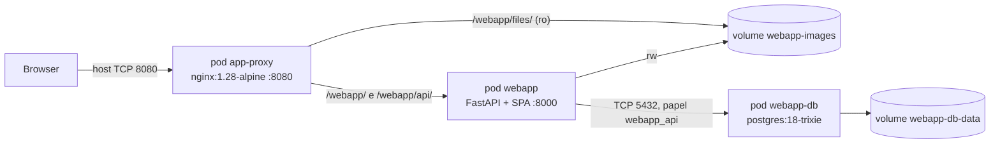

<details id="top">
    <summary>Índice</summary>
    <ol>
        <li><a href="#objetivo-e-público">Objetivo e público</a></li>
        <li><a href="#decisões">Decisões</a></li>
        <li><a href="#topologia">Topologia</a></li>
        <li><a href="#configuração-versus-código">Configuração versus código</a></li>
        <li><a href="#contrato-da-api">Contrato da API</a></li>
        <li><a href="#estrutura-de-arquivos">Estrutura de arquivos</a></li>
        <li><a href="#fases-de-implementação">Fases de implementação</a></li>
        <li><a href="#verificação">Verificação</a></li>
        <li><a href="#fora-do-escopo-e-riscos">Fora do escopo e riscos</a></li>
    </ol>
</details>

# Plano: aplicação web CRUD de usuários

## Objetivo e público

Este plano orienta desenvolvedores e operadores do boilerplate na criação de uma SPA básica.
A SPA cria, lista, edita e exclui registros com nome, email, localização e imagem de perfil.
Ela segue o [contrato de arquitetura](../contracts/ARCHITECTURE.md) e usa a rede Podman padrão.

Requisitos funcionais:

- tabela de registros com controles de edição por ícones à direita;
- todas as operações pela API CRUD do backend, chamada pelo frontend na própria página;
- dados no PostgreSQL;
- upload de imagem pelo método tradicional `multipart/form-data`;
- download de imagens servido diretamente pelo NGINX de aplicações;
- SPA em `http://localhost:8080/webapp/index.html` e API em `http://localhost:8080/webapp/api/...`.

Status: implementação concluída. O registro histórico da validação está em
[Histórico de execuções de laboratório](../memory/historico-dev.md#validação-da-webapp).
O procedimento operacional está em [webapp-crud](../../docs/recipes/webapp-crud.md).

<div>
  <a href="#top" title="De volta ao topo da página">
    <picture>
      <source media="(prefers-color-scheme: dark)" srcset="../../docs/images/up-arrow_white.svg">
      
    </picture>
  </a>
  <br><br>
</div>

## Decisões

| Tema | Decisão | Motivo |
|---|---|---|
| Formato de deployment | Kubernetes YAML (`kind: Pod`) executado por unidades Quadlet `.kube` | Atende ao pedido de arquivos YAML e mantém Quadlet como dono do ciclo de vida (seção 22 do contrato). |
| Rede | Todos os pods com `Network=podman` | Seção 9: rede padrão única com DNS Aardvark. O nome do pod resolve como `<pod>` e `<pod>.dns.podman`. |
| Prefixo HTTP | `/webapp/` e `/webapp/api/` | Pedido explícito. **Desvio** do exemplo `/app/` do contrato; o contrato permite prefixos por aplicação (seção 8.1). |
| Container da aplicação | `webapp`: FastAPI serve API e assets estáticos no TCP `8000` | Seção 6 e 22. |
| Frontend | HTML/CSS/JavaScript ES modules sem build | Seção 6 permite páginas pequenas sem Vite. Evita toolchain Node na imagem. |
| Upload | `multipart/form-data` recebido pelo FastAPI | Menos componentes que tusd. TUS fica como evolução (seção [Fora do escopo](#fora-do-escopo-e-riscos)). |
| Download | NGINX lê o volume `webapp-images` somente leitura em `/webapp/files/` | Pedido explícito; nenhum código de download. |
| Banco | Imagem oficial `postgres:18-trixie`, schema por `/docker-entrypoint-initdb.d` | Usa o mecanismo padrão da imagem; nenhum runner de migração. |
| Papéis do banco | `webapp_owner` (superusuário da imagem) e `webapp_api` (somente DML) | Menor privilégio para o runtime (guia SQL). |
| Secrets | Arquivos em `/etc/webapp/secrets/`, fora do Git, montados somente leitura | Seção 13. Senhas lidas por `*_FILE`/`\set` sem passar por argumentos de processo. |
| Resolução de upstream no NGINX | `resolver` dinâmico via `NGINX_ENTRYPOINT_LOCAL_RESOLVERS` | Recurso padrão da imagem NGINX; sobrevive à recriação do pod `webapp` sem fixar IP. |

<div>
  <a href="#top" title="De volta ao topo da página">
    <picture>
      <source media="(prefers-color-scheme: dark)" srcset="../../docs/images/up-arrow_white.svg">
      
    </picture>
  </a>
  <br><br>
</div>

## Topologia



| Pod | Imagem | Porta | Volumes | Secrets |
|---|---|---|---|---|
| `webapp-db` | `docker.io/library/postgres:18-trixie` | 5432, sem publicação no host | `webapp-db-data` → `/var/lib/postgresql`; init SQL somente leitura | `postgres-password`, `api-db-password` |
| `webapp` | `localhost/webapp:0.1.0` | 8000, sem publicação no host | `webapp-images` → `/data/images` | `api-db-password` |
| `app-proxy` | `docker.io/library/nginx:1.28-alpine` | 8080, publicada em `0.0.0.0:8080` | `webapp-images` → `/srv/webapp/images` somente leitura; configuração somente leitura | nenhum |

Ordem de início, declarada nas unidades Quadlet: `webapp-db` → `webapp` → `app-proxy`.

<div>
  <a href="#top" title="De volta ao topo da página">
    <picture>
      <source media="(prefers-color-scheme: dark)" srcset="../../docs/images/up-arrow_white.svg">
      
    </picture>
  </a>
  <br><br>
</div>

## Configuração versus código

Somente configuração (padrões das soluções existentes):

| Item | Mecanismo padrão reutilizado |
|---|---|
| PostgreSQL | `POSTGRES_DB`, `POSTGRES_USER`, `POSTGRES_PASSWORD_FILE`, scripts em `/docker-entrypoint-initdb.d` |
| NGINX | `nginx.conf` da imagem; `/etc/nginx/templates/*.template` com `envsubst`; `NGINX_ENTRYPOINT_LOCAL_RESOLVERS` |
| Ciclo de vida | Quadlet `.kube` gera unidades systemd; `podman kube play` cria pods |
| Rede e DNS | Rede `podman` e Aardvark DNS, sem configuração adicional |
| Arquivos estáticos | `StaticFiles(html=True)` do Starlette/FastAPI; `alias` do NGINX para imagens |
| Documentação da API | OpenAPI gerada pelo FastAPI em `/webapp/api/docs` |

O que precisa ser codificado:

| Arquivo | Conteúdo | Tamanho esperado |
|---|---|---|
| `webapp/database/init/001_schema.sql` | Schema `webapp`, tabela `TB_USUARIO`, comentários de catálogo | ~50 linhas |
| `webapp/database/init/002_api_role.sql` | Papel `webapp_api` com DML e senha lida do secret | ~20 linhas |
| `webapp/backend/src/webapp_api/` | Configuração, pool de conexões, repositório SQL, validação de imagem, rotas | ~350 linhas |
| `webapp/backend/tests/` | Testes unitários da API com repositório falso | ~200 linhas |
| `webapp/frontend/` | `index.html`, `app.js`, `styles.css` | ~350 linhas |
| `webapp/Containerfile` | Build multi-stage com uv | ~30 linhas |
| `deploy/webapp/` | 3 YAML, 3 `.kube`, 2 arquivos NGINX | ~150 linhas |
| `deploy/scripts/deploy-webapp.sh` | Preflight, secrets, build, instalação e start | ~200 linhas |
| `deploy/scripts/smoke-test-webapp.sh` | Teste CRUD ponta a ponta com `curl` | ~120 linhas |

<div>
  <a href="#top" title="De volta ao topo da página">
    <picture>
      <source media="(prefers-color-scheme: dark)" srcset="../../docs/images/up-arrow_white.svg">
      
    </picture>
  </a>
  <br><br>
</div>

## Contrato da API

Base: `/webapp/api`. Corpo e resposta em JSON, exceto o upload de imagem.

| Método | Caminho | Corpo | Sucesso | Erros |
|---|---|---|---|---|
| `GET` | `/health` | — | `200 {"status": "ok"}` | `503` sem banco |
| `GET` | `/users` | — | `200 [User]`, ordenado por `id` | — |
| `POST` | `/users` | `UserIn` | `201 User` | `409` email duplicado; `422` validação |
| `GET` | `/users/{id}` | — | `200 User` | `404` |
| `PUT` | `/users/{id}` | `UserIn` | `200 User` | `404`, `409`, `422` |
| `DELETE` | `/users/{id}` | — | `204`; remove também a imagem | `404` |
| `PUT` | `/users/{id}/image` | multipart campo `file` | `200 User` | `404`, `413` acima de 5 MiB, `415` tipo não suportado |
| `DELETE` | `/users/{id}/image` | — | `200 User` | `404` |

Modelos:

| Campo | `UserIn` | `User` | Restrições |
|---|---|---|---|
| `id` | — | inteiro | gerado pelo banco |
| `name` | obrigatório | texto | 1 a 200 caracteres após remover espaços nas pontas |
| `email` | obrigatório | texto | formato de email, até 254 caracteres, único sem diferenciar maiúsculas |
| `location` | opcional | texto ou `null` | até 200 caracteres; vazio vira `null` |
| `image_url` | — | texto ou `null` | `/webapp/files/<32 hex>.<ext>` |
| `created_at`, `updated_at` | — | ISO 8601 UTC | — |

Imagens aceitas: PNG, JPEG, GIF e WebP, identificados pelos bytes iniciais, não pelo nome.
O arquivo recebe nome aleatório de 32 caracteres hexadecimais mais a extensão, como `b9e9…95aa.png`. Substituir ou excluir remove o arquivo anterior.

<div>
  <a href="#top" title="De volta ao topo da página">
    <picture>
      <source media="(prefers-color-scheme: dark)" srcset="../../docs/images/up-arrow_white.svg">
      
    </picture>
  </a>
  <br><br>
</div>

## Estrutura de arquivos

```text
pyproject.toml                 # workspace uv e configuração Ruff/pytest
uv.lock
.python-version
webapp/
├── Containerfile
├── backend/
│   ├── pyproject.toml
│   ├── src/webapp_api/        # config, db, repository, images, main
│   └── tests/
├── frontend/                  # index.html, app.js, styles.css
└── database/init/             # 001_schema.sql, 002_api_role.sql
deploy/
├── webapp/
│   ├── kube/                  # webapp-db.yaml, webapp.yaml, app-proxy.yaml
│   ├── quadlet/               # webapp-db.kube, webapp.kube, app-proxy.kube
│   └── nginx/                 # default.conf.template, apps.d/webapp.conf
└── scripts/
    ├── deploy-webapp.sh
    └── smoke-test-webapp.sh
```

Caminhos no host criados pelo deployment:

| Caminho | Conteúdo | Dono e modo |
|---|---|---|
| `/etc/webapp/kube/` | cópias dos YAML | `root:root 0644` |
| `/etc/app-proxy/templates/` | template do servidor NGINX `:8080` | `root:root 0644` |
| `/etc/app-proxy/apps.d/` | rotas por aplicação, como `webapp.conf` | `root:root 0644` |
| `/etc/webapp/db-init/` | scripts SQL de inicialização | `root:root 0644` |
| `/etc/webapp/secrets/postgres-password` | senha do `webapp_owner` | `999:999 0400` |
| `/etc/webapp/secrets/db-init-api-password` | senha do `webapp_api` para o init | `999:999 0400` |
| `/etc/webapp/secrets/api-db-password` | senha do `webapp_api` para a API | `10001:10001 0400` |
| `/etc/containers/systemd/*.kube` | unidades Quadlet | `root:root 0644` |
| volume `webapp-images` | imagens de perfil; criado com `o=uid=10001,gid=10001` | `10001:10001 0755` |
| volume `webapp-db-data` | dados do PostgreSQL | `999:999` |

<div>
  <a href="#top" title="De volta ao topo da página">
    <picture>
      <source media="(prefers-color-scheme: dark)" srcset="../../docs/images/up-arrow_white.svg">
      
    </picture>
  </a>
  <br><br>
</div>

## Fases de implementação

1. **Banco.** Escrever `001_schema.sql` e `002_api_role.sql`. Validar em PostgreSQL 18 descartável.
2. **Backend.** Criar workspace uv, pacote `webapp_api`, testes com repositório falso. Rodar Ruff e pytest.
3. **Frontend.** Criar SPA sem build: tabela, diálogo de formulário, ícones SVG de editar, trocar imagem e excluir.
4. **Imagem.** Escrever `webapp/Containerfile` multi-stage com `uv sync --locked`; usuário `10001`.
5. **YAML e Quadlet.** Escrever os três pods e as três unidades `.kube` com dependências.
6. **NGINX.** Template do servidor `:8080` com `resolver` dinâmico e `apps.d/webapp.conf` com as rotas.
7. **Scripts.** `deploy-webapp.sh` idempotente: preflight, secrets sem sobrescrever, build, instalação, `daemon-reload`, start e health. `smoke-test-webapp.sh`: CRUD completo e download pelo NGINX.
8. **Validação.** Lint, testes, deploy no host, smoke test, teste no browser e recriação de pod.
9. **Documentação.** Receita operacional e atualização do README.

<div>
  <a href="#top" title="De volta ao topo da página">
    <picture>
      <source media="(prefers-color-scheme: dark)" srcset="../../docs/images/up-arrow_white.svg">
      
    </picture>
  </a>
  <br><br>
</div>

## Verificação

| Verificação | Comando ou método | Resultado esperado |
|---|---|---|
| Lint Python | `uv run ruff check .` e `uv run ruff format --check .` | sem achados |
| Testes unitários | `uv run pytest` | todos passam |
| Shell | `shellcheck -s bash deploy/scripts/*-webapp.sh` | sem achados |
| Deploy | `sudo deploy/scripts/deploy-webapp.sh` | três unidades `active`, health `200` |
| Ponta a ponta | `deploy/scripts/smoke-test-webapp.sh` | `Smoke test passed` |
| Browser | abrir `http://localhost:8080/webapp/index.html` | criar, editar, trocar imagem e excluir |
| Resiliência | `systemctl restart webapp.service` e repetir smoke test | NGINX resolve o novo IP |
| Persistência | `systemctl restart webapp-db.service` | registros mantidos |

<div>
  <a href="#top" title="De volta ao topo da página">
    <picture>
      <source media="(prefers-color-scheme: dark)" srcset="../../docs/images/up-arrow_white.svg">
      
    </picture>
  </a>
  <br><br>
</div>

## Fora do escopo e riscos

- **Identidade HTTP.** A API ainda não autoriza por `X-User-*`. O emulador NGINX de desenvolvimento (seção 8.2) não faz parte desta entrega. Não expor em produção sem o gate de identidade.
- **TUS.** Evolução possível: pod `tusd` com `-base-path=/webapp/uploads/`, rota no NGINX e associação do upload ao usuário pela API. Ver [file-upload-service](../../docs/recipes/file-upload-service.md).
- **SSH nos containers, aliases `dev.anatel` e backup pgBackRest.** Previstos no contrato; não implementados aqui.
- **Migrações.** Os scripts de init rodam só com volume vazio. Mudanças de schema futuras exigem runner de migração.
- **Dono do volume de imagens.** Sem as opções `uid`/`gid`, o Podman volta o dono do volume para `root` quando o pod `app-proxy` monta o volume. O script de deploy cria o volume com essas opções e falha se um volume existente não as tiver.
- **Imagens órfãs.** Se o banco falhar após gravar o arquivo, a API remove o arquivo novo. Falha ao remover arquivo antigo só gera log.

<div>
  <a href="#top" title="De volta ao topo da página">
    <picture>
      <source media="(prefers-color-scheme: dark)" srcset="../../docs/images/up-arrow_white.svg">
      
    </picture>
  </a>
  <br><br>
</div>
