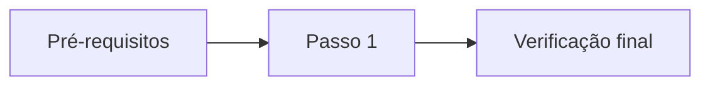

# Recipe Development Guide

A recipe is a reproducible, sequential procedure that takes the reader from a defined starting state to a verified end state, such as installing a server or configuring a service. Recipes are user directed content: write them in Brazilian Portuguese unless the documentation contract specifies otherwise. This guide is agent directed content and extends [the documentation development guide](./docsDevGuide.instructions.md). Follow that guide for language, configuration reference tables, safety, navigation markup, and validation; apply this guide for recipe structure and content. If the two conflict for a recipe, this guide prevails.

## Principles

- **Executable:** the reader can follow the recipe from top to bottom by copying commands, without interpreting prose or editing commands.
- **Sequential:** each step has one purpose, depends only on earlier steps, and ends with a verification.
- **Truthful:** document only commands and outputs that were executed or confirmed in official sources. Label everything else.
- **Safe:** warn before risk, provide backup and rollback, keep secrets out.
- **Explained:** state why a step or setting exists whenever it deviates from the tool's defaults. Keep the rationale short and next to the setting.

## Agent Workflow

1. Identify the target: operating system and version, required privileges, audience (user or administrator), starting state, and end state. Ask the user only when a missing detail changes the commands.
2. Collect sources in this order: scripts, templates, and configuration already in the repository; official documentation for the targeted versions; reputable secondary sources only to complement. When web access is available, confirm commands, flags, defaults, and download locations for the exact versions. Do not put private content (hostnames, addresses, secrets) in search queries.
3. When converting existing notes or a raw recipe, preserve technical decisions, values, and rationale; restructure the content; never change a value silently. Detect inconsistencies, such as a configuration block that differs from its explanation, deprecated options, duplicated rows, or mismatched versions. Resolve each from an authoritative source or mark it with a `Verificar` callout and report it to the user.
4. Draft the outline from [Recipe Structure](#recipe-structure), then write the steps following [Step Anatomy](#step-anatomy).
5. Run the [Validation](#validation) checklist.
6. Report to the user: what was created, which commands and outputs are unverified, assumptions made, and open questions.

## Recipe Structure

Use the sections below, in this order, with these Brazilian Portuguese headings. Omit only sections marked as conditional.

| Order | Heading | Content | Required |
| ----- | ------- | ------- | -------- |
| 1 | `Visão geral` | Purpose, audience, outcome, scope, estimated time, status, diagram, sources and adaptations, security decisions and accepted risks | Yes |
| 2 | `Ambiente e versões` | Operating system, component versions, date and platform where the recipe was tested, client or compatibility matrix | Yes |
| 3 | `Pré-requisitos e variáveis` | Access, permissions, network ports, packages, input files, backups, and the variables block | Yes |
| 4 | `Passo N: <ação>` | One top-level section per step, in execution order | Yes |
| 5 | `Verificação final` | End-to-end checks that prove the stated outcome | Yes |
| 6 | `Operação e referência rápida` | Day-to-day commands for what the recipe installed | Conditional |
| 7 | `Solução de problemas` | Table of symptom, probable cause, and fix | Yes |
| 8 | `Reversão e desinstalação` | Ordered steps that undo the recipe, with data-loss warnings | Yes |
| 9 | `Referências` | External and internal references | Yes |
| 10 | `Pendências` | Known gaps and planned work. Keep unfinished notes here, never in the body | Conditional |

Heading rules:

- Use one `#` title that names the action, the tool, and the context. Every other section is `##`; do not skip levels.
- Every step is a top-level `##` section so that the index and the return link reach each step directly.
- Write step headings as `## Passo N: <verb phrase in the infinitive>`, for example `## Passo 3: Inicializar a infraestrutura de chaves`. Number steps consecutively with no gaps.
- Keep heading text free of punctuation other than the single colon after the step number. Keep peer headings unique.
- Use `###` only for subdivisions inside `Visão geral`, `Ambiente e versões`, and `Solução de problemas`. Never use headings for the recurring labels inside a step; use the bold labels defined in [Step Anatomy](#step-anatomy) to avoid duplicate anchors.

### Section Content

- **Visão geral:** state the purpose and audience in the first paragraph. Add a status table (audience, estimated time, scope and non-scope, verification status with date). Add a Mermaid diagram when the recipe has two or more components or more than five steps. Add `### Fontes e adaptações` when the recipe is based on other material, naming the source and what was changed. Add `### Decisões de segurança e riscos aceitos` as a table (decision, risk, justification, mitigation) when any step weakens defaults.
- **Ambiente e versões:** list component versions in a table, including the exact versions the recipe was tested with. State which versions are verified and which are only expected to work.
- **Pré-requisitos e variáveis:** list required access and privileges, the working host, network ports in a table (port, protocol, direction, purpose), packages, files to upload, and required backups. Close with the variables block and the placeholder table described in [Copy-Ready Commands](#copy-ready-commands).
- **Verificação final:** run checks from the reader's point of view (service state, listening port, a real client request, log inspection) and state the pass criterion for each.
- **Solução de problemas:** use a table with symptom or log message, probable cause, and fix. Link each row to the step it belongs to.
- **Reversão e desinstalação:** list the steps in reverse order, state which data is lost, and state explicitly which actions cannot be reversed.

## Step Anatomy

Each step contains the following, in this order. Keep a step to one purpose and at most five commands; split larger steps.

1. **Objective:** one sentence on what the step achieves and, when not obvious, why it is needed.
2. **`**Contexto:**`** host, user or privilege level, and working directory. State it in the first step and whenever it changes; do not repeat it otherwise.
3. **Commands:** following [Copy-Ready Commands](#copy-ready-commands).
4. **`**Resultado esperado:**`** following [Expected Output](#expected-output).
5. **`**Verificação:**`** a command that proves the step worked, plus the success criterion. Omit it only when the command output already proves success and the expected output says so.
6. **`**Se falhar:**`** a link to the matching row of `Solução de problemas`, or a one-line fix. Optional.

Write affirmatively: describe only the actions the reader performs. Present a conditional branch only when the reader will legitimately meet either state, for example a first run versus a rerun, and present it as a short "Se ... / Caso contrário ..." pair.

Use these callouts, written as blockquotes with a bold label, so they render in any Markdown renderer:

| Callout | Use |
| ------- | --- |
| `> **Atenção:**` | Risk, service interruption, or data change |
| `> **Irreversível:**` | Operation that cannot be undone |
| `> **Nota:**` | Relevant clarification that does not change the procedure |
| `> **Não verificado:**` | Command, output, or behavior that was not executed or confirmed in an official source |
| `> **Verificar:**` | Inconsistency that needs the owner's confirmation. Resolve before delivery or report it to the user |

## Copy-Ready Commands

The reader copies a block and pastes it. A block must work as pasted.

- Put one logical action in each fenced block, with at most three lines. Move multi-step, looping, or branching logic to a script in `deploy/scripts/` and document how to call it, its arguments, prerequisites, and expected output.
- Put only pasteable content in the block: no prompt characters (`$`, `#`, `>`), no trailing comments, no output, no prose. Explain in the text before the block.
- Tag every block with its language: `bash`, `powershell`, `sql`, `ini`, `yaml`, `json`, or `text` (output only).
- Never tell the reader to open an interactive editor and change a line. Provide a non-interactive command (`tee`, `install`, `sed -i`, `grep -q ... || ...`) or the complete file content with its path and permissions.
- Prefer idempotent commands. When rerunning is unsafe, say so before the block.
- Use absolute paths and long option names when the tool offers them. State the privilege level once in `**Contexto:**` instead of prefixing every command with `sudo`, and show it explicitly only when a step switches user.
- Define every environment-specific or reused value once, in a single `bash` block in `Pré-requisitos e variáveis` (`VARIABLE=value`), and reference it as `"${VARIABLE}"` in later commands. Tell the reader that variables last only for the current shell session and that the block must be run again in a new session.
- Add a placeholder table next to the variables block (variable, description, example, where used). Use angle-bracket placeholders (`<NAME>`) only inside file content, and list each one in that table.
- Pin component versions in variables. Link to the release page and verify the checksum or signature when upstream publishes one.
- Do not use `curl ... | sh` patterns, commands that print secrets, or commands that put secrets in shell history. Use approved secret references.
- When a command prompts interactively, list each prompt and the answer to give under `**Resultado esperado:**`.

## Expected Output

- Place the output in a separate block tagged `text`, introduced by `**Resultado esperado:**`. Never mix commands and output in one block.
- Use real captured output or output copied from official documentation. When neither exists, label it `Exemplo ilustrativo (não capturado)` and add a `Não verificado` callout. Never invent output.
- Trim noise (progress dots, banners, repeated lines) and mark omissions with `[...]`. Keep the lines that prove success.
- Replace sensitive or environment-specific values (hostnames, MAC addresses, serial numbers, process IDs, timestamps) with placeholders or note that they vary.
- When a command prints nothing, say so and give the check, for example `echo "${?}"` with the expected value `0`.
- Show a first-run output and a rerun output only when the reader will meet both.

## Configuration Files

- Introduce each file with its path, owner, mode, and the command that creates it. Show the complete file, or the exact lines to add, in a block tagged with the file's language.
- Explain every non-default directive in a table with the columns directive, value, purpose, and rationale or compatibility constraint. Document deliberately omitted directives in a second table with the columns directive and reason omitted.
- Make every value in the explanation tables match the configuration block literally. Check protocol, algorithm, port, path, and version values one by one.
- Follow the Configuration References section of the documentation development guide when the file follows a schema.
- Add a syntax or dry-run check after writing the file, using the tool's own validator (for example `nginx -t`).
- When the repository holds the file as a template or script, link to it and show how to deploy it, for example with `install -m`.

## Safety Decisions

- Before a destructive or irreversible action, add an `Atenção` or `Irreversível` callout covering affected data, service interruption, the backup command, and the rollback.
- Record every step that weakens a default (disabling SELinux, legacy crypto policies, opening ports, relaxing permissions) in `### Decisões de segurança e riscos aceitos` with the risk, justification, scope, and a mitigation or safer alternative. Never copy an insecure choice from source material without flagging it.
- Keep secrets, private keys, tokens, and passwords out of the recipe. Describe where the reader stores them and which permissions they need.
- Replace real hostnames, user names, MAC addresses, and serial numbers with documentation values: `example.com` names and the RFC 5737 ranges `192.0.2.0/24`, `198.51.100.0/24`, `203.0.113.0/24`. Keep a real internal addressing plan only when the recipe is internal documentation and its owner confirms.

## External References

- Prefer official documentation for the exact versions in `Ambiente e versões`. Use blogs, forums, and community wikis only to complement, and never as the sole source for defaults, flags, or security guidance.
- Link at the point of use with descriptive link text, and consolidate every link in `Referências` as a table (reference, what it is used for, version or consulted date in `AAAA-MM-DD`).
- Prefer versioned or permanent URLs. When web access is available, confirm that each link resolves and supports the statement that cites it.
- Paraphrase external material in your own words; do not copy it. Credit the original in `Fontes e adaptações` when the recipe derives from it.
- Link to repository scripts, templates, and related recipes with relative paths.

## Page Navigation

Follow the Page Navigation section of the documentation development guide for the exact markup of the index and the return link. Recipe-specific rules:

- List every `##` section in the index, in document order, including every step, so the reader can jump straight to any step.
- End every `##` section, including each step, with the return-to-top block, after its last subsection.
- Adjust the arrow image paths to the recipe's location and confirm that both images exist.
- Refer to other steps with links to their headings, for example `volte ao [Passo 2: Habilitar o encaminhamento de IP](#passo-2-habilitar-o-encaminhamento-de-ip)`. Never write "acima" or "abaixo".
- Confirm each anchor in the intended renderer; do not assume how accents, colons, or spaces are converted.

## Quick Reference

- Use `Operação e referência rápida` for commands that operate what the recipe installed: start, stop, status, logs, reload, backup, and restore.
- Present commands as tables with the columns action and command, grouped by tool under `###` headings.
- Move generic cheat sheets that are unrelated to the recipe to a shared page and link to it.

## Writing Style

- Address the reader in the imperative ("Execute", "Edite", "Verifique") and use the present tense.
- Use short sentences with one idea each. Avoid minimizing words such as "basta", "simplesmente", and "apenas".
- Define each acronym on first use. Use one term for each concept throughout the recipe.
- Keep commands, paths, identifiers, and configuration keys verbatim; do not translate them.
- Do not leave truncated sentences, `TODO` markers, or half-written steps in the body. Move them to `Pendências` or complete them.

## Common Defects

| Defect | Correction |
| ------ | ---------- |
| Opening an editor and asking the reader to change a line | Provide a non-interactive command or the full file content |
| Prompts, comments, or output inside a command block | Split into a clean command block and a separate `text` output block |
| Version hard-coded in several commands | Define a version variable once and reference it |
| Real hostnames, users, MAC addresses, or serial numbers | Replace with documentation values |
| Several-kilobyte outputs such as progress dots | Trim to the lines that prove success and mark `[...]` |
| Directive explanation that disagrees with the configuration block | Align both from an authoritative source or add `Verificar` |
| Duplicated table rows or duplicated headings | Merge or rename; keep peer headings unique |
| Heading levels that vary between peer sections | Use `##` for every top-level section and step |
| Cheat sheets unrelated to the recipe | Move to a shared page and link |
| Insecure setting presented as the normal path | Add it to the decisions table with risk and mitigation |
| Step without a verification | Add a verification command and success criterion |

## Validation

- Structure: the index matches the `##` sections in order, every `##` section ends with the return block, heading levels do not skip, anchors resolve in the intended renderer, fenced blocks are closed, and tables and Mermaid diagrams render.
- Commands: each block runs as pasted, in order, on the documented environment; every variable is defined before use; no block contains prompts, comments, output, or secrets.
- Verification state: every command and output is either verified by execution or labeled `Não verificado`. Test in a disposable environment (VM or container) when feasible.
- Consistency: versions, ports, paths, variable names, and file contents agree across all sections and between configuration blocks and their explanation tables.
- Safety: destructive steps have backup and rollback, security-weakening choices are recorded, and `Reversão e desinstalação` undoes every step that changed the system.
- References: links resolve, versions match, and linked scripts and templates exist.
- Use the repository's existing documentation checks. Do not add scripts or dependencies solely for these checks.

## Recipe Template

Use this skeleton for new recipes. Replace the example content, keep the order, and end every `##` section with the return-to-top block, keeping it identical to the one in the documentation development guide. Continue with the remaining steps and sections from [Recipe Structure](#recipe-structure) using the same pattern.

````markdown
# Instalação do <Serviço> no <Sistema operacional>

<details id="top">
    <summary>Índice</summary>
    <ol>
        <li><a href="#visão-geral">Visão geral</a></li>
        <li><a href="#ambiente-e-versões">Ambiente e versões</a></li>
        <li><a href="#pré-requisitos-e-variáveis">Pré-requisitos e variáveis</a></li>
        <li><a href="#passo-1-instalar-o-pacote">Passo 1: Instalar o pacote</a></li>
        <li><a href="#verificação-final">Verificação final</a></li>
        <li><a href="#solução-de-problemas">Solução de problemas</a></li>
        <li><a href="#reversão-e-desinstalação">Reversão e desinstalação</a></li>
        <li><a href="#referências">Referências</a></li>
    </ol>
</details>

## Visão geral

Este guia orienta administradores de sistemas Linux a instalar o <Serviço>. Ao final, o serviço estará ativo e respondendo na porta definida.

| Item | Descrição |
| ---- | --------- |
| Público | Administradores de sistemas Linux |
| Tempo estimado | 30 minutos |
| Escopo | O que a receita cobre e o que não cobre |
| Status | Verificado em AAAA-MM-DD |



### Fontes e adaptações

Baseada em [título da fonte](https://example.com/fonte). Alterações: descreva o que foi adaptado.

### Decisões de segurança e riscos aceitos

| Decisão | Risco | Justificativa | Mitigação |
| ------- | ----- | ------------- | --------- |
| Descrição da decisão | Impacto | Motivo | Alternativa ou controle compensatório |

<div>
  <a href="#top" title="De volta ao topo da página">
    <picture>
      <source media="(prefers-color-scheme: dark)" srcset="./docs/images/up-arrow_white.svg">
      
    </picture>
  </a>
  <br><br>
</div>

## Ambiente e versões

| Componente | Versão | Observação |
| ---------- | ------ | ---------- |
| Sistema operacional | Nome e versão | Testado em AAAA-MM-DD |
| <Serviço> | X.Y.Z | Versão fixada na variável `SERVICE_VERSION` |

<div>
  <a href="#top" title="De volta ao topo da página">
    <picture>
      <source media="(prefers-color-scheme: dark)" srcset="./docs/images/up-arrow_white.svg">
      
    </picture>
  </a>
  <br><br>
</div>

## Pré-requisitos e variáveis

- Acesso `root` ao servidor `servidor.example.com`.
- Porta `8080/TCP` liberada de entrada.

Defina as variáveis na sessão de shell atual e execute o bloco novamente em cada nova sessão:

```bash
PACKAGE_NAME=servico
SERVICE_VERSION=1.2.3
```

| Variável | Descrição | Exemplo | Usada em |
| -------- | --------- | ------- | -------- |
| `PACKAGE_NAME` | Nome do pacote no repositório | `servico` | Passo 1 |
| `SERVICE_VERSION` | Versão fixada do serviço | `1.2.3` | Passo 1 |

<div>
  <a href="#top" title="De volta ao topo da página">
    <picture>
      <source media="(prefers-color-scheme: dark)" srcset="./docs/images/up-arrow_white.svg">
      
    </picture>
  </a>
  <br><br>
</div>

## Passo 1: Instalar o pacote

Instale o pacote para disponibilizar o binário e o serviço do sistema.

**Contexto:** servidor `servidor.example.com`, usuário `root`, diretório `/root`.

```bash
dnf install --assumeyes "${PACKAGE_NAME}-${SERVICE_VERSION}"
```

**Resultado esperado:**

```text
[...]
Complete!
```

**Verificação:**

```bash
rpm --query "${PACKAGE_NAME}"
```

O comando exibe o nome e a versão instalada. Qualquer outra resposta indica falha na instalação.

<div>
  <a href="#top" title="De volta ao topo da página">
    <picture>
      <source media="(prefers-color-scheme: dark)" srcset="./docs/images/up-arrow_white.svg">
      
    </picture>
  </a>
  <br><br>
</div>

## Referências

| Referência | Uso | Versão ou consulta |
| ---------- | --- | ------------------ |
| [Documentação oficial do <Serviço>](https://example.com/docs) | Parâmetros e valores padrão | 1.2.3, consultada em AAAA-MM-DD |

<div>
  <a href="#top" title="De volta ao topo da página">
    <picture>
      <source media="(prefers-color-scheme: dark)" srcset="./docs/images/up-arrow_white.svg">
      
    </picture>
  </a>
  <br><br>
</div>
````
