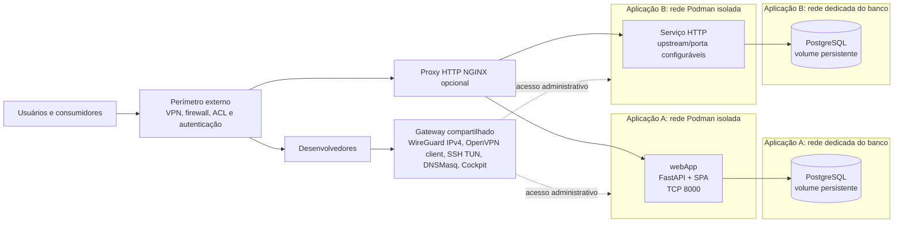

<details>
    <summary>Índice</summary>
    <ol>
        <li><a href="#visão-geral">Visão Geral</a></li>
        <li><a href="#arquitetura">Arquitetura</a></li>
        <li><a href="#estrutura-do-repositório">Estrutura do Repositório</a></li>
        <li><a href="#modelo-de-desenvolvimento">Modelo de Desenvolvimento</a></li>
        <li><a href="#pré-requisitos">Pré-requisitos</a></li>
        <li><a href="#como-rodar-localmente">Como Rodar Localmente</a></li>
        <li><a href="#containers-e-redes-podman">Containers e Redes Podman</a></li>
        <li><a href="#implantação-e-operação">Implantação e Operação</a></li>
        <li><a href="#configuração-e-segurança">Configuração e Segurança</a></li>
        <li><a href="#decisões-em-aberto-e-próximas-etapas">Decisões em Aberto e Próximas Etapas</a></li>
        <li><a href="#licença-e-contribuição">Licença e Contribuição</a></li>
    </ol>
</details>

## Visão geral

Este repositório é a base planejada para aplicações web com backend Python/FastAPI, frontend
JavaScript e PostgreSQL, executadas em containers Podman. A arquitetura prioriza isolamento entre
aplicações, desenvolvimento remoto com VS Code, implantação reproduzível e baixa dependência
operacional do host.

O contrato arquitetural está em
[docs/contracts/WEB_APP_BOILERPLATE_ARCHITECTURE.md](docs/contracts/WEB_APP_BOILERPLATE_ARCHITECTURE.md).
Ele descreve o host-alvo RHEL 9.8 com Podman rootful 5.8.2, os gateways, as redes, o acesso SSH,
o DNS de desenvolvimento, os secrets e os critérios para a implementação.

**Estado atual:** o código da aplicação ainda é um scaffold Python. O bootstrap do Development
Gateway tem configuração, imagem Debian, startup, Quadlet, runtimes opt-in de OpenVPN, SSH TUN e
WireGuard, CLI root-only de peers e handoff explícito de DNS por readiness. A configuração versionada
habilita OpenVPN e WireGuard; SSH TUN permanece desativado. WireGuard usa bind `0.0.0.0`, UDP
`1194`, pool `192.168.10.0/24`, servidor/resolver `192.168.10.1` e chave externa em
`/etc/gateway/wireguard/server.key`. O endpoint acessível pelo cliente é fornecido em cada chamada
`peer generate --endpoint`, não na configuração do servidor. O `--check` não cria a chave; `--apply`
a gera somente se estiver ausente e reutiliza uma chave existente para preservar perfis já emitidos.
A aceitação de túnel e forwarding do kernel não foi validada no host-alvo. Receitas de
split DNS para `dev.anatel` existem para Windows 11, Linux e macOS, mas exigem validação em cada
sistema. Não implante em host live; consulte
[docs/plans/gateway-implementation.md](docs/plans/gateway-implementation.md).

<div> <a href="#visão-geral" title="De volta ao topo da página"> <picture> <source media="(prefers-color-scheme: dark)" srcset="./docs/images/up-arrow_white.svg">  </picture> </a> <br><br> </div>

## Arquitetura

A arquitetura separa o acesso de desenvolvimento, o tráfego das aplicações e o perímetro de
segurança administrado pela infraestrutura:



Componentes e limites principais:

- **Development Gateway:** um container compartilhado exclusivamente para acesso dos
  desenvolvedores a todos os serviços e portas configurados. O runtime OpenVPN client Layer 3
  agora é opt-in e permanece desativado na configuração versionada.
  O runtime SSH TUN simultâneo também está implementado, opt-in e desativado na configuração
  versionada. A aceitação em host-alvo continua pendente. O acesso a portas de serviços não exige
  publicação no host; WireGuard publica seu listener UDP somente quando habilitado com valores
  explícitos de deployment.
  Oferece SSH, DNS de desenvolvimento, forwarding, diagnóstico, Cockpit e `cockpit-podman`; não é
  proxy de usuários.
- **Proxy HTTP NGINX:** opcional, compartilhado e limitado a reverse proxy HTTP. Pode encaminhar
  rotas para serviços HTTP de diferentes aplicações, cada qual com upstream e porta configuráveis.
  Na aplicação inicial `webApp`, `/app/` e `/app/api/` usam o mesmo listener TCP `8000`. O perímetro externo
  autentica usuários e injeta os campos `X-USER`; a aplicação usa a identidade para autorizar.
  NGINX não implementa login nem autenticação. Serviços não HTTP de usuários são publicados
  diretamente por bind de host, protocolo e portas explicitamente configurados, com autenticação
  própria do serviço e controles do perímetro.
- **Aplicação inicial:** um container `webApp` serve a SPA em `/app/` e API em `/app/api/` no único
  listener FastAPI `TCP 8000`. O proxy opcional encaminha ambas as rotas ao mesmo listener.
  Aplicações HTTP adicionais podem configurar seus próprios upstreams e portas. PostgreSQL e
  serviços auxiliares podem permanecer em containers independentes.
- **PostgreSQL:** container com volume persistente. FastAPI o utiliza na rede dedicada, mas membros
  de `shared` — incluindo Gateway e NGINX — também têm alcance de rede; autenticação do serviço é
  obrigatória e a topologia não isola esses membros.
- **Perímetro de segurança:** VPN, firewall, ACL e autenticação externa ao boilerplate. O Development
  Gateway não substitui esses controles nem funciona como firewall de autorização.

O contrato confirmado é roteamento Layer 3 IPv4 split-tunnel para todos os CIDRs Podman configurados,
sem forwarding por serviço. Destinos, pools, pares de endereço, rotas de retorno e registros DNS do
Gateway usam IPv4; DNS gera registros A, não AAAA. Isso não desativa IPv6 no host nem nos clientes.
O runtime não força a família do SSH externo; use `ssh -4` no cliente quando precisar de conexão
externa IPv4. O cliente OpenVPN, SSH TUN e servidor WireGuard aditivo permanecem separados.
WireGuard é aditivo; peers aprovados alcançam todos os CIDRs Podman, inclusive PostgreSQL, sem NAT,
forwarding entre aplicações ou rota default pelo túnel. `dev.anatel` é o domínio interno-only; o
schema aceita o sufixo e as receitas implementam split DNS por sistema operacional. O config define
listener, pool, endereço do servidor/resolver e caminho da chave. O endpoint público não fica no
config nem no preflight: `peer generate --endpoint` inclui o host no perfil `.conf` do cliente.
O bind `0.0.0.0` publica UDP `1194` em todas as interfaces IPv4 do host; preflight verifica o bind
local, mas não a alcançabilidade externa. Se a chave estiver ausente, `--apply` a cria depois do
preflight; `--check` permanece somente leitura. Para preservar perfis de cliente já emitidos em
redeploys, mantenha a chave existente no caminho configurado; `--apply` a reutiliza e nunca a
substitui. Nenhum requisito de firewall/perímetro externo foi aprovado. Nenhuma rota default do cliente será substituída. Consulte o [plano
do Gateway](docs/plans/gateway-plan.md), o [status de implementação](docs/plans/gateway-implementation.md)
e o [contrato arquitetural](docs/contracts/WEB_APP_BOILERPLATE_ARCHITECTURE.md).

O cliente OpenVPN permanece separado. Protocolo, porta, dispositivo, topologia, autenticação,
cipher, opções de domínio e `client_to_client` pertencem ao servidor/perfil externo; endpoint também
é propriedade do perfil, não do JSON do Gateway. Este é um setup novo, sem migração ou compatibilidade
de configuração para os campos OpenVPN retirados: `protocol`, `port`, `device`, `topology`,
`client_to_client`, `auth`, `cipher`, `push_domains` e `endpoint` são rejeitados, inclusive em
configurações schema-v1. Isso não torna incompatíveis as demais seções opcionais schema-v1; seus
contratos continuam determinando compatibilidade. O campo `client_pool` permanece opcional porque o
perfil externo é opaco e pode determinar a alocação. Sem esse campo, validação emite um aviso; o
runtime valida o endereço e a máscara recebidos contra as redes Podman, mas não pode verificar a
alocação do cliente nem instalar ou validar uma rota de retorno no host. O caminho de resposta
simétrico não é garantido nesse caso. Com `client_pool`, as validações de conflito e a rota de retorno
existente continuam ativas. O perfil permanece externo e opaco; o Gateway verifica apenas caminho, tipo de arquivo,
propriedade e permissões antes de montá-lo somente para leitura. O schema permanece na versão 1
e mantém controles fixos do cliente no runtime.

Receitas de onboarding e split DNS por sistema operacional: [Windows 11](docs/recipes/wireguard-windows-11.md),
[Linux](docs/recipes/wireguard-linux.md) e [macOS](docs/recipes/wireguard-macos.md). O fluxo usa CLI
root-only via `podman exec`, sem API pública. Gere perfis somente em terminal direto, confiável e
nunca gravado. Leia o plano de implementação para limites, valores pendentes e aceitação bloqueada.

O cliente OpenVPN agora tem execução supervisionada, verificação de perfil sem leitura do conteúdo,
TUN dedicado, regras de forwarding no namespace do container e rota de retorno do pool marcada
`proto 186`. O runtime ignora mutações de rotas OpenVPN e rejeita candidatos de rota recebidos;
as redes Podman já são diretamente conectadas. O perfil só monta em leitura. A configuração
versionada habilita o cliente OpenVPN. O perfil real não foi aberto nem testado; túnel,
source-preservation e retorno exigem
aceitação isolada em RHEL 9.8 / Podman 5.8.2. SSH TUN está implementado, mas permanece desativado
e aguarda aceitação no host-alvo.

O bootstrap do Gateway não inspeciona containers de aplicação. Após evento de readiness, o chamador
explícito usa `scripts/refresh-gateway-dns.sh --revision` para obter revisão da configuração ativa e
envia um handoff com escopo de containers DNS configurados e IDs Podman prontos via
`scripts/refresh-gateway-dns.sh --handoff REQUEST.json`. O Gateway revalida identidade, estado
running/healthy e a rede exata; stop, falha ou substituição removem endereços antigos quando o
chamador envia o evento. Nenhum watcher ou integração de lifecycle de aplicação foi adicionado.

O proxy HTTP está selecionado para bind `0.0.0.0:8080` no host, mapeado para TCP `80` no container.
Como o Gateway permite acesso direto e o listener está em todas as interfaces, rotas protegidas
dependem de um gate de deployment: restringir efetivamente o ingresso ao perímetro confiável ou
verificar a proveniência da identidade até a aplicação. Nem um CIDR nem um `X-USER` bruto comprovam
autenticação. O perímetro deve remover/substituir identidade enviada pelo cliente; a aplicação deve
rejeitar identidade ausente ou não confiável. A lista exata de campos `X-USER` e o mecanismo de
proveniência permanecem pré-requisitos de implementação; autenticação/autorização de runtime não
está implementada.

<div> <a href="#visão-geral" title="De volta ao topo da página"> <picture> <source media="(prefers-color-scheme: dark)" srcset="./docs/images/up-arrow_white.svg">  </picture> </a> <br><br> </div>

## Estrutura do repositório

O repositório ainda contém somente o scaffold inicial. A estrutura lógica prevista separa aplicação,
gateways e operações de deployment:

```text
repository/
├── webApp/                  # FastAPI, API e assets SPA no mesmo serviço (planejado)
├── gateway/
│   ├── development/         # Gateway administrativo compartilhado
│   └── http_proxy/          # Proxy HTTP NGINX opcional
├── database/                # Inicialização e recursos do PostgreSQL
├── deploy/quadlet/           # Quadlet do Gateway
├── config/                  # Configuração estrutural versionada
├── compose/                 # Definições dos serviços e redes Podman
├── docs/
│   └── plans/               # Contratos e planos arquiteturais
├── scripts/                 # Bootstrap e operação do gateway
├── tests/                   # Validação local e smoke tests isolados
├── src/
│   └── main.py              # Scaffold atual
└── pyproject.toml           # Configuração do projeto Python
```

Os nomes e a disposição finais podem evoluir durante a implementação. As responsabilidades e os
limites de segurança definidos no contrato arquitetural devem permanecer explícitos.

<div> <a href="#visão-geral" title="De volta ao topo da página"> <picture> <source media="(prefers-color-scheme: dark)" srcset="./docs/images/up-arrow_white.svg">  </picture> </a> <br><br> </div>

## Modelo de desenvolvimento

O desenvolvimento cotidiano deve ocorrer pelo VS Code, usando Git, terminal, testes e ferramentas
de debugging. O Gateway fornece acesso roteado aos serviços e portas configurados, sem exigir
publicação das portas dos serviços no host ou acesso administrativo permanente ao host RHEL. O
listener UDP WireGuard é publicado no host somente quando o runtime for explicitamente habilitado.

O host de execução fornece Podman e armazenamento persistente. A equipe de infraestrutura realiza
a configuração inicial e operações excepcionais do host. Os containers permanecem substituíveis;
volumes preservam os dados que precisam sobreviver à recriação.

Desenvolvimento e produção mantêm a mesma separação de responsabilidades e isolamento de redes.
Recursos, secrets, certificados, réplicas e observabilidade podem variar por ambiente.

<div> <a href="#visão-geral" title="De volta ao topo da página"> <picture> <source media="(prefers-color-scheme: dark)" srcset="./docs/images/up-arrow_white.svg">  </picture> </a> <br><br> </div>

## Pré-requisitos

### Desenvolvimento

- Git;
- VS Code, recomendado para edição e acesso remoto;
- Python 3.14 ou superior;
- [UV](https://docs.astral.sh/uv/) para gerenciar o ambiente Python;
- Podman quando for necessário executar ou validar containers localmente.

### Ambiente remoto

- Red Hat Enterprise Linux 9.8, rootful Podman 5.8.2, systemd/Quadlet e SELinux desativado
  (baseline aprovado; o deployment verifica, mas não altera a segurança do host);
- armazenamento para volumes persistentes;
- equipe de infraestrutura com acesso administrativo para configuração inicial e operações do host;
- acesso SSH autorizado ao Gateway;
- controles externos de rede e autenticação definidos pela organização;
- configuração das redes e registros DNS das aplicações, além dos arquivos externos de chaves e TLS descritos abaixo.

Scripts de deployment do host devem exigir esse baseline RHEL/Podman. Imagens do Gateway e das
aplicações devem usar uma distribuição Linux eficiente e mantida, preferencialmente Debian ou
Alpine; a distribuição do container é independente do host.

O script verifica as dependências de host, incluindo `jq`, Python 3, Podman, systemd, Quadlet,
OpenSSH e ferramentas de diagnóstico. O contrato arquitetural não exige acesso administrativo
diário dos desenvolvedores ao host. As capabilities mínimas e o comportamento com SELinux já
desativado ainda precisam ser confirmados em um host RHEL 9.8 / Podman 5.8.2 descartável; não altere
o estado de segurança de um host para realizar esse teste.

<div> <a href="#visão-geral" title="De volta ao topo da página"> <picture> <source media="(prefers-color-scheme: dark)" srcset="./docs/images/up-arrow_white.svg">  </picture> </a> <br><br> </div>

## Como rodar localmente

O scaffold atual não inicia uma API nem um frontend. Para executar o código Python existente:

```powershell
uv run python -m src.main
```

O comando imprime uma mensagem de exemplo. O Gateway possui imagem, script de
deployment e testes locais; veja [Implantação e operação](#implantação-e-operação). Isso não
significa que o stack da aplicação web esteja implementado nem que Debian seja um host suportado
para deployment.

<div> <a href="#visão-geral" title="De volta ao topo da página"> <picture> <source media="(prefers-color-scheme: dark)" srcset="./docs/images/up-arrow_white.svg">  </picture> </a> <br><br> </div>

## Containers e redes Podman

O array top-level `networks` em `config/host_config.json` é o inventário global das redes Podman
declaradas para aplicações e seus serviços. Cada aplicação terá uma rede Podman própria, com CIDR
sem sobreposição. O Gateway conecta-se a todas as redes desse inventário; essa conexão não as une
nem cria roteamento entre redes app-specific.

A rede `shared` é uma bridge Podman compartilhada explicitamente por seus membros. Ela não é uma
interface física do host, uma interface do host ligada ao Gateway, nem uma rota ou pool de endereços
de VPN. Rotas externas de VPN, pools de endereços de túneis e interfaces físicas/do host são
conceitos distintos e não pertencem ao inventário `networks`.

`networks` declara somente as redes Podman da aplicação; não declara todos os recursos de rede do
host. Ao implantar uma aplicação, a implantação atualiza somente esse inventário de redes Podman
para a nova rede e reconcilia o Gateway existente, que deve permanecer conectado a todas as redes
declaradas.

O deployment deverá gerar ou atualizar os registros do DNSMasq para serviços de desenvolvimento
selecionados, usando nomes estáveis sob `dev.anatel`, por exemplo `backend.project-a.dev.anatel`.
Esse sufixo é interno e não público. A configuração deverá acompanhar a recriação dos containers; seus endereços IP não são identidades permanentes. A
publicação de um nome DNS não concede conectividade entre redes.

O SSH seguirá o mesmo limite: o Gateway encaminha conexões aos containers de aplicação,
mas a autenticação acontece no destino. O acesso SSH ao próprio gateway é autenticado pelo gateway.
Cada desenvolvedor usa sua própria chave; chaves privadas não são compartilhadas nem copiadas para o
ambiente.

O PostgreSQL terá volume persistente e participará da rede dedicada da aplicação e de `shared`.
Os membros de `shared`, incluindo Gateway e NGINX, terão alcance de rede ao banco; a autenticação
do PostgreSQL controla o acesso. FastAPI utiliza o banco; os assets do frontend não recebem
credenciais nem acessam PostgreSQL diretamente.

**Backup PostgreSQL:** o desenho planejado usa pgBackRest com full mensal e incremental semanal,
um repositório de trabalho separado das exportações concluídas e publicação de gerações verificadas.
O plano e os requisitos de recuperação estão em
[Application Stack Plan](docs/plans/application-stack-plan.md) e
[Application Deployment Plan](docs/plans/application-deployment-plan.md). Não está implementado:
o validador/configuração runtime atual não aceita os campos de backup propostos e nenhum timer,
mount, publisher ou restore pgBackRest está disponível. Não use esses exemplos como configuração
executável nem implante com base nesse desenho.

<div> <a href="#visão-geral" title="De volta ao topo da página"> <picture> <source media="(prefers-color-scheme: dark)" srcset="./docs/images/up-arrow_white.svg">  </picture> </a> <br><br> </div>

## Implantação e operação

O script [`scripts/deploy-gateway.sh`](scripts/deploy-gateway.sh) separa validação, preflight e apply.
O caminho da configuração como único argumento executa essas etapas sequencialmente. `--apply`
isolado confia em um `--check` anterior. O script constrói e instala o Development Gateway; não
instala pacotes no host, não provisiona aplicações ou volumes, e não remove redes Podman existentes. Consulte
[docs/plans/gateway-implementation.md](docs/plans/gateway-implementation.md)
para o inventário detalhado de paths, decisões e limitações.

### Modos do script

| Modo | Uso e efeito |
|---|---|
| `--validate-config` | Valida o JSON localmente. Não exige root e não altera o host. |
| `--check` | Faz preflight somente leitura. Exige root e RHEL 9.8 com Podman 5.8.2; não constrói imagem nem inicia serviços. |
| `host_config.json` como único argumento | Executa `--validate-config`, `--check` e `--apply` nessa ordem; para no primeiro erro. |
| `--apply` | Não repete preflight; exige `--check` bem-sucedido antes da chamada. Mantém validações dos arquivos gerados e health checks após ativação. Use apenas em host de teste RHEL 9.8 / Podman 5.8.2 autorizado. |

Comece ajustando `config/host_config.json`. `networks` declara as redes Podman da aplicação, com
nome e CIDR IPv4 esperado. O Gateway conecta-se automaticamente a todas as redes declaradas;
nenhuma lista seletiva de redes é mantida no bloco `gateway`. `containers` lista serviços e redes
que o preflight deve conferir. Cada registro DNS futuro associará um nome `.dev.anatel` a um
container e a uma rede declarada. O schema aceita nomes sob `dev.anatel`; o gerador DNS usa nomes
declarados sem sufixo fixo. `dns_records` permanece vazio, então não há respostas ativas. Receitas
de split DNS WireGuard por sistema operacional existem, mas precisam de validação nesse sistema:

```json
{
  "schema_version": 1,
  "gateway": {
    "name": "gateway",
    "bind_address": "127.0.0.1",
    "ssh_bind_address": "0.0.0.0",
    "cockpit_bind_address": "127.0.0.1",
    "ssh_port": 2222,
    "cockpit_port": 9090,
    "authorized_keys_path": "/etc/gateway/authorized_keys"
  },
  "networks": [
    { "name": "project-a-net", "subnet": "10.89.1.0/24" }
  ],
  "containers": [
    { "name": "project-a-backend", "networks": ["project-a-net"] }
  ],
  "dns_records": [
    {
      "name": "backend.project-a.dev.anatel",
      "container": "project-a-backend",
      "network": "project-a-net"
    }
  ]
}
```

O CIDR selecionado para `shared` é `192.168.9.0/24`, com Gateway em `192.168.9.2`; `webApp` permanece
em `192.168.8.0/29`. O solicitante confirmou em 2026-10-19 que `192.168.9.0/24` está disponível e
aprovado para uso. Essa confirmação não é uma medição da tabela de rotas do host. Gateway
`--check` agora compara as redes declaradas com rotas IPv4 de todas as tabelas, incluindo rotas de
endereços locais; ignora rotas default e aceita apenas rotas exatas comprovadas pela inspeção das
redes Podman declaradas. Escolha CIDRs que não conflitem com as redes e rotas existentes no host.
Gateway `--check` verifica as redes Podman existentes, informa redes declaradas ausentes como
criação planejada e anuncia cada registro DNS como `readiness/unverified`, sem consultar containers
de aplicação ou targets DNS.
Gateway `--apply` cria redes ausentes, mas não inspeciona, cria, inicia, para ou altera containers de
aplicação; registros DNS permanecem pendentes até o handoff de atualização após readiness. O comando
geral `host-preflight.sh --check` também verifica conflitos de rotas IPv4,
mantém a inspeção dos containers configurados e reporta containers parados como pendentes.

Para conferir um host com outros containers, sem exigir configuração ou credenciais do gateway:

```bash
./scripts/host-preflight.sh --validate-config config/host_config.json
sudo ./scripts/host-preflight.sh --check config/host_config.json
```

O comando geral verifica o Podman acessível ao usuário que o executa, as subnets declaradas e os
containers configurados. Use `sudo` quando os containers pertencerem ao Podman rootful. Ele não
exige RHEL 9, credenciais Cockpit ou arquivos Quadlet. Os comandos de
`scripts/deploy-gateway.sh` continuam executando as verificações estritas do deployment.

### Credenciais externas

Crie estes arquivos no host antes de `--check`. O script não os cria, não os sobrescreve e nunca
precisa das chaves privadas dos desenvolvedores.

| Caminho padrão | Conteúdo e requisitos |
|---|---|
| `/etc/gateway/authorized_keys` | Um ou mais registros de chaves **públicas** para login SSH no gateway. arquivo não vazio, root-owned e sem escrita para grupo/outros. Para geração de chaves, veja [Gateway SSH key](docs/recipes/windows-11-gateway-ssh-key.md). |
| `/etc/gateway/cockpit-password` | Uma senha em uma linha para `gateway-admin`; propriedade `root:root`, sem acesso por grupo/outros (normalmente modo `0600`). |
| `/etc/gateway/tls/gateway.cert` | Certificado TLS válido do Cockpit. Para geração e confiança nos clientes, veja [Gateway Cockpit TLS](docs/recipes/gateway-cockpit-tls.md). |
| `/etc/gateway/tls/gateway.key` | Chave privada correspondente; root-owned e sem acesso por grupo/outros (normalmente modo `0600`). |
| `/etc/gateway/openvpn/client.ovpn` | Perfil OpenVPN externo; arquivo regular root-owned, legível apenas por root (normalmente modo `0600`), montado somente para leitura quando o runtime é habilitado. O código não abre nem copia seu conteúdo. |
| `/etc/gateway/wireguard/server.key` (`gateway.remote_access.wireguard.server_private_key_path`) | Chave privada do servidor WireGuard; arquivo regular root-owned, modo `0600`, fora do Git e montado somente para leitura. `--apply` gera somente quando ausente; uma chave existente é reutilizada para preservar perfis já emitidos. Nunca incluir o conteúdo no JSON. |

Receita curta para criar e instalar a chave pública de login no Windows 11:
[Gateway SSH key](docs/recipes/windows-11-gateway-ssh-key.md).

Receita para gerar o certificado/chave TLS do Cockpit e distribuir somente a CA pública
a desenvolvedores no Windows, macOS e Linux, com resumo e verificação:
[Gateway Cockpit TLS](docs/recipes/gateway-cockpit-tls.md).

Os certificados e secrets são entradas externas. O deployment os monta como somente leitura. A
chave pública em `authorized_keys` autoriza acesso ao gateway, não aos containers de aplicação.

### Preflight e deployment

Execute a validação antes de acessar o host:

```bash
./scripts/deploy-gateway.sh --validate-config config/host_config.json
```

Em um host de teste **RHEL 9.8** autorizado, com Podman rootful 5.8.2, Quadlet e SELinux já
desativado, execute o preflight e só então aplique. O script verifica o estado e não o altera:

```bash
sudo ./scripts/deploy-gateway.sh --check config/host_config.json
sudo ./scripts/deploy-gateway.sh --apply config/host_config.json
```

Para executar as três etapas em sequência, use somente o caminho da configuração:

```bash
sudo ./scripts/deploy-gateway.sh config/host_config.json
```

O modo sequencial valida a configuração, executa o preflight e só então aplica. O lock é mantido
durante o preflight e o apply. Em chamadas separadas, `--apply` confia que `--check` já passou e não
repete esses testes.

`--check` exige RHEL 9.8, Podman rootful 5.8.2 e SELinux já desativado. Verifica credenciais,
portas, redes, rotas IPv4 do host, socket rootful e ferramentas exigidas; não inspeciona containers
de aplicação ou targets DNS. Se OpenVPN estiver habilitado, verifica apenas metadados de propriedade,
modo e arquivo regular do perfil; não lê seu conteúdo. Se WireGuard estiver habilitado, verifica
inputs, se `modprobe` consegue resolver o módulo sem carregá-lo, metadados da chave se existente e
disponibilidade local de bind UDP antes de qualquer mutação. Se o Gateway ativo já possuir essa porta,
reutiliza a listener existente em vez de rejeitar o próprio serviço. Se o módulo estiver descarregado,
informa que `--apply` o carregará. Se a chave faltar, informa que `--apply` a criará. Não instala
pacotes nem altera a política de módulos do host. Não valida o endpoint por peer nem sua alcançabilidade externa.
Após iniciar o unit, `--apply` repete os health checks durante `gateway.startup_readiness.timeout_seconds`
e aguarda `gateway.startup_readiness.interval_seconds` entre tentativas. Os valores devem estar entre
1-300 e 1-10 segundos, respectivamente, e o intervalo não pode exceder o timeout. Sem esse objeto,
os padrões são 60 segundos e 2 segundos. Falhas intermediárias ficam ocultas; ao esgotar o timeout,
o comando relata a última falha. Se systemd marcar o unit como inativo ou falho, o script interrompe
as tentativas e consulta Podman e o journal imediatamente. Também exige `tun0` com endereço IPv4 se
OpenVPN estiver habilitado e `wg0` com o endereço configurado se WireGuard estiver habilitado.

Em falha de ativação ou readiness, o script desativa reinícios automáticos, mantém o container e os
arquivos Quadlet temporários de diagnóstico, e não executa rollback automático. Use `podman inspect`
e `podman logs` para investigar. Uma nova execução pode reutilizar somente o override marcado pelo
Gateway; uma implantação saudável restaura o Quadlet normal e remove o override.
Redes ausentes são informadas como criação planejada. O comando geral
`host-preflight.sh --check` também verifica rotas e continua inspecionando os containers declarados.
Não contorne a verificação nem rode `--apply` em Debian, em host live ou antes de aprovação
operacional.

### O que o apply cria

- Constrói a imagem Debian 13 `linux/amd64` `localhost/gateway:1`, a partir de
  `gateway/development/Containerfile` e versões fixadas no repositório.
- Cria `/var/lib/gateway/` e arquivos gerados: cópia da configuração, metadados de
  entradas, declarações DNS pendentes e marcador de propriedade.
- Cria a identidade SSH Ed25519 persistente do gateway somente quando os dois arquivos da chave
  ainda não existem. Uma chave incompleta ou alterada causa falha; não há rotação automática.
- Cria somente redes Podman declaradas que ainda não existam. Redes existentes precisam ter o CIDR
  declarado; o script nunca as exclui.
- Renderiza `/etc/containers/systemd/gateway.container` e recarrega systemd. Quadlet aplica
  `[Install] WantedBy=multi-user.target` para o boot; `--apply` inicia ou reinicia o unit gerado
  sem `systemctl enable`.
- Inicia o container `gateway`, ligado somente às redes declaradas. A unidade publica
  SSH e Cockpit nos ports configurados e monta o socket rootful do Podman no container.
- Com OpenVPN habilitado e perfil revisado, monta o perfil somente para leitura, adiciona apenas
  `/dev/net/tun` e `NET_ADMIN`, instala forwarding restrito TUN-para-Podman e gerencia somente a
  rota IPv4 do pool com protocolo reservado `186`. A configuração versionada não habilita esse
  runtime.
- Com WireGuard habilitado, `--apply` carrega o módulo com `modprobe` e confirma
  `/sys/module/wireguard` antes das demais mutações. A unidade Quadlet carrega o módulo em cada início,
  inclusive após reboot. Ambos respeitam a blacklist do host. O deployment não instala pacotes nem
  descarrega o módulo durante rollback ou quando WireGuard é desabilitado. `--apply` gera a chave
  somente se estiver ausente, depois do preflight e da construção da imagem. Chave existente é
  validada e reutilizada; nunca é substituída. O Gateway monta somente o arquivo de chave em leitura,
  publica `0.0.0.0:1194/UDP`, adiciona `NET_ADMIN` e instala a rota de retorno exata para o pool. O
  endpoint público é fornecido apenas ao gerar cada perfil.

O script não cria as credenciais externas, containers de aplicação, volumes ou dados de aplicação.
Também não usa `--privileged`, não expõe a API Podman por TCP e não altera SELinux. Se o apply falhar,
ele tenta restaurar os arquivos gerados e o estado anterior do serviço; imagens, chaves persistentes
e redes recém-criadas podem permanecer para inspeção.

O endereço padrão de bind é `127.0.0.1`, então as portas ficam acessíveis apenas no próprio host.
Para acesso remoto, configure um endereço do host aprovado pela infraestrutura e controles externos
de firewall/ACL. O gateway não substitui o perímetro de segurança.

### Usar SSH, DNS e Cockpit

O gateway aceita login SSH como `developer` na porta configurada (padrão `2222`), usando a chave
privada do desenvolvedor que permanece na workstation. DNSMasq só resolverá os nomes declarados
depois que o handoff readiness-scoped publicar registros válidos; nenhum target DNS está declarado
atualmente. Os runtimes Layer 3 OpenVPN e WireGuard estão habilitados na configuração versionada; SSH TUN
permanece desativado. Ativação e aceitação no host-alvo permanecem pendentes.

Com SSH TUN habilitado e suas rotas split ativas, o VS Code Remote-SSH poderá conectar-se
diretamente ao endereço/DNS do container. Abaixo está o caminho alternativo
ProxyJump, que funciona sem SSH TUN e encaminha somente TCP/22. Os aliases separam a identidade do
Gateway e a identidade/chave pública autorizada no destino:

```sshconfig
Host dev-gateway-proxy
    HostName 127.0.0.1
    User developer
    Port 2222
    IdentityFile ~/.ssh/id_ed25519_gateway
    IdentitiesOnly yes
    StrictHostKeyChecking yes
    UserKnownHostsFile ~/.ssh/known_hosts_gateway

Host backend-project-a-via-proxy
    HostName backend.project-a.dev.anatel
    User developer
    Port 22
    ProxyJump dev-gateway-proxy
    IdentityFile ~/.ssh/id_ed25519_project_a
    IdentitiesOnly yes
    StrictHostKeyChecking yes
    UserKnownHostsFile ~/.ssh/known_hosts_project_a
```

Para o caminho direto por SSH TUN, use um alias separado para que sua chave de host seja
verificada independentemente:

```sshconfig
Host backend-project-a-via-tunnel
    HostName backend.project-a.dev.anatel
    User developer
    Port 22
    IdentityFile ~/.ssh/id_ed25519_project_a
    IdentitiesOnly yes
    StrictHostKeyChecking yes
    UserKnownHostsFile ~/.ssh/known_hosts_project_a
```

Com `ssh_bind_address` em `0.0.0.0`, encaminhe a porta SSH do host pelo perímetro externo. O
`cockpit_bind_address` permanece em `127.0.0.1`; o Cockpit não fica exposto externamente. Se os
binds forem alterados, atualize cada campo separadamente.
O usuário e a chave do destino precisam existir no container de aplicação; o gateway não provisiona
nem substitui essa autenticação. No caminho ProxyJump, forwarding SSH é somente TCP/22 e usa o nome
DNS declarado. Acesso Layer 3 direto pelo túnel, quando implementado, não fica limitado a esse
forwarding. No caminho ProxyJump, autenticação do destino continua independente, e suas chaves de host são
verificadas; não desative `StrictHostKeyChecking` nem reutilize a chave pública de host do Gateway
para um destino. O servidor SSH, a conta de desenvolvedor, a chave pública de destino e a instalação
do VS Code Server são pré-requisitos no destino. ProxyJump é TCP-only e não fornece DNS do cliente,
rotas IP nem substitui SSH TUN.

O Cockpit fica em `https://127.0.0.1:9090/` por padrão. Entre como `gateway-admin`, usando a senha
de `/etc/gateway/cockpit-password`. Para acesso remoto, aplique as mesmas restrições de
bind e perímetro usadas para SSH. O `cockpit-podman` usa `/run/podman/podman.sock`: mesmo montado
como somente leitura, esse socket concede amplo controle sobre containers rootful. Não há listener
Podman TCP. A aprovação desse limite de autoridade não comprova compatibilidade com o baseline de
SELinux desativado.

Targets DNS ficam sem endereço publicado até existir o handoff de atualização com readiness. Gateway
`--apply` não consulta containers e nunca mantém endereços antigos ao gerar essa configuração
pendente. A geração readiness-scoped e a atualização após criação, parada ou substituição ainda não
estão implementadas.

### Diagnóstico e testes locais

```bash
sudo systemctl status gateway.service
sudo journalctl -u gateway.service
sudo podman ps -a --filter name=gateway
sudo podman inspect gateway
sudo podman logs --tail 100 gateway
sudo ./scripts/deploy-gateway.sh --check config/host_config.json
```

Se o container ainda estiver executando, abra um shell com
`sudo podman exec -it gateway /bin/bash`. Se estiver parado, examine primeiro `podman inspect` e
`podman logs`; o container permanece disponível para esses comandos.

Os helpers Python ficam em `scripts/gateway/`; o README do pacote
documenta interfaces, saída, erros e comandos externos. Para instalar e executar
os testes unitários Python:

```bash
uv sync --group dev
uv run pytest
```

Para validar a imagem e os scripts localmente em uma máquina com Podman, `jq`, `ssh-keygen` e
OpenSSL:

```bash
podman build --pull=always --file gateway/development/Containerfile \
  --tag localhost/gateway:1 gateway/development
bash tests/scripts/test-gateway-config.sh
bash tests/scripts/test-gateway-container.sh
```

O smoke test cria chaves e certificado temporários, não conecta redes nem publica portas, e remove
seu container e arquivos temporários ao terminar. Passar esses testes localmente não é aceitação
do deployment em RHEL 9.8 / Podman 5.8.2.

Ainda exigem um RHEL 9.8 / Podman 5.8.2 descartável com SELinux desativado: `--apply`, reboot, socket,
capabilities, isolamento de rede, forwarding/NAT e autenticação SSH no destino. Não declare
aceitação antes desses gates.

<div> <a href="#visão-geral" title="De volta ao topo da página"> <picture> <source media="(prefers-color-scheme: dark)" srcset="./docs/images/up-arrow_white.svg">  </picture> </a> <br><br> </div>

## Configuração e segurança

A configuração estrutural deverá ser versionada no Git: serviços, redes, portas, templates e
parâmetros do deployment. Senhas, tokens, chaves privadas e certificados privados ficam fora do
repositório. A primeira implementação prevê arquivos de secrets no host, montados somente para os
containers que precisam deles e em modo somente leitura.

Princípios obrigatórios:

- aplicar menor privilégio e evitar `--privileged`;
- não expor o socket/API do Podman por TCP sem necessidade aprovada;
- manter redes de aplicações isoladas;
- não expor PostgreSQL externamente por padrão;
- não incluir secrets nas imagens ou no Git;
- não montar secrets em serviços que não os utilizam;
- usar chaves SSH individuais e provisionar somente as chaves públicas;
- separar o Development Gateway administrativo do proxy HTTP opcional;
- tratar o perímetro externo como responsabilidade da infraestrutura.

Os caminhos externos de credenciais e os mounts do gateway estão definidos em
[docs/plans/gateway-implementation.md](docs/plans/gateway-implementation.md).
As capabilities mínimas, compatibilidade com o baseline de SELinux desativado e runtime Layer 3
continuam pendentes de aceitação em RHEL 9.8 / Podman 5.8.2. O módulo WireGuard está disponível no
host de teste; a ferramenta `wg` não é necessária no host porque a imagem inclui `wireguard-tools`.
Testes isolados de handshake e forwarding passaram, mas aceitação de deployment continua pendente.
A integração com um Secret Manager fica fora da primeira versão; o servidor OpenVPN permanece
externo e os runtimes OpenVPN client, SSH TUN e WireGuard estão implementados; a configuração
versionada habilita OpenVPN e WireGuard.

<div> <a href="#visão-geral" title="De volta ao topo da página"> <picture> <source media="(prefers-color-scheme: dark)" srcset="./docs/images/up-arrow_white.svg">  </picture> </a> <br><br> </div>

## Decisões em aberto e próximas etapas

A arquitetura já estabelece RHEL 9.8, Podman rootful 5.8.2, backend FastAPI, frontend JavaScript,
PostgreSQL, um Gateway compartilhado, redes isoladas por aplicação, DNSMasq e secrets externos ao
Git. Perfis VPN reais, CIDRs de pools e sistemas operacionais cliente são inputs de deployment, não
decisões arquiteturais em aberto. Permanecem em aberto:

- capabilities do Gateway e integração Cockpit/Podman;
- mecanismo verificável de proveniência dos campos `X-USER` para endpoints protegidos;
- mecanismo de snapshot consistente do repositório pgBackRest, capacidade dos volumes,
  protocolo de coleta e confirmação externa, retenção de dependências e metas RPO/RTO;
- health checks, logs e atualização/versionamento de imagens;
- configuração de exposição direta por serviço não HTTP.

Próxima etapa do gateway: executar os gates de aceitação em host RHEL 9.8 / Podman 5.8.2 descartável
com suporte WireGuard no kernel e registrar Quadlet, reboot, SELinux, capabilities, forwarding e
Cockpit/Podman. Testar concorrência de OpenVPN/SSH TUN/WireGuard, conflito/reconciliação/rollback
de rotas, cleanup de sessões, revogação e split DNS nos três sistemas. O código está implementado;
aceitação de kernel/túnel permanece bloqueada no host atual. Não use um host live para essa
validação. As decisões restantes da aplicação e do proxy HTTP devem ser tratadas separadamente.

<div> <a href="#visão-geral" title="De volta ao topo da página"> <picture> <source media="(prefers-color-scheme: dark)" srcset="./docs/images/up-arrow_white.svg">  </picture> </a> <br><br> </div>

## Licença e contribuição

Consulte os arquivos de política e contribuição na raiz do repositório:

- [LICENSE.md](LICENSE.md)
- [CONTRIBUTING.md](CONTRIBUTING.md)
- [CODE_OF_CONDUCT.md](CODE_OF_CONDUCT.md)
- [SECURITY.md](SECURITY.md)
- [SUPPORT.md](SUPPORT.md)

Siga as diretrizes de contribuição e o código de conduta ao enviar alterações.

<div> <a href="#visão-geral" title="De volta ao topo da página"> <picture> <source media="(prefers-color-scheme: dark)" srcset="./docs/images/up-arrow_white.svg">  </picture> </a> <br><br> </div>