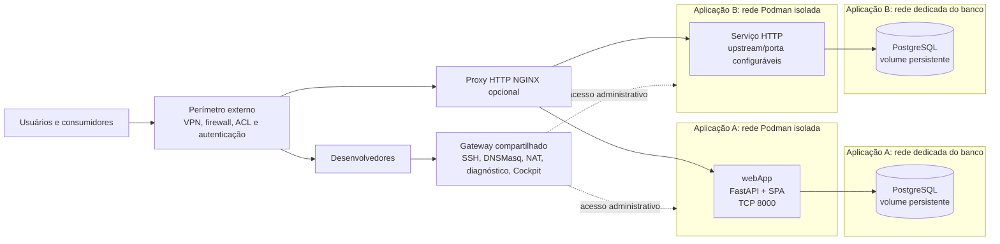

<details>
    <summary>Índice</summary>
    <ol>
        <li><a href="#visão-geral">Visão Geral</a></li>
        <li><a href="#arquitetura">Arquitetura</a></li>
        <li><a href="#estrutura-do-repositório">Estrutura do Repositório</a></li>
        <li><a href="#modelo-de-desenvolvimento">Modelo de Desenvolvimento</a></li>
        <li><a href="#pré-requisitos">Pré-requisitos</a></li>
        <li><a href="#como-rodar-localmente">Como Rodar Localmente</a></li>
        <li><a href="#containers-e-redes-podman">Containers e Redes Podman</a></li>
        <li><a href="#implantação-e-operação">Implantação e Operação</a></li>
        <li><a href="#configuração-e-segurança">Configuração e Segurança</a></li>
        <li><a href="#decisões-em-aberto-e-próximas-etapas">Decisões em Aberto e Próximas Etapas</a></li>
        <li><a href="#licença-e-contribuição">Licença e Contribuição</a></li>
    </ol>
</details>

## Visão geral

Este repositório é a base planejada para aplicações web com backend Python/FastAPI, frontend
JavaScript e PostgreSQL, executadas em containers Podman. A arquitetura prioriza isolamento entre
aplicações, desenvolvimento remoto com VS Code, implantação reproduzível e baixa dependência
operacional do host.

O contrato arquitetural está em
[docs/contracts/WEB_APP_BOILERPLATE_ARCHITECTURE.md](docs/contracts/WEB_APP_BOILERPLATE_ARCHITECTURE.md).
Ele descreve o host-alvo RHEL 9.8 com Podman rootful 5.8.2, os gateways, as redes, o acesso SSH,
o DNS de desenvolvimento, os secrets e os critérios para a implementação.

**Estado atual:** o código da aplicação ainda é um scaffold Python. O bootstrap do Development
Gateway tem configuração, imagem Debian, startup e Quadlet versionados. A aceitação em RHEL 9.8
com Podman rootful 5.8.2, Quadlet e SELinux permanece pendente. Não implante em host live; consulte
[docs/plans/gateway-implementation.md](docs/plans/gateway-implementation.md).

<div> <a href="#visão-geral" title="De volta ao topo da página"> <picture> <source media="(prefers-color-scheme: dark)" srcset="./docs/images/up-arrow_white.svg">  </picture> </a> <br><br> </div>

## Arquitetura

A arquitetura separa o acesso de desenvolvimento, o tráfego das aplicações e o perímetro de
segurança administrado pela infraestrutura:



Componentes e limites principais:

- **Development Gateway:** um container compartilhado exclusivamente para acesso dos
  desenvolvedores a todos os serviços e portas configurados. O plano aprovado prevê acesso Layer 3
  split-tunnel às redes Podman por OpenVPN client no Gateway e múltiplas sessões SSH TUN; esse
  runtime ainda não está implementado. O acesso roteado não exige publicação de portas no host.
  Oferece SSH, DNS de desenvolvimento, forwarding, diagnóstico, Cockpit e `cockpit-podman`; não é
  proxy de usuários.
- **Proxy HTTP NGINX:** opcional, compartilhado e limitado a reverse proxy HTTP. Pode encaminhar
  rotas para serviços HTTP de diferentes aplicações, cada qual com upstream e porta configuráveis.
  Na aplicação inicial `webApp`, `/app/` e `/app/api/` usam o mesmo listener TCP `8000`. O perímetro externo
  autentica usuários e injeta os campos `X-USER`; a aplicação usa a identidade para autorizar.
  NGINX não implementa login nem autenticação. Serviços não HTTP de usuários são publicados
  diretamente por bind de host, protocolo e portas explicitamente configurados, com autenticação
  própria do serviço e controles do perímetro.
- **Aplicação inicial:** um container `webApp` serve a SPA em `/app/` e API em `/app/api/` no único
  listener FastAPI `TCP 8000`. O proxy opcional encaminha ambas as rotas ao mesmo listener.
  Aplicações HTTP adicionais podem configurar seus próprios upstreams e portas. PostgreSQL e
  serviços auxiliares podem permanecer em containers independentes.
- **PostgreSQL:** container com volume persistente. FastAPI o utiliza na rede dedicada, mas membros
  de `shared` — incluindo Gateway e NGINX — também têm alcance de rede; autenticação do serviço é
  obrigatória e a topologia não isola esses membros.
- **Perímetro de segurança:** VPN, firewall, ACL e autenticação externa ao boilerplate. O Development
  Gateway não substitui esses controles nem funciona como firewall de autorização.

O contrato confirmado é roteamento Layer 3 split-tunnel para os CIDRs Podman configurados, sem
forwarding por serviço. O OpenVPN server permanece externo, aloca endereços de cliente e a
infraestrutura externa instala rotas dos CIDRs Podman via OpenVPN client do Gateway. SSH TUN
(`ssh -w`) permite múltiplos desenvolvedores simultâneos com interface e par de endereços exclusivos
por sessão. Pools de túnel são separados dos CIDRs Podman; nenhuma rota default do cliente é
substituída. Essas capacidades estão planejadas, não implementadas. Consulte o [plano do
Gateway](docs/plans/gateway-plan.md) e o [contrato arquitetural](docs/contracts/WEB_APP_BOILERPLATE_ARCHITECTURE.md)
para requisitos de roteamento, conflito, retorno, cleanup e aceitação.

O proxy HTTP está selecionado para bind `0.0.0.0:8080` no host, mapeado para TCP `80` no container.
Como o Gateway permite acesso direto e o listener está em todas as interfaces, rotas protegidas
dependem de um gate de deployment: restringir efetivamente o ingresso ao perímetro confiável ou
verificar a proveniência da identidade até a aplicação. Nem um CIDR nem um `X-USER` bruto comprovam
autenticação. O perímetro deve remover/substituir identidade enviada pelo cliente; a aplicação deve
rejeitar identidade ausente ou não confiável. A lista exata de campos `X-USER` e o mecanismo de
proveniência permanecem pré-requisitos de implementação; autenticação/autorização de runtime não
está implementada.

<div> <a href="#visão-geral" title="De volta ao topo da página"> <picture> <source media="(prefers-color-scheme: dark)" srcset="./docs/images/up-arrow_white.svg">  </picture> </a> <br><br> </div>

## Estrutura do repositório

O repositório ainda contém somente o scaffold inicial. A estrutura lógica prevista separa aplicação,
gateways e operações de deployment:

```text
repository/
├── webApp/                  # FastAPI, API e assets SPA no mesmo serviço (planejado)
├── gateway/
│   ├── development/         # Gateway administrativo compartilhado
│   └── http_proxy/          # Proxy HTTP NGINX opcional
├── database/                # Inicialização e recursos do PostgreSQL
├── deploy/quadlet/           # Quadlet do Gateway
├── config/                  # Configuração estrutural versionada
├── compose/                 # Definições dos serviços e redes Podman
├── docs/
│   └── plans/               # Contratos e planos arquiteturais
├── scripts/                 # Bootstrap e operação do gateway
├── tests/                   # Validação local e smoke tests isolados
├── src/
│   └── main.py              # Scaffold atual
└── pyproject.toml           # Configuração do projeto Python
```

Os nomes e a disposição finais podem evoluir durante a implementação. As responsabilidades e os
limites de segurança definidos no contrato arquitetural devem permanecer explícitos.

<div> <a href="#visão-geral" title="De volta ao topo da página"> <picture> <source media="(prefers-color-scheme: dark)" srcset="./docs/images/up-arrow_white.svg">  </picture> </a> <br><br> </div>

## Modelo de desenvolvimento

O desenvolvimento cotidiano deve ocorrer pelo VS Code, usando Git, terminal, testes e ferramentas
de debugging. O Gateway fornece acesso roteado aos serviços e portas configurados, sem exigir
publicação de portas no host ou acesso administrativo permanente ao host RHEL.

O host de execução fornece Podman e armazenamento persistente. A equipe de infraestrutura realiza
a configuração inicial e operações excepcionais do host. Os containers permanecem substituíveis;
volumes preservam os dados que precisam sobreviver à recriação.

Desenvolvimento e produção mantêm a mesma separação de responsabilidades e isolamento de redes.
Recursos, secrets, certificados, réplicas e observabilidade podem variar por ambiente.

<div> <a href="#visão-geral" title="De volta ao topo da página"> <picture> <source media="(prefers-color-scheme: dark)" srcset="./docs/images/up-arrow_white.svg">  </picture> </a> <br><br> </div>

## Pré-requisitos

### Desenvolvimento

- Git;
- VS Code, recomendado para edição e acesso remoto;
- Python 3.14 ou superior;
- [UV](https://docs.astral.sh/uv/) para gerenciar o ambiente Python;
- Podman quando for necessário executar ou validar containers localmente.

### Ambiente remoto

- Red Hat Enterprise Linux 9.8, rootful Podman 5.8.2, systemd/Quadlet e SELinux desativado
  (baseline aprovado; o deployment verifica, mas não altera a segurança do host);
- armazenamento para volumes persistentes;
- equipe de infraestrutura com acesso administrativo para configuração inicial e operações do host;
- acesso SSH autorizado ao Gateway;
- controles externos de rede e autenticação definidos pela organização;
- configuração das redes e registros DNS das aplicações, além dos arquivos externos de chaves e TLS descritos abaixo.

Scripts de deployment do host devem exigir esse baseline RHEL/Podman. Imagens do Gateway e das
aplicações devem usar uma distribuição Linux eficiente e mantida, preferencialmente Debian ou
Alpine; a distribuição do container é independente do host.

O script verifica as dependências de host, incluindo `jq`, Python 3, Podman, systemd, Quadlet,
OpenSSH e ferramentas de diagnóstico. O contrato arquitetural não exige acesso administrativo
diário dos desenvolvedores ao host. As capabilities mínimas e o comportamento com SELinux já
desativado ainda precisam ser confirmados em um host RHEL 9.8 / Podman 5.8.2 descartável; não altere
o estado de segurança de um host para realizar esse teste.

<div> <a href="#visão-geral" title="De volta ao topo da página"> <picture> <source media="(prefers-color-scheme: dark)" srcset="./docs/images/up-arrow_white.svg">  </picture> </a> <br><br> </div>

## Como rodar localmente

O scaffold atual não inicia uma API nem um frontend. Para executar o código Python existente:

```powershell
uv run python -m src.main
```

O comando imprime uma mensagem de exemplo. O Gateway possui imagem, script de
deployment e testes locais; veja [Implantação e operação](#implantação-e-operação). Isso não
significa que o stack da aplicação web esteja implementado nem que Debian seja um host suportado
para deployment.

<div> <a href="#visão-geral" title="De volta ao topo da página"> <picture> <source media="(prefers-color-scheme: dark)" srcset="./docs/images/up-arrow_white.svg">  </picture> </a> <br><br> </div>

## Containers e redes Podman

O array top-level `networks` em `config/host_config.json` é o inventário global das redes Podman
declaradas para aplicações e seus serviços. Cada aplicação terá uma rede Podman própria, com CIDR
sem sobreposição. O Gateway conecta-se a todas as redes desse inventário; essa conexão não as une
nem cria roteamento entre redes app-specific.

A rede `shared` é uma bridge Podman compartilhada explicitamente por seus membros. Ela não é uma
interface física do host, uma interface do host ligada ao Gateway, nem uma rota ou pool de endereços
de VPN. Rotas externas de VPN, pools de endereços de túneis e interfaces físicas/do host são
conceitos distintos e não pertencem ao inventário `networks`.

`networks` declara somente as redes Podman da aplicação; não declara todos os recursos de rede do
host. Ao implantar uma aplicação, a implantação atualiza somente esse inventário de redes Podman
para a nova rede e reconcilia o Gateway existente, que deve permanecer conectado a todas as redes
declaradas.

O deployment deverá gerar ou atualizar os registros do DNSMasq para serviços de desenvolvimento
selecionados, usando nomes estáveis como `backend.project-a.dev.internal`. A configuração deverá
acompanhar a recriação dos containers; seus endereços IP não são identidades permanentes. A
publicação de um nome DNS não concede conectividade entre redes.

O SSH seguirá o mesmo limite: o Gateway encaminha conexões aos containers de aplicação,
mas a autenticação acontece no destino. O acesso SSH ao próprio gateway é autenticado pelo gateway.
Cada desenvolvedor usa sua própria chave; chaves privadas não são compartilhadas nem copiadas para o
ambiente.

O PostgreSQL terá volume persistente e participará da rede dedicada da aplicação e de `shared`.
Os membros de `shared`, incluindo Gateway e NGINX, terão alcance de rede ao banco; a autenticação
do PostgreSQL controla o acesso. FastAPI utiliza o banco; os assets do frontend não recebem
credenciais nem acessam PostgreSQL diretamente.

**Backup PostgreSQL:** o desenho planejado usa pgBackRest com full mensal e incremental semanal,
um repositório de trabalho separado das exportações concluídas e publicação de gerações verificadas.
O plano e os requisitos de recuperação estão em
[Application Stack Plan](docs/plans/application-stack-plan.md) e
[Application Deployment Plan](docs/plans/application-deployment-plan.md). Não está implementado:
o validador/configuração runtime atual não aceita os campos de backup propostos e nenhum timer,
mount, publisher ou restore pgBackRest está disponível. Não use esses exemplos como configuração
executável nem implante com base nesse desenho.

<div> <a href="#visão-geral" title="De volta ao topo da página"> <picture> <source media="(prefers-color-scheme: dark)" srcset="./docs/images/up-arrow_white.svg">  </picture> </a> <br><br> </div>

## Implantação e operação

O script [`scripts/deploy-gateway.sh`](scripts/deploy-gateway.sh) valida a
configuração, verifica pré-requisitos do host e, em `--apply`, constrói e instala o Development
Gateway. Ele não instala pacotes no host, não provisiona aplicações ou volumes, e não remove redes
Podman existentes. Consulte
[docs/plans/gateway-implementation.md](docs/plans/gateway-implementation.md)
para o inventário detalhado de paths, decisões e limitações.

### Modos do script

| Modo | Uso e efeito |
|---|---|
| `--validate-config` | Valida o JSON localmente. Não exige root e não altera o host. |
| `--check` | Faz preflight somente leitura. Exige root e RHEL 9.8 com Podman 5.8.2; não constrói imagem nem inicia serviços. |
| `--apply` | Repete o preflight e, se aprovado, constrói a imagem, instala os arquivos gerenciados e ativa o serviço. Use apenas em host de teste RHEL 9.8 / Podman 5.8.2 autorizado. |

Comece ajustando `config/host_config.json`. `networks` declara as redes Podman da aplicação, com
nome e CIDR IPv4 esperado. O Gateway conecta-se automaticamente a todas as redes declaradas;
nenhuma lista seletiva de redes é mantida no bloco `gateway`. `containers` lista serviços e redes
que o preflight deve conferir. Cada registro DNS associa um nome `.dev.internal` a um container e a
uma rede declarada. Exemplo:

```json
{
  "schema_version": 1,
  "gateway": {
    "name": "gateway",
    "bind_address": "127.0.0.1",
    "ssh_bind_address": "0.0.0.0",
    "cockpit_bind_address": "127.0.0.1",
    "ssh_port": 2222,
    "cockpit_port": 9090,
    "authorized_keys_path": "/etc/gateway/authorized_keys"
  },
  "networks": [
    { "name": "project-a-net", "subnet": "10.89.1.0/24" }
  ],
  "containers": [
    { "name": "project-a-backend", "networks": ["project-a-net"] }
  ],
  "dns_records": [
    {
      "name": "backend.project-a.dev.internal",
      "container": "project-a-backend",
      "network": "project-a-net"
    }
  ]
}
```

Escolha CIDRs que não conflitem com as redes existentes no host. **Limitação dos scripts atuais,
não do contrato aprovado:** o preflight geral (`host-preflight.sh --check`) exige que cada rede
declarada já exista com o CIDR esperado e verifica os containers listados; containers parados são
reportados como pendentes. O preflight atual do Gateway aceita redes declaradas ausentes, mas não as
reporta como criação planejada; também exige ao menos uma rede Podman declarada e um registro DNS.
O fluxo atual de DNS ainda depende dos targets, podendo solicitar que targets parados sejam iniciados.
O contrato planejado de bootstrap limpo permite redes ausentes (`--check` informa criação planejada;
`--apply` as cria) e não exige containers de aplicação, targets DNS ou registros DNS para iniciar o
Gateway. Consulte o [status de implementação](docs/plans/gateway-implementation.md); esses
comportamentos ainda não foram implementados.

Para conferir um host com outros containers, sem exigir configuração ou credenciais do gateway:

```bash
./scripts/host-preflight.sh --validate-config config/host_config.json
sudo ./scripts/host-preflight.sh --check config/host_config.json
```

O comando geral verifica o Podman acessível ao usuário que o executa, as subnets declaradas e os
containers configurados. Use `sudo` quando os containers pertencerem ao Podman rootful. Ele não
exige RHEL 9, credenciais Cockpit ou arquivos Quadlet. Os comandos de
`scripts/deploy-gateway.sh` continuam executando as verificações estritas do deployment.

### Credenciais externas

Crie estes arquivos no host antes de `--check`. O script não os cria, não os sobrescreve e nunca
precisa das chaves privadas dos desenvolvedores.

| Caminho padrão | Conteúdo e requisitos |
|---|---|
| `/etc/gateway/authorized_keys` | Um ou mais registros de chaves **públicas** para login SSH no gateway; arquivo não vazio, root-owned e sem escrita para grupo/outros. |
| `/etc/gateway/cockpit-password` | Uma senha em uma linha para `gateway-admin`; propriedade `root:root`, sem acesso por grupo/outros (normalmente modo `0600`). |
| `/etc/gateway/tls/gateway.cert` | Certificado TLS válido do Cockpit. |
| `/etc/gateway/tls/gateway.key` | Chave privada correspondente; root-owned e sem acesso por grupo/outros (normalmente modo `0600`). |

Os certificados e secrets são entradas externas. O deployment os monta como somente leitura. A
chave pública em `authorized_keys` autoriza acesso ao gateway, não aos containers de aplicação.

### Preflight e deployment

Execute a validação antes de acessar o host:

```bash
./scripts/deploy-gateway.sh --validate-config config/host_config.json
```

Em um host de teste **RHEL 9.8** autorizado, com Podman rootful 5.8.2, Quadlet e SELinux já
desativado, execute o preflight e só então aplique. O script verifica o estado e não o altera:

```bash
sudo ./scripts/deploy-gateway.sh --check config/host_config.json
sudo ./scripts/deploy-gateway.sh --apply config/host_config.json
```

`--check` exige RHEL 9.8 e Podman 5.8.2 e verifica as credenciais, portas, redes, containers,
socket rootful e ferramentas exigidas. Não contorne essa verificação nem rode `--apply` em Debian,
em host live ou antes de aprovação operacional.

### O que o apply cria

- Constrói a imagem Debian 13 `linux/amd64` `localhost/gateway:1`, a partir de
  `gateway/development/Containerfile` e versões fixadas no repositório.
- Cria `/var/lib/gateway/` e arquivos gerados: cópia da configuração, metadados de
  entradas, registros DNS e marcador de propriedade.
- Cria a identidade SSH Ed25519 persistente do gateway somente quando os dois arquivos da chave
  ainda não existem. Uma chave incompleta ou alterada causa falha; não há rotação automática.
- Cria somente redes Podman declaradas que ainda não existam. Redes existentes precisam ter o CIDR
  declarado; o script nunca as exclui.
- Renderiza `/etc/containers/systemd/gateway.container`, recarrega systemd e habilita
  `gateway.service` para iniciar no boot.
- Inicia o container `gateway`, ligado somente às redes declaradas. A unidade publica
  SSH e Cockpit nos ports configurados e monta o socket rootful do Podman no container.

O script não cria as credenciais externas, containers de aplicação, volumes ou dados de aplicação.
Também não usa `--privileged`, não expõe a API Podman por TCP e não altera SELinux. Se o apply falhar,
ele tenta restaurar os arquivos gerados e o estado anterior do serviço; imagens, chaves persistentes
e redes recém-criadas podem permanecer para inspeção.

O endereço padrão de bind é `127.0.0.1`, então as portas ficam acessíveis apenas no próprio host.
Para acesso remoto, configure um endereço do host aprovado pela infraestrutura e controles externos
de firewall/ACL. O gateway não substitui o perímetro de segurança.

### Usar SSH, DNS e Cockpit

O gateway aceita login SSH como `developer` na porta configurada (padrão `2222`), usando a chave
privada do desenvolvedor que permanece na workstation. O DNSMasq resolve, dentro do gateway, os
nomes dos targets em execução. O acesso Layer 3 por OpenVPN/SSH TUN e suas rotas ainda estão
planejados, não implementados.

Quando o SSH TUN estiver implementado, o VS Code Remote-SSH poderá conectar-se diretamente ao
endereço/DNS do container através das rotas split do túnel. Abaixo está o caminho alternativo
ProxyJump, que funciona sem SSH TUN e encaminha somente TCP/22. Os aliases separam a identidade do
Gateway e a identidade/chave pública autorizada no destino:

```sshconfig
Host dev-gateway-proxy
    HostName 127.0.0.1
    User developer
    Port 2222
    IdentityFile ~/.ssh/id_ed25519_gateway
    IdentitiesOnly yes
    StrictHostKeyChecking yes
    UserKnownHostsFile ~/.ssh/known_hosts_gateway

Host backend-project-a-via-proxy
    HostName backend.project-a.dev.internal
    User developer
    Port 22
    ProxyJump dev-gateway-proxy
    IdentityFile ~/.ssh/id_ed25519_project_a
    IdentitiesOnly yes
    StrictHostKeyChecking yes
    UserKnownHostsFile ~/.ssh/known_hosts_project_a
```

Para o caminho direto por SSH TUN, use um alias separado para que sua chave de host seja
verificada independentemente:

```sshconfig
Host backend-project-a-via-tunnel
    HostName backend.project-a.dev.internal
    User developer
    Port 22
    IdentityFile ~/.ssh/id_ed25519_project_a
    IdentitiesOnly yes
    StrictHostKeyChecking yes
    UserKnownHostsFile ~/.ssh/known_hosts_project_a
```

Com `ssh_bind_address` em `0.0.0.0`, encaminhe a porta SSH do host pelo perímetro externo. O
`cockpit_bind_address` permanece em `127.0.0.1`; o Cockpit não fica exposto externamente. Se os
binds forem alterados, atualize cada campo separadamente.
O usuário e a chave do destino precisam existir no container de aplicação; o gateway não provisiona
nem substitui essa autenticação. No caminho ProxyJump, forwarding SSH é somente TCP/22 e usa o nome
DNS declarado. Acesso Layer 3 direto pelo túnel, quando implementado, não fica limitado a esse
forwarding. No caminho ProxyJump, autenticação do destino continua independente, e suas chaves de host são
verificadas; não desative `StrictHostKeyChecking` nem reutilize a chave pública de host do Gateway
para um destino. O servidor SSH, a conta de desenvolvedor, a chave pública de destino e a instalação
do VS Code Server são pré-requisitos no destino. ProxyJump é TCP-only e não fornece DNS do cliente,
rotas IP nem substitui SSH TUN.

O Cockpit fica em `https://127.0.0.1:9090/` por padrão. Entre como `gateway-admin`, usando a senha
de `/etc/gateway/cockpit-password`. Para acesso remoto, aplique as mesmas restrições de
bind e perímetro usadas para SSH. O `cockpit-podman` usa `/run/podman/podman.sock`: mesmo montado
como somente leitura, esse socket concede amplo controle sobre containers rootful. Não há listener
Podman TCP. A aprovação desse limite de autoridade não comprova compatibilidade com o baseline de
SELinux desativado.

Depois que uma aplicação criar ou recriar um container mapeado, execute `--apply` novamente para
atualizar o endereço DNS. Targets ausentes ou parados são reportados como pendentes e omitidos; um
endereço antigo não é mantido. Um target em execução na rede errada causa erro de preflight.

### Diagnóstico e testes locais

```bash
sudo systemctl status gateway.service
sudo journalctl -u gateway.service
sudo podman ps --filter name=gateway
sudo ./scripts/deploy-gateway.sh --check config/host_config.json
```

Os helpers Python ficam em `scripts/gateway/`; o README do pacote
documenta interfaces, saída, erros e comandos externos. Para instalar e executar
os testes unitários Python:

```bash
uv sync --group dev
uv run pytest
```

Para validar a imagem e os scripts localmente em uma máquina com Podman, `jq`, `ssh-keygen` e
OpenSSL:

```bash
podman build --pull=always --file gateway/development/Containerfile \
  --tag localhost/gateway:1 gateway/development
bash tests/scripts/test-gateway-config.sh
bash tests/scripts/test-gateway-container.sh
```

O smoke test cria chaves e certificado temporários, não conecta redes nem publica portas, e remove
seu container e arquivos temporários ao terminar. Passar esses testes localmente não é aceitação
do deployment em RHEL 9.8 / Podman 5.8.2.

Ainda exigem um RHEL 9.8 / Podman 5.8.2 descartável com SELinux desativado: `--apply`, reboot, socket,
capabilities, isolamento de rede, forwarding/NAT e autenticação SSH no destino. Não declare
aceitação antes desses gates.

<div> <a href="#visão-geral" title="De volta ao topo da página"> <picture> <source media="(prefers-color-scheme: dark)" srcset="./docs/images/up-arrow_white.svg">  </picture> </a> <br><br> </div>

## Configuração e segurança

A configuração estrutural deverá ser versionada no Git: serviços, redes, portas, templates e
parâmetros do deployment. Senhas, tokens, chaves privadas e certificados privados ficam fora do
repositório. A primeira implementação prevê arquivos de secrets no host, montados somente para os
containers que precisam deles e em modo somente leitura.

Princípios obrigatórios:

- aplicar menor privilégio e evitar `--privileged`;
- não expor o socket/API do Podman por TCP sem necessidade aprovada;
- manter redes de aplicações isoladas;
- não expor PostgreSQL externamente por padrão;
- não incluir secrets nas imagens ou no Git;
- não montar secrets em serviços que não os utilizam;
- usar chaves SSH individuais e provisionar somente as chaves públicas;
- separar o Development Gateway administrativo do proxy HTTP opcional;
- tratar o perímetro externo como responsabilidade da infraestrutura.

Os caminhos externos de credenciais e os mounts do gateway estão definidos em
[docs/plans/gateway-implementation.md](docs/plans/gateway-implementation.md).
As capabilities mínimas, compatibilidade com o baseline de SELinux desativado e runtime Layer 3 continuam pendentes de teste em
RHEL 9.8 / Podman 5.8.2. A integração com um Secret Manager fica fora da primeira versão; o servidor
OpenVPN permanece externo e o Gateway OpenVPN client/SSH TUN estão planejados.

<div> <a href="#visão-geral" title="De volta ao topo da página"> <picture> <source media="(prefers-color-scheme: dark)" srcset="./docs/images/up-arrow_white.svg">  </picture> </a> <br><br> </div>

## Decisões em aberto e próximas etapas

A arquitetura já estabelece RHEL 9.8, Podman rootful 5.8.2, backend FastAPI, frontend JavaScript,
PostgreSQL, um Gateway compartilhado, redes isoladas por aplicação, DNSMasq e secrets externos ao
Git. Perfis VPN reais, CIDRs de pools e sistemas operacionais cliente são inputs de deployment, não
decisões arquiteturais em aberto. Permanecem em aberto:

- capabilities do Gateway e integração Cockpit/Podman;
- mecanismo verificável de proveniência dos campos `X-USER` para endpoints protegidos;
- mecanismo de snapshot consistente do repositório pgBackRest, capacidade dos volumes,
  protocolo de coleta e confirmação externa, retenção de dependências e metas RPO/RTO;
- health checks, logs e atualização/versionamento de imagens;
- configuração de exposição direta por serviço não HTTP.

Próxima etapa do gateway: executar os gates de aceitação em um host RHEL 9.8 / Podman 5.8.2
descartável e registrar os resultados de Quadlet, reboot, SELinux, capabilities, forwarding e
Cockpit/Podman, incluindo concorrência de clientes OpenVPN/SSH TUN, conflito/reconciliação/rollback
de rotas e cleanup de sessões. O runtime de túnel continua planejado e não implementado. Não use um
host live para essa validação. As decisões restantes da aplicação e do proxy HTTP devem ser tratadas
separadamente.

<div> <a href="#visão-geral" title="De volta ao topo da página"> <picture> <source media="(prefers-color-scheme: dark)" srcset="./docs/images/up-arrow_white.svg">  </picture> </a> <br><br> </div>

## Licença e contribuição

Consulte os arquivos de política e contribuição na raiz do repositório:

- [LICENSE.md](LICENSE.md)
- [CONTRIBUTING.md](CONTRIBUTING.md)
- [CODE_OF_CONDUCT.md](CODE_OF_CONDUCT.md)
- [SECURITY.md](SECURITY.md)
- [SUPPORT.md](SUPPORT.md)

Siga as diretrizes de contribuição e o código de conduta ao enviar alterações.

<div> <a href="#visão-geral" title="De volta ao topo da página"> <picture> <source media="(prefers-color-scheme: dark)" srcset="./docs/images/up-arrow_white.svg">  </picture> </a> <br><br> </div>