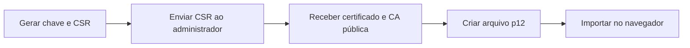

# Gerar e importar a credencial de cliente do Cockpit

<details id="top">
    <summary>Índice</summary>
    <ol>
        <li><a href="#visão-geral">Visão geral</a></li>
        <li><a href="#ambiente-e-versões">Ambiente e versões</a></li>
        <li><a href="#pré-requisitos-e-variáveis">Pré-requisitos e variáveis</a></li>
        <li><a href="#passo-1-gerar-a-chave-e-o-csr">Passo 1: Gerar a chave e o CSR</a></li>
        <li><a href="#passo-2-conferir-o-certificado-assinado">Passo 2: Conferir o certificado assinado</a></li>
        <li><a href="#passo-3-criar-o-arquivo-p12">Passo 3: Criar o arquivo p12</a></li>
        <li><a href="#passo-4-importar-no-navegador">Passo 4: Importar no navegador</a></li>
        <li><a href="#passo-5-remover-cópias-de-trabalho">Passo 5: Remover cópias de trabalho</a></li>
        <li><a href="#verificação-final">Verificação final</a></li>
        <li><a href="#solução-de-problemas">Solução de problemas</a></li>
        <li><a href="#reversão-e-desinstalação">Reversão e desinstalação</a></li>
        <li><a href="#referências">Referências</a></li>
        <li><a href="#pendências">Pendências</a></li>
    </ol>
</details>

## Visão geral

Esta receita orienta o usuário final a gerar, no próprio computador, a chave privada e o pedido
de certificado (CSR) usados para acessar o Cockpit. Depois, ela orienta a importar o certificado
assinado no navegador. A chave privada não sai do computador do usuário.

Esta receita complementa a [receita do Cockpit no RHEL 9.8](cockpit-rhel9-podman-cert-auth.md),
que configura o host e assina o certificado pela CA de clientes.

| Item | Descrição |
| --- | --- |
| Público | Usuários que acessam o Cockpit com certificado de cliente |
| Tempo estimado | 20 a 30 minutos |
| Escopo | Geração da chave e do CSR, conferência do certificado, arquivo PKCS #12, importação no navegador e remoção das cópias de trabalho |
| Fora do escopo | Assinatura do certificado, configuração do host e do SSSD, e acesso por rede |
| Status | Não verificado em 2026-11-25 |



### Fontes e adaptações

Baseada nos comandos de geração e assinatura da
[receita do Cockpit no RHEL 9.8](cockpit-rhel9-podman-cert-auth.md). Adaptações: comandos para
Linux, Windows 11 e macOS, verificação da correspondência entre chave e certificado, e
importação no navegador de cada sistema.

### Decisões de segurança e riscos aceitos

| Decisão | Risco | Justificativa | Mitigação |
| --- | --- | --- | --- |
| Chave gerada no computador do usuário | Perda do computador expõe o arquivo `.key` | A chave nunca passa pelo administrador | Frase secreta forte e disco criptografado |
| Arquivo `.p12` contém a chave privada | Cópia indevida permite acesso ao Cockpit | O navegador importa a credencial nesse formato | Senha de exportação forte, cópia única em cofre aprovado e remoção do disco |
| Mesma credencial em vários navegadores | Cada cópia amplia a superfície de risco | Permite usar mais de um navegador | Importar somente em dispositivos aprovados |

<div>
  <a href="#top" title="De volta ao topo da página">
    <picture>
      <source media="(prefers-color-scheme: dark)" srcset="../images/up-arrow_white.svg">
      
    </picture>
  </a>
  <br><br>
</div>

## Ambiente e versões

| Sistema | Ferramenta usada | Estado |
| --- | --- | --- |
| Linux com OpenSSL 3.x | Pacote `openssl` da distribuição | Não verificado |
| Windows 11 | OpenSSL do Git for Windows ou ShiningLight OpenSSL, instalado com `winget` | Não verificado |
| macOS | OpenSSL 3.x instalado pelo Homebrew (`openssl@3`) | Não verificado |

Navegadores previstos: Firefox, Google Chrome e Microsoft Edge.

> **Não verificado:** nenhum comando desta receita foi executado em Linux, Windows 11 ou macOS.
> Valide cada bloco no sistema do usuário antes de distribuir a receita.

<div>
  <a href="#top" title="De volta ao topo da página">
    <picture>
      <source media="(prefers-color-scheme: dark)" srcset="../images/up-arrow_white.svg">
      
    </picture>
  </a>
  <br><br>
</div>

## Pré-requisitos e variáveis

- Um computador com Linux, Windows 11 ou macOS, sob controle do usuário.
- OpenSSL 3.x instalado:
  - Linux: pacote `openssl` da distribuição.
  - Windows 11: OpenSSL do Git for Windows (`C:\Program Files\Git\usr\bin\openssl.exe`) ou
    `winget install -e --id ShiningLight.OpenSSL`, que instala em
    `C:\Program Files\OpenSSL-Win64\bin\openssl.exe`.
  - macOS: `brew install openssl@3`.
- Um navegador: Firefox, Google Chrome ou Microsoft Edge.
- Uma frase secreta forte para a chave privada, guardada em cofre aprovado.
- Um diretório privado de trabalho, no disco criptografado do computador.

Receba do administrador, antes de começar, a CA pública `cockpit-client-ca.crt`. Confirme a
impressão digital SHA-256 dela pelo canal administrativo separado. Depois de enviar o CSR,
receba também `${CERT_NAME}.crt`, cujo nome segue o identificador `DEVICE_ID` informado pelo administrador.

> [!WARNING]
> Os comandos param se encontrarem um arquivo existente no diretório de trabalho. Não apague nem
> sobrescreva arquivos sem conferir o conteúdo. Mova os arquivos antigos antes de repetir um passo.

Defina as variáveis na sessão atual. Repita o bloco ao abrir outro terminal.

**Linux:**

```bash
COCKPIT_USER=podman_user
DEVICE_ID=notebook-joao
CERT_NAME="${COCKPIT_USER}-${DEVICE_ID}"
CLIENT_WORK_DIR="${HOME}/cockpit-client-cert"
OPENSSL_BIN=openssl
```

**macOS:**

```bash
COCKPIT_USER=podman_user
DEVICE_ID=notebook-joao
CERT_NAME="${COCKPIT_USER}-${DEVICE_ID}"
CLIENT_WORK_DIR="${HOME}/cockpit-client-cert"
OPENSSL_BIN="$(brew --prefix openssl@3)/bin/openssl"
```

**Windows 11 (PowerShell):**

```powershell
$CockpitUser = "podman_user"
$DeviceId = "notebook-joao"
$CertName = "$CockpitUser-$DeviceId"
$ClientWorkDir = Join-Path $HOME "cockpit-client-cert"
$OpenSsl = "C:\Program Files\Git\usr\bin\openssl.exe"
```

| Variável | Descrição | Exemplo | Usada em |
| --- | --- | --- | --- |
| `COCKPIT_USER` | Conta de destino no Cockpit | `podman_user` | Passos 1 a 5 |
| `DEVICE_ID` | Identificador da máquina, fornecido pelo administrador. Use letras minúsculas, dígitos e `-` | `notebook-joao` | Passos 1 a 5 |
| `CERT_NAME` | Nome do certificado: `${COCKPIT_USER}-${DEVICE_ID}`, usado no `CN` e nos arquivos | `podman_user-notebook-joao` | Passos 1 a 5 |
| `CLIENT_WORK_DIR` | Diretório de trabalho no computador do usuário | `${HOME}/cockpit-client-cert` | Passos 1 a 5 |
| `OPENSSL_BIN` | Executável do OpenSSL (Linux e macOS) | `openssl` | Passos 1 a 3 |
| `$ClientWorkDir` | Diretório de trabalho (Windows) | `$HOME\cockpit-client-cert` | Passos 1 a 5 |
| `$OpenSsl` | Executável do OpenSSL (Windows) | `C:\Program Files\Git\usr\bin\openssl.exe` | Passos 1 a 3 |

> **Nota:** No Windows, use PowerShell. O Git Bash converte argumentos que começam com `/`, como
> `-subj "/CN=..."`, em caminhos de arquivo.

<div>
  <a href="#top" title="De volta ao topo da página">
    <picture>
      <source media="(prefers-color-scheme: dark)" srcset="../images/up-arrow_white.svg">
      
    </picture>
  </a>
  <br><br>
</div>

## Passo 1: Gerar a chave e o CSR

Gere a chave privada e o pedido de certificado no computador do usuário. Envie somente o arquivo
`.csr` ao administrador.

**Contexto:** computador do usuário, sessão do próprio usuário, diretório `CLIENT_WORK_DIR` ou
`$ClientWorkDir`.

**Linux e macOS:**

```bash
install -d -m 0700 "${CLIENT_WORK_DIR}" && \
test ! -e "${CLIENT_WORK_DIR}/${CERT_NAME}.key" && \
test ! -e "${CLIENT_WORK_DIR}/${CERT_NAME}.csr" && \
"${OPENSSL_BIN}" genpkey -algorithm RSA -pkeyopt rsa_keygen_bits:3072 -aes-256-cbc -out "${CLIENT_WORK_DIR}/${CERT_NAME}.key" && \
"${OPENSSL_BIN}" req -new -sha256 -key "${CLIENT_WORK_DIR}/${CERT_NAME}.key" -out "${CLIENT_WORK_DIR}/${CERT_NAME}.csr" -subj "/CN=${CERT_NAME}" || \
echo "Falha: arquivo existente ou frase secreta divergente. Mova os arquivos antes de repetir." >&2
```

**Windows 11 (PowerShell):**

```powershell
if ((Test-Path "$ClientWorkDir\$CertName.key") -or (Test-Path "$ClientWorkDir\$CertName.csr")) {
    Write-Error "Arquivo existente em $ClientWorkDir. Mova-o antes de repetir."
} else {
    New-Item -ItemType Directory -Force $ClientWorkDir | Out-Null
    & $OpenSsl genpkey -algorithm RSA -pkeyopt rsa_keygen_bits:3072 -aes-256-cbc -out "$ClientWorkDir\$CertName.key"
    & $OpenSsl req -new -sha256 -key "$ClientWorkDir\$CertName.key" -out "$ClientWorkDir\$CertName.csr" -subj "/CN=$CertName"
}
```

O OpenSSL solicita três vezes uma frase secreta. Nas duas primeiras, você define a frase e a
confirma. Na terceira, informa a mesma frase para ler a chave e assinar o pedido.

**Resultado esperado:**

```text
Enter PEM pass phrase:
Verifying - Enter PEM pass phrase:
Enter pass phrase for .../podman_user-notebook-joao.key:
```

Envie `${CERT_NAME}.csr` ao administrador. A chave `${CERT_NAME}.key` nunca sai deste computador, é pessoal e deve ser mantida em segurança pelo próprio usuário.

**Verificação:**

```bash
"${OPENSSL_BIN}" req -in "${CLIENT_WORK_DIR}/${CERT_NAME}.csr" -noout -verify -subject
```

No Windows, execute

```powershell
& $OpenSsl req -in "$ClientWorkDir\$CertName.csr" -noout -verify -subject
```

Critério: a saída inclui `Certificate request self-signature ok` e `subject=CN=podman_user-notebook-joao`.

> **Não verificado:** o bloco do Windows e a forma de fornecer a frase secreta pelo console do
> PowerShell não foram executados.

<div>
  <a href="#top" title="De volta ao topo da página">
    <picture>
      <source media="(prefers-color-scheme: dark)" srcset="../images/up-arrow_white.svg">
      
    </picture>
  </a>
  <br><br>
</div>

## Passo 2: Conferir o certificado assinado

Copie para o diretório de trabalho os arquivos recebidos do administrador: `${CERT_NAME}.crt` e
`cockpit-client-ca.crt`. Confira se o certificado foi assinado pela CA correta, se tem a
finalidade de cliente e se corresponde à sua chave privada.

**Contexto:** computador do usuário, diretório de trabalho com os arquivos recebidos.

**Linux e macOS:**

```bash
"${OPENSSL_BIN}" verify -CAfile "${CLIENT_WORK_DIR}/cockpit-client-ca.crt" -purpose sslclient "${CLIENT_WORK_DIR}/${CERT_NAME}.crt"
"${OPENSSL_BIN}" x509 -in "${CLIENT_WORK_DIR}/${CERT_NAME}.crt" -noout -subject -ext extendedKeyUsage
"${OPENSSL_BIN}" x509 -in "${CLIENT_WORK_DIR}/cockpit-client-ca.crt" -noout -fingerprint -sha256
```

**Windows 11 (PowerShell):**

```powershell
& $OpenSsl verify -CAfile "$ClientWorkDir\cockpit-client-ca.crt" -purpose sslclient "$ClientWorkDir\$CertName.crt"
& $OpenSsl x509 -in "$ClientWorkDir\$CertName.crt" -noout -subject -ext extendedKeyUsage
& $OpenSsl x509 -in "$ClientWorkDir\cockpit-client-ca.crt" -noout -fingerprint -sha256
```

**Resultado esperado:**

```text
.../podman_user-notebook-joao.crt: OK
subject=CN=podman_user-notebook-joao
X509v3 Extended Key Usage:
    TLS Web Client Authentication
sha256 Fingerprint=[...]
```

Compare a impressão digital SHA-256 exibida com a informada pelo administrador. Se forem
diferentes, não importe o certificado.

Agora confirme que o certificado corresponde à sua chave privada. O comando pede a frase secreta.

**Linux e macOS:**

```bash
diff <("${OPENSSL_BIN}" x509 -in "${CLIENT_WORK_DIR}/${CERT_NAME}.crt" -noout -pubkey) <("${OPENSSL_BIN}" pkey -in "${CLIENT_WORK_DIR}/${CERT_NAME}.key" -pubout)
```

**Windows 11 (PowerShell):**

```powershell
& $OpenSsl x509 -in "$ClientWorkDir\$CertName.crt" -noout -pubkey -out "$ClientWorkDir\cert-pub.pem"
& $OpenSsl pkey -in "$ClientWorkDir\$CertName.key" -pubout -out "$ClientWorkDir\key-pub.pem"
fc.exe "$ClientWorkDir\cert-pub.pem" "$ClientWorkDir\key-pub.pem"
Remove-Item "$ClientWorkDir\cert-pub.pem", "$ClientWorkDir\key-pub.pem"
```

**Resultado esperado:** no Linux e no macOS, o `diff` não mostra saída. No Windows, o `fc.exe`
informa que não há diferenças. Qualquer diferença indica que o certificado não pertence a esta
chave. Nesse caso, repita o Passo 1 e envie um novo CSR.

**Verificação:** o `verify` deve retornar `OK`, a finalidade deve incluir
`TLS Web Client Authentication` e a impressão digital deve coincidir com a informada pelo
administrador.

> **Não verificado:** os comandos do Windows não foram executados.

<div>
  <a href="#top" title="De volta ao topo da página">
    <picture>
      <source media="(prefers-color-scheme: dark)" srcset="../images/up-arrow_white.svg">
      
    </picture>
  </a>
  <br><br>
</div>

## Passo 3: Criar o arquivo p12

Empacote a chave privada, o certificado e a CA pública em um arquivo PKCS #12 (`.p12`). Esse
arquivo é o que o navegador importa.

**Contexto:** computador do usuário, diretório de trabalho com os arquivos das etapas anteriores.

**Linux:**

```bash
test ! -e "${CLIENT_WORK_DIR}/${CERT_NAME}.p12" && \
"${OPENSSL_BIN}" pkcs12 -export -in "${CLIENT_WORK_DIR}/${CERT_NAME}.crt" -inkey "${CLIENT_WORK_DIR}/${CERT_NAME}.key" -certfile "${CLIENT_WORK_DIR}/cockpit-client-ca.crt" -name "RHEL Cockpit - ${CERT_NAME}" -out "${CLIENT_WORK_DIR}/${CERT_NAME}.p12" && \
chmod 0600 "${CLIENT_WORK_DIR}/${CERT_NAME}.p12"
```

**macOS:**

```bash
test ! -e "${CLIENT_WORK_DIR}/${CERT_NAME}.p12" && \
"${OPENSSL_BIN}" pkcs12 -export -legacy -in "${CLIENT_WORK_DIR}/${CERT_NAME}.crt" -inkey "${CLIENT_WORK_DIR}/${CERT_NAME}.key" -certfile "${CLIENT_WORK_DIR}/cockpit-client-ca.crt" -name "RHEL Cockpit - ${CERT_NAME}" -out "${CLIENT_WORK_DIR}/${CERT_NAME}.p12" && \
chmod 0600 "${CLIENT_WORK_DIR}/${CERT_NAME}.p12"
```

**Windows 11 (PowerShell):**

```powershell
if (Test-Path "$ClientWorkDir\$CertName.p12") {
    Write-Error "Arquivo .p12 existente. Mova-o antes de repetir."
} else {
    & $OpenSsl pkcs12 -export -in "$ClientWorkDir\$CertName.crt" -inkey "$ClientWorkDir\$CertName.key" -certfile "$ClientWorkDir\cockpit-client-ca.crt" -name "RHEL Cockpit - $CertName" -out "$ClientWorkDir\$CertName.p12"
}
```

O OpenSSL solicita a frase secreta da chave privada e, em seguida, uma senha de exportação duas
vezes. A senha de exportação protege o `.p12` e é pedida ao importar no navegador. Ela pode ser
diferente da frase secreta da chave.

**Resultado esperado:** o arquivo `${CERT_NAME}.p12` existe no diretório de trabalho e não há
mensagem de erro.

**Verificação:**

```bash
"${OPENSSL_BIN}" pkcs12 -info -noout -in "${CLIENT_WORK_DIR}/${CERT_NAME}.p12"
```

No Windows, use:

```powershell
& $OpenSsl pkcs12 -info -noout -in "$ClientWorkDir\$CertName.p12"
```

Critério: o comando pede a senha de exportação e termina sem erro. Não exibe a chave privada.

> [!WARNING]
> No macOS, a opção `-legacy` gera o arquivo no formato que o Keychain aceita. Sem ela, o
> Keychain pode recusar a importação com `MAC verification failed`.

> **Não verificado:** a opção `-legacy` no macOS e os comandos do Windows não foram executados.

<div>
  <a href="#top" title="De volta ao topo da página">
    <picture>
      <source media="(prefers-color-scheme: dark)" srcset="../images/up-arrow_white.svg">
      
    </picture>
  </a>
  <br><br>
</div>

## Passo 4: Importar no navegador

Importe o arquivo `${CERT_NAME}.p12` no navegador. Use a senha de exportação definida no Passo 3.
Os nomes dos menus podem variar conforme o idioma e a versão do navegador.

**Firefox (Linux, Windows 11 e macOS):**

1. Abra **Configurações** e selecione **Privacidade e segurança**.
2. Em **Certificados**, escolha **Ver certificados**.
3. Na guia **Seus certificados**, escolha **Importar** e selecione `${CERT_NAME}.p12`.
4. Informe a senha de exportação.

**Google Chrome e Microsoft Edge (Windows 11):**

Execute no PowerShell. O comando pede a senha de exportação sem exibi-la.

```powershell
$Password = Read-Host "Senha de exportação do .p12" -AsSecureString
Import-PfxCertificate -FilePath "$ClientWorkDir\$CertName.p12" -CertStoreLocation Cert:\CurrentUser\My -Password $Password
```

**Resultado esperado:** o comando exibe uma linha com o `Thumbprint` e o `Subject`
`CN=podman_user-notebook-joao`.

**Google Chrome e Safari (macOS):**

Clique duas vezes em `${CERT_NAME}.p12`. O Acesso às Chaves abre e pede a senha de exportação.
Confirme a importação no chaveiro **login**.

**Google Chrome e Chromium (Linux):**

Abra **Configurações**, selecione **Privacidade e segurança** e depois **Segurança**. Em
**Gerenciar certificados**, escolha **Importar** e selecione `${CERT_NAME}.p12`.

> **Não verificado:** os passos do Chrome no Linux e do Safari no macOS não foram executados.

**Resultado esperado em todos os casos:** ao acessar `https://<COCKPIT_FQDN>:9090`, o navegador
oferece o certificado `${CERT_NAME}`. Reinicie o navegador se ele não oferecer a opção.

**Verificação:** consulte a lista de certificados pessoais do navegador. No Windows, também é
possível listar o certificado com:

```powershell
Get-ChildItem Cert:\CurrentUser\My | Where-Object { $_.Subject -eq "CN=$CertName" }
```

Critério: o certificado `CN=podman_user-notebook-joao` aparece na lista.

<div>
  <a href="#top" title="De volta ao topo da página">
    <picture>
      <source media="(prefers-color-scheme: dark)" srcset="../images/up-arrow_white.svg">
      
    </picture>
  </a>
  <br><br>
</div>

## Passo 5: Remover cópias de trabalho

Guarde uma cópia cifrada do `.p12` em cofre aprovado e remova a cópia de trabalho do disco. O
arquivo contém a chave privada.

**Contexto:** computador do usuário, após a importação comprovada no navegador.

**Linux e macOS:**

```bash
rm -f "${CLIENT_WORK_DIR}/${CERT_NAME}.p12"
```

**Windows 11 (PowerShell):**

```powershell
Remove-Item "$ClientWorkDir\$CertName.p12"
```

**Resultado esperado:** o comando não exibe saída.

**Verificação:**

```bash
test ! -e "${CLIENT_WORK_DIR}/${CERT_NAME}.p12" && echo "removido"
```

Critério: a saída é `removido`. Não envie o `.p12` nem o `.key` ao administrador nem a outras
pessoas.

<div>
  <a href="#top" title="De volta ao topo da página">
    <picture>
      <source media="(prefers-color-scheme: dark)" srcset="../images/up-arrow_white.svg">
      
    </picture>
  </a>
  <br><br>
</div>

## Verificação final

Confirme o resultado do ponto de vista do usuário.

| Verificação | Ação | Critério |
| --- | --- | --- |
| Certificado no navegador | Consultar a lista de certificados pessoais | `CN=podman_user-notebook-joao` aparece |
| Acesso ao Cockpit | Abrir `https://<COCKPIT_FQDN>:9090` e selecionar o certificado | Login sem campos de senha |
| Cópia de trabalho removida | Executar a verificação do Passo 5 | Saída `removido` |

Para o teste completo do Cockpit, siga o Passo 10 da
[receita do Cockpit no RHEL 9.8](cockpit-rhel9-podman-cert-auth.md#passo-10-testar-o-acesso-com-o-certificado).

<div>
  <a href="#top" title="De volta ao topo da página">
    <picture>
      <source media="(prefers-color-scheme: dark)" srcset="../images/up-arrow_white.svg">
      
    </picture>
  </a>
  <br><br>
</div>

## Solução de problemas

| Sintoma ou log | Causa provável | Correção |
| --- | --- | --- |
| `Verifying - Enter PEM pass phrase` não confere | Frase secreta digitada de forma diferente | Mova os arquivos gerados e repita o [Passo 1](#passo-1-gerar-a-chave-e-o-csr) |
| `unable to load Private Key` ou `bad decrypt` | Frase secreta incorreta | Informe a frase definida no Passo 1 |
| Mensagem `Falha: arquivo existente` | Arquivo do passo anterior ainda existe | Mova `${CERT_NAME}.key` ou `${CERT_NAME}.csr` para outra pasta e repita o passo |
| `verify` retorna erro | CA diferente da que assinou o certificado | Confira a CA pública e a impressão digital com o administrador |
| `diff` ou `fc.exe` mostra diferença | Certificado não corresponde à chave | Repita o [Passo 1](#passo-1-gerar-a-chave-e-o-csr) e envie novo CSR |
| `Import-PfxCertificate` informa senha incorreta | Senha de exportação digitada errada | Use a senha definida no [Passo 3](#passo-3-criar-o-arquivo-p12) |
| Navegador não oferece o certificado | Importação em armazenamento diferente do usado pelo navegador | Importe no navegador usado ou reinicie-o |
| macOS informa `MAC verification failed` | Arquivo gerado sem `-legacy` | Repita o [Passo 3](#passo-3-criar-o-arquivo-p12) com a variante do macOS |
| `openssl` não encontrado no Windows | Caminho de `$OpenSsl` incorreto | Confirme o caminho do executável e atualize a variável |

<div>
  <a href="#top" title="De volta ao topo da página">
    <picture>
      <source media="(prefers-color-scheme: dark)" srcset="../images/up-arrow_white.svg">
      
    </picture>
  </a>
  <br><br>
</div>

## Reversão e desinstalação

1. Remova o certificado do navegador:
   - Firefox: em **Seus certificados**, selecione `${CERT_NAME}` e escolha **Excluir**.
   - Windows: execute
     `Get-ChildItem Cert:\CurrentUser\My | Where-Object { $_.Subject -eq "CN=$CertName" } | Remove-Item`.
   - macOS: no Acesso às Chaves, exclua o certificado `podman_user-notebook-joao` do chaveiro **login**.
   - Chrome no Linux: em **Gerenciar certificados**, exclua `podman_user-notebook-joao`.
2. Remova os arquivos de trabalho que ainda existirem em `CLIENT_WORK_DIR` ou `$ClientWorkDir`.
3. Solicite ao administrador a remoção da CA de confiança do host, caso o acesso deva ser
   encerrado de forma geral.

> **Irreversível:** excluir a única cópia da chave privada e do `.p12` impede reimportar esta
> credencial. Não há revogação individual nesta configuração. O certificado continua válido até
> o administrador remover a CA de confiança ou emitir outra credencial.

<div>
  <a href="#top" title="De volta ao topo da página">
    <picture>
      <source media="(prefers-color-scheme: dark)" srcset="../images/up-arrow_white.svg">
      
    </picture>
  </a>
  <br><br>
</div>

## Referências

| Referência | Uso | Versão ou consulta |
| --- | --- | --- |
| [Receita do Cockpit no RHEL 9.8](cockpit-rhel9-podman-cert-auth.md) | Assinatura da CA de clientes e configuração do host | Documento interno |
| [OpenSSL: `genpkey`](https://docs.openssl.org/master/man1/openssl-genpkey/) | Geração da chave privada | Consultada em 2026-11-25 |
| [OpenSSL: `req`](https://docs.openssl.org/master/man1/openssl-req/) | Geração e verificação do CSR | Consultada em 2026-11-25 |
| [OpenSSL: `pkcs12`](https://docs.openssl.org/master/man1/openssl-pkcs12/) | Criação e inspeção do arquivo `.p12` | Consultada em 2026-11-25 |
| [Homebrew: `openssl@3`](https://formulae.brew.sh/formula/openssl@3) | Instalação do OpenSSL no macOS | Consultada em 2026-11-25 |
| [ShiningLight OpenSSL no winget](https://winget.run/pkg/ShiningLight/OpenSSL) | Instalação do OpenSSL no Windows | Consultada em 2026-11-25 |
| [Microsoft: `Import-PfxCertificate`](https://learn.microsoft.com/en-us/powershell/module/pki/import-pfxcertificate) | Importação do `.p12` no Windows | Consultada em 2026-11-25 |
| [Mozilla: certificados de cliente no Firefox](https://support.mozilla.org/kb/installing-client-certificate) | Importação no Firefox | Consultada em 2026-11-25 |
| [Apple: adicionar certificados ao Keychain](https://support.apple.com/guide/keychain-access/add-certificates-to-a-keychain-kyca2794/mac) | Importação no macOS | Consultada em 2026-11-25 |

<div>
  <a href="#top" title="De volta ao topo da página">
    <picture>
      <source media="(prefers-color-scheme: dark)" srcset="../images/up-arrow_white.svg">
      
    </picture>
  </a>
  <br><br>
</div>

## Pendências

> **Não verificado:** esta receita não foi executada em Linux, Windows 11 ou macOS. Antes de
> distribuí-la, valide cada bloco em um computador de teste com cada sistema e cada navegador.
> Confirme também a importação do `.p12` no macOS com e sem `-legacy`.

<div>
  <a href="#top" title="De volta ao topo da página">
    <picture>
      <source media="(prefers-color-scheme: dark)" srcset="../images/up-arrow_white.svg">
      
    </picture>
  </a>
  <br><br>
</div>
