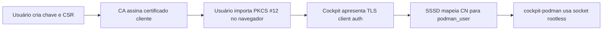

# Instalar o Cockpit no RHEL 9.8 com Podman e autenticação por certificado

<details id="top">
    <summary>Índice</summary>
    <ol>
        <li><a href="#visão-geral">Visão geral</a></li>
        <li><a href="#ambiente-e-versões">Ambiente e versões</a></li>
        <li><a href="#pré-requisitos-e-variáveis">Pré-requisitos e variáveis</a></li>
        <li><a href="#passo-1-instalar-os-pacotes">Passo 1: Instalar os pacotes</a></li>
        <li><a href="#passo-2-ativar-o-cockpit-e-o-socket-podman">Passo 2: Ativar o Cockpit e o socket Podman</a></li>
        <li><a href="#passo-3-criar-a-ca-de-clientes">Passo 3: Criar a CA de clientes</a></li>
        <li><a href="#passo-4-assinar-o-certificado-do-usuário">Passo 4: Assinar o certificado do usuário</a></li>
        <li><a href="#passo-5-mapear-o-certificado-para-podman_user">Passo 5: Mapear o certificado para podman_user</a></li>
        <li><a href="#passo-6-exigir-certificado-no-cockpit">Passo 6: Exigir certificado no Cockpit</a></li>
        <li><a href="#passo-7-ocultar-logs-e-terminal">Passo 7: Ocultar logs e terminal</a></li>
        <li><a href="#passo-8-ocultar-aplicações-e-atualizações">Passo 8: Ocultar aplicações e atualizações</a></li>
        <li><a href="#passo-9-ocultar-ferramentas-de-diagnóstico">Passo 9: Ocultar ferramentas de diagnóstico</a></li>
        <li><a href="#passo-10-testar-o-acesso-com-o-certificado">Passo 10: Testar o acesso com o certificado</a></li>
        <li><a href="#passo-11-aplicar-a-personalização-da-tela-de-entrada">Passo 11: Aplicar a personalização da tela de entrada</a></li>
        <li><a href="#verificação-final">Verificação final</a></li>
        <li><a href="#operação-e-referência-rápida">Operação e referência rápida</a></li>
        <li><a href="#revogar-uma-credencial-específica">Revogar uma credencial específica</a></li>
        <li><a href="#solução-de-problemas">Solução de problemas</a></li>
        <li><a href="#reversão-e-desinstalação">Reversão e desinstalação</a></li>
        <li><a href="#referências">Referências</a></li>
        <li><a href="#pendências">Pendências</a></li>
    </ol>
</details>

## Visão geral

Esta receita orienta administradores do host RHEL 9.8 a instalar o Cockpit, adicionar
`cockpit-podman` e exigir certificado TLS de cliente no navegador. A configuração aceita somente a
conta local `podman_user`, desativa usuário e senha, GSSAPI e oculta os itens laterais indicados.

O Cockpit funciona diretamente no host. `cockpit-podman` consulta o socket rootless de
`podman_user`; ele não lê containers de outra conta. Portainer continua sendo a interface
principal. Quadlet permanece a autoridade do deployment.

A geração da chave do usuário e a importação do certificado no navegador estão na
[receita de credencial de cliente](cockpit-client-certificate.md).

| Item | Descrição |
| --- | --- |
| Público | Administradores do host RHEL |
| Tempo estimado | 60 a 90 minutos |
| Escopo | Instalação, Podman rootless, extensão Files, certificado de cliente, acesso exclusivo e ocultação do menu |
| Fora do escopo | CA corporativa, identidade federada, emissão de certificado do servidor Cockpit, geração da chave do usuário e importação no navegador ([receita de credencial de cliente](cockpit-client-certificate.md)) |
| Verificação | Comandos confirmados em fontes oficiais; não executados neste host em 2026-11-25 |



### Fontes e adaptações

Esta receita combina a instalação oficial do Cockpit no RHEL 9, autenticação por certificado,
mapeamento local do SSSD, extensões `cockpit-podman` e `cockpit-files` e manifest overrides. Adaptações do
repositório:

- o usuário local permitido é `podman_user`;
- o socket Podman é rootless e pertence a `podman_user`;
- os itens solicitados são ocultados por arquivos `*.override.json`;
- Portainer continua sendo a interface principal de containers.

### Decisões de segurança e riscos aceitos

| Decisão | Risco | Justificativa | Mitigação |
| --- | --- | --- | --- |
| Certificados com `CN=podman_user-<DEVICE_ID>` mapeiam para a conta `podman_user` | Perda de autoria individual no host | Os containers pertencem a uma conta operacional dedicada | Um identificador por máquina, registro em `issued-certificates.csv`, lista `ALLOWED_DEVICES` e revogação por identificador |
| Cockpit aceita somente certificado de cliente | Bloqueio administrativo se o arquivo PKCS #12 ou a CA forem perdidos | Atende à exigência de remover login por senha | Mantenha console local e cópia recuperável da CA em cofre aprovado |
| `firewalld` permanece desativado | A porta `9090/TCP` depende da proteção externa | O contrato não usa firewall local no host | Restrinja o ingresso por ACL, firewall ou proxy corporativo fora do host |
| `authselect` habilita suporte a smart card | Altera a pilha PAM do sistema | Necessário ao provedor proxy do SSSD | Execute backup, confirme o perfil atual e mantenha senha para serviços externos ao Cockpit |
| `cockpit-podman` oferece uma segunda interface | Alterações manuais podem divergir do Quadlet | Facilita inspeção e operação excepcional | Restrinja a `podman_user` e trate Quadlet como fonte de verdade |
| `cockpit-files` acessa arquivos com as permissões da conta autenticada | Usuário com certificado navega e altera os arquivos que `podman_user` pode acessar | Extensão solicitada para gestão de arquivos pelo Cockpit | Não conceda `sudo` a `podman_user` e mantenha o home restrito às necessidades da conta |

<div>
  <a href="#top" title="De volta ao topo da página">
    <picture>
      <source media="(prefers-color-scheme: dark)" srcset="../images/up-arrow_white.svg">
      
    </picture>
  </a>
  <br><br>
</div>

## Ambiente e versões

| Componente | Versão alvo | Estado |
| --- | --- | --- |
| Red Hat Enterprise Linux | 9.8 | Alvo do contrato |
| Podman | 5.8.2 rootless | Alvo do contrato |
| Cockpit | Versão suportada nos repositórios do RHEL 9.8 | Resolvida pelo `dnf` |
| `cockpit-podman` | Versão compatível nos repositórios do RHEL 9.8 | Resolvida pelo `dnf` |
| `cockpit-files` | Versão compatível nos repositórios do RHEL 9.8 | Resolvida pelo `dnf`; confirme com `dnf info cockpit-files` antes da instalação. Não verificado no RHEL 9.8 |
| SSSD | 2.x do RHEL 9.8 | Deve suportar `proxy_lib_name = files` |
| OpenSSL | 3.x do RHEL 9.8 | Usado na assinatura e empacotamento |

Execute `dnf` em vez de fixar um NEVRA. O Cockpit deve permanecer na versão compatível com os
demais pacotes suportados pelo canal do RHEL 9.8.

<div>
  <a href="#top" title="De volta ao topo da página">
    <picture>
      <source media="(prefers-color-scheme: dark)" srcset="../images/up-arrow_white.svg">
      
    </picture>
  </a>
  <br><br>
</div>

## Pré-requisitos e variáveis

- Execute os passos do host como `root`, a partir de `/root`.
- A conta local `podman_user` deve existir e possuir home local.
- Confirme que a ACL ou o firewall externo permite `9090/TCP` somente pela rede administrativa.
- Confirme que `firewalld` permanece desativado conforme o contrato do host.
- O certificado de servidor do Cockpit deve ser confiável pelos navegadores.
- Se necessário, use a [receita de TLS](gateway-tls.md) para instalar o certificado de servidor.
- A CA privada de clientes deve permanecer em estação de assinatura controlada, fora do host RHEL.
- Solicite ao usuário o arquivo `${CERT_NAME}.csr`, gerado conforme o
  [Passo 1 da receita de credencial de cliente](cockpit-client-certificate.md#passo-1-gerar-a-chave-e-o-csr).
- Informe ao usuário o `DEVICE_ID` desta máquina. Entregue `${CERT_NAME}.crt` e
  `cockpit-client-ca.crt`. Ele confere e importa a credencial conforme o
  [Passo 4 da receita de credencial de cliente](cockpit-client-certificate.md#passo-4-importar-no-navegador).
- Confirme que o host está inscrito no Satellite, CDN ou outro repositório RHEL aprovado.
- Faça backup de `/etc/cockpit`, `/etc/sssd`, `/etc/pam.d/cockpit` e do perfil `authselect`.

> **Atenção:** Esta receita pressupõe um host RHEL autônomo, com usuário local.
> Não substitua a configuração SSSD de um host integrado a IdM, AD ou LDAP sem adaptar as
> seções `domains` e `certmap` com a equipe de identidade.

| Porta | Protocolo | Direção | Finalidade |
| --- | --- | --- | --- |
| `9090` | TCP | Entrada pela rede de administração, controlada fora do host | HTTPS do Cockpit |

Defina as variáveis na sessão atual. Repita este bloco ao abrir outro shell:

```bash
COCKPIT_FQDN=rhfisnsdsin01.anatel.gov.br
COCKPIT_USER=podman_user
CLIENT_CA_DIR="/home/${COCKPIT_USER}/cockpit-client-ca"
CLIENT_CA_STAGE=/root/cockpit-client-stage
CERT_VALIDITY_DAYS=1095
DEVICE_ID=notebook-joao
CERT_NAME="${COCKPIT_USER}-${DEVICE_ID}"
ALLOWED_DEVICES="notebook-joao"
BRANDING_REPO="/home/${COCKPIT_USER}/webAppBoilerPlate"
BRANDING_STAGE="/home/${COCKPIT_USER}/cockpit-branding"
```

| Variável | Descrição | Exemplo | Usada em |
| --- | --- | --- | --- |
| `COCKPIT_FQDN` | DNS administrativo do host, presente no certificado do servidor | `cockpit.example.com` | Passo 10 |
| `COCKPIT_USER` | Conta local que possui os containers rootless | `podman_user` | Passos 2, 5 e 10 |
| `CLIENT_CA_DIR` | Diretório privado da CA na estação de assinatura | `/home/podman_user/cockpit-client-ca` | Passos 3 e 4 |
| `CLIENT_CA_STAGE` | Diretório de transporte da CA pública no host | `/root/cockpit-client-stage` | Passo 5 |
| `CERT_VALIDITY_DAYS` | Validade do certificado de cliente | `1095` | Passo 4 |
| `DEVICE_ID` | Identificador da máquina autorizada; compõe o `CN` e o nome do arquivo. Use apenas letras minúsculas, dígitos e `-` | `notebook-joao` | Passos 4 e revogação |
| `CERT_NAME` | Nome do certificado: `${COCKPIT_USER}-${DEVICE_ID}` | `podman_user-notebook-joao` | Passos 4 e revogação |
| `ALLOWED_DEVICES` | Identificadores ativos separados por `\|`; a regra SSSD aceita somente estes | `notebook-joao\|desktop-maria` | Passos 5 e revogação |
| `BRANDING_REPO` | Clone do repositório na conta `podman_user` | `/home/podman_user/webAppBoilerPlate` | Passo 11 |
| `BRANDING_STAGE` | Cópia dos artefatos de personalização na home de `podman_user` | `/home/podman_user/cockpit-branding` | Passo 11 |

<div>
  <a href="#top" title="De volta ao topo da página">
    <picture>
      <source media="(prefers-color-scheme: dark)" srcset="../images/up-arrow_white.svg">
      
    </picture>
  </a>
  <br><br>
</div>

## Passo 1: Instalar os pacotes

Instale a base do Cockpit, as extensões Podman e Files e o suporte necessário ao mapeamento de certificados.

**Contexto:** host RHEL 9.8, usuário `root`, diretório `/root`.

```bash
dnf install --assumeyes cockpit cockpit-podman cockpit-files podman openssl sssd sssd-proxy sssd-tools
```

**Resultado esperado:** o `dnf` conclui sem mensagens de erro e instala as dependências.

**Verificação:**

```bash
rpm --query cockpit cockpit-podman cockpit-files podman sssd sssd-proxy
```

Critério: cada consulta mostra o nome e a versão instalada. `package ... is not installed`
indica falha.

<div>
  <a href="#top" title="De volta ao topo da página">
    <picture>
      <source media="(prefers-color-scheme: dark)" srcset="../images/up-arrow_white.svg">
      
    </picture>
  </a>
  <br><br>
</div>

## Passo 2: Ativar o Cockpit e o socket Podman

Ative o socket do Cockpit no boot e o socket API rootless pertencente a `podman_user`.

```bash
systemctl enable --now cockpit.socket
loginctl enable-linger "${COCKPIT_USER}"
runuser -u "${COCKPIT_USER}" -- env XDG_RUNTIME_DIR="/run/user/$(id -u "${COCKPIT_USER}")" systemctl --user enable --now podman.socket
```

**Resultado esperado:** ambos os sockets ficam ativos. `linger` mantém o user manager de
`podman_user` ativo após logout.

**Verificação:**

```bash
systemctl is-active cockpit.socket
runuser -u "${COCKPIT_USER}" -- env XDG_RUNTIME_DIR="/run/user/$(id -u "${COCKPIT_USER}")" systemctl --user is-active podman.socket
```

Critério: ambos os comandos retornam `active`.

<div>
  <a href="#top" title="De volta ao topo da página">
    <picture>
      <source media="(prefers-color-scheme: dark)" srcset="../images/up-arrow_white.svg">
      
    </picture>
  </a>
  <br><br>
</div>

## Passo 3: Criar a CA de clientes

Crie uma CA dedicada aos certificados de clientes. Em produção, substitua esta CA local pela CA
corporativa aprovada.

**Contexto:** estação de assinatura controlada, usuário administrador, diretório definido por
`CLIENT_CA_DIR`. Não execute na conta do usuário final.

> **Atenção:** a chave privada da CA concede emissão de credenciais. Nunca a copie para o host
> Cockpit, navegador, backup compartilhado ou repositório Git.

> [!WARNING]
> Não reutilize a CA que assina o certificado TLS do Cockpit. Os computadores dos
> desenvolvedores confiam nessa CA para validar o servidor. Se ela também assinar certificados
> de cliente, quem possuir sua chave poderá emitir certificados TLS aceitos por esses
> computadores e credenciais de login para `podman_user`. Use esta CA somente para
> `clientAuth` e inclua apenas ela em `/etc/sssd/pki/sssd_auth_ca_db.pem`. A CA de TLS não
> deve estar nesse arquivo.

> [!WARNING]
> Os comandos abaixo sobrescrevem arquivos existentes no diretório da CA de clientes (${CLIENT_CA_DIR}"). Certifique-se de que não há arquivos importantes antes de executá-los.

```bash
install -d -m 0700 "${CLIENT_CA_DIR}"
openssl genpkey -algorithm RSA -pkeyopt rsa_keygen_bits:3072 -aes-256-cbc -out "${CLIENT_CA_DIR}/cockpit-client-ca.key"
openssl req -new -x509 -sha256 -days 1825 -key "${CLIENT_CA_DIR}/cockpit-client-ca.key" -out "${CLIENT_CA_DIR}/cockpit-client-ca.crt" -subj "/CN=RHEL 9 Cockpit Client CA" -addext "basicConstraints=critical,CA:TRUE,pathlen:0" -addext "keyUsage=critical,keyCertSign,cRLSign" -addext "subjectKeyIdentifier=hash"
```

O OpenSSL solicita a frase secreta da chave da CA. Informe-a somente no terminal local da
estação de assinatura.

**Resultado esperado:** a estação contém a chave privada `cockpit-client-ca.key` e o certificado
público `cockpit-client-ca.crt`.

**Verificação:**

```bash
openssl x509 -in "${CLIENT_CA_DIR}/cockpit-client-ca.crt" -noout -subject -issuer -dates -sha256 -fingerprint
```

Critério: `subject` e `issuer` mostram `CN=RHEL 9 Cockpit Client CA`. Registre a impressão
digital por canal administrativo independente.

<div>
  <a href="#top" title="De volta ao topo da página">
    <picture>
      <source media="(prefers-color-scheme: dark)" srcset="../images/up-arrow_white.svg">
      
    </picture>
  </a>
  <br><br>
</div>

## Passo 4: Assinar o certificado do usuário

Assine o CSR recebido. A assinatura gera um certificado de cliente; a chave privada nunca é
assinada nem transferida.

**Contexto:** estação de assinatura, usuário administrador, diretório da CA.

Crie `client-auth.ext` dentro de `CLIENT_CA_DIR`. A saída terá modo `0600` por `umask`:

```bash
umask 077
cat > "${CLIENT_CA_DIR}/client-auth.ext" <<'EOF'
basicConstraints=critical,CA:FALSE
keyUsage=critical,digitalSignature,keyEncipherment
extendedKeyUsage=clientAuth
subjectKeyIdentifier=hash
authorityKeyIdentifier=keyid,issuer
EOF
```

Copie `${CERT_NAME}.csr` para `CLIENT_CA_DIR`. Assine somente após conferir `subject=CN=${CERT_NAME}`
e se `DEVICE_ID` corresponde à máquina que solicitou o certificado:

```bash
test ! -e "${CLIENT_CA_DIR}/${CERT_NAME}.crt" && \
openssl x509 -req -in "${CLIENT_CA_DIR}/${CERT_NAME}.csr" -CA "${CLIENT_CA_DIR}/cockpit-client-ca.crt" -CAkey "${CLIENT_CA_DIR}/cockpit-client-ca.key" -set_serial "0x$(openssl rand -hex 16)" -days "${CERT_VALIDITY_DAYS}" -sha256 -extfile "${CLIENT_CA_DIR}/client-auth.ext" -out "${CLIENT_CA_DIR}/${CERT_NAME}.crt" && \
printf '%s,%s,%s\n' "$(date --iso-8601=seconds)" "${DEVICE_ID}" "$(openssl x509 -in "${CLIENT_CA_DIR}/${CERT_NAME}.crt" -noout -serial)" >> "${CLIENT_CA_DIR}/issued-certificates.csv"
```

**Resultado esperado:** `Signature ok` aparece durante a emissão e o certificado termina com
`.crt`.

**Verificação:**

```bash
openssl verify -CAfile "${CLIENT_CA_DIR}/cockpit-client-ca.crt" -purpose sslclient "${CLIENT_CA_DIR}/${CERT_NAME}.crt"
openssl x509 -in "${CLIENT_CA_DIR}/${CERT_NAME}.crt" -noout -subject -issuer -dates -ext extendedKeyUsage
```

Critério: a verificação retorna `${CERT_NAME}.crt: OK`, o assunto é `CN = ${CERT_NAME}` e
`extendedKeyUsage` contém `TLS Web Client Authentication`. O arquivo `issued-certificates.csv` registra
data, `DEVICE_ID` e número de série.

Entregue ao usuário `${CERT_NAME}.crt` e `cockpit-client-ca.crt` pelo canal administrativo. O usuário confere e
importa a credencial conforme a [receita de credencial de cliente](cockpit-client-certificate.md).

Copie para o diretório de staging do host em `CLIENT_CA_STAGE` apenas a CA pública:

```bash
install -d -m 0700 "${CLIENT_CA_STAGE}"
cp --archive "${CLIENT_CA_DIR}/cockpit-client-ca.crt" "${CLIENT_CA_STAGE}/"
```

<div>
  <a href="#top" title="De volta ao topo da página">
    <picture>
      <source media="(prefers-color-scheme: dark)" srcset="../images/up-arrow_white.svg">
      
    </picture>
  </a>
  <br><br>
</div>

## Passo 5: Mapear o certificado para `podman_user`

Instale a CA pública no SSSD, crie um único mapeamento local e aplique uma lista de usuários
permitidos ao PAM do Cockpit.

> **Atenção:** esta etapa substitui a configuração SSSD do host autônomo. Se `sssd.conf` já
> contém domínios corporativos, interrompa e adapte a configuração antes de continuar.

Faça os backups de nome fixo uma vez. Os backups não são sobrescritos se o passo for repetido:

```bash
test -e /etc/sssd/sssd.conf.pre-cockpit-cert || [[ ! -e /etc/sssd/sssd.conf ]] || cp --archive /etc/sssd/sssd.conf /etc/sssd/sssd.conf.pre-cockpit-cert
test ! -e /etc/pam.d/cockpit.pre-cockpit-cert && cp --archive /etc/pam.d/cockpit /etc/pam.d/cockpit.pre-cockpit-cert
test -e /etc/sssd/pki/sssd_auth_ca_db.pem.pre-cockpit-cert || [[ ! -e /etc/sssd/pki/sssd_auth_ca_db.pem ]] || cp --archive /etc/sssd/pki/sssd_auth_ca_db.pem /etc/sssd/pki/sssd_auth_ca_db.pem.pre-cockpit-cert
test -e /root/authselect-profile.pre-cockpit-cert.txt || authselect current > /root/authselect-profile.pre-cockpit-cert.txt
```

Instale a CA pública, com dono `root:root` e modo `0644`:

```bash
install -d -o root -g root -m 0700 /etc/sssd/pki
install -o root -g root -m 0644 "${CLIENT_CA_STAGE}/cockpit-client-ca.crt" /etc/sssd/pki/sssd_auth_ca_db.pem
```

Crie `/etc/sssd/sssd.conf` com `root:root`, modo `0600`:

```bash
cat > /etc/sssd/sssd.conf <<EOF
[sssd]
domains = local

[pam]
pam_cert_auth = True

[domain/local]
id_provider = proxy
proxy_lib_name = files
local_auth_policy = only

[certmap/local/podman_user]
matchrule = <SUBJECT>^CN=${COCKPIT_USER}-(${ALLOWED_DEVICES})\$
EOF
chown root:root /etc/sssd/sssd.conf
chmod 0600 /etc/sssd/sssd.conf
```

A regra aceita somente o `CN=podman_user-<DEVICE_ID>` dos identificadores listados em
`ALLOWED_DEVICES`. Um certificado de identificador desconhecido ou removido da lista não é
mapeado. Ao adicionar ou remover uma máquina, altere `ALLOWED_DEVICES` e repita este passo.

Crie `/etc/cockpit/allowed-users`, com `root:root`, modo `0640`:

```bash
printf '%s\n' "${COCKPIT_USER}" > /etc/cockpit/allowed-users
chown root:root /etc/cockpit/allowed-users
chmod 0640 /etc/cockpit/allowed-users
```

Habilite o suporte PAM e adicione o allowlist ao arquivo Cockpit:

```bash
authselect select sssd with-smartcard --force
grep --quiet --fixed-strings 'file=/etc/cockpit/allowed-users' /etc/pam.d/cockpit || sed -i '/^account[[:space:]].*pam_nologin\.so/a account    required     pam_listfile.so item=user sense=allow file=/etc/cockpit/allowed-users onerr=fail' /etc/pam.d/cockpit
```

**Resultado esperado:** o perfil SSSD suporta certificados e o PAM do Cockpit permite somente a
conta listada.

**Verificação:**

```bash
chmod 0600 /etc/sssd/sssd.conf
sssctl config-check
systemctl restart sssd
systemctl is-active sssd
```

Critério: `sssctl config-check` não informa erro e `sssd` retorna `active`.

<div>
  <a href="#top" title="De volta ao topo da página">
    <picture>
      <source media="(prefers-color-scheme: dark)" srcset="../images/up-arrow_white.svg">
      
    </picture>
  </a>
  <br><br>
</div>

## Passo 6: Exigir certificado no Cockpit

Ative TLS client authentication e desative senha e GSSAPI no Cockpit.

Faça backup do arquivo existente:

```bash
[[ ! -e /etc/cockpit/cockpit.conf ]] || test ! -e /etc/cockpit/cockpit.conf.pre-cockpit-cert
[[ ! -e /etc/cockpit/cockpit.conf ]] || cp --archive /etc/cockpit/cockpit.conf /etc/cockpit/cockpit.conf.pre-cockpit-cert
```

Crie `/etc/cockpit/cockpit.conf`, com `root:root`, modo `0644`:

```bash
cat > /etc/cockpit/cockpit.conf <<'EOF'
[WebService]
ClientCertAuthentication = yes

[basic]
action = none

[negotiate]
action = none
EOF
chown root:root /etc/cockpit/cockpit.conf
chmod 0644 /etc/cockpit/cockpit.conf
```

Para uma instalação anterior, restaure do backup as seções não relacionadas, como `Origins`,
`UrlRoot` ou configurações de sessão.

Reinicie o endpoint e confirme a configuração:

```bash
systemctl restart cockpit.socket
systemctl try-restart cockpit.service
```

**Resultado esperado:** o Cockpit inicia e aceita somente o esquema TLS client certificate.

**Verificação:**

```bash
systemctl is-active cockpit.socket
grep --extended-regexp 'ClientCertAuthentication|action = none' /etc/cockpit/cockpit.conf
```

Critério: o socket está `active` e as três opções aparecem no arquivo.

<div>
  <a href="#top" title="De volta ao topo da página">
    <picture>
      <source media="(prefers-color-scheme: dark)" srcset="../images/up-arrow_white.svg">
      
    </picture>
  </a>
  <br><br>
</div>

## Passo 7: Ocultar logs e terminal

Oculte `Logs` e `Terminal` pelo override do pacote `systemd`. Ocultar `Terminal` remove a entrada
que manteria a seção `Tools` visível.

Crie `/etc/cockpit/systemd.override.json`, com `root:root`, modo `0644`:

```bash
cat > /etc/cockpit/systemd.override.json <<'EOF'
{
  "menu": {
    "logs": null
  },
  "tools": {
  }
}
EOF
chown root:root /etc/cockpit/systemd.override.json
chmod 0644 /etc/cockpit/systemd.override.json
```

**Resultado esperado:** `Logs` e `Terminal` deixam de compor o menu.

**Verificação:**

```bash
python3 -m json.tool /etc/cockpit/systemd.override.json >/dev/null
```

Critério: o comando termina com código `0`.

<div>
  <a href="#top" title="De volta ao topo da página">
    <picture>
      <source media="(prefers-color-scheme: dark)" srcset="../images/up-arrow_white.svg">
      
    </picture>
  </a>
  <br><br>
</div>

## Passo 8: Ocultar aplicações e atualizações

Oculte `Subscriptions`, `Software updates` e `Applications` pelos overrides dos pacotes que
fornecem esses itens.

Crie `/etc/cockpit/subscription-manager.override.json`, `/etc/cockpit/packagekit.override.json` e
`/etc/cockpit/apps.override.json`. Use `root:root`, modo `0644` em cada arquivo:

```bash
printf '%s\n' '{"tools":{"index":null}}' > /etc/cockpit/subscription-manager.override.json
printf '%s\n' '{"tools":{"index":null}}' > /etc/cockpit/packagekit.override.json
printf '%s\n' '{"tools":{"index":null}}' > /etc/cockpit/apps.override.json
chmod 0644 /etc/cockpit/subscription-manager.override.json /etc/cockpit/packagekit.override.json /etc/cockpit/apps.override.json
```

**Resultado esperado:** as três entradas deixam de ser oferecidas na seção `Tools`.

**Verificação:**

```bash
python3 -c 'import json; [json.load(open(path)) for path in ("/etc/cockpit/subscription-manager.override.json", "/etc/cockpit/packagekit.override.json", "/etc/cockpit/apps.override.json")]'
```

Critério: o comando termina com código `0`.

<div>
  <a href="#top" title="De volta ao topo da página">
    <picture>
      <source media="(prefers-color-scheme: dark)" srcset="../images/up-arrow_white.svg">
      
    </picture>
  </a>
  <br><br>
</div>

## Passo 9: Ocultar ferramentas de diagnóstico

Oculte `SELinux`, `Kernel dump` e `System diagnostics`. Em versões mais recentes do Cockpit, o
último item usa o rótulo `Diagnostic reports`.

Crie `/etc/cockpit/selinux.override.json`, `/etc/cockpit/kdump.override.json` e
`/etc/cockpit/sosreport.override.json`. Use `root:root`, modo `0644` em cada arquivo:

```bash
printf '%s\n' '{"tools":{"index":null}}' > /etc/cockpit/selinux.override.json
printf '%s\n' '{"tools":{"index":null}}' > /etc/cockpit/kdump.override.json
printf '%s\n' '{"tools":{"index":null}}' > /etc/cockpit/sosreport.override.json
chmod 0644 /etc/cockpit/selinux.override.json /etc/cockpit/kdump.override.json /etc/cockpit/sosreport.override.json
```

**Resultado esperado:** os três itens deixam de aparecer na seção `Tools`.

**Verificação:**

```bash
python3 -c 'import json; [json.load(open(path)) for path in ("/etc/cockpit/selinux.override.json", "/etc/cockpit/kdump.override.json", "/etc/cockpit/sosreport.override.json")]'
cockpit-bridge --packages | grep --extended-regexp 'system|updates|apps|selinux|kdump|sosreport|subscriptions'
```

Critério: todos os JSONs são válidos e os pacotes relevantes aparecem no inventário do bridge.

Reinicie o socket para invalidar a lista de pacotes do Cockpit:

```bash
systemctl restart cockpit.socket
```

<div>
  <a href="#top" title="De volta ao topo da página">
    <picture>
      <source media="(prefers-color-scheme: dark)" srcset="../images/up-arrow_white.svg">
      
    </picture>
  </a>
  <br><br>
</div>

## Passo 10: Testar o acesso com o certificado

Confirme o caminho completo antes de encerrar o acesso administrativo alternativo.

No computador com o certificado importado, abra `https://<COCKPIT_FQDN>:9090`. Selecione o
certificado quando solicitado. O login deve abrir diretamente a interface de `podman_user`, sem
campos de usuário e senha.

Abra **Podman containers**. Confirme que os containers de `podman_user` aparecem e que o plugin
não solicita senha para operar o socket rootless.

Abra **Files** e confirme que a listagem mostra o diretório pessoal de `podman_user`.

No host, teste a rejeição do esquema de senha:

```bash
curl --silent --show-error --output /dev/null --write-out '%{http_code}\n' --user 'podman_user:senha-invalida' "https://${COCKPIT_FQDN}:9090/login"
```

**Resultado esperado:** o retorno HTTP é `401`. O navegador autenticado por certificado entra sem
formulário e o menu ocultado não mostra `Subscriptions`, `Software updates`, `SELinux`,
`Kernel dump`, `System diagnostics`/`Diagnostic reports`, `Applications`, `Terminal` nem `Logs`.

**Verificação:**

```bash
journalctl --since '-10 min' --unit cockpit.service --unit cockpit.socket --unit sssd
```

Critério: não há erro de certificado, mapeamento SSSD ou inicialização do Cockpit.

<div>
  <a href="#top" title="De volta ao topo da página">
    <picture>
      <source media="(prefers-color-scheme: dark)" srcset="../images/up-arrow_white.svg">
      
    </picture>
  </a>
  <br><br>
</div>

## Passo 11: Aplicar a personalização da tela de entrada

Aplique o tema da tela de entrada do Cockpit: logo ANATEL branco isolado no canto superior
esquerdo, título `Servidor WebApp Dev` e fundo `#295ca7`.

**Contexto:** host RHEL 9.8, usuário `root`, diretório `/root`. O clone do repositório deve existir
em `${BRANDING_REPO}`, na conta `podman_user`, conforme o
[Implantar da receita da webapp](webapp-crud.md#implantar). Os artefatos são:
`deploy/cockpit/branding/branding.css`, `deploy/cockpit/branding/favicon.ico`,
`deploy/cockpit/branding/apple-touch-icon.png` e `docs/images/Logo Anatel White.svg`.

Copie os artefatos do clone para a home de `podman_user` e, em seguida, instale-os no diretório
local de branding do Cockpit. O Cockpit consulta `/etc/cockpit/branding` antes dos diretórios do
sistema.

```bash
install --directory --owner "${COCKPIT_USER}" --group "${COCKPIT_USER}" --mode 0755 "${BRANDING_STAGE}"
install --owner "${COCKPIT_USER}" --group "${COCKPIT_USER}" --mode 0644 "${BRANDING_REPO}/deploy/cockpit/branding/branding.css" "${BRANDING_STAGE}/branding.css"
install --owner "${COCKPIT_USER}" --group "${COCKPIT_USER}" --mode 0644 "${BRANDING_REPO}/deploy/cockpit/branding/favicon.ico" "${BRANDING_STAGE}/favicon.ico"
install --owner "${COCKPIT_USER}" --group "${COCKPIT_USER}" --mode 0644 "${BRANDING_REPO}/deploy/cockpit/branding/apple-touch-icon.png" "${BRANDING_STAGE}/apple-touch-icon.png"
install --owner "${COCKPIT_USER}" --group "${COCKPIT_USER}" --mode 0644 "${BRANDING_REPO}/docs/images/Logo Anatel White.svg" "${BRANDING_STAGE}/logo.svg"
install --directory --mode 0755 /etc/cockpit/branding
install --mode 0644 "${BRANDING_STAGE}/branding.css" "${BRANDING_STAGE}/logo.svg" "${BRANDING_STAGE}/favicon.ico" "${BRANDING_STAGE}/apple-touch-icon.png" /etc/cockpit/branding/
restorecon -RF /etc/cockpit/branding
systemctl restart cockpit.socket
```

> **Atenção:** o reinício encerra sessões administrativas ativas no Cockpit. Mantenha uma sessão
> de console local aberta.

**Resultado esperado:** `/etc/cockpit/branding/` contém `branding.css`, `logo.svg`, `favicon.ico` e
`apple-touch-icon.png`. O arquivo `logo.svg` é a cópia de `Logo Anatel White.svg`. Não há erro do
`install`, do `restorecon` nem do reinício. O reinício força novos processos do Cockpit a ler o
diretório de branding.

**Verificação:**

```bash
ls -l /etc/cockpit/branding/
for asset in branding.css logo.svg favicon.ico apple-touch-icon.png; do
  curl --silent --show-error --output /dev/null --write-out "${asset} %{http_code}\n" "https://${COCKPIT_FQDN}:9090/cockpit/static/${asset}"
done
```

Critério: a listagem mostra os quatro arquivos e cada `curl` retorna `200`, sem autenticação.
A personalização aparece somente na tela de entrada (`/login`). Com `ClientCertAuthentication = yes`,
o navegador com certificado entra direto e não exibe essa tela. Para conferir o visual, encerre a
sessão pelo menu do usuário do Cockpit e recarregue a página com `Ctrl+F5`.

<div>
  <a href="#top" title="De volta ao topo da página">
    <picture>
      <source media="(prefers-color-scheme: dark)" srcset="../images/up-arrow_white.svg">
      
    </picture>
  </a>
  <br><br>
</div>

## Verificação final

Execute as verificações do ponto de vista do host e do navegador.

| Verificação | Comando ou ação | Critério |
| --- | --- | --- |
| Serviço Cockpit | `systemctl is-active cockpit.socket` | `active` |
| API Podman rootless | `runuser -u podman_user -- env XDG_RUNTIME_DIR=/run/user/$(id -u podman_user) systemctl --user is-active podman.socket` | `active` |
| Configuração SSSD | `sssctl config-check` | Nenhum erro |
| Certificado cliente | Abrir `https://cockpit.example.com:9090` | Navegador entra como `podman_user` sem formulário de senha |
| Senha bloqueada | Executar o `curl` do Passo 10 | HTTP `401` |
| Menu reduzido | Conferir o menu lateral | Nenhum item ocultado aparece |
| Personalização da entrada | `curl` do Passo 11 | HTTP `200` para `branding.css`, `logo.svg`, `favicon.ico` e `apple-touch-icon.png` |
| Containers | Abrir **Podman containers** | Containers rootless de `podman_user` aparecem |
| Extensão Files | `rpm --query cockpit-files` e abrir **Files** | Pacote instalado e diretório pessoal de `podman_user` listado |
| Firewall local | `systemctl is-enabled firewalld` | `disabled` |
| Ingresso | Confirmar na ACL ou no firewall externo | Somente a rede administrativa alcança `9090/TCP` |

<div>
  <a href="#top" title="De volta ao topo da página">
    <picture>
      <source media="(prefers-color-scheme: dark)" srcset="../images/up-arrow_white.svg">
      
    </picture>
  </a>
  <br><br>
</div>

## Operação e referência rápida

### Cockpit

| Ação | Comando |
| --- | --- |
| Verificar socket | `systemctl status cockpit.socket` |
| Reiniciar endpoint | `systemctl restart cockpit.socket` |
| Consultar logs | `journalctl --unit cockpit.service --unit cockpit.socket` |

### Podman de `podman_user`

| Ação | Comando |
| --- | --- |
| Verificar socket | `runuser -u podman_user -- env XDG_RUNTIME_DIR=/run/user/$(id -u podman_user) systemctl --user is-active podman.socket` |
| Listar containers | `runuser -u podman_user -- env XDG_RUNTIME_DIR=/run/user/$(id -u podman_user) podman ps --all` |
| Verificar linger | `loginctl show-user podman_user --property=Linger` |

### Renovação

1. Gere um novo CSR conforme o [Passo 1 da receita de credencial de cliente](cockpit-client-certificate.md#passo-1-gerar-a-chave-e-o-csr).
2. Assine-o antes do vencimento, no [Passo 4](#passo-4-assinar-o-certificado-do-usuário).
3. Crie o novo arquivo p12 conforme o [Passo 3 da receita de credencial de cliente](cockpit-client-certificate.md#passo-3-criar-o-arquivo-p12).
4. Importe o novo certificado conforme o [Passo 4 da receita de credencial de cliente](cockpit-client-certificate.md#passo-4-importar-no-navegador).
5. Remova do navegador o certificado vencido.

Se a CA mudar, instale a nova CA pública no SSSD, reinicie `sssd` e emita todos os certificados
novamente.

<div>
  <a href="#top" title="De volta ao topo da página">
    <picture>
      <source media="(prefers-color-scheme: dark)" srcset="../images/up-arrow_white.svg">
      
    </picture>
  </a>
  <br><br>
</div>

## Revogar uma credencial específica

Revoga o acesso de uma máquina sem afetar as demais. A receita não publica lista de revogação
(CRL) nem usa OCSP, e o SSSD não verifica revogação. O acesso é controlado pela lista
`ALLOWED_DEVICES`: a regra aceita somente os identificadores listados. Revogar é remover o
identificador dessa lista.

**Contexto:** estação de assinatura para a etapa 1; host RHEL para as etapas 2 e 3. Defina
`DEVICE_ID` com o identificador da máquina a revogar.

1. Na estação de assinatura, localize o registro da máquina:

```bash
grep --fixed-strings ",${DEVICE_ID}," "${CLIENT_CA_DIR}/issued-certificates.csv"
```

   **Resultado esperado:** uma linha com a data de emissão, o `DEVICE_ID` e `serial=...`.

2. No host RHEL, defina `ALLOWED_DEVICES` sem o identificador revogado e repita o
   [Passo 5](#passo-5-mapear-o-certificado-para-podman_user). Depois, expire o cache do SSSD e
   reinicie o serviço. Por exemplo, se a lista era `notebook-joao|desktop-maria` e a máquina
   revogada é `desktop-maria`:

```bash
ALLOWED_DEVICES="notebook-joao"
sss_cache -E
systemctl restart sssd
```

   **Verificação:** tente abrir o Cockpit a partir da máquina revogada. O login deve ser
   recusado. Para confirmar pelo log do host:

```bash
journalctl --since '-10 min' | grep --ignore-case 'matching user'
```

   Critério: a saída inclui `No matching user for certificate`. Uma máquina ativa deve continuar
   entrando normalmente.

3. Na estação de assinatura, registre a revogação:

```bash
printf '%s,%s,revoked\n' "$(date --iso-8601=seconds)" "${DEVICE_ID}" >> "${CLIENT_CA_DIR}/issued-certificates.csv"
```

4. Peça ao usuário da máquina revogada que remova o certificado do navegador e os arquivos locais,
   conforme a [receita de credencial de cliente](cockpit-client-certificate.md#reversão-e-desinstalação).

> **Atenção:** a CA não invalida a chave da máquina revogada. Se a chave foi comprometida, não
> reative o identificador. Emita uma nova credencial com outro `DEVICE_ID`, por exemplo
> `notebook-joao-2`, e aplique o Passo 5 com a nova lista.

Para reativar uma máquina, inclua o identificador em `ALLOWED_DEVICES`, repita o
[Passo 5](#passo-5-mapear-o-certificado-para-podman_user) e execute `sss_cache -E` e
`systemctl restart sssd`.

<div>
  <a href="#top" title="De volta ao topo da página">
    <picture>
      <source media="(prefers-color-scheme: dark)" srcset="../images/up-arrow_white.svg">
      
    </picture>
  </a>
  <br><br>
</div>

## Solução de problemas

| Sintoma ou log | Causa provável | Correção |
| --- | --- | --- |
| Navegador não oferece certificado | PKCS #12 não foi importado ou contém cadeia incorreta | Repita a [importação na receita de credencial de cliente](cockpit-client-certificate.md#passo-4-importar-no-navegador) |
| `No matching user for certificate` | `CN` ou regra `certmap` não coincide | Compare `openssl x509 -subject` com `[certmap/local/podman_user]` no [Passo 5](#passo-5-mapear-o-certificado-para-podman_user) |
| Login retorna à página de senha | `[basic]` continua ativo ou Cockpit não reiniciou | Repita o [Passo 6](#passo-6-exigir-certificado-no-cockpit) e reinicie `cockpit.socket` |
| Personalização da entrada sem efeito | Processo do Cockpit em execução usa raízes de branding antigas, ou a sessão entrou direto por certificado | Reinicie `cockpit.socket`, encerre a sessão e recarregue com `Ctrl+F5`. Confirme HTTP `200` no [Passo 11](#passo-11-aplicar-a-personalização-da-tela-de-entrada) |
| HTTP 401 ao apresentar certificado válido | CA do cliente não está em `/etc/sssd/pki/sssd_auth_ca_db.pem` | Confira cadeia e reinicie `sssd` no [Passo 5](#passo-5-mapear-o-certificado-para-podman_user) |
| `sssctl config-check` falha | Sintaxe SSSD ou permissões incorretas | Mantenha `/etc/sssd/sssd.conf` com modo `0600` e valide a cópia do [Passo 5](#passo-5-mapear-o-certificado-para-podman_user) |
| Podman containers não aparece | Pacote ou socket rootless ausente | Repita os [Passos 1](#passo-1-instalar-os-pacotes) e [2](#passo-2-ativar-o-cockpit-e-o-socket-podman) |
| Máquina revogada ainda entra | Cache do SSSD ou `ALLOWED_DEVICES` não atualizada | Confirme a lista, execute `sss_cache -E` e `systemctl restart sssd` na [seção de revogação](#revogar-uma-credencial-específica) |
| Containers vazios | Sessão Cockpit não entrou como `podman_user` | Confirme o assunto do certificado e a conta exibida no Cockpit |
| Item ainda aparece no menu | Override usa pacote ou diretório incorreto | Execute `cockpit-bridge --packages` e compare com os [Passos 7 a 9](#passo-7-ocultar-logs-e-terminal) |
| Item Files ausente | Pacote `cockpit-files` não instalado ou página em cache | Confirme `rpm --query cockpit-files`, reinicie `cockpit.socket` e recarregue a página sem cache |
| Conexão expirada | ACL ou firewall externo está incorreto | Revise o controle externo de ingresso para `9090/TCP` |

<div>
  <a href="#top" title="De volta ao topo da página">
    <picture>
      <source media="(prefers-color-scheme: dark)" srcset="../images/up-arrow_white.svg">
      
    </picture>
  </a>
  <br><br>
</div>

## Reversão e desinstalação

Faça a reversão na ordem abaixo. A remoção dos pacotes não apaga automaticamente os containers
nem configurações externas; a restauração do acesso por senha reduz os controles de autenticação.

> **Atenção:** mantenha uma sessão de console local aberta durante a restauração.
> A interrupção de Cockpit ou SSSD pode encerrar a sessão administrativa remota.

1. Restaure `/etc/cockpit/cockpit.conf.pre-cockpit-cert`. Se não existir backup, remova o
   `cockpit.conf` criado pela receita.
2. Restaure `/etc/pam.d/cockpit.pre-cockpit-cert`.
3. Restaure `/etc/sssd/sssd.conf.pre-cockpit-cert`. Se não existir backup, remova o
   `sssd.conf` criado pela receita.
4. Restaure `/etc/sssd/pki/sssd_auth_ca_db.pem.pre-cockpit-cert`. Se não existir backup, remova
   o `sssd_auth_ca_db.pem` criado pela receita.
5. Selecione novamente o perfil registrado em `/root/authselect-profile.pre-cockpit-cert.txt`.
6. Remova somente os overrides, o allowlist e a personalização de tela criados por esta receita.
7. Reinicie `sssd`, `cockpit.socket` e o socket Podman do usuário.
8. Revogue a credencial removendo a CA cliente de confiança ou substituindo toda a CA. Remova o
   certificado do navegador conforme a [receita de credencial de cliente](cockpit-client-certificate.md#reversão-e-desinstalação).
9. Desinstale `cockpit-podman` e `cockpit-files` somente se as extensões não forem mais necessárias.

```bash
rm --force /etc/cockpit/systemd.override.json /etc/cockpit/subscription-manager.override.json /etc/cockpit/packagekit.override.json /etc/cockpit/apps.override.json /etc/cockpit/selinux.override.json /etc/cockpit/kdump.override.json /etc/cockpit/sosreport.override.json
rm --force /etc/cockpit/allowed-users
rm --force /etc/cockpit/branding/branding.css /etc/cockpit/branding/logo.svg /etc/cockpit/branding/favicon.ico /etc/cockpit/branding/apple-touch-icon.png
systemctl restart sssd cockpit.socket
```

Para remover as extensões sem remover o Cockpit base:

```bash
dnf remove --assumeyes cockpit-podman cockpit-files
```

> **Irreversível:** excluir a única cópia da chave privada da CA impede emitir novos
> certificados. Remover a CA de confiança invalida todos os certificados de clientes emitidos
> por ela. Não há revogação individual nessa configuração.

<div>
  <a href="#top" title="De volta ao topo da página">
    <picture>
      <source media="(prefers-color-scheme: dark)" srcset="../images/up-arrow_white.svg">
      
    </picture>
  </a>
  <br><br>
</div>

## Referências

| Referência | Uso | Versão ou consulta |
| --- | --- | --- |
| [Cockpit: instalação no RHEL](https://cockpit-project.org/running.html#rhel) | Instalação e ativação no RHEL | Consultada em 2026-11-25 |
| [Cockpit: autenticação por certificado](https://docs.cockpit-project.org/cockpit-guide/latest/guide/cert-authentication.html) | Client certificate e desativação de senha | Consultada em 2026-11-25 |
| [Cockpit: mecanismo de autenticação](https://github.com/cockpit-project/cockpit/blob/main/doc/authentication.md) | `action = none` para `basic` e `negotiate` | Consultada em 2026-11-25 |
| [Cockpit: pacotes e manifest overrides](https://docs.cockpit-project.org/cockpit-guide/latest/guide/packages.html) | Estrutura dos overrides e JSON Merge Patch | Consultada em 2026-11-25 |
| [RHEL 9: web console](https://docs.redhat.com/en/documentation/red_hat_enterprise_linux/9/html-single/managing_systems_using_the_rhel_9_web_console/managing_systems_using_the_rhel_9_web_console) | Pacotes e menu no RHEL 9 | Consultada em 2026-11-25 |
| [RHEL 9: certificados locais e smart card](https://docs.redhat.com/en/documentation/red_hat_enterprise_linux/9/html/managing_smart_card_authentication/configuring-and-importing-local-certificates-to-a-smart-card_managing-smart-card-authentication) | CA, SSSD e certificados de clientes locais | Consultada em 2026-11-25 |
| [SSSD: remoção do files provider](https://sssd.io/docs/files-provider-deprecation.html) | Provedor proxy para usuários locais | Consultada em 2026-11-25 |
| [RHEL 9: criação de chaves e certificados TLS](https://docs.redhat.com/en/documentation/red_hat_enterprise_linux/9/html/securing_networks/creating-and-managing-tls-keys-and-certificates_securing-networks) | OpenSSL, CSR e EKU `clientAuth` | Consultada em 2026-11-25 |
| [Receita de TLS do Gateway e Cockpit](gateway-tls.md) | Certificado de servidor do Cockpit | Documento interno |
| [Receita de credencial de cliente](cockpit-client-certificate.md) | Geração da chave, CSR e importação no navegador | Documento interno |
| [Manifesto `systemd`](https://github.com/cockpit-project/cockpit/blob/main/pkg/systemd/manifest.json) | IDs `logs` e `terminal` | Consultado em 2026-11-25 |
| [Manifesto `packagekit`](https://github.com/cockpit-project/cockpit/blob/main/pkg/packagekit/manifest.json) | ID `index` de Software updates | Consultado em 2026-11-25 |
| [Manifesto `apps`](https://github.com/cockpit-project/cockpit/blob/main/pkg/apps/manifest.json) | ID `index` de Applications | Consultado em 2026-11-25 |
| [Manifesto `subscription-manager-cockpit`](https://github.com/cockpit-project/subscription-manager-cockpit/blob/main/src/manifest.json) | ID `index` de Subscriptions | Consultado em 2026-11-25 |
| [Manifesto `cockpit-podman`](https://github.com/cockpit-project/cockpit-podman/blob/main/src/manifest.json) | Página Podman containers e requisito do socket | Consultado em 2026-11-25 |
| [Cockpit Files](https://github.com/cockpit-project/cockpit-files) | Extensão de gestão de arquivos e pacote `cockpit-files` | Consultado em 2026-11-25 |

<div>
  <a href="#top" title="De volta ao topo da página">
    <picture>
      <source media="(prefers-color-scheme: dark)" srcset="../images/up-arrow_white.svg">
      
    </picture>
  </a>
  <br><br>
</div>

## Pendências

> **Não verificado:** a sequência não foi executada em uma instalação descartável do RHEL 9.8.
> Antes de publicar como procedimento de produção, valide os nomes dos diretórios de pacote com
> `cockpit-bridge --packages`, execute login por certificado e confirme que nenhum item ocultado
> aparece.

<div>
  <a href="#top" title="De volta ao topo da página">
    <picture>
      <source media="(prefers-color-scheme: dark)" srcset="../images/up-arrow_white.svg">
      
    </picture>
  </a>
  <br><br>
</div>
