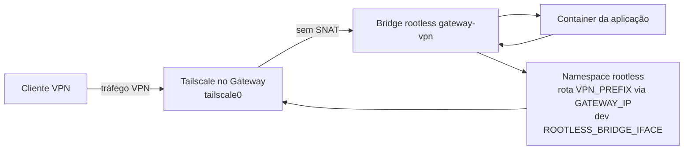

<details id="top">
    <summary>Índice</summary>
    <ol>
        <li><a href="#1-objetivo-status-e-limites">Objetivo, status e limites</a></li>
        <li><a href="#2-inventário">Inventário</a></li>
        <li><a href="#3-pré-requisitos-e-descoberta">Pré-requisitos e descoberta</a></li>
        <li><a href="#4-preparar-o-host">Preparar o host</a></li>
        <li><a href="#5-prova-de-conceito-descartável">Prova de conceito descartável</a></li>
        <li><a href="#6-preparar-configurações">Preparar configurações</a></li>
        <li><a href="#7-rede-rootless-e-rota-de-retorno">Rede rootless e rota de retorno</a></li>
        <li><a href="#8-instalar-unidades-e-iniciar">Instalar unidades e iniciar</a></li>
        <li><a href="#9-inscrever-o-gateway-e-acessar-o-headplane">Inscrever o Gateway e acessar o Headplane</a></li>
        <li><a href="#10-testes-funcionais-e-gates">Testes funcionais e gates</a></li>
        <li><a href="#11-rollback-e-limpeza">Rollback e limpeza</a></li>
        <li><a href="#12-decisões-pendentes">Decisões pendentes</a></li>
        <li><a href="#13-fontes-oficiais">Fontes oficiais</a></li>
    </ol>
</details>

> **Status — variante temporária e experimental.** Não validada no alvo RHEL 9.8 / Podman 5.8.2. Esta receita fica fora do contrato de [ARCHITECTURE.md](../contracts/ARCHITECTURE.md), que continua exigindo Podman rootful e a rede padrão `podman`. A receita rootful continua sendo a referência e o fallback. Adoção definitiva exige revisão separada do contrato. Nenhum comando abaixo foi testado no alvo; trate todos como não verificados.

# Gateway VPN com Headscale, Headplane e Tailscale — variante rootless experimental

## 1. Objetivo, status e limites

Esta receita descreve uma instalação **nova e descartável** do Gateway como usuário local dedicado `<GATEWAY_USER>` com Podman rootless, Quadlet e a bridge exclusiva `gateway-vpn`. Sugestão de conta: `gwvpn`. Use Bash a partir da raiz do repositório, com as ferramentas indicadas em cada etapa.

| Placeholder | Descrição | Como obter | Exemplo |
| --- | --- | --- | --- |
| `<GATEWAY_USER>` | Conta local dedicada ao Podman rootless | Defina a conta aprovada e use o mesmo valor em `GATEWAY_USER` | `gwvpn` |
| `<GATEWAY_HOME>` | Caminho absoluto da home da conta | Leia o sexto campo de `getent passwd "$GATEWAY_USER"` | `/home/gwvpn` |
| `SUBUID_RANGE`, `SUBGID_RANGE` | Faixas exclusivas alocadas à conta | Inspecione `/etc/subuid` e `/etc/subgid`; escolha intervalos sem sobreposição | `200000-265535` |
| `<ROOTLESS_SUBNET>` | Subnet dedicada da bridge rootless | Planeje sem sobreposição com rotas, LAN, VPN e redes corporativas | `10.89.0.0/24` |
| `<ROOTLESS_BRIDGE_IP>` | Gateway da bridge e resolver Aardvark | Escolha dentro de `<ROOTLESS_SUBNET>` e confirme com `podman network inspect` | `10.89.0.1` |
| `<ROOTLESS_BRIDGE_IFACE>` | Interface da bridge dentro da namespace rootless | `podman unshare --rootless-netns /usr/sbin/ip -4 addr` | `podman1` |
| `<GATEWAY_IP>` | IP estático do container Gateway | Escolha livre dentro de `<ROOTLESS_SUBNET>`, diferente do bridge | `10.89.0.2` |
| `<VPN_PREFIX>` | Prefixo VPN anunciado e usado na rota de retorno | Defina dentro do prefixo Headscale e sem sobreposição | `100.96.0.0/24` |
| `<HTTPS_HOST_PORT>` | Porta não privilegiada publicada no host | Escolha porta livre; infraestrutura encaminha TCP externo 443 | `8443` |
| `<HEADSCALE_FQDN>` | FQDN público do endpoint Headscale | Obtenha da infraestrutura e valide DNS/TLS | `headscale.example.com` |
| `<APP_ALIAS>` | Alias DNS do container de aplicação | Leia `NetworkAlias` ou configuração da aplicação | `app-poc.dev.anatel` |
| `<TLS_STAGE>` | Diretório seguro com certificado e chave entregues à conta | Combine com a infraestrutura; use caminho absoluto legível pela conta | `/home/gwvpn/tls-stage` |
| `<ID_DO_USUÁRIO>` | ID do usuário Headscale | Consulte a saída de `podman exec gateway headscale users list` | ID retornado pela listagem |
| `<ID_DO_NÓ>` | ID do nó Tailscale registrado | Execute `podman exec gateway headscale nodes list` | ID retornado pela listagem |

A variante mantém Headscale, Headplane, `tailscaled` e NGINX no container Debian `gateway`. O anúncio usa `--snat-subnet-routes=false` e deve preservar o IP VPN original visto pela aplicação. O Gateway anuncia somente `<ROOTLESS_SUBNET>`; não anuncie rota default nem use o Gateway como exit node.

| Tema | Receita rootful de referência | Variante temporária rootless |
| --- | --- | --- |
| Conta de execução | Serviço do sistema e Podman rootful | Conta local dedicada `<GATEWAY_USER>` e Podman rootless |
| Quadlet | `/etc/containers/systemd/`, `systemctl` do sistema | `~/.config/containers/systemd/`, `systemctl --user` |
| Rede anunciada | Rede padrão rootful `podman` | Bridge rootless dedicada `gateway-vpn` |
| Rota de retorno | Serviço de host na namespace de rede do host | Rota dentro de `podman unshare --rootless-netns` |
| HTTPS | TCP 443 publicado diretamente pelo container | TCP `<HTTPS_HOST_PORT>` no host; infraestrutura encaminha TCP externo 443 para ele |
| Armazenamento | Store rootful e volumes do rootful | Store e volumes independentes do usuário rootless |
| Referência e suporte | Receita rootful e contrato | Experimental; sem suporte Portainer rootless e sem migração de dados |



A bridge existe na namespace de rede rootless e não é diretamente alcançável pela namespace de rede do host. Não publique DNS TCP/UDP 53 no host; os clientes VPN consultam o Aardvark pelo split DNS e pela rota anunciada. O tráfego de retorno ao cliente depende da rota instalada nessa namespace. Todos os containers de aplicação que precisem ser anunciados devem entrar na mesma bridge e usar aliases DNS nela.

Não altere a [receita rootful](gateway-headscale-podman-rootfull%20copy.md), o contrato, arquivos em `deploy/` ou o Gateway rootful ativo. O Gateway rootful não pode anunciar ao mesmo tempo rotas iguais ou sobrepostas às desta variante. Não migre volumes rootful: o store rootless é separado. Portainer está fora do escopo e não é oficialmente suportado nesta topologia rootless.

<div>
  <a href="#top" title="De volta ao topo da página">
    <picture>
      <source media="(prefers-color-scheme: dark)" srcset="../images/up-arrow_white.svg">
      
    </picture>
  </a>
  <br><br>
</div>

## 2. Inventário

| Arquivo | Uso nesta variante | Adaptação ou limite |
| --- | --- | --- |
| [Containerfile](../../deploy/gateway/v1/Containerfile), [entrypoint.sh](../../deploy/gateway/v1/entrypoint.sh), [healthcheck.sh](../../deploy/gateway/v1/healthcheck.sh) | Reutilizados | A imagem mantém processos e healthcheck existentes; build e execução usam Podman do usuário. |
| [headscale.yaml](../../deploy/gateway/v1/config/headscale.yaml) | Copiado e adaptado | Trocar `192.0.2.53` pelo `<ROOTLESS_BRIDGE_IP>` do Aardvark e ajustar endpoint/prefixo. |
| [headplane.yaml](../../deploy/gateway/v1/config/headplane.yaml) | Candidato, validado e instalado | `prepare-headplane-candidate.sh` cria segredo inicial em modo `0444`; ajuste permissões depois da validação. |
| [nginx.conf](../../deploy/gateway/v1/config/nginx.conf) | Copiado e adaptado | Ajustar FQDN e prefixo permitido; validar o endereço de origem que NGINX realmente recebe. |
| [gateway.container](../../deploy/gateway/v1/quadlet/gateway.container) | Copiado para o diretório Quadlet do usuário | Trocar dependências rootful, rede, publicação de porta e caminhos bind. Manter TUN, `NET_ADMIN` e `ip_forward`. |
| [gateway-vpn-return-route.service](../../deploy/gateway/v1/host/gateway-vpn-return-route.service) e [env.example](../../deploy/gateway/v1/host/gateway-vpn-return-route.env.example) | **Não usados** | Configuram uma rota na namespace rootful do host; não controlam a namespace rootless. |
| [prepare-headplane-candidate.sh](../../deploy/scripts/prepare-headplane-candidate.sh) | Reutilizado como `<GATEWAY_USER>` | Usa `openssl`; cria diretório `0700`, config `0600` e segredo `0444`. |
| [validate-headplane-config.sh](../../deploy/scripts/validate-headplane-config.sh) | Reutilizado como `<GATEWAY_USER>` | Chama `podman run`, `podman healthcheck` e remove o container de validação. Usa o store rootless da sessão atual; não valida as permissões finais dos bind mounts. |
| [enroll-gateway.sh](../../deploy/scripts/enroll-gateway.sh) | Reutilizado com argumentos explícitos | Inspeciona a rede Podman visível ao usuário, exige exatamente um CIDR IPv4, anuncia essa rede com `--snat-subnet-routes=false` e apaga o arquivo da auth key. |
| [install-file.sh](../../deploy/scripts/install-file.sh) | **Não usado nesta variante** | Sempre chama `chown`; sem root só serve se proprietário/grupo forem permitidos para o próprio usuário, não para mapear UID interno. Como root, pode criar arquivos com proprietário incompatível. Use instalação/cópia curta como o usuário. |
| [Receita TLS](gateway-tls.md) | Referência para certificado | O procedimento existente gera material em caminhos controlados pelo host; a infraestrutura deve entregar os arquivos à conta rootless por canal seguro, sem afrouxar a chave privada. |

Interfaces reais dos scripts: `prepare-headplane-candidate.sh [candidate_dir] [template_file]` usa como template padrão `deploy/gateway/v1/config/headplane.yaml` e, sem diretório, cria staging em `/tmp`; cria config `0600` e segredo de 32 hex `0444`. `validate-headplane-config.sh <candidate_config> <candidate_secret> [containerfile_or_image]` usa o Containerfile versionado como padrão, roda container de rede `none`, tenta healthcheck por até 20 segundos e remove o container; remove também imagem que baixou somente quando a validação falha. `enroll-gateway.sh <headscale_fqdn> [container_name] [network_name] [authkey_path]` assume `gateway`, `podman` e `/run/tailscale-auth/authkey` quando omitidos; esta receita passa `gateway` e `gateway-vpn` explicitamente. `install-file.sh <source_path|-> <target_path> <mode> <owner> <group>` ajusta proprietário/grupo com `chown`, aplica modo, recusa destino existente e faz rename atômico; sem root, `chown` só pode manter um proprietário/grupo permitido para o usuário atual, não mapear UID interno. Executar como root não atende ao modelo de arquivos pertencentes à conta rootless.

`prepare-headplane-candidate.sh` é reutilizável sem root, mas seu segredo `0444` não atende à política de permissões finais. Valide primeiro; depois copie, restrinja e aplique o mapeamento de UID interno descrito na seção 6. `validate-headplane-config.sh` usa o `podman` encontrado no `PATH`; não o execute com `sudo`.

<div>
  <a href="#top" title="De volta ao topo da página">
    <picture>
      <source media="(prefers-color-scheme: dark)" srcset="../images/up-arrow_white.svg">
      
    </picture>
  </a>
  <br><br>
</div>

## 3. Pré-requisitos e descoberta

Faça primeiro as inspeções de leitura. Não altere redes, sysctls, firewall, SELinux, unidades nem imagens nesta etapa. Obtenha da equipe de infraestrutura o CIDR atual da rede rootful `podman`; não use `sudo podman` nesta receita nem confunda esse valor com a rede `podman` do store rootless.

**Gate G0 — bloqueante, somente leitura.** Depois da preparação de conta na seção 4, entre como `<GATEWAY_USER>` em uma sessão real (`machinectl shell <GATEWAY_USER>@` ou SSH) e execute as verificações abaixo. `sudo -u` sozinho não fornece a sessão D-Bus de usuário nem `XDG_RUNTIME_DIR`.

```bash
podman --version
podman info --format '{{.Host.Security.Rootless}}'
podman info --format '{{.Host.CgroupsVersion}}'
```

```bash
printf 'runtime=%s\n' "$XDG_RUNTIME_DIR"
test -S "$XDG_RUNTIME_DIR/bus"
```

Exija `true`, cgroups `v2`, `XDG_RUNTIME_DIR` definido e socket `bus` presente. Confirme faixas subuid/subgid para o usuário, `newuidmap`, `newgidmap`, `pasta`, Netavark e Aardvark DNS; use `podman info --debug`, `command -v` e os nomes de pacote disponíveis no RHEL para confirmar caminhos e instalação. Confirme também:

```bash
command -v newuidmap
command -v newgidmap
command -v pasta
```

```bash
rpm -q netavark aardvark-dns passt
getenforce
test -c /dev/net/tun
```

```bash
loginctl show-user "$(id -un)" -p Linger
findmnt -no FSTYPE,OPTIONS -T "$HOME"
grep -E "^$(id -un):[0-9]+:[0-9]+$" /etc/subuid /etc/subgid
```

Exija SELinux `Disabled`, dispositivo `/dev/net/tun` presente, `Linger=yes`, ranges subuid/subgid, e home em disco local. A home não pode estar em NFS nem montada com `noexec` ou `nodev`. `rpm -q` pode usar nomes de pacote diferentes no repositório RHEL; confirme os executáveis efetivos em vez de ignorar ausência de Netavark/Aardvark/pasta.

Registre, sem alterar, rotas do host, LAN/corporativas, prefixo VPN planejado e CIDR rootful `podman` fornecido pela infraestrutura. `<ROOTLESS_SUBNET>` não pode sobrepor nenhum deles. Escolha `<ROOTLESS_BRIDGE_IP>` dentro dessa rede e `<GATEWAY_IP>` livre, diferente do bridge; escolha `<VPN_PREFIX>` sem sobreposição e dentro do prefixo configurado no Headscale. Escolha `<HTTPS_HOST_PORT>` não privilegiada, por padrão `8443`.

**Critério G0:** todas as verificações e os dados de rede estão disponíveis e não se sobrepõem. **Se falhar: pare.** Não tente contornar SELinux, user namespaces, home remota ou falta de dependências nesta receita.

<div>
  <a href="#top" title="De volta ao topo da página">
    <picture>
      <source media="(prefers-color-scheme: dark)" srcset="../images/up-arrow_white.svg">
      
    </picture>
  </a>
  <br><br>
</div>

## 4. Preparar o host

Execute somente esta preparação inicial como `root` ou com `sudo`. Reserve ranges subuid e subgid livres, sem sobrepor as ranges já alocadas em `/etc/subuid` e `/etc/subgid`. Não use os valores de exemplo de outra conta.

Use conta de serviço local exclusiva. Se a conta já existir, pare e valide sua finalidade, home e ranges antes de alterá-la. Não execute `useradd` para uma conta existente. Confirme que a home fica em disco local não NFS, sem `noexec`/`nodev`; não mova o armazenamento rootless para NFS.

Substitua os valores indicados antes de executar:

```bash
GATEWAY_USER=gwvpn
SUBUID_RANGE='INICIO-FIM_LIVRES'
SUBGID_RANGE='INICIO-FIM_LIVRES'
```

Inspecione ranges existentes para a conta e todas as faixas alocadas antes de criar a conta ou chamar `usermod`:

```bash
sudo awk -F: -v user="$GATEWAY_USER" '$1 == user { print FILENAME ":" $0 }' /etc/subuid /etc/subgid
sudo awk -F: '{ print FILENAME ":" $0 }' /etc/subuid /etc/subgid
```

Se a conta não existir, crie-a:

```bash
sudo useradd --create-home --home-dir "/home/$GATEWAY_USER" --shell /bin/bash "$GATEWAY_USER"
```

Se houver qualquer faixa da conta em `/etc/subuid` ou `/etc/subgid`, pule `usermod` e confirme que ambas as alocações existentes são adequadas; se faltar uma faixa, pare e planeje uma alteração aprovada separada. Somente se nenhum arquivo já contiver faixa para a conta, compare os intervalos propostos com todas as faixas listadas e confirme que não há sobreposição antes de atribuí-los. Ative linger para a conta:

```bash
sudo usermod --add-subuids "$SUBUID_RANGE" --add-subgids "$SUBGID_RANGE" "$GATEWAY_USER"
```

```bash
sudo loginctl enable-linger "$GATEWAY_USER"
```

A publicação padrão usa `<HTTPS_HOST_PORT>` e encaminhamento externo TCP `443` para host TCP `<HTTPS_HOST_PORT>` pela infraestrutura autorizada. **Alternativa somente com aprovação explícita:** `net.ipv4.ip_unprivileged_port_start=443` permite que qualquer usuário não privilegiado do host tente bind em portas a partir de 443. É uma mudança global de política, não restrita ao Gateway. Registre o valor anterior e só então avalie a alteração temporária:

```bash
/usr/sbin/sysctl -n net.ipv4.ip_unprivileged_port_start
sudo /usr/sbin/sysctl -w net.ipv4.ip_unprivileged_port_start=443
```

Não persista o sysctl nesta receita. Restaure o valor anterior aprovado no rollback. Não altere firewall nem encaminhamento de portas sem autorização da infraestrutura.

Depois da preparação, abra uma sessão real de `<GATEWAY_USER>`:

```text
machinectl shell <GATEWAY_USER>@
```

SSH também serve. Confirme novamente o socket de usuário e `XDG_RUNTIME_DIR`. Daqui em diante execute **tudo** como `<GATEWAY_USER>`, sem `sudo`: build, scripts, Podman, Quadlet, configurações, rede, logs e testes. Quadlet rootless é gerenciado por `systemctl --user` e não aceita `User=` para trocar a conta do container; o manager já executa como o usuário dedicado.

<div>
  <a href="#top" title="De volta ao topo da página">
    <picture>
      <source media="(prefers-color-scheme: dark)" srcset="../images/up-arrow_white.svg">
      
    </picture>
  </a>
  <br><br>
</div>

## 5. Prova de conceito descartável

Execute como `<GATEWAY_USER>` na sessão real e na raiz do repositório. Use a rede `gateway-vpn` reservada na seção 3; não conecte containers de produção durante a prova. As imagens dos probes e a imagem gateway podem ser baixadas/construídas no store rootless.

Crie a bridge com DNS habilitado por padrão e informe subnet/gateway escolhidos. Confirme o resultado efetivo; não prossiga se DNS estiver desabilitado:

```bash
podman network create --driver bridge --subnet '<ROOTLESS_SUBNET>' --gateway '<ROOTLESS_BRIDGE_IP>' gateway-vpn
podman network inspect gateway-vpn
```

**Gate G1 — crítico, bloqueante.** Exija `dns_enabled: true`. Inicie um probe com alias e IP escolhido e resolva seu alias de outro container descartável na mesma bridge:

```bash
podman run -d --name gateway-poc-dns --network gateway-vpn --network-alias dev-gateway.dev.anatel --network-alias app-poc.dev.anatel --ip '<GATEWAY_IP>' docker.io/library/busybox:1.36 sleep 600
podman run --rm --network gateway-vpn docker.io/library/busybox:1.36 nslookup dev-gateway.dev.anatel
podman run --rm --network gateway-vpn docker.io/library/busybox:1.36 nslookup app-poc.dev.anatel
```

**Critério G1:** ambos os nomes resolvem para `<GATEWAY_IP>` pela bridge rootless. **Se falhar: pare** e não instale Gateway nem anuncie a rede.

**Gate G2 — crítico, bloqueante.** Com a bridge ativa, primeiro confira o encaminhamento IPv4 na namespace rootless:

```bash
podman unshare --rootless-netns /usr/sbin/sysctl net.ipv4.ip_forward
```

**Critério:** a saída deve ser `net.ipv4.ip_forward = 1`. **Se for diferente ou o comando falhar: pare.**

Descubra a interface e a rota na mesma namespace; use `replace` para tornar a instalação idempotente:

```bash
podman unshare --rootless-netns /usr/sbin/ip -4 addr
podman unshare --rootless-netns /usr/sbin/ip -4 route
```

```bash
podman unshare --rootless-netns /usr/sbin/ip -4 route replace "<VPN_PREFIX>" via "<GATEWAY_IP>" dev "<ROOTLESS_BRIDGE_IFACE>"
podman unshare --rootless-netns /usr/sbin/ip -4 route show "<VPN_PREFIX>"
```

**Critério G2:** rota aparece com o next hop e interface esperados. A comprovação completa exige também reiniciar `gateway.service` após instalar o drop-in na seção 7 e confirmar que a rota reaparece; até esse teste, G2 permanece aberto. `replace` torna a operação repetível. **Se a instalação ou reaplicação falhar: pare.**

O `Sysctl=net.ipv4.ip_forward=1` do container configura o encaminhamento no container e é separado do encaminhamento da namespace rootless verificado aqui.

**Gate G3 — crítico, bloqueante.** Construa a imagem existente sem iniciar seus serviços e teste TUN, `NET_ADMIN` e `ip_forward` em container descartável rootless:

```bash
podman build --tag localhost/gateway:1.0.0 --file deploy/gateway/v1/Containerfile deploy/gateway/v1
```

```bash
podman run --rm --network gateway-vpn --cap-add NET_ADMIN \
  --device /dev/net/tun:/dev/net/tun --sysctl net.ipv4.ip_forward=1 \
  --entrypoint /bin/bash localhost/gateway:1.0.0 -ec 'test -c /dev/net/tun; /usr/sbin/ip tuntap add dev tun-poc mode tun; /usr/sbin/ip link del dev tun-poc; test "$(cat /proc/sys/net/ipv4/ip_forward)" = 1'
```

**Critério G3:** comando retorna `0`, abre/remove interface TUN e lê `ip_forward=1`. **Se falhar: pare.** Não use `--privileged`, socket Podman nem `--tun=userspace-networking` como substituto; essa alternativa não cumpre o contrato L3 sem SNAT.

Remova apenas os probes depois dos gates. Mantenha a rede para a instalação, mas remova/recrie-a se os parâmetros precisarem mudar:

```bash
podman rm --force gateway-poc-dns
```

<div>
  <a href="#top" title="De volta ao topo da página">
    <picture>
      <source media="(prefers-color-scheme: dark)" srcset="../images/up-arrow_white.svg">
      
    </picture>
  </a>
  <br><br>
</div>

## 6. Preparar configurações

Mantenha configurações, TLS e secrets em `$HOME/.config/gateway-vpn`, de propriedade de `<GATEWAY_USER>`. Use diretórios `0700` e arquivos `0600` quando possível. Não versione secrets nem chaves privadas. Confirme que os destinos ainda não existem antes de instalar; esta receita é para instalação nova.

```bash
mkdir -p "$HOME/.config/gateway-vpn/tls" "$HOME/.config/gateway-vpn/secrets/tailscale"
chmod 0700 "$HOME/.config/gateway-vpn" "$HOME/.config/gateway-vpn/tls" "$HOME/.config/gateway-vpn/secrets" "$HOME/.config/gateway-vpn/secrets/tailscale"
```

Prepare o candidato Headplane com o script existente, como `<GATEWAY_USER>`:

```bash
headplane_candidate_dir=$(deploy/scripts/prepare-headplane-candidate.sh)
headplane_candidate_config="$headplane_candidate_dir/headplane.yaml"
headplane_candidate_secret="$headplane_candidate_dir/headplane-cookie-secret"
```

Edite somente `headplane_candidate_config`: defina `headscale.public_url` como `https://<HEADSCALE_FQDN>` e mantenha `server.base_url` como `https://dev-gateway.dev.anatel`. Confirme os caminhos existentes de config e secret no template. O script deixa o segredo candidato em `0444` para a validação upstream; não instale esse modo como permissão final.

**Gate G4 — bloqueante.** Valide o candidato pela ferramenta existente, ainda como `<GATEWAY_USER>` e sem `sudo`:

```bash
deploy/scripts/validate-headplane-config.sh "$headplane_candidate_config" "$headplane_candidate_secret"
```

**Critério G4:** saída `0` e healthcheck Headplane aprovado. A validação usa Podman rootless da sessão atual e rede `none`; ela não comprova montagem final, UID interno nem conectividade do Gateway. **Se falhar: pare**, corrija o candidato e valide novamente.

Instale/adapte cópias dos arquivos existentes no diretório rootless. Revise primeiro os destinos e preserve qualquer arquivo preexistente. Ajuste `headscale.yaml`: `server_url` para `https://<HEADSCALE_FQDN>`, `prefixes.v4` para `<VPN_PREFIX>` e o nameserver de `dns.nameservers.split.dev.anatel` de `192.0.2.53` para `<ROOTLESS_BRIDGE_IP>` — o endereço do resolver Aardvark, não o IP do container Gateway. Em `nginx.conf`, substitua o FQDN de exemplo e alinhe `allow 100.64.0.0/10` ao prefixo VPN efetivo. Não altere a regra `deny all` sem revisão.

```bash
gateway_config_dir="$HOME/.config/gateway-vpn"
```

```bash
test ! -e "$gateway_config_dir/headscale.yaml" && test ! -L "$gateway_config_dir/headscale.yaml" && install -m 0600 deploy/gateway/v1/config/headscale.yaml "$gateway_config_dir/headscale.yaml" || { printf 'Destino existente ou falha na instalação: %s\n' "$gateway_config_dir/headscale.yaml" >&2; exit 1; }
test ! -e "$gateway_config_dir/headplane.yaml" && test ! -L "$gateway_config_dir/headplane.yaml" && install -m 0600 "$headplane_candidate_config" "$gateway_config_dir/headplane.yaml" || { printf 'Destino existente ou falha na instalação: %s\n' "$gateway_config_dir/headplane.yaml" >&2; exit 1; }
test ! -e "$gateway_config_dir/nginx.conf" && test ! -L "$gateway_config_dir/nginx.conf" && install -m 0600 deploy/gateway/v1/config/nginx.conf "$gateway_config_dir/nginx.conf" || { printf 'Destino existente ou falha na instalação: %s\n' "$gateway_config_dir/nginx.conf" >&2; exit 1; }
```

`install-file.sh` não é a alternativa desta receita: ele chama `chown` e não faz o mapeamento rootless necessário; `install -m` executado pelo usuário mantém o proprietário atual. Faça as edições dos arquivos instalados com o usuário; não execute o instalador como root.

Obtenha `fullchain.pem` e `privkey.pem` por processo aprovado. A receita [gateway-tls.md](gateway-tls.md) produz os arquivos de TLS do host, mas a chave pode ser root-only; não copie por um caminho que o usuário não possa ler, não relaxe a permissão de origem e não passe a chave em argumentos. A infraestrutura deve entregar o par a uma área de staging legível somente pela conta rootless, por canal seguro. Defina `TLS_STAGE` como esse diretório absoluto. Preserve a chave em `0600`; o certificado público pode usar `0644`.

```bash
TLS_STAGE='<TLS_STAGE>'
```

```bash
test ! -e "$gateway_config_dir/tls/fullchain.pem" && test ! -L "$gateway_config_dir/tls/fullchain.pem" && install -m 0644 "$TLS_STAGE/fullchain.pem" "$gateway_config_dir/tls/fullchain.pem" || { printf 'Destino existente ou falha na instalação: %s\n' "$gateway_config_dir/tls/fullchain.pem" >&2; exit 1; }
test ! -e "$gateway_config_dir/tls/privkey.pem" && test ! -L "$gateway_config_dir/tls/privkey.pem" && install -m 0600 "$TLS_STAGE/privkey.pem" "$gateway_config_dir/tls/privkey.pem" || { printf 'Destino existente ou falha na instalação: %s\n' "$gateway_config_dir/tls/privkey.pem" >&2; exit 1; }
```

Depois de validar o candidato, instale o segredo em destino novo e remova o staging criado pelo script:

```bash
chmod 0600 "$headplane_candidate_secret"
test ! -e "$gateway_config_dir/secrets/headplane-cookie-secret" && test ! -L "$gateway_config_dir/secrets/headplane-cookie-secret" && install -m 0600 "$headplane_candidate_secret" "$gateway_config_dir/secrets/headplane-cookie-secret" || { printf 'Destino existente ou falha na instalação: %s\n' "$gateway_config_dir/secrets/headplane-cookie-secret" >&2; exit 1; }
rm -rf -- "${headplane_candidate_dir}"
```

```bash
podman unshare chown 20002:20002 "$gateway_config_dir/secrets/headplane-cookie-secret"
podman unshare chmod 0400 "$gateway_config_dir/secrets/headplane-cookie-secret"
```

A imagem cria `headscale` UID/GID `20001` e `headplane` UID/GID `20002`; `entrypoint.sh` inicia esses processos com seus UIDs internos. O Headplane lê `/etc/headplane/config.yaml`, `/etc/headscale/config.yaml` e seu cookie secret. O Headscale lê `/etc/headscale/config.yaml` e sua chave Noise persistida em `/var/lib/headscale/noise_private.key`. O NGINX executa como root e lê sua configuração e a chave TLS.

A receita rootful instala as configurações não secretas como `root:root` modo `0644`, o certificado público como `root:root` modo `0644`, a chave TLS como `root:root` modo `0600` e o cookie secret como `root:20002` modo `0440`. Use o mapeamento rootless equivalente: arquivos de configuração e certificado legíveis em `0644`, propriedade interna `0:0`; chave TLS restrita a `0:0` modo `0600`; cookie secret restrito a `20002:20002` modo `0400`. Assim Headplane UID `20002` também pode ler a configuração Headscale referenciada por seu próprio YAML.

```bash
podman unshare chown 0:0 "$gateway_config_dir/headscale.yaml" "$gateway_config_dir/headplane.yaml" "$gateway_config_dir/nginx.conf" "$gateway_config_dir/tls/fullchain.pem" "$gateway_config_dir/tls/privkey.pem"
podman unshare chmod 0644 "$gateway_config_dir/headscale.yaml" "$gateway_config_dir/headplane.yaml" "$gateway_config_dir/nginx.conf" "$gateway_config_dir/tls/fullchain.pem"
podman unshare chmod 0600 "$gateway_config_dir/tls/privkey.pem"
```

As pastas continuam sob controle do usuário; os arquivos mapeados podem aparecer com UID não reconhecido na namespace do host. Defina e valide o método de edição/backup desses arquivos antes da operação contínua. `tailscaled` roda como root interno e grava seu estado no volume rootless. A montagem `secrets/tailscale` é temporária para auth key e deve permanecer `0700`.

<div>
  <a href="#top" title="De volta ao topo da página">
    <picture>
      <source media="(prefers-color-scheme: dark)" srcset="../images/up-arrow_white.svg">
      
    </picture>
  </a>
  <br><br>
</div>

## 7. Rede rootless e rota de retorno

A bridge `gateway-vpn` foi criada pela conta rootless na prova de conceito. Confirme que subnet, gateway e DNS habilitado continuam corretos. Ela precisa conter o Gateway e os containers de aplicação que serão anunciados. Descubra a interface efetiva dentro da namespace rootless, não na namespace do host:

```bash
podman network inspect gateway-vpn
podman unshare --rootless-netns /usr/sbin/ip -4 addr
podman unshare --rootless-netns /usr/sbin/ip -4 route
```

O serviço rootful `gateway-vpn-return-route.service` e o arquivo `/etc/sysconfig/gateway-vpn-return-route` **não são usados**. Não instale rota no host. A rota `<VPN_PREFIX> via <GATEWAY_IP> dev <ROOTLESS_BRIDGE_IFACE>` deve existir dentro da namespace rootless e ser reaplicada quando ela for recriada, inclusive após parar todos os containers rootless.

Use drop-in Quadlet do usuário em `~/.config/containers/systemd/gateway.container.d/`. O Quadlet oficialmente aceita arquivos `<name>.container.d/*.conf` e os mescla ao arquivo fonte; consulte [podman-systemd.unit(5), seção DESCRIPTION](https://docs.podman.io/en/latest/markdown/podman-systemd.unit.5.html). Crie `gateway.container.d/10-return-route.conf` com editor. Use o caminho absoluto retornado por `command -v podman` e `/usr/sbin/ip`; substitua os três valores de rede por valores aprovados:

```bash
mkdir -p "$HOME/.config/containers/systemd/gateway.container.d"
```

```ini
[Service]
ExecStartPost="/usr/bin/podman" unshare --rootless-netns "/usr/sbin/ip" -4 route replace "<VPN_PREFIX>" via "<GATEWAY_IP>" dev "<ROOTLESS_BRIDGE_IFACE>"
```

`ExecStartPost` roda depois de cada início do Gateway e executa `/usr/sbin/ip -4 route replace`, operação idempotente. Não use `route add`. O exemplo não contém `%`; escape qualquer `%` literal como `%%` para o systemd. Esse mecanismo é experimental e precisa passar G2 após reinício do serviço na seção 8. Se todos os containers forem parados, a namespace rootless pode desaparecer e a rota junto com ela; o próximo start do Gateway deve instalá-la novamente.

Se `ExecStartPost` falhar, o systemd marca a inicialização da unidade como falha e interrompe o container; trate isso como falha G2/G5.

<div>
  <a href="#top" title="De volta ao topo da página">
    <picture>
      <source media="(prefers-color-scheme: dark)" srcset="../images/up-arrow_white.svg">
      
    </picture>
  </a>
  <br><br>
</div>

## 8. Instalar unidades e iniciar

Como `<GATEWAY_USER>`, copie o Quadlet versionado para `~/.config/containers/systemd/` depois de confirmar que o destino não existe. Edite somente a cópia do usuário; não altere `deploy/`.

```bash
mkdir -p "$HOME/.config/containers/systemd"
test ! -e "$HOME/.config/containers/systemd/gateway.container" && test ! -L "$HOME/.config/containers/systemd/gateway.container" && install -m 0644 deploy/gateway/v1/quadlet/gateway.container "$HOME/.config/containers/systemd/gateway.container" || { printf 'Destino existente ou falha na instalação: %s\n' "$HOME/.config/containers/systemd/gateway.container" >&2; exit 1; }
```

Aplique estas mudanças exatas na cópia:

| Diretiva original | Alteração na cópia rootless |
| --- | --- |
| `After=network-online.target` | Remova. |
| `Requires=gateway-vpn-return-route.service` | Remova. |
| `After=gateway-vpn-return-route.service` | Remova. |
| `Wants=network-online.target` | Remova. |
| `Network=podman` | `Network=gateway-vpn` |
| `IP=CHANGE_ME_GATEWAY_IPV4` | `IP=<GATEWAY_IP>` |
| `PublishPort=443:443/tcp` | `PublishPort=<HTTPS_HOST_PORT>:443/tcp` |
| `Volume=/etc/gateway-vpn/headscale.yaml:/etc/headscale/config.yaml:ro` | `Volume=<GATEWAY_HOME>/.config/gateway-vpn/headscale.yaml:/etc/headscale/config.yaml:ro` |
| `Volume=/etc/gateway-vpn/headplane.yaml:/etc/headplane/config.yaml:ro` | `Volume=<GATEWAY_HOME>/.config/gateway-vpn/headplane.yaml:/etc/headplane/config.yaml:ro` |
| `Volume=/etc/gateway-vpn/nginx.conf:/etc/nginx/nginx.conf:ro` | `Volume=<GATEWAY_HOME>/.config/gateway-vpn/nginx.conf:/etc/nginx/nginx.conf:ro` |
| `Volume=/etc/gateway-vpn/tls:/etc/gateway-vpn/tls:ro` | `Volume=<GATEWAY_HOME>/.config/gateway-vpn/tls:/etc/gateway-vpn/tls:ro` |
| `Volume=/etc/gateway-vpn/secrets/headplane-cookie-secret:/run/secrets/headplane-cookie-secret:ro` | `Volume=<GATEWAY_HOME>/.config/gateway-vpn/secrets/headplane-cookie-secret:/run/secrets/headplane-cookie-secret:ro` |
| `Volume=/etc/gateway-vpn/secrets/tailscale:/run/tailscale-auth` | `Volume=<GATEWAY_HOME>/.config/gateway-vpn/secrets/tailscale:/run/tailscale-auth` |
| `WantedBy=multi-user.target` | `WantedBy=default.target` |

Obtenha a home absoluta com `getent passwd "$GATEWAY_USER"` e substitua `<GATEWAY_HOME>` pelo sexto campo, por exemplo `/home/gwvpn`. Não use `~` nem `<GATEWAY_USER>` nas linhas `Volume=`. Mantenha `NetworkAlias=dev-gateway.dev.anatel`, os três volumes nomeados, `AddCapability=NET_ADMIN`, `/dev/net/tun` e `Sysctl=net.ipv4.ip_forward=1`. Os volumes nomeados pertencem ao store rootless, não ao rootful. Não adicione `User=`, `Group=` ou `DynamicUser=`; Quadlet não os suporta para executar como usuário não-root. Também não use `--privileged`, socket Podman ou networking Tailscale userspace.

Confirme `<HTTPS_HOST_PORT>` na unidade e instale o drop-in de rota da seção 7. A infraestrutura externa deve encaminhar TCP público `443` para essa porta do host. O encaminhador rootless padrão (`rootlessport`) não preserva o IP de origem do cliente no listener público Headscale. O encaminhador `pasta` é experimental e não deve ser presumido. Teste a regra VPN-only do Headplane contra o endereço de origem que o NGINX realmente recebe.

**Gate G5 — bloqueante.** Recarregue o generator Quadlet e inicie a unidade. O generator processa `[Install] WantedBy=default.target` no `daemon-reload`; unidades geradas não aceitam o comando tradicional de habilitação. Confirme o autostart (`generated`), o target, o linger, os processos e as permissões:

```bash
systemctl --user daemon-reload
systemctl --user start gateway.service
systemctl --user is-enabled gateway.service
```

A saída de `is-enabled` deve ser `generated`. Confira `[Install] WantedBy=default.target` na cópia Quadlet e confirme que o linger está ativo:

```bash
loginctl show-user "$(id -un)" -p Linger
systemctl --user status gateway.service --no-pager
```

Verifique o healthcheck e a leitura como Headplane UID `20002` e Headscale UID `20001`. O container usa `setpriv` do pacote Debian `util-linux` instalado no Containerfile; `entrypoint.sh` já usa esse binário para iniciar ambos os processos:

```bash
podman healthcheck run gateway
podman inspect --format '{{.State.Health.Status}}' gateway
podman exec gateway setpriv --reuid=20002 --regid=20002 --clear-groups -- test -r /etc/headscale/config.yaml
```

```bash
podman exec gateway setpriv --reuid=20002 --regid=20002 --clear-groups -- test -r /etc/headplane/config.yaml
podman exec gateway setpriv --reuid=20002 --regid=20002 --clear-groups -- test -r /run/secrets/headplane-cookie-secret
```

```bash
podman exec gateway setpriv --reuid=20001 --regid=20001 --clear-groups -- test -r /etc/headscale/config.yaml
podman exec gateway setpriv --reuid=20001 --regid=20001 --clear-groups -- test -r /var/lib/headscale/noise_private.key
```

```bash
podman exec gateway stat -c '%a %u:%g %n' /etc/nginx/nginx.conf /etc/gateway-vpn/tls/fullchain.pem /etc/gateway-vpn/tls/privkey.pem
```

Espera-se modo `0644`, proprietário `0:0`, para `nginx.conf` e `fullchain.pem`; para `privkey.pem`, modo `0600` e proprietário `0:0`. Os testes com `setpriv` acima continuam validando leitura como UIDs `20001` e `20002`.

Leia os logs do container e da unidade; confirme inicialização do Headplane e ausência de erros de leitura de configuração ou segredo:

```bash
podman logs gateway
journalctl --user -u gateway.service -n 100 --no-pager
```

Reinicie e confira se a rota volta sem comando manual:

```bash
systemctl --user restart gateway.service
podman unshare --rootless-netns /usr/sbin/ip -4 route show '<VPN_PREFIX>'
```

**Critério G5:** unidade ativa, estado `healthy`, `is-enabled` retorna `generated`, linger ativo, Headplane UID `20002` lê ambas as configurações e o cookie secret, e Headscale UID `20001` lê sua chave Noise. Os logs confirmam inicialização Headplane sem erro de leitura. **Critério final G2:** a rota reaparece após restart sem comando manual. **Se qualquer verificação falhar: pare** e não inscreva o Gateway.

<div>
  <a href="#top" title="De volta ao topo da página">
    <picture>
      <source media="(prefers-color-scheme: dark)" srcset="../images/up-arrow_white.svg">
      
    </picture>
  </a>
  <br><br>
</div>

## 9. Inscrever o Gateway e acessar o Headplane

Crie o usuário no Headscale e obtenha seu ID sem expor segredo:

```bash
podman exec gateway headscale users create gateway-router
podman exec gateway headscale users list
```

Para obter o ID do nó após a inscrição, execute `podman exec gateway headscale nodes list` e use o valor correspondente em `<ID_DO_NÓ>`.

Crie auth key de uso único e validade curta diretamente no bind mount, sem exibi-la no terminal. Substitua o ID antes de executar:

```bash
HEADSCALE_USER_ID='<ID_DO_USUÁRIO>'
podman exec gateway sh -ec 'test ! -e /run/tailscale-auth/authkey; umask 077; headscale preauthkeys create --user "$1" --expiration 1h > /run/tailscale-auth/authkey' sh "$HEADSCALE_USER_ID"
deploy/scripts/enroll-gateway.sh "<HEADSCALE_FQDN>" gateway gateway-vpn
```

Execute `enroll-gateway.sh` como `<GATEWAY_USER>`. Ele inspeciona `gateway-vpn` no store rootless do usuário, exige um CIDR IPv4 único, chama `tailscale up` com `--snat-subnet-routes=false`, sem exit node e sem aceitar DNS/rotas, e remove o arquivo de auth key. Confirme que anuncia **somente** `<ROOTLESS_SUBNET>`; aprove essa rota no Headscale. O script não consulta o store rootful.

```bash
NODE_ID='<ID_DO_NÓ>'
podman exec gateway headscale nodes approve-routes --identifier "$NODE_ID" --routes '<ROOTLESS_SUBNET>'
podman exec gateway tailscale status
```

**Gate G6 — crítico, bloqueante.** A rota de retorno precisa estar presente no netns rootless. Acesse um listener descartável em container de aplicação por um cliente VPN e confira no log do listener o peer original, que deve ser o IP VPN do cliente, não o IP do Gateway/bridge. Não aceite só uma captura no Gateway como prova de ausência de SNAT.

**Critério G6:** aplicação registra o IP VPN original e o retorno funciona. **Se falhar: pare**, não anuncie ou mantenha a rota e não use SNAT como correção.

**Gate G7 — bloqueante.** De um cliente VPN, consulte por UDP e TCP o resolver Aardvark em `<ROOTLESS_BRIDGE_IP>`:

```bash
dig @'<ROOTLESS_BRIDGE_IP>' dev-gateway.dev.anatel A
dig @'<ROOTLESS_BRIDGE_IP>' '<APP_ALIAS>' A
```

```bash
dig +tcp @'<ROOTLESS_BRIDGE_IP>' dev-gateway.dev.anatel A
dig +tcp @'<ROOTLESS_BRIDGE_IP>' '<APP_ALIAS>' A
```

**Critério G7:** UDP e TCP resolvem o alias do Gateway e um alias de aplicação para seus IPs rootless. **Se falhar: pare** e revise rota, split DNS, bridge e aliases.

**Gate G8 — bloqueante.** De dentro da VPN, acesse `https://dev-gateway.dev.anatel/admin`; de um cliente fora da VPN, tente o mesmo virtual host e confirme negação. Antes da VPN, valide o endpoint Headscale público por TLS através do encaminhamento externo TCP 443 para `<HTTPS_HOST_PORT>`:

```bash
curl --fail --show-error "https://<HEADSCALE_FQDN>/health"
curl --fail --show-error https://dev-gateway.dev.anatel/admin
curl -sS -o /dev/null -w '%{http_code}\n' https://dev-gateway.dev.anatel/admin
```

Confie no certificado pela CA aprovada; não use `curl -k`. Execute a segunda consulta dentro da VPN e a terceira fora dela; a terceira deve retornar `403`. Se o nome não resolver fora da VPN, use o mecanismo aprovado de resolução do ambiente de teste, sem alterar DNS de produção. **Critério G8:** Headplane acessível somente pela VPN e Headscale acessível no endpoint público antes da VPN. Verifique logs NGINX e `$remote_addr`: `rootlessport` pode ocultar o IP cliente e afetar a regra `allow`/`deny`. **Se falhar: pare.** Não enfraqueça a regra nem declare o endpoint seguro sem teste externo controlado.

<div>
  <a href="#top" title="De volta ao topo da página">
    <picture>
      <source media="(prefers-color-scheme: dark)" srcset="../images/up-arrow_white.svg">
      
    </picture>
  </a>
  <br><br>
</div>

## 10. Testes funcionais e gates

Execute os gates na ordem indicada. Qualquer falha interrompe a receita. Comandos são exemplos de verificação, não evidência de execução ou aprovação no alvo.

| Gate | Etapa | Teste ou comando | Critério de aprovação | Falha |
| --- | --- | --- | --- | --- |
| G0 | Pré-requisitos | `podman info`, cgroups, subuid/gid, executáveis, SELinux, TUN, linger, home | Rootless `true`, cgroups v2, dependências e ranges presentes, SELinux `Disabled`, TUN presente, linger ativo, home local compatível | Pare antes da POC |
| G1 | POC | `podman network inspect gateway-vpn`; `nslookup` entre probes | `dns_enabled: true`; ambos aliases resolvem pela bridge | Pare; não instale Gateway |
| G2 | POC e G5 | `podman unshare --rootless-netns /usr/sbin/sysctl net.ipv4.ip_forward`; `podman unshare --rootless-netns /usr/sbin/ip -4 route replace ...`; restart do serviço | `ip_forward=1`; rota instalada e reaplicada pelo drop-in | Pare; não inscreva Gateway |
| G3 | POC | Container descartável com `NET_ADMIN`, `/dev/net/tun` e `ip_forward` | TUN e capability funcionam; `ip_forward=1` | Pare; sem `--privileged` ou substituto userspace |
| G4 | Configuração | `deploy/scripts/validate-headplane-config.sh ...` | Exit `0` e healthcheck Headplane aprovado | Pare; corrija e revalide |
| G5 | Inicialização | `is-enabled` (`generated`), `[Install] WantedBy=default.target`, linger, healthcheck, leitura como UIDs `20001`/`20002`, logs e restart | Unidade ativa; `default.target`; permissões e rota confirmadas | Pare antes da inscrição |
| G6 | VPN/L3 | Listener de app registra peer; rota VPN no netns | IP VPN original chega à aplicação, sem SNAT, com retorno | Pare; não anuncie rota |
| G7 | DNS | `dig` UDP e TCP para `<ROOTLESS_BRIDGE_IP>` | Gateway e alias de app resolvem do cliente VPN | Pare; revise rede/DNS |
| G8 | Acesso | `curl` dentro/fora da VPN e endpoint público pré-VPN; logs NGINX | Headplane só pela VPN; Headscale público alcançável antes da VPN | Pare; não relaxe controles |
| G9 | Reboot | `is-enabled` (`generated`), `[Install] WantedBy=default.target`, linger, rota e VPN após reboot sem login | `default.target`, linger ativo, rota reaplicada e VPN sem reinscrição | Pare; não adote variante |
| G10 | Adoção | Revisão separada de `ARCHITECTURE.md` | Contrato alterado/aprovado separadamente; esta receita não concede aprovação | Não declarar adoção definitiva |

**Gate G9 — crítico, bloqueante.** Em VM descartável e com janela autorizada, reinicie o host sem login interativo. Confirme que linger inicia a unidade gerada e a rota do netns sem login; verifique serviço, healthcheck e estado de autostart:

```bash
systemctl --user is-enabled gateway.service
loginctl show-user "$(id -un)" -p Linger
systemctl --user status gateway.service --no-pager
```

`is-enabled` deve retornar `generated`. A cópia Quadlet deve manter `[Install] WantedBy=default.target` e linger deve ser `yes`. Confirme o healthcheck e a rota após reboot; valide que a VPN funciona sem reinscrever o nó:

```bash
podman healthcheck run gateway
podman unshare --rootless-netns /usr/sbin/ip -4 route show '<VPN_PREFIX>'
podman exec gateway tailscale status
```

**Se falhar: pare** e não use em ambiente persistente.

**Gate G10 — adoção definitiva.** Exige revisão e aprovação separadas do contrato arquitetural. Não faz parte desta receita nem modifica `ARCHITECTURE.md`.

<div>
  <a href="#top" title="De volta ao topo da página">
    <picture>
      <source media="(prefers-color-scheme: dark)" srcset="../images/up-arrow_white.svg">
      
    </picture>
  </a>
  <br><br>
</div>

## 11. Rollback e limpeza

Rollback interrompe a VPN e o acesso Headplane. Faça-o em janela aprovada. Não apague volumes rootless: contêm banco/identidade Headscale, estado Tailscale e dados Headplane. A remoção de volumes pode causar perda permanente e reinscrição; exige backup verificado e aprovação separada.

Remova a rota enquanto a namespace rootless ainda existe. Se `/usr/sbin/ip route del` falhar porque a namespace rootless já não existe, isso é esperado e inofensivo; continue o rollback. Substitua os valores pelos mesmos usados na instalação:

```bash
podman unshare --rootless-netns /usr/sbin/ip -4 route del '<VPN_PREFIX>' via '<GATEWAY_IP>' dev '<ROOTLESS_BRIDGE_IFACE>'
```

Pare a unidade gerada, remova o arquivo fonte e o drop-in, e recarregue o generator:

```bash
systemctl --user stop gateway.service
rm -- "$HOME/.config/containers/systemd/gateway.container"
rm -- "$HOME/.config/containers/systemd/gateway.container.d/10-return-route.conf"
```

```bash
systemctl --user daemon-reload
```

Pare também os outros containers rootless ligados a `gateway-vpn` por suas unidades autorizadas. Remova a rede somente quando nenhum container estiver conectado:

```bash
podman network rm gateway-vpn
```

Mantenha os volumes, a conta, as faixas subuid/gid e os arquivos de configuração até revisar backups e acesso. Não execute `podman volume rm`, `podman volume prune` ou `userdel` como parte deste rollback. Restaure o sysctl somente se a alternativa privilegiada foi aprovada, usando exatamente o valor anterior registrado. A receita rootful e seus volumes permanecem intocados como fallback; não opere os dois Gateways anunciando rotas sobrepostas.

<div>
  <a href="#top" title="De volta ao topo da página">
    <picture>
      <source media="(prefers-color-scheme: dark)" srcset="../images/up-arrow_white.svg">
      
    </picture>
  </a>
  <br><br>
</div>

## 12. Decisões pendentes

Registre estas decisões com a infraestrutura antes de qualquer piloto persistente:

| Decisão | Estado / input necessário |
| --- | --- |
| Nome e home da conta | Aprovar `<GATEWAY_USER>` (sugestão `gwvpn`) e confirmar home local sem NFS, `noexec` ou `nodev`. |
| HTTPS privilegiado | Preferir encaminhamento externo 443 para `<HTTPS_HOST_PORT>`; qualquer sysctl exige aprovação explícita e análise do efeito global. |
| IP cliente no endpoint público | Medir o efeito `rootlessport`; avaliar `pasta` somente em experimento aprovado, sem assumir preservação de origem. |
| Proprietário de secrets/config | Validar `podman unshare chown` para UID `20001`/`20002`, leitura pelo processo e fluxo seguro de edição/backup. |
| Mecanismo de rota | Validar drop-in `ExecStartPost` versus unidade de usuário separada, incluindo restart e recriação do netns. |
| Risco residual não verificado | Suporte a drop-in `.container.d` no Podman 5.8.2 do alvo. |
| Subnet e endereços | Definir `<ROOTLESS_SUBNET>`, `<ROOTLESS_BRIDGE_IP>`, `<GATEWAY_IP>`, `<ROOTLESS_BRIDGE_IFACE>` e `<VPN_PREFIX>` sem sobreposição. |
| VM de teste | Aprovar VM descartável RHEL 9.8 / Podman 5.8.2, snapshots e janela de reboot/rollback. |
| Adoção | Revisar o contrato arquitetural separadamente antes de qualquer implantação definitiva. |

<div>
  <a href="#top" title="De volta ao topo da página">
    <picture>
      <source media="(prefers-color-scheme: dark)" srcset="../images/up-arrow_white.svg">
      
    </picture>
  </a>
  <br><br>
</div>

## 13. Fontes oficiais

- [Podman rootless](https://docs.podman.io/en/latest/markdown/podman-rootless.1.html)
- [Podman rootless tutorial](https://github.com/containers/podman/blob/main/docs/tutorials/rootless_tutorial.md)
- [Podman Quadlet — `podman-systemd.unit(5)`](https://docs.podman.io/en/latest/markdown/podman-systemd.unit.5.html)
- [Podman user namespaces — `podman-unshare(1)`](https://docs.podman.io/en/latest/markdown/podman-unshare.1.html)
- [Podman redes — `podman-network(1)`](https://docs.podman.io/en/latest/markdown/podman-network.1.html)
- [Tailscale subnet routers](https://tailscale.com/kb/1019/subnets)
- [Tailscale userspace networking](https://tailscale.com/kb/1112/userspace-networking)
- [Headscale v0.29.6 release e checksums](https://github.com/juanfont/headscale/releases/tag/v0.29.6)
- [Headscale v0.29.6 configuração de referência](https://github.com/juanfont/headscale/blob/v0.29.6/config-example.yaml)
- [Headscale v0.29.6 criação de pre-auth keys](https://github.com/juanfont/headscale/blob/v0.29.6/cmd/headscale/cli/preauthkeys.go)
- [Headscale v0.29.6 aprovação de rotas](https://github.com/juanfont/headscale/blob/v0.29.6/cmd/headscale/cli/nodes.go)
- [Headplane v0.8.2 release](https://github.com/tale/headplane/releases/tag/v0.8.2)
- [Headplane v0.8.2 configuration reference](https://github.com/tale/headplane/blob/v0.8.2/docs/configuration/index.md)
- [Headplane v0.8.2 configuration schema](https://github.com/tale/headplane/blob/v0.8.2/app/server/config/config-schema.ts)
- [Headplane v0.8.2 configuration loader](https://github.com/tale/headplane/blob/v0.8.2/app/server/config/load.ts)
- [Headplane v0.8.2 server startup](https://github.com/tale/headplane/blob/v0.8.2/app/server/app.ts)
- [Headplane v0.8.2 Kubernetes schema](https://github.com/tale/headplane/blob/v0.8.2/app/server/config/integration/kubernetes.ts)
- [Headplane v0.8.2 Dockerfile](https://github.com/tale/headplane/blob/v0.8.2/Dockerfile)
- [Headplane v0.8.2 publicação e tags OCI](https://github.com/tale/headplane/blob/v0.8.2/.github/workflows/release.yaml)
- [Headplane instalação Docker e reverse proxy](https://github.com/tale/headplane/blob/v0.8.2/docs/install/docker.md)
- [Tailscale v1.104.2 release](https://github.com/tailscale/tailscale/releases/tag/v1.104.2)
- [Tailscale v1.104.2 build da imagem oficial](https://github.com/tailscale/tailscale/blob/v1.104.2/build_docker.sh)
- [Tailscale containers oficiais](https://tailscale.com/kb/1282/docker)
- [Portainer com Podman — limites de plataforma](https://docs.portainer.io/start/install-ce/server/podman/linux)
- [Receita TLS local](gateway-tls.md)
- [Contrato arquitetural](../contracts/ARCHITECTURE.md)

<div>
  <a href="#top" title="De volta ao topo da página">
    <picture>
      <source media="(prefers-color-scheme: dark)" srcset="../images/up-arrow_white.svg">
      
    </picture>
  </a>
  <br><br>
</div>
