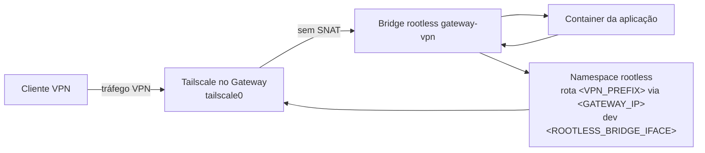

<details id="top">
    <summary>Índice</summary>
  <!-- cspell:disable -->
    <ol>
        <li><a href="#visão-geral">Visão geral</a></li>
        <li><a href="#ambiente-e-versões">Ambiente e versões</a></li>
        <li><a href="#pré-requisitos-e-variáveis">Pré-requisitos e variáveis</a></li>
        <li><a href="#passo-1-preparar-o-host">Passo 1: Preparar o host</a></li>
        <li><a href="#passo-2-preparar-a-conta-rootless">Passo 2: Preparar a conta rootless</a></li>
        <li><a href="#passo-3-verificar-os-pré-requisitos-no-host">Passo 3: Verificar os pré-requisitos no host</a></li>
        <li><a href="#passo-4-confirmar-o-plano-da-bridge-rootless">Passo 4: Confirmar o plano da bridge rootless</a></li>
        <li><a href="#passo-5-criar-a-bridge-rootless">Passo 5: Criar a bridge rootless</a></li>
        <li><a href="#passo-6-iniciar-os-containers-de-teste">Passo 6: Iniciar os containers de teste</a></li>
        <li><a href="#passo-7-validar-dns-a-partir-do-primeiro-probe">Passo 7: Validar DNS a partir do primeiro probe</a></li>
        <li><a href="#passo-8-validar-dns-a-partir-do-segundo-probe">Passo 8: Validar DNS a partir do segundo probe</a></li>
        <li><a href="#passo-9-habilitar-encaminhamento-na-namespace-rootless">Passo 9: Habilitar encaminhamento na namespace rootless</a></li>
        <li><a href="#passo-10-instalar-a-rota-de-retorno">Passo 10: Instalar a rota de retorno</a></li>
        <li><a href="#passo-11-construir-a-imagem-gateway">Passo 11: Construir a imagem Gateway</a></li>
        <li><a href="#passo-12-testar-tun-e-encaminhamento-no-container">Passo 12: Testar TUN e encaminhamento no container</a></li>
        <li><a href="#passo-13-remover-os-containers-de-teste">Passo 13: Remover os containers de teste</a></li>
        <li><a href="#passo-14-preparar-configurações">Passo 14: Preparar configurações</a></li>
        <li><a href="#passo-15-preparar-as-candidatas-de-configuração">Passo 15: Preparar as candidatas de configuração</a></li>
        <li><a href="#passo-16-validar-a-candidata-headplane">Passo 16: Validar a candidata Headplane</a></li>
        <li><a href="#passo-17-instalar-configurações-de-base">Passo 17: Instalar configurações de base</a></li>
        <li><a href="#passo-18-verificar-configurações-instaladas">Passo 18: Verificar configurações instaladas</a></li>
        <li><a href="#passo-19-instalar-tls-e-segredo-headplane">Passo 19: Instalar TLS e segredo Headplane</a></li>
        <li><a href="#passo-20-aplicar-ownership-e-modos-internos">Passo 20: Aplicar ownership e modos internos</a></li>
        <li><a href="#passo-21-inspecionar-rede-rootless">Passo 21: Inspecionar rede rootless</a></li>
        <li><a href="#passo-22-criar-drop-in-de-rota">Passo 22: Criar drop-in de rota</a></li>
        <li><a href="#passo-23-instalar-a-unidade-quadlet">Passo 23: Instalar a unidade Quadlet</a></li>
        <li><a href="#passo-24-iniciar-a-unidade-do-gateway">Passo 24: Iniciar a unidade do Gateway</a></li>
        <li><a href="#passo-25-verificar-healthcheck">Passo 25: Verificar healthcheck</a></li>
        <li><a href="#passo-26-verificar-leitura-como-headplane">Passo 26: Verificar leitura como Headplane</a></li>
        <li><a href="#passo-27-verificar-leitura-como-headscale">Passo 27: Verificar leitura como Headscale</a></li>
        <li><a href="#passo-28-verificar-logs-e-rota">Passo 28: Verificar logs e rota</a></li>
        <li><a href="#passo-29-criar-a-conta-headscale">Passo 29: Criar a conta Headscale</a></li>
        <li><a href="#passo-30-criar-auth-key-de-laboratório">Passo 30: Criar auth key de laboratório</a></li>
        <li><a href="#passo-31-inscrever-o-gateway-em-laboratório">Passo 31: Inscrever o Gateway em laboratório</a></li>
        <li><a href="#passo-32-aprovar-a-rota-rootless">Passo 32: Aprovar a rota rootless</a></li>
        <li><a href="#passo-33-validar-tráfego-vpn-sem-snat">Passo 33: Validar tráfego VPN sem SNAT</a></li>
        <li><a href="#passo-34-validar-dns-na-vpn">Passo 34: Validar DNS na VPN</a></li>
        <li><a href="#passo-35-validar-acesso-https-e-headplane">Passo 35: Validar acesso HTTPS e Headplane</a></li>
        <li><a href="#verificação-final">Verificação final</a></li>
        <li><a href="#solução-de-problemas">Solução de problemas</a></li>
        <li><a href="#reversão-e-desinstalação">Reversão e desinstalação</a></li>
        <li><a href="#referências">Referências</a></li>
    </ol>
      <!-- cspell:enable -->
</details>

# Deploy do Gateway VPN com Headscale, Headplane e Tailscale — alvo rootless

Esta receita descreve a instalação e configuração do Gateway VPN com Headscale, Headplane e Tailscale em um ambiente rootless, utilizando Podman e Quadlet. O objetivo é permitir que o Gateway opere sem privilégios de root, mantendo a segurança e a segregação de rede adequada.

> **Receita primária e alvo rootless.** O procedimento rootful continua implementado e mantido como
> referência legada na [receita rootful](gateway-headscale-podman-rootfull.md).

## Visão geral

Esta receita descreve uma instalação **nova** do Gateway como usuário local dedicado `<GATEWAY_USER>` com Podman rootless, Quadlet e a bridge exclusiva `gateway-vpn`. Sugestão de conta: `podman_user`. Use Bash a partir da raiz do repositório, com as ferramentas indicadas em cada etapa.

| Item | Descrição |
| --- | --- |
| Público | Administradores de sistemas responsáveis pelo host e pela conta rootless |
| Escopo | Instalação nova e validação operacional do Gateway em Podman rootless |
| Fora do escopo | Deploy rootless do Gateway como código, migração de dados e qualificação de acesso WAN |

A variante mantém Headscale, Headplane, `tailscaled` e NGINX no container Debian `gateway`. O anúncio usa `--snat-subnet-routes=false` e deve preservar o IP VPN original visto pela aplicação. O Gateway anuncia somente `<ROOTLESS_SUBNET>`; não anuncie rota default nem use o Gateway como exit node.

| Tema | Alternativa rootful (implementada, mantida) | Alvo rootless |
| --- | --- | --- |
| Conta de execução | Serviço do sistema e Podman rootful | Conta local dedicada `<GATEWAY_USER>` e Podman rootless |
| Quadlet | `/etc/containers/systemd/`, `systemctl` do sistema | `~/.config/containers/systemd/`, `systemctl --user` |
| Rede anunciada | Rede padrão rootful `podman` | Bridge rootless dedicada `gateway-vpn` |
| Rota de retorno | Serviço de host na namespace de rede do host | Rota dentro de `podman unshare --rootless-netns` |
| HTTPS | TCP 443 publicado diretamente pelo container | TCP 443 publicado diretamente no host pelo `rootlessport` |
| Armazenamento | Store rootful e volumes do rootful | Store e volumes independentes do usuário rootless |
| Referência e suporte | Alternativa rootful mantida | Alvo rootless; sem suporte Portainer rootless e sem migração de dados |



A bridge existe na namespace de rede rootless e não é diretamente alcançável pela namespace de rede do host. Não publique DNS TCP/UDP 53 no host; os clientes VPN consultam o Aardvark pelo split DNS e pela rota anunciada. O tráfego de retorno ao cliente depende da rota instalada nessa namespace. Todos os containers de aplicação que precisem ser anunciados devem entrar na mesma bridge e usar aliases DNS nela.

### Inventário

| Arquivo | Uso nesta variante | Adaptação ou limite |
| --- | --- | --- |
| [Containerfile](../../deploy/gateway/v1/Containerfile), [entrypoint.sh](../../deploy/gateway/v1/entrypoint.sh), [healthcheck.sh](../../deploy/gateway/v1/healthcheck.sh) | Reutilizados | A imagem mantém processos e healthcheck existentes; build e execução usam Podman do usuário. |
| [headscale.yaml](../../deploy/gateway/v1/config/headscale.yaml) | Copiado e adaptado | Trocar `192.0.2.53` pelo `<ROOTLESS_BRIDGE_IP>` do Aardvark e ajustar endpoint/prefixo. |
| [headplane.yaml](../../deploy/gateway/v1/config/headplane.yaml) | Candidato, validado e instalado | `prepare-headplane-candidate.sh` cria segredo inicial em modo `0444`; ajuste permissões depois da validação. |
| [nginx.conf](../../deploy/gateway/v1/config/nginx.conf) | Copiado e adaptado | Ajustar FQDN e prefixo permitido; validar o endereço de origem que NGINX realmente recebe. |
| [gateway.container](../../deploy/gateway/v1/quadlet/gateway.container) | Copiado para o diretório Quadlet do usuário | Trocar dependências rootful, rede, publicação de porta e caminhos bind. Manter TUN, `NET_ADMIN` e `ip_forward`. |
| [load-env.sh](../../deploy/scripts/load-env.sh) | Fonte das constantes operacionais | Revisar antes do uso; instalar no diretório privado da conta Gateway e carregar com `source`. |
| [gateway-vpn-return-route.service](../../deploy/gateway/v1/host/gateway-vpn-return-route.service) e [env.example](../../deploy/gateway/v1/host/gateway-vpn-return-route.env.example) | **Não usados** | Configuram uma rota na namespace rootful do host; não controlam a namespace rootless. |
| [prepare-headplane-candidate.sh](../../deploy/scripts/prepare-headplane-candidate.sh) | Reutilizado como `<GATEWAY_USER>` | Usa `openssl`; cria diretório `0700`, config `0600` e segredo `0444`. |
| [validate-headplane-config.sh](../../deploy/scripts/validate-headplane-config.sh) | Reutilizado como `<GATEWAY_USER>` | Chama `podman run`, `podman healthcheck` e remove o container de validação. Usa o store rootless da sessão atual; não valida as permissões finais dos bind mounts. |
| [enroll-gateway.sh](../../deploy/scripts/enroll-gateway.sh) | Workaround de laboratório, não integração rootless suportada | Inspeciona a rede Podman visível ao usuário, exige exatamente um CIDR IPv4, anuncia essa rede com `--snat-subnet-routes=false` e apaga o arquivo da auth key. |
| [install-file.sh](../../deploy/scripts/install-file.sh) | **Não usado nesta variante** | Sempre chama `chown`; sem root só serve se proprietário/grupo forem permitidos para o próprio usuário, não para mapear UID interno. Como root, pode criar arquivos com proprietário incompatível. Use instalação/cópia curta como o usuário. |
| [Receita TLS](gateway-tls.md) | Referência para certificado | O procedimento existente gera material em caminhos controlados pelo host; a infraestrutura deve entregar os arquivos à conta rootless por canal seguro, sem afrouxar a chave privada. |

Interfaces reais dos scripts:

- `prepare-headplane-candidate.sh [candidate_dir] [template_file]` usa como template padrão `deploy/gateway/v1/config/headplane.yaml` e, sem diretório, cria staging em `/tmp`; cria config `0600` e segredo de 32 hex `0444`.
- `validate-headplane-config.sh <candidate_config> <candidate_secret> [containerfile_or_image]` usa o Containerfile versionado como padrão, cria um diretório temporário `0700`, copia as candidatas nele como `0444` legíveis pelo processo no container, roda com rede `none` e entrypoint/healthcheck nativos, tenta a checagem por até 20 segundos e remove as cópias e o container; remove também a imagem que baixou somente quando a validação falha.
- `enroll-gateway.sh <headscale_fqdn> [container_name] [network_name] [authkey_path]` assume `gateway`, `podman` e `/run/tailscale-auth/authkey` quando omitidos; esta receita passa `gateway` e `gateway-vpn` explicitamente.
- `install-file.sh <source_path|-> <target_path> <mode> <owner> <group>` ajusta proprietário/grupo com `chown`, aplica modo, recusa destino existente e faz rename atômico; sem root, `chown` só pode manter um proprietário/grupo permitido para o usuário atual, não mapear UID interno. Executar como root não atende ao modelo de arquivos pertencentes à conta rootless.
- `prepare-headplane-candidate.sh` é reutilizável sem root, mas seu segredo `0444` não atende à política de permissões finais. Valide primeiro; depois copie, restrinja e aplique o mapeamento de UID interno descrito no [Passo 20](#passo-20-aplicar-ownership-e-modos-internos). `validate-headplane-config.sh` usa o `podman` encontrado no `PATH`; não o execute com `sudo`.

### Decisões de segurança e riscos aceitos

| Decisão | Risco | Justificativa | Mitigação |
| --- | --- | --- | --- |
| Definir `net.ipv4.ip_unprivileged_port_start=443` | Qualquer usuário não privilegiado pode vincular TCP/UDP 443–1023 | `rootlessport` precisa publicar diretamente TCP 443 | Usar `--sysctl-only` para preparar somente o sysctl; guardar valor e arquivo anteriores; validar SELinux e firewall separadamente antes da implantação |
| Exigir SELinux já desativado | O host não tem controles SELinux ativos | Decisão de arquitetura existente, não alterada por esta receita | Confirmar `Disabled` antes de aplicar; parar se script propuser alterar SELinux |

<div>
  <a href="#top" title="De volta ao topo da página">
    <picture>
      <source media="(prefers-color-scheme: dark)" srcset="../images/up-arrow_white.svg">
      
    </picture>
  </a>
  <br><br>
</div>

## Ambiente e versões

| Componente | Versão | Estado da verificação |
| --- | --- | --- |
| Sistema operacional do host | RHEL 9.8 | Necessário para implantação. Ambiente validado. Versões posteriores possivelmente compatíveis, mas não testadas |
| Podman rootless e Quadlet | Podman 5.8.5 | Necessário para implantação. Ambiente validado. Versões posteriores possivelmente compatíveis, mas não testadas. Para instalação, siga a (documentação oficial do Podman e Quadlet)[https://podman.io/docs/installation] |
| git | 2.40.1 | Necessário para clonagem do repositório, Passos 1–2. Pode ser substituído por outra versão compatível ou utilizado outro método para obtenção do código. Para instalação, siga a (documentação oficial do Git)[https://git-scm.com/install/linux] |
| Imagem Gateway | Headscale 0.29.6, Headplane 0.8.2 e Tailscale 1.104.2 | Versões fixadas em [Containerfile](../../deploy/gateway/v1/Containerfile); build e runtime integrado registrados |
| Cliente VPN | Debian 13, Tailscale 1.104.4 | Utilizado para teste de cliente. Não necessário para implantação do gateway |


<div>
  <a href="#top" title="De volta ao topo da página">
    <picture>
      <source media="(prefers-color-scheme: dark)" srcset="../images/up-arrow_white.svg">
      
    </picture>
  </a>
  <br><br>
</div>

## Pré-requisitos e variáveis

- Use Bash a partir da raiz do repositório, com acesso `root` para preparar o host e a conta.
- Reserve uma conta local dedicada, ranges subuid/subgid sem sobreposição e home em disco local.
- O host deve der disponibilidade para uso da porta 443 que aturará como Endpoint Headscale e Headplane.
- O host deve ter disponibilidade da porta usada pelo serviço VPN, geralmente a porta 41641 UDP.

| Variável ou placeholder | Descrição | Exemplo | Onde usar |
| --- | --- | --- | --- |
| `GATEWAY_USER` / `<GATEWAY_USER>` | Conta local dedicada ao Podman rootless | `podman_user` | Passos 1 |
| `<GATEWAY_HOME>` | Home absoluta da conta, obtida pelo sexto campo de `getent passwd "$GATEWAY_USER"` | `/home/podman_user` | Passos 20 e 23 |
| `SUBUID_RANGE`, `SUBGID_RANGE` | Faixas exclusivas e sem sobreposição. Somente necessárias se a conta ainda não tiver faixas atribuídas ou houver necessidade de definir novas faixas | `200000-65535` | Passo 1 |
| `ROOTLESS_SUBNET` / `<ROOTLESS_SUBNET>` | Subnet dedicada da bridge rootless | `10.100.0.0/24` | Passos 4–35 |
| `ROOTLESS_BRIDGE_IP` / `<ROOTLESS_BRIDGE_IP>` | Gateway da bridge e resolver Aardvark | `10.100.0.1` | Passos 4–35 |
| `ROOTLESS_BRIDGE_IFACE` / `<ROOTLESS_BRIDGE_IFACE>` | Interface na namespace rootless | `podman1` | Passos 10, 22–28 e 33 |
| `GATEWAY_IP` / `<GATEWAY_IP>` | IP estático do container Gateway | `10.100.0.2` | Passos 10, 22–28 e 33 |
| `VPN_PREFIX` / `<VPN_PREFIX>` | Prefixo VPN anunciado e usado na rota de retorno | `100.101.0.0/24` | Passos 10, 22–28 e 33 |
| `HEADSCALE_FQDN` / `<HEADSCALE_FQDN>` | FQDN público do endpoint Headscale | `headscale.dev.anatel` | Passos 15, 18, 31 e 35 |
| `GATEWAY_LAN_IP` / `<GATEWAY_LAN_IP>` | IP LAN usado para verificar o acesso Headplane pela LAN | `192.0.2.10` | Passo 35 |
| `APP_ALIAS` / `<APP_ALIAS>` | Alias DNS do container de aplicação | `webapp.dev.anatel` | Passos 33–35 |
| `TLS_STAGE` / `<TLS_STAGE>` | Diretório seguro com certificado e chave entregues à conta | `/home/podman_user/tls-stage` | Passo 19 |
| `CA_FILE` / `<CA_FILE>` | Certificado público da CA que assinou o endpoint Headscale | `/home/podman_user/tls-stage/gateway-dev-ca.crt` | Passo 19 |
| `<ID_DO_USUÁRIO>`, `<ID_DO_NÓ>` | IDs retornados pelo Headscale | Valores da listagem | Passos 29–32 |

Antes do [Passo 1](#passo-1-preparar-o-host), como `root`, guarde o valor atual do sysctl em diretório restrito:

```bash
sudo sh -c 'install -d -m 0700 /root/rootless-host-backup; umask 077; sysctl -n net.ipv4.ip_unprivileged_port_start > /root/rootless-host-backup/net.ipv4.ip_unprivileged_port_start'
```

Verifique se `/etc/sysctl.d/90-rootless-ports.conf` existe:

```bash
sudo test -e /etc/sysctl.d/90-rootless-ports.conf && printf 'presente\n' || printf 'ausente\n'
```

Anote o resultado para a reversão. Se estiver presente, copie o arquivo preservando conteúdo e modo:

```bash
sudo cp -a /etc/sysctl.d/90-rootless-ports.conf /root/rootless-host-backup/
```

Se estiver ausente, não execute a cópia; a reversão removerá o arquivo criado pelo script.

<div>
  <a href="#top" title="De volta ao topo da página">
    <picture>
      <source media="(prefers-color-scheme: dark)" srcset="../images/up-arrow_white.svg">
      
    </picture>
  </a>
  <br><br>
</div>

## Passo 1: Preparar a conta rootless

**Objetivo:** Preparar a conta local dedicada e suas faixas de identidade para o Podman rootless.

**Contexto:** Execute como `root`; entre na conta dedicada quando indicado.

Verifique se a conta dedicada já existe:

```bash
GATEWAY_USER=podman_user
id "$GATEWAY_USER" &>/dev/null && echo "Conta existe" || echo "Conta não existe"
```

Se a conta não existir, crie-a:

```bash
useradd --create-home --home-dir "/home/$GATEWAY_USER" --shell /bin/bash "$GATEWAY_USER"
```

Caso a conta exista, confirme que a conta atende aos requisitos de finalidade, home local e ranges antes de reutilizá-la para o Podman rootless.

```bash
awk -F: -v user="$GATEWAY_USER" '$1 == user { print FILENAME ":" $0 }' /etc/subuid /etc/subgid
awk -F: '{ print FILENAME ":" $0 }' /etc/subuid /etc/subgid
```

O primeiro comando imprime somente as faixas já atribuídas a `GATEWAY_USER`; o segundo imprime todas as faixas alocadas. Cada linha tem o formato `arquivo:usuário:UID inicial:quantidade`.

Se o primeiro comando não imprimir linhas, essa conta não tem faixas registradas. Se imprimir faixas, confirme as alocações indicada na primeira faixa não coincida com outras faixas já existentes no host; caso contrário, ajuste os ranges antes de prosseguir.

As variáveis `SUBUID_RANGE` e `SUBGID_RANGE` usam o formato `UID_INICIAL-UID_FINAL`. Por exemplo, `200000-265535` corresponde a `usuário:200000:65536` no arquivo; a terceira coluna é a quantidade de IDs. É necessário garantir que o range seja de no mínimo 65536 IDs.

Caso seja necessário definir as faixas de subuids e subgids, utilize os comandos `usermod` apropriados antes de prosseguir.

```bash
SUBUID_RANGE='<INICIO-FIM_LIVRES>'
SUBGID_RANGE='<INICIO-FIM_LIVRES>'

usermod --add-subuids "$SUBUID_RANGE" --add-subgids "$SUBGID_RANGE" "$GATEWAY_USER"
```

Mude para a conta dedicada do usuário para clonar o repositório com os scripts que serão posteriormente utilizados, que devem ser armazenados no diretório home do usuário.

```bash
su - "$GATEWAY_USER"
cd ~
git clone https://github.com/FSLobao/webAppBoilerPlate.git
exit
```

Como etapa inicial da configuração, defina as variáveis de ambiente e prepare o loader.

Verifique se as variáveis já estão definidas corretamente antes de prosseguir.
```bash
GATEWAY_HOME=$(getent passwd "$GATEWAY_USER" | cut -d: -f6)
GATEWAY_GROUP=$(id -gn "$GATEWAY_USER")
GATEWAY_ENV_FILE="$GATEWAY_HOME/.config/gateway-vpn/load-env.sh"
[[ -n "$GATEWAY_HOME" && ! -e "$GATEWAY_ENV_FILE" && ! -L "$GATEWAY_ENV_FILE" ]] || {
  printf 'Home inválida ou loader já existente; preserve-o e resolva manualmente.\n' >&2
}
```

Caso as verificações anteriores estejam corretas, crie o diretório de configuração e instale o loader:

```bash
install -d -o "$GATEWAY_USER" -g "$GATEWAY_GROUP" -m 0700 "$(dirname "$GATEWAY_ENV_FILE")"
install -o "$GATEWAY_USER" -g "$GATEWAY_GROUP" -m 0700 deploy/scripts/load-env.sh "$GATEWAY_ENV_FILE"
```

Valide o arquivo como Bash e confirme que ele carrega todas as variáveis sem alterá-las fora do
shell que executou `source`:

```bash
bash -n "$GATEWAY_ENV_FILE"
runuser -u "$GATEWAY_USER" -- bash -ec 'source "$1"; declare -p GATEWAY_USER ROOTLESS_SUBNET ROOTLESS_BRIDGE_IP ROOTLESS_BRIDGE_IFACE GATEWAY_IP VPN_PREFIX HEADSCALE_FQDN GATEWAY_LAN_IP APP_ALIAS TLS_STAGE CA_FILE >/dev/null' bash "$GATEWAY_ENV_FILE"
```

Uma vez validado, sempre que necessário, carregue o loader no shell com as variáveis para continuar o processo de instalação:

```bash
source "$HOME/.config/gateway-vpn/load-env.sh"
```

> [!TIP]
> Use `source` ou o equivalente `.`. Como dica, defina este alias na conta Gateway para carregar o arquivo com um comando curto:
> 
> ```bash
> alias gwenv='source "$HOME/.config/gateway-vpn/load-env.sh"'
> ```
>
>  Para tornar persistente o alias, adicione-o à última linha do `~/.bashrc` do usuário GATEWAY_USER. Para isso, pode usar o seguinte comando:
>
> ```bash
> echo "alias gwenv='source \"/home/$GATEWAY_USER/.config/gateway-vpn/load-env.sh\"'" >> /home/$GATEWAY_USER/.bashrc
> ```


<div>
  <a href="#top" title="De volta ao topo da página">
    <picture>
      <source media="(prefers-color-scheme: dark)" srcset="../images/up-arrow_white.svg">
      
    </picture>
  </a>
  <br><br>
</div>

## Passo 2: Preparar o host como root

Lembre-se de carregar as constantes antes dos comandos desta etapa, caso a sessão tenha sido reiniciada.

```bash
GATEWAY_USER=podman_user
source "/home/"$GATEWAY_USER"/webAppBoilerPlate/.config/gateway-vpn/load-env.sh"
```

Gere uma senha inicial aleatória para a conta dedicada. Execute na raiz do repositório, confirme que `.env` é ignorado e que ainda não existe. O arquivo fica em modo `0600`; não imprima nem passe a senha em argumentos. O uso do pequeno script abaixo garante que a senha seja criada, armazenada e aplicada de forma segura, sem apresentar a senha em logs ou argumentos.

```bash
cd /home/"$GATEWAY_USER"/webAppBoilerPlate
git config --global --add safe.directory /home/"$GATEWAY_USER"/webAppBoilerPlate
git check-ignore -q .env || { printf ".env precisa estar ignorado pelo Git.\n" >&2; }
test ! -e .env || { printf ".env já existe; preserve-o e resolva manualmente.\n" >&2; }
umask 077
GWVPN_INITIAL_PASSWORD=$(openssl rand -hex 32)
printf "GWVPN_INITIAL_PASSWORD=%s\n" "$GWVPN_INITIAL_PASSWORD" > .env
if ! printf "%s:%s\n" "$GATEWAY_USER" "$GWVPN_INITIAL_PASSWORD" | chpasswd; then
  rm -- .env
  unset GWVPN_INITIAL_PASSWORD
  exit 1
fi
unset GWVPN_INITIAL_PASSWORD
```

Este .env contém credencial inicial; remova-o ou mova-o depois de armazenar a credencial em cofre seguro.

Ative linger para a conta:

```bash
loginctl enable-linger "$GATEWAY_USER"
```

O sistema deve atender aos seguintes requisitos:

- `SELINUX=disabled`,
- `firewalld`/`nftables` desativados,
- TCP 443 disponível para bind rootless, conforme a arquitetura do host.

Para verificação rápida desses requisitos, execute o script de preparação do host rootless, que gera um relatório de verificação das condições necessárias para a execução rootless.

```bash
./deploy/scripts/prepare-rootless-host.sh --check
```
Um exemplo de relatório é apresentado à seguir, em um sistema RHEL 9.8 em sua configuração padrão:

```bash
Sysctl: would change (file=file-missing, mode=missing, runtime=1024; desired file=net.ipv4.ip_unprivileged_port_start=443, mode=0644, runtime=443).
firewalld.service: would change (enabled=enabled, active=active; desired disabled/inactive).
nftables.service: unchanged (enabled=disabled, active=inactive).
SELinux config: would change (current=SELINUX=enforcing, desired=SELINUX=disabled).
SELinux runtime mode is Enforcing; a reboot would be required after the change
```

O uso de firewalld e SELinux não é abrangido no escopo deste repositório e depende de políticas locais do ambiente do host. Caso não se deseje desativá-los, pode-se utilizar a opção `--sysctl-only` para preparar apenas o sysctl, sem alterar o estado do firewall ou do SELinux.

Quando executado o conjunto completo de configuração:

```bash
./deploy/scripts/prepare-rootless-host.sh
```

É esperado o seguinte resultado:

```bash
net.ipv4.ip_unprivileged_port_start = 443
Sysctl: changed (file=net.ipv4.ip_unprivileged_port_start=443, mode=0644, runtime=443; was 1024).
Removed "/etc/systemd/system/multi-user.target.wants/firewalld.service".
Removed "/etc/systemd/system/dbus-org.fedoraproject.FirewallD1.service".
firewalld.service: changed (enabled=disabled, active=inactive).
nftables.service: unchanged (enabled=disabled, active=inactive).
SELinux config: changed (current=SELINUX=disabled; was SELINUX=enforcing).
SELinux runtime: reboot required (mode=Enforcing).
SELinux runtime mode is Enforcing; reboot required to complete
```

<div>
  <a href="#top" title="De volta ao topo da página">
    <picture>
      <source media="(prefers-color-scheme: dark)" srcset="../images/up-arrow_white.svg">
      
    </picture>
  </a>
  <br><br>
</div>

## Passo 3: Confirmar o plano da bridge rootless

Ainda usando a conta de usuário, no shell `root`, carregue as variáveis de ambiente caso necessário:

```bash
GATEWAY_USER=podman_user
source "/home/"$GATEWAY_USER"/webAppBoilerPlate/.config/gateway-vpn/load-env.sh"
```

```bash
ip -4 route show table all
```

Compare as rotas do host com `<ROOTLESS_SUBNET>`, `<VPN_PREFIX>`, LAN/corporativas e o CIDR rootful `podman` fornecido pela infraestrutura. Não use `sudo podman` nesta receita.

<div>
  <a href="#top" title="De volta ao topo da página">
    <picture>
      <source media="(prefers-color-scheme: dark)" srcset="../images/up-arrow_white.svg">
      
    </picture>
  </a>
  <br><br>
</div>


## Passo 4: Verificar os pré-requisitos no host como `<GATEWAY_USER>`

Depois da preparação, como `root`, abra uma sessão de `<GATEWAY_USER>`:

```bash
su - "$GATEWAY_USER"
```

Na sessão do usuário, defina o runtime e confirme o user bus:

```bash
export XDG_RUNTIME_DIR="/run/user/$(id -u)"
test -S "$XDG_RUNTIME_DIR/bus" || { printf "User bus indisponível.\n" >&2; exit 1; }
```

Se `su` não fornecer o user bus, saia da sessão e use `machinectl shell <GATEWAY_USER>@`; repita a verificação. SSH também pode ser utilizado caso machinectl não esteja disponível, realizando-se a conexão utilizando a senha de usuário armazenda no arquivo .env local, por exemplo: `ssh "$GATEWAY_USER@localhost"`.

Daqui em diante execute **tudo** como `<GATEWAY_USER>`, sem `sudo`.
Confirme Podman `5.8.2`, rootless `true` e cgroups `v2` na saída de `podman info`. Confirme também os helpers de user namespace:

```bash
podman info --format '{{.Version.Version}}'
podman info --format '{{.Host.Security.Rootless}}'
podman info --format '{{.Host.CgroupVersion}}'
command -v newuidmap newgidmap pasta
```

Confirme que o dispositivo `/dev/net/tun` está presente e que a home está em disco local. O seguinte comando deve retornar 0 (sucesso não apresenta saída), indicando que o dispositivo existe
```bash
test -c /dev/net/tun
```

Confirme que a home não está em NFS nem montada com `noexec` ou `nodev`.
```bash
findmnt -no FSTYPE,OPTIONS -T "$HOME"
```

Sempre que iniciar a sessão do usuário `<GATEWAY_USER>`, carregue as variáveis definidas no loader usando o comando a seguir:

```bash
source "$HOME/.config/gateway-vpn/load-env.sh"
```

Caso tenha definido o alias `gwenv` no `~/.bashrc` do root, basta executá-lo para carregar as variáveis:

```bash
gwenv
```

<div>
  <a href="#top" title="De volta ao topo da página">
    <picture>
      <source media="(prefers-color-scheme: dark)" srcset="../images/up-arrow_white.svg">
      
    </picture>
  </a>
  <br><br>
</div>

## Passo 5: Criar a bridge rootless

Carregue as constantes aprovadas:

```bash
source "$HOME/.config/gateway-vpn/load-env.sh"
```

Crie a bridge com DNS habilitado por padrão e informe subnet/gateway escolhidos. Confirme o resultado efetivo; não prossiga se DNS estiver desabilitado:

```bash
podman network create --driver bridge --subnet "${ROOTLESS_SUBNET}" --gateway "${ROOTLESS_BRIDGE_IP}" gateway-vpn
podman network inspect gateway-vpn
```


<div>
  <a href="#top" title="De volta ao topo da página">
    <picture>
      <source media="(prefers-color-scheme: dark)" srcset="../images/up-arrow_white.svg">
      
    </picture>
  </a>
  <br><br>
</div>

## Passo 6: Iniciar os containers de teste

Este passo é opcional e serve para criar dois probes isolados que permitem verificar os aliases DNS da bridge.

```bash
podman run -d --name g1-probe-a --network gateway-vpn --network-alias g1-a.dev.anatel docker.io/library/busybox:1.36 sleep 300
podman run -d --name g1-probe-b --network gateway-vpn --network-alias g1-b.dev.anatel docker.io/library/busybox:1.36 sleep 300
podman inspect --format "{{range \$k,\$v := .NetworkSettings.Networks}}{{\$v.IPAddress}}{{end}}" g1-probe-a
podman inspect --format "{{range \$k,\$v := .NetworkSettings.Networks}}{{\$v.IPAddress}}{{end}}" g1-probe-b
```

Os dois probes ficam em execução e exibem IPs distintos da subnet.

Compare os IPs retornados com a subnet e confirme que são distintos.

Para validar DNS a partir do primeiro probe, execute consultas `nslookup` para os aliases configurados na bridge.

```bash
podman exec g1-probe-a nslookup g1-a.dev.anatel
podman exec g1-probe-a nslookup g1-b.dev.anatel
podman exec g1-probe-a nslookup dev-gateway.dev.anatel
```

É esperado que os aliases `g1-a.dev.anatel`, `g1-b.dev.anatel` e `dev-gateway.dev.anatel` resolvam para os IPs esperados.

Confirme que o segundo probe obtém as mesmas respostas DNS esperadas.

```bash
podman exec g1-probe-b nslookup g1-a.dev.anatel
podman exec g1-probe-b nslookup g1-b.dev.anatel
podman exec g1-probe-b nslookup dev-gateway.dev.anatel
```

Cada alias resolve para o IP do seu container pela bridge rootless. Compare os resultados de `nslookup` com os IPs exibidos por `podman inspect`. **Se falhar: pare** e não instale Gateway nem anuncie a rede.

O resultado esperado é que cada alias resolva somente para o IP atribuído ao container correspondente.

Verifique se as seis consultas correspondem aos IPs dos dois probes e do Gateway.

<div>
  <a href="#top" title="De volta ao topo da página">
    <picture>
      <source media="(prefers-color-scheme: dark)" srcset="../images/up-arrow_white.svg">
      
    </picture>
  </a>
  <br><br>
</div>

## Passo 9: Habilitar encaminhamento na namespace rootless

Habilitar IPv4 forwarding somente na namespace rootless.

Execute como `<GATEWAY_USER>` com a bridge ativa.

```bash
podman unshare --rootless-netns /usr/sbin/sysctl net.ipv4.ip_forward
```

A saída deve ser `net.ipv4.ip_forward = 1`. Se o valor for `0`, ajuste somente a namespace rootless e confirme novamente:

```bash
podman unshare --rootless-netns /usr/sbin/sysctl -w net.ipv4.ip_forward=1
podman unshare --rootless-netns /usr/sbin/sysctl net.ipv4.ip_forward
```

Esse ajuste não altera o sysctl global do host. **Se o comando falhar ou o valor continuar diferente de `1`.


<div>
  <a href="#top" title="De volta ao topo da página">
    <picture>
      <source media="(prefers-color-scheme: dark)" srcset="../images/up-arrow_white.svg">
      
    </picture>
  </a>
  <br><br>
</div>

## Passo 10: Instalar a rota de retorno

**Objetivo:** Instalar a rota VPN dentro da namespace rootless.

**Contexto:** Execute como `<GATEWAY_USER>` na sessão rootless e use a interface descoberta.

Carregue as constantes aprovadas:

```bash
source "$HOME/.config/gateway-vpn/load-env.sh"
```

Descubra a interface na mesma namespace; use `replace` para tornar a instalação idempotente:

```bash
podman unshare --rootless-netns /usr/sbin/ip -4 addr
```

```bash
podman unshare --rootless-netns /usr/sbin/ip -4 route replace "${VPN_PREFIX}" via "${GATEWAY_IP}" dev "${ROOTLESS_BRIDGE_IFACE}"
set -o pipefail
podman unshare --rootless-netns /usr/sbin/ip -4 route show "${VPN_PREFIX}" | awk -v prefix="${VPN_PREFIX}" -v gateway="${GATEWAY_IP}" -v iface="${ROOTLESS_BRIDGE_IFACE}" '
$1 == prefix {
  via = 0
  device = 0
  for (i = 1; i < NF; i++) {
    if ($i == "via" && $(i + 1) == gateway) via = 1
    if ($i == "dev" && $(i + 1) == iface) device = 1
  }
  if (via && device) {
    print
    found = 1
  }
}
END {
  if (!found) {
    print "Expected route missing or mismatched" > "/dev/stderr"
    exit 1
  }
}'
```

<div>
  <a href="#top" title="De volta ao topo da página">
    <picture>
      <source media="(prefers-color-scheme: dark)" srcset="../images/up-arrow_white.svg">
      
    </picture>
  </a>
  <br><br>
</div>

## Passo 11: Construir a imagem Gateway

**Objetivo:** Construir a imagem Gateway sem iniciar seus serviços.

**Contexto:** Execute como `<GATEWAY_USER>` após criar a bridge.

```bash
podman build --tag localhost/gateway:1.0.0 --file deploy/gateway/v1/Containerfile deploy/gateway/v1
```

**Resultado esperado:** A imagem `localhost/gateway:1.0.0` é construída.

**Verificação:** Prossiga somente se o comando retornar sucesso.

<div>
  <a href="#top" title="De volta ao topo da página">
    <picture>
      <source media="(prefers-color-scheme: dark)" srcset="../images/up-arrow_white.svg">
      
    </picture>
  </a>
  <br><br>
</div>

## Passo 12: Testar TUN e encaminhamento no container

**Objetivo:** Confirmar que a imagem rootless pode usar TUN, `NET_ADMIN` e `ip_forward`.

**Contexto:** Execute como `<GATEWAY_USER>` após construir a imagem.

O `Sysctl=net.ipv4.ip_forward=1` do container configura encaminhamento dentro do container. O drop-in do [Passo 22](#passo-22-criar-drop-in-de-rota) também configura `net.ipv4.ip_forward=1` na namespace rootless; nenhum dos dois altera o sysctl global do host.

**Gate G3 — crítico, bloqueante.** Teste as capacidades em container descartável:

```bash
podman run --rm --network gateway-vpn --cap-add NET_ADMIN \
  --device /dev/net/tun:/dev/net/tun --sysctl net.ipv4.ip_forward=1 \
  --entrypoint /bin/bash localhost/gateway:1.0.0 -ec 'test -c /dev/net/tun; /usr/sbin/ip tuntap add dev tun-poc mode tun; /usr/sbin/ip link del dev tun-poc; test "$(cat /proc/sys/net/ipv4/ip_forward)" = 1'
```

**Critério G3:** comando retorna `0`, abre/remove interface TUN e lê `ip_forward=1`. **Se falhar: pare.** Não use `--privileged`, socket Podman nem `--tun=userspace-networking` como substituto.

**Resultado esperado:** O container descartável retorna `0` e remove a interface TUN criada.

**Verificação:** Confirme o código de saída G3 antes de continuar.

<div>
  <a href="#top" title="De volta ao topo da página">
    <picture>
      <source media="(prefers-color-scheme: dark)" srcset="../images/up-arrow_white.svg">
      
    </picture>
  </a>
  <br><br>
</div>

## Passo 13: Remover os containers de teste

**Objetivo:** Remover somente os probes temporários após os gates G1 e G3.

**Contexto:** Execute como `<GATEWAY_USER>`; mantenha a bridge para a instalação.

Remova apenas os probes depois dos gates. Mantenha a rede para a instalação, mas remova/recrie-a se os parâmetros precisarem mudar:

```bash
podman rm -f g1-probe-a g1-probe-b
```

**Resultado esperado:** Os probes são removidos; a bridge `gateway-vpn` permanece.

**Verificação:** Confirme que `podman ps -a` não lista os probes e preserve a bridge.

<div>
  <a href="#top" title="De volta ao topo da página">
    <picture>
      <source media="(prefers-color-scheme: dark)" srcset="../images/up-arrow_white.svg">
      
    </picture>
  </a>
  <br><br>
</div>

## Passo 14: Preparar configurações

**Objetivo:** Criar diretórios rootless privados para configurações, TLS e secrets.

**Contexto:** Execute como `<GATEWAY_USER>` na sessão rootless; obtenha o certificado e a chave por canal seguro.

Mantenha configurações, TLS e secrets em `$HOME/.config/gateway-vpn`, de propriedade de `<GATEWAY_USER>`. Use diretórios `0700` e arquivos `0600` quando possível. Não versione secrets nem chaves privadas. Confirme que os destinos ainda não existem antes de instalar; esta receita é para instalação nova.

```bash
mkdir -p "$HOME/.config/gateway-vpn/tls" "$HOME/.config/gateway-vpn/secrets/tailscale"
chmod 0700 "$HOME/.config/gateway-vpn" "$HOME/.config/gateway-vpn/tls" "$HOME/.config/gateway-vpn/secrets" "$HOME/.config/gateway-vpn/secrets/tailscale"
```

**Resultado esperado:** Os diretórios existem e pertencem à conta rootless, com modo `0700`.

**Verificação:** Confirme caminhos, proprietário e modo antes de criar arquivos.

<div>
  <a href="#top" title="De volta ao topo da página">
    <picture>
      <source media="(prefers-color-scheme: dark)" srcset="../images/up-arrow_white.svg">
      
    </picture>
  </a>
  <br><br>
</div>

## Passo 15: Preparar as candidatas de configuração

**Objetivo:** Aplicar todas as alterações de ambiente às candidatas antes de instalá-las.

**Contexto:** Execute como `<GATEWAY_USER>` na sessão rootless.

Carregue as constantes aprovadas:

```bash
source "$HOME/.config/gateway-vpn/load-env.sh"
```

Prepare o staging da configuração Headplane com o script existente:

```bash
headplane_candidate_dir=$(deploy/scripts/prepare-headplane-candidate.sh)
headplane_candidate_config="$headplane_candidate_dir/headplane.yaml"
headplane_candidate_secret="$headplane_candidate_dir/headplane-cookie-secret"
headscale_candidate_config="$headplane_candidate_dir/headscale.yaml"
nginx_candidate_config="$headplane_candidate_dir/nginx.conf"
```

Copie as demais configurações para o mesmo staging:

```bash
install -m 0600 deploy/gateway/v1/config/headscale.yaml "$headscale_candidate_config"
install -m 0600 deploy/gateway/v1/config/nginx.conf "$nginx_candidate_config"
```

Aplique todas as substituições específicas do ambiente antes de instalar as candidatas.
O Headscale e o Headplane usam o mesmo endpoint HTTPS externo. O Headplane usa
`headscale.url: "http://127.0.0.1:8080"` para comunicação interna e
`server.base_url: "https://dev-gateway.dev.anatel"` para sua própria interface.

```bash
sed -i \
  -e "s|^server_url: .*|server_url: \"https://${HEADSCALE_FQDN}\"|" \
  -e "s|^  v4: .*|  v4: \"${VPN_PREFIX}\"|" \
  -e "s|^        - \"192.0.2.53\"|        - \"${ROOTLESS_BRIDGE_IP}\"|" \
  "$headscale_candidate_config"
```

```bash
sed -i \
  -e "s|server_name headscale.example.invalid;|server_name ${HEADSCALE_FQDN};|" \
  -e "s|allow 100.64.0.0/10;|allow ${VPN_PREFIX};|" \
  "$nginx_candidate_config"
```

```bash
sed -i "s|^  public_url: .*|  public_url: \"https://${HEADSCALE_FQDN}\"|" \
  "$headplane_candidate_config"
```

O script deixa o segredo candidato em `0444` para a validação upstream. Preserve esse modo até o
[Passo 19](#passo-19-instalar-tls-e-segredo-headplane), quando ele será instalado com modo final.

**Resultado esperado:** As três candidatas usam os valores rootless aprovados. Os dois campos do
endpoint Headscale usam `https://${HEADSCALE_FQDN}`; `server.base_url` permanece no endereço do
Headplane.

**Verificação:** Confirme os valores críticos antes de instalar:

```bash
grep -F "server_url: \"https://${HEADSCALE_FQDN}\"" "$headscale_candidate_config"
grep -F "  v4: \"${VPN_PREFIX}\"" "$headscale_candidate_config"
grep -F "        - \"${ROOTLESS_BRIDGE_IP}\"" "$headscale_candidate_config"
grep -F "  public_url: \"https://${HEADSCALE_FQDN}\"" "$headplane_candidate_config"
grep -F "  base_url: \"https://dev-gateway.dev.anatel\"" "$headplane_candidate_config"
```

<div>
  <a href="#top" title="De volta ao topo da página">
    <picture>
      <source media="(prefers-color-scheme: dark)" srcset="../images/up-arrow_white.svg">
      
    </picture>
  </a>
  <br><br>
</div>

## Passo 16: Validar a candidata Headplane

**Objetivo:** Executar a pré-checagem isolada existente sem tratá-la como validação integrada.

**Contexto:** Execute como `<GATEWAY_USER>` na sessão rootless, sem `sudo`.

**Gate G4 — bloqueante.** Valide a candidata pela ferramenta existente:

```bash
deploy/scripts/validate-headplane-config.sh "$headplane_candidate_config" "$headplane_candidate_secret"
```

O helper executa Headplane com `--network none`. Ele cria um diretório temporário `0700` e monta cópias `0444` do YAML e do cookie secret; os arquivos candidatos originais permanecem inalterados. O entrypoint e o healthcheck nativos da imagem não são substituídos. O candidato desta receita também referencia `/etc/headscale/config.yaml` e a API Headscale; o helper pode falhar com configuração válida porque omite esse arquivo e não alcança o serviço. **Gate G4:** não trate erro de dependência do helper como validação aprovada nem como YAML inválido. Confirme schema/secret e mantenha G4 aberto até G5: a unidade completa deve ficar `healthy`, ler configurações/secrets nos UIDs corretos e iniciar Headplane sem erro. **Se o runtime completo falhar, pare antes da inscrição.**

Se os logs mostrarem `EACCES: permission denied, open '/etc/headplane/config.yaml'`, não altere a candidata para `0644` nem execute o helper com `sudo`. Use a versão atual do script, que monta cópias legíveis criadas em um diretório privado, e repita o comando como `<GATEWAY_USER>`.

**Resultado esperado:** G4 fornece somente uma pré-checagem; o healthcheck completo em G5 continua obrigatório.

**Verificação:** Não feche G4 até o runtime integrado passar em G5.

<div>
  <a href="#top" title="De volta ao topo da página">
    <picture>
      <source media="(prefers-color-scheme: dark)" srcset="../images/up-arrow_white.svg">
      
    </picture>
  </a>
  <br><br>
</div>

## Passo 17: Instalar configurações de base

**Objetivo:** Instalar as candidatas sem sobrescrever dados existentes.

**Contexto:** Execute como `<GATEWAY_USER>` na sessão rootless; use o diretório de configuração privado.

Carregue as constantes aprovadas:

```bash
source "$HOME/.config/gateway-vpn/load-env.sh"
```

Instale as candidatas já adaptadas no [Passo 15](#passo-15-preparar-as-candidatas-de-configuração).
Não execute substituições depois da instalação.

```bash
gateway_config_dir="$HOME/.config/gateway-vpn"
```

Verifique se os arquivos de configuração já existem antes de prosseguir:

```bash
[[ -f "$headscale_candidate_config" && -f "$headplane_candidate_config" && -f "$nginx_candidate_config" ]] || {
  printf 'Uma ou mais candidatas estão ausentes; refaça o Passo 15.\n' >&2
}
[[ ! -e "$gateway_config_dir/headscale.yaml" && ! -L "$gateway_config_dir/headscale.yaml" &&
   ! -e "$gateway_config_dir/headplane.yaml" && ! -L "$gateway_config_dir/headplane.yaml" &&
   ! -e "$gateway_config_dir/nginx.conf" && ! -L "$gateway_config_dir/nginx.conf" ]] || {
  printf 'Um ou mais destinos já existem; preserve-os e resolva manualmente.\n' >&2
}
```

Instale as candidatas nos destinos finais:

```bash
install -m 0600 "$headscale_candidate_config" "$gateway_config_dir/headscale.yaml"
install -m 0600 "$headplane_candidate_config" "$gateway_config_dir/headplane.yaml"
install -m 0600 "$nginx_candidate_config" "$gateway_config_dir/nginx.conf"
```

`install-file.sh` não é a alternativa desta receita: ele chama `chown` e não faz o mapeamento
rootless necessário. `install -m`, executado pelo usuário, mantém o proprietário atual. Não
execute a instalação como root.

**Resultado esperado:** Os três arquivos base existem em destinos novos sob o diretório rootless.

**Verificação:** Confirme que a guarda não apontou destino existente e que as cópias foram criadas.

<div>
  <a href="#top" title="De volta ao topo da página">
    <picture>
      <source media="(prefers-color-scheme: dark)" srcset="../images/up-arrow_white.svg">
      
    </picture>
  </a>
  <br><br>
</div>

## Passo 18: Verificar configurações instaladas

**Objetivo:** Confirmar que a instalação preservou os valores aplicados no staging.

**Contexto:** Execute como `<GATEWAY_USER>` na mesma sessão rootless.

Carregue as constantes aprovadas:

```bash
source "$HOME/.config/gateway-vpn/load-env.sh"
```

```bash
grep -Fq "server_url: \"https://${HEADSCALE_FQDN}\"" "$gateway_config_dir/headscale.yaml" &&
grep -Fq "  v4: \"${VPN_PREFIX}\"" "$gateway_config_dir/headscale.yaml" &&
grep -Fq "        - \"${ROOTLESS_BRIDGE_IP}\"" "$gateway_config_dir/headscale.yaml" &&
grep -Fq "  public_url: \"https://${HEADSCALE_FQDN}\"" "$gateway_config_dir/headplane.yaml" &&
grep -Fq "server_name ${HEADSCALE_FQDN};" "$gateway_config_dir/nginx.conf" &&
grep -Fq "allow ${VPN_PREFIX};" "$gateway_config_dir/nginx.conf" &&
grep -Fq "deny all;" "$gateway_config_dir/nginx.conf"
```

**Resultado esperado:** Todos os comandos terminam com código `0` e nenhuma substituição restante
é necessária nos arquivos instalados.

**Verificação:** Confirme `printf '%s\n' "$?"` retorna `0` depois do último comando.

<div>
  <a href="#top" title="De volta ao topo da página">
    <picture>
      <source media="(prefers-color-scheme: dark)" srcset="../images/up-arrow_white.svg">
      
    </picture>
  </a>
  <br><br>
</div>

## Passo 19: Instalar TLS e segredo Headplane

**Objetivo:** Instalar certificado, chave, CA pública e segredo Headplane com permissões restritas.

**Contexto:** Execute como `<GATEWAY_USER>` após a validação candidata; obtenha TLS por canal seguro e não exiba secrets.

Carregue as constantes aprovadas:

```bash
source "$HOME/.config/gateway-vpn/load-env.sh"
```

Obtenha `fullchain.pem` e `privkey.pem` por processo aprovado. A receita [gateway-tls.md](gateway-tls.md) produz os arquivos de TLS do host, mas a chave pode ser root-only; não copie por um caminho que o usuário não possa ler, não relaxe a permissão de origem e não passe a chave em argumentos. A infraestrutura deve entregar o par a uma área de staging legível somente pela conta rootless, por canal seguro. Use o `TLS_STAGE` definido na seção Pré-requisitos e variáveis. Preserve a chave em `0600`; o certificado público pode usar `0644`.

```bash
GATEWAY_CERT='/etc/gateway/tls/gateway.cert'
GATEWAY_KEY='/etc/gateway/tls/gateway.key'
CA_FILE='/etc/gateway/tls/gateway-dev-ca.crt'

install -D -m 0644  "$GATEWAY_CERT" "$gateway_config_dir/tls/fullchain.pem"
install -D -m 0600 "$GATEWAY_KEY" "$gateway_config_dir/tls/privkey.pem"
install -D -m 0644 "$CA_FILE" "$gateway_config_dir/tls/gateway-ca.crt"
```

Crie um bundle de confiança dentro do diretório montado. Ele preserva as CAs públicas da imagem
e adiciona a CA privada que assinou `<HEADSCALE_FQDN>`. Sem essa confiança, `tailscaled` dentro
do Gateway rejeita a conexão com o Headscale como `x509: certificate signed by unknown authority`.

```bash
ca_bundle_tmp=$(mktemp "$gateway_config_dir/tls/ca-bundle.pem.XXXXXX")
podman run --rm --entrypoint /bin/cat localhost/gateway:1.0.0 /etc/ssl/certs/ca-certificates.crt > "$ca_bundle_tmp"
cat "$gateway_config_dir/tls/gateway-ca.crt" >> "$ca_bundle_tmp"
```

```bash
install -m 0644 "$ca_bundle_tmp" "$gateway_config_dir/tls/ca-bundle.pem"
rm -f -- "$ca_bundle_tmp"
```

Depois de validar e instalar a candidata, instale o segredo em destino novo e remova o staging:

```bash
chmod 0600 "$headplane_candidate_secret"
install -m 0600 "$headplane_candidate_secret" "$gateway_config_dir/secrets/headplane-cookie-secret"
if [[ -n "${headplane_candidate_dir:-}" && -d "${headplane_candidate_dir}" && ! -L "${headplane_candidate_dir}" ]]; then
  rm -rf -- "${headplane_candidate_dir}"
fi
```

**Resultado esperado:** Certificado, CA e bundle são públicos com modo `0644`; a chave TLS e o
secret usam `0600`. O staging foi removido.

**Verificação:** Confirme que os três certificados existem e que o bundle não está vazio:

```bash
test -s "$gateway_config_dir/tls/fullchain.pem"
test -s "$gateway_config_dir/tls/gateway-ca.crt"
test -s "$gateway_config_dir/tls/ca-bundle.pem"
```

<div>
  <a href="#top" title="De volta ao topo da página">
    <picture>
      <source media="(prefers-color-scheme: dark)" srcset="../images/up-arrow_white.svg">
      
    </picture>
  </a>
  <br><br>
</div>

## Passo 20: Aplicar ownership e modos internos

**Objetivo:** Aplicar os mapeamentos e modos exigidos pelos processos Headscale, Headplane e NGINX.

**Contexto:** Execute como `<GATEWAY_USER>` usando `podman unshare`.

A imagem cria `headscale` UID/GID `20001` e `headplane` UID/GID `20002`; `entrypoint.sh` inicia esses processos com seus UIDs internos. O Headplane lê `/etc/headplane/config.yaml`, `/etc/headscale/config.yaml` e seu cookie secret. O Headscale lê `/etc/headscale/config.yaml` e sua chave Noise persistida em `/var/lib/headscale/noise_private.key`. O NGINX executa como root e lê sua configuração e a chave TLS.

A receita rootful instala as configurações não secretas como `root:root` modo `0644`, o certificado público como `root:root` modo `0644`, a chave TLS como `root:root` modo `0600` e o cookie secret como `root:20002` modo `0440`. Use o mapeamento rootless equivalente: arquivos de configuração e certificado legíveis em `0644`, propriedade interna `0:0`; chave TLS restrita a `0:0` modo `0600`; cookie secret restrito a `20002:20002` modo `0400`. Assim Headplane UID `20002` também pode ler a configuração Headscale referenciada por seu próprio YAML.

O volume nomeado `gateway-headscale-data` persiste o banco e a chave Noise. Ele mascara o diretório da imagem; por isso, atribua o volume a Headscale UID/GID `20001` antes de iniciar o Gateway.

> **Atenção:** Se o volume já contém dados, pare `gateway.service` e faça backup verificado antes de alterar ownership. Não remova o volume.

Crie o volume se ainda não existir e obtenha seu caminho no store rootless:

```bash
podman volume exists gateway-headscale-data || podman volume create gateway-headscale-data
headscale_data_dir=$(podman volume inspect --format '{{.Mountpoint}}' gateway-headscale-data)
```

Como `<GATEWAY_USER>`, aplique o ownership interno ao volume e restrinja o diretório:

```bash
podman unshare chown -R 20001:20001 "$headscale_data_dir"
podman unshare chmod 0700 "$headscale_data_dir"
```

```bash
podman unshare chown 20002:20002 "$gateway_config_dir/secrets/headplane-cookie-secret"
podman unshare chmod 0400 "$gateway_config_dir/secrets/headplane-cookie-secret"
```

```bash
podman unshare chown 0:0 "$gateway_config_dir/headscale.yaml" "$gateway_config_dir/headplane.yaml" "$gateway_config_dir/nginx.conf" "$gateway_config_dir/tls/fullchain.pem" "$gateway_config_dir/tls/privkey.pem"
podman unshare chmod 0644 "$gateway_config_dir/headscale.yaml" "$gateway_config_dir/headplane.yaml" "$gateway_config_dir/nginx.conf" "$gateway_config_dir/tls/fullchain.pem"
podman unshare chmod 0600 "$gateway_config_dir/tls/privkey.pem"
```

```bash
podman unshare chown 0:0 "$gateway_config_dir/tls/gateway-ca.crt" "$gateway_config_dir/tls/ca-bundle.pem"
podman unshare chmod 0644 "$gateway_config_dir/tls/gateway-ca.crt" "$gateway_config_dir/tls/ca-bundle.pem"
```

As pastas continuam sob controle do usuário; os arquivos mapeados podem aparecer com UID não reconhecido na namespace do host. Defina e valide o método de backup desses arquivos antes da operação contínua. `tailscaled` roda como root interno e grava seu estado no volume rootless. A montagem `secrets/tailscale` é temporária para auth key e deve permanecer `0700`.

**Resultado esperado:** O volume Headscale pertence internamente a `20001:20001`; os arquivos de configuração e TLS usam ownership e modos restritos.

**Verificação:** Confirme os destinos, modos e proprietários; no [Passo 27](#passo-27-verificar-leitura-como-headscale), valide escrita no diretório de dados e leitura da chave Noise.

<div>
  <a href="#top" title="De volta ao topo da página">
    <picture>
      <source media="(prefers-color-scheme: dark)" srcset="../images/up-arrow_white.svg">
      
    </picture>
  </a>
  <br><br>
</div>

## Passo 21: Inspecionar rede rootless

**Objetivo:** Confirmar a bridge e descobrir a interface e as rotas na namespace rootless.

**Contexto:** Execute como `<GATEWAY_USER>` na sessão rootless; use os valores de rede aprovados.

A bridge `gateway-vpn` foi criada pela conta rootless na prova de conceito. Confirme que subnet, gateway e DNS habilitado continuam corretos. Ela precisa conter o Gateway e os containers de aplicação que serão anunciados. Descubra a interface efetiva dentro da namespace rootless, não na namespace do host:

```bash
podman network inspect gateway-vpn
podman unshare --rootless-netns /usr/sbin/ip -4 addr
podman unshare --rootless-netns /usr/sbin/ip -4 route
```

**Resultado esperado:** A bridge tem subnet, gateway e DNS aprovados; a interface rootless está identificada.

**Verificação:** Registre a interface exibida e atualize `ROOTLESS_BRIDGE_IFACE` se diferir do exemplo.

<div>
  <a href="#top" title="De volta ao topo da página">
    <picture>
      <source media="(prefers-color-scheme: dark)" srcset="../images/up-arrow_white.svg">
      
    </picture>
  </a>
  <br><br>
</div>

## Passo 22: Criar drop-in de rota

**Objetivo:** Criar o drop-in que reaplica forwarding, rota e regras restritas após cada início do Gateway.

**Contexto:** Execute como `<GATEWAY_USER>` na sessão rootless; use os valores de rede verificados no Passo 19.

Carregue as constantes aprovadas:

```bash
source "$HOME/.config/gateway-vpn/load-env.sh"
```

O serviço rootful `gateway-vpn-return-route.service` e o arquivo `/etc/sysconfig/gateway-vpn-return-route` **não são usados**. Não instale rota no host. A rota `<VPN_PREFIX> via <GATEWAY_IP> dev <ROOTLESS_BRIDGE_IFACE>` deve existir dentro da namespace rootless e ser reaplicada quando ela for recriada, inclusive após parar todos os containers rootless.

Use drop-in Quadlet do usuário em `~/.config/containers/systemd/gateway.container.d/`. O Quadlet oficialmente aceita arquivos `<name>.container.d/*.conf` e os mescla ao arquivo fonte; consulte [podman-systemd.unit(5), seção DESCRIPTION](https://docs.podman.io/en/latest/markdown/podman-systemd.unit.5.html). O próximo comando cria `gateway.container.d/10-return-route.conf` em modo `0644`, usando o caminho absoluto retornado por `command -v podman` e os valores definidos para a rede:

```bash
mkdir -p "$HOME/.config/containers/systemd/gateway.container.d"
```

```bash
PODMAN_BIN=$(command -v podman)
test -x "$PODMAN_BIN"
install -m 0644 /dev/stdin "$HOME/.config/containers/systemd/gateway.container.d/10-return-route.conf" <<EOF
[Service]
ExecStartPost="${PODMAN_BIN}" unshare --rootless-netns "/usr/sbin/sysctl" -w net.ipv4.ip_forward=1
ExecStartPost="${PODMAN_BIN}" unshare --rootless-netns "/usr/sbin/ip" -4 route replace "${VPN_PREFIX}" via "${GATEWAY_IP}" dev "${ROOTLESS_BRIDGE_IFACE}"
ExecStartPost="${PODMAN_BIN}" unshare --rootless-netns "/usr/bin/bash" -c "/usr/sbin/iptables -C FORWARD -o ${ROOTLESS_BRIDGE_IFACE} -s ${ROOTLESS_SUBNET} -d ${VPN_PREFIX} -j ACCEPT || /usr/sbin/iptables -I FORWARD 1 -o ${ROOTLESS_BRIDGE_IFACE} -s ${ROOTLESS_SUBNET} -d ${VPN_PREFIX} -j ACCEPT"
ExecStartPost="${PODMAN_BIN}" unshare --rootless-netns "/usr/bin/bash" -c "/usr/sbin/iptables -t nat -C POSTROUTING -s ${ROOTLESS_SUBNET} -d ${VPN_PREFIX} -j ACCEPT || /usr/sbin/iptables -t nat -I POSTROUTING 1 -s ${ROOTLESS_SUBNET} -d ${VPN_PREFIX} -j ACCEPT"
EOF
```

`ExecStartPost` roda depois de cada início do Gateway. Ele configura forwarding na namespace rootless, reaplica a rota e instala regras estreitas de `FORWARD` e `POSTROUTING`. As exceções permitem o retorno da bridge ao prefixo VPN e evitam SNAT por regras padrão do Netavark. Os comandos são idempotentes. Não use `route add`. O exemplo não contém `%`; escape qualquer `%` literal como `%%` para o systemd. Esse mecanismo é experimental e precisa passar G2 após reinício do serviço no [Passo 24](#passo-24-iniciar-a-unidade-do-gateway). Se todos os containers forem parados, a namespace rootless pode desaparecer e a rota junto com ela; o próximo start do Gateway deve instalá-la novamente.

Se `ExecStartPost` falhar, o systemd marca a inicialização da unidade como falha e interrompe o container; trate isso como falha G2/G5.

**Resultado esperado:** O drop-in reaplica somente a rota VPN e as regras `FORWARD`/`POSTROUTING` necessárias.

**Verificação:** Confirme os caminhos absolutos e valores no drop-in antes de recarregar Quadlet no [Passo 24](#passo-24-iniciar-a-unidade-do-gateway).

<div>
  <a href="#top" title="De volta ao topo da página">
    <picture>
      <source media="(prefers-color-scheme: dark)" srcset="../images/up-arrow_white.svg">
      
    </picture>
  </a>
  <br><br>
</div>

## Passo 23: Instalar a unidade Quadlet

**Objetivo:** Instalar a unidade Quadlet rootless e iniciar o Gateway como serviço do usuário.

**Contexto:** Execute como `<GATEWAY_USER>` na sessão rootless, sem `sudo`.

Carregue as constantes aprovadas:

```bash
source "$HOME/.config/gateway-vpn/load-env.sh"
```

Como `<GATEWAY_USER>`, copie o Quadlet versionado para `~/.config/containers/systemd/` depois de confirmar que o destino não existe. Altere somente a cópia do usuário; não altere `deploy/`.

```bash
GATEWAY_HOME=$(getent passwd "$GATEWAY_USER" | cut -d: -f6)
[[ -n "$GATEWAY_HOME" && ! -e "$HOME/.config/containers/systemd/gateway.container" && ! -L "$HOME/.config/containers/systemd/gateway.container" ]] || { printf "Home inválida ou destino existente.\n" >&2; exit 1; }
install -m 0644 deploy/gateway/v1/quadlet/gateway.container "$HOME/.config/containers/systemd/gateway.container"
```

O arquivo abaixo contém a unidade completa. Ele preserva as diretivas necessárias e aplica os caminhos e valores rootless indicados:

| Diretiva original | Alteração na cópia rootless |
| --- | --- |
| `After=network-online.target` | Remova. |
| `Requires=gateway-vpn-return-route.service` | Remova. |
| `After=gateway-vpn-return-route.service` | Remova. |
| `Wants=network-online.target` | Remova. |
| `Network=podman` | `Network=gateway-vpn` |
| `IP=CHANGE_ME_GATEWAY_IPV4` | `IP=<GATEWAY_IP>` |
| `PublishPort=443:443/tcp` | Mantenha; publicação direta da TCP 443 |
| `Environment=SSL_CERT_FILE=/etc/gateway-vpn/tls/ca-bundle.pem` | Adicione para `tailscaled` confiar na CA privada |
| `Volume=/etc/gateway-vpn/headscale.yaml:/etc/headscale/config.yaml:ro` | `Volume=<GATEWAY_HOME>/.config/gateway-vpn/headscale.yaml:/etc/headscale/config.yaml:ro` |
| `Volume=/etc/gateway-vpn/headplane.yaml:/etc/headplane/config.yaml:ro` | `Volume=<GATEWAY_HOME>/.config/gateway-vpn/headplane.yaml:/etc/headplane/config.yaml:ro` |
| `Volume=/etc/gateway-vpn/nginx.conf:/etc/nginx/nginx.conf:ro` | `Volume=<GATEWAY_HOME>/.config/gateway-vpn/nginx.conf:/etc/nginx/nginx.conf:ro` |
| `Volume=/etc/gateway-vpn/tls:/etc/gateway-vpn/tls:ro` | `Volume=<GATEWAY_HOME>/.config/gateway-vpn/tls:/etc/gateway-vpn/tls:ro` |
| `Volume=/etc/gateway-vpn/secrets/headplane-cookie-secret:/run/secrets/headplane-cookie-secret:ro` | `Volume=<GATEWAY_HOME>/.config/gateway-vpn/secrets/headplane-cookie-secret:/run/secrets/headplane-cookie-secret:ro` |
| `Volume=/etc/gateway-vpn/secrets/tailscale:/run/tailscale-auth` | `Volume=<GATEWAY_HOME>/.config/gateway-vpn/secrets/tailscale:/run/tailscale-auth` |
| `WantedBy=multi-user.target` | `WantedBy=default.target` |

Execute como `<GATEWAY_USER>`. `GATEWAY_HOME` vem do sexto campo de `getent passwd`; o comando recusa um destino existente, instala o arquivo em modo `0644` e confirma as diretivas principais:

```bash
gateway_quadlet="$HOME/.config/containers/systemd/gateway.container"
[[ -n "$GATEWAY_HOME" && ! -e "$gateway_quadlet" && ! -L "$gateway_quadlet" ]] || { printf "Home inválida ou destino existente.\n" >&2; exit 1; }
install -m 0644 /dev/stdin "$gateway_quadlet" <<EOF
[Unit]
Description=Headscale and Tailscale development Gateway

[Container]
ContainerName=gateway
Image=localhost/gateway:1.0.0
HealthCmd=/usr/local/sbin/gateway-healthcheck
HealthInterval=30s
HealthTimeout=5s
HealthStartPeriod=5s
HealthRetries=3
Network=gateway-vpn
NetworkAlias=dev-gateway.dev.anatel
IP=${GATEWAY_IP}
PublishPort=443:443/tcp
Environment=SSL_CERT_FILE=/etc/gateway-vpn/tls/ca-bundle.pem
AddCapability=NET_ADMIN
AddDevice=/dev/net/tun:/dev/net/tun
Sysctl=net.ipv4.ip_forward=1
Volume=gateway-headscale-data:/var/lib/headscale
Volume=gateway-headplane-data:/var/lib/headplane
Volume=gateway-tailscale-data:/var/lib/tailscale
Volume=${GATEWAY_HOME}/.config/gateway-vpn/headscale.yaml:/etc/headscale/config.yaml:ro
Volume=${GATEWAY_HOME}/.config/gateway-vpn/headplane.yaml:/etc/headplane/config.yaml:ro
Volume=${GATEWAY_HOME}/.config/gateway-vpn/nginx.conf:/etc/nginx/nginx.conf:ro
Volume=${GATEWAY_HOME}/.config/gateway-vpn/tls:/etc/gateway-vpn/tls:ro
Volume=${GATEWAY_HOME}/.config/gateway-vpn/secrets/headplane-cookie-secret:/run/secrets/headplane-cookie-secret:ro
Volume=${GATEWAY_HOME}/.config/gateway-vpn/secrets/tailscale:/run/tailscale-auth

[Service]
Restart=on-failure
TimeoutStopSec=30

[Install]
WantedBy=default.target
EOF
grep -E '^(Network|IP|PublishPort|Volume|WantedBy)=' "$gateway_quadlet"
```

Mantenha os três volumes nomeados, `NetworkAlias=dev-gateway.dev.anatel`, `AddCapability=NET_ADMIN`, `/dev/net/tun` e `Sysctl=net.ipv4.ip_forward=1`. Não adicione `User=`, `Group=` ou `DynamicUser=`; Quadlet não os suporta para executar como usuário não-root. Não use `--privileged`, socket Podman ou networking Tailscale userspace.

**Resultado esperado:** A cópia Quadlet usa `gateway-vpn`, IP estático, volumes rootless e `default.target`.

**Verificação:** Revise a saída de `grep` e confirme que dependências rootful foram removidas.

<div>
  <a href="#top" title="De volta ao topo da página">
    <picture>
      <source media="(prefers-color-scheme: dark)" srcset="../images/up-arrow_white.svg">
      
    </picture>
  </a>
  <br><br>
</div>

## Passo 24: Iniciar a unidade do Gateway

**Objetivo:** Recarregar o generator Quadlet e iniciar a unidade rootless.

**Contexto:** Execute como `<GATEWAY_USER>` na sessão rootless; não use `sudo`.

Mantenha `PublishPort=443:443/tcp` na unidade e instale o drop-in de rota do [Passo 22](#passo-22-criar-drop-in-de-rota). O endpoint Headscale e o tráfego VPN usam diretamente TCP 443 no host. O encaminhador rootless padrão (`rootlessport`) não preserva o IP de origem do cliente no listener público Headscale. O encaminhador `pasta` é experimental e não deve ser presumido. Teste a regra VPN-only do Headplane contra o endereço de origem que o NGINX realmente recebe.

**Gate G5 — bloqueante.** Recarregue o generator Quadlet e inicie a unidade. O generator processa `[Install] WantedBy=default.target` no `daemon-reload`; unidades geradas não aceitam o comando tradicional de habilitação. Confirme o autostart (`generated`), o target, o linger, os processos e as permissões:

```bash
systemctl --user daemon-reload
systemctl --user start gateway.service
systemctl --user is-enabled gateway.service
```

A saída de `is-enabled` deve ser `generated`. Confira `[Install] WantedBy=default.target` na cópia Quadlet e confirme que o linger está ativo. Aguarde a inicialização do Headplane antes do healthcheck; uma falha durante `HealthStartPeriod` não é resultado final:

```bash
loginctl show-user "$(id -un)" -p Linger
systemctl --user status gateway.service --no-pager
```

**Resultado esperado:** `gateway.service` está ativo, `is-enabled` retorna `generated` e `Linger=yes`.

**Verificação:** Confirme a saída dos cinco checks antes de validar a healthcheck.

<div>
  <a href="#top" title="De volta ao topo da página">
    <picture>
      <source media="(prefers-color-scheme: dark)" srcset="../images/up-arrow_white.svg">
      
    </picture>
  </a>
  <br><br>
</div>

## Passo 25: Verificar healthcheck

**Objetivo:** Confirmar que o Gateway inicia e fica saudável.

**Contexto:** Execute como `<GATEWAY_USER>` após o início da unidade; aguarde `HealthStartPeriod`.

O container usa `setpriv` do pacote Debian `util-linux` instalado no Containerfile; `entrypoint.sh` já usa esse binário para iniciar Headscale e Headplane.

```bash
sleep 10
podman healthcheck run gateway
podman inspect --format '{{.State.Health.Status}}' gateway
podman logs gateway
```

**Resultado esperado:** O healthcheck retorna sucesso, o estado é `healthy` e os logs não mostram erro de leitura de configuração ou segredo.

**Verificação:** Confirme `healthy` em `podman inspect` e revise os logs.

<div>
  <a href="#top" title="De volta ao topo da página">
    <picture>
      <source media="(prefers-color-scheme: dark)" srcset="../images/up-arrow_white.svg">
      
    </picture>
  </a>
  <br><br>
</div>

## Passo 26: Verificar leitura como Headplane

**Objetivo:** Confirmar que UID `20002` lê suas configurações e o cookie secret.

**Contexto:** Execute como `<GATEWAY_USER>` no container Gateway saudável.

```bash
podman exec gateway setpriv --reuid=20002 --regid=20002 --clear-groups -- test -r /etc/headscale/config.yaml
```

```bash
podman exec gateway setpriv --reuid=20002 --regid=20002 --clear-groups -- test -r /etc/headplane/config.yaml
podman exec gateway setpriv --reuid=20002 --regid=20002 --clear-groups -- test -r /run/secrets/headplane-cookie-secret
```

**Resultado esperado:** As três verificações de leitura retornam código `0`.

**Verificação:** Confirme o código de saída de cada comando.

<div>
  <a href="#top" title="De volta ao topo da página">
    <picture>
      <source media="(prefers-color-scheme: dark)" srcset="../images/up-arrow_white.svg">
      
    </picture>
  </a>
  <br><br>
</div>

## Passo 27: Verificar leitura como Headscale

**Objetivo:** Confirmar que UID `20001` lê sua configuração e chave Noise, grava no diretório de dados, e que NGINX lê TLS.

**Contexto:** Execute como `<GATEWAY_USER>` no container Gateway saudável.

```bash
podman exec gateway setpriv --reuid=20001 --regid=20001 --clear-groups -- test -r /etc/headscale/config.yaml
podman exec gateway setpriv --reuid=20001 --regid=20001 --clear-groups -- test -r /var/lib/headscale/noise_private.key
podman exec gateway setpriv --reuid=20001 --regid=20001 --clear-groups -- test -w /var/lib/headscale
```

```bash
podman exec gateway stat -c '%a %u:%g %n' /etc/nginx/nginx.conf /etc/gateway-vpn/tls/fullchain.pem /etc/gateway-vpn/tls/privkey.pem
```

Espera-se estas linhas de `stat -c %a`: `644 0:0 /etc/nginx/nginx.conf`, `644 0:0 /etc/gateway-vpn/tls/fullchain.pem` e `600 0:0 /etc/gateway-vpn/tls/privkey.pem`. Os testes com `setpriv` também validam leitura como UIDs `20001` e `20002`.

**Resultado esperado:** Os testes Headscale passam e os arquivos NGINX/TLS mostram modos e owners esperados.

**Verificação:** Compare as três linhas de `stat` com os critérios G5.

<div>
  <a href="#top" title="De volta ao topo da página">
    <picture>
      <source media="(prefers-color-scheme: dark)" srcset="../images/up-arrow_white.svg">
      
    </picture>
  </a>
  <br><br>
</div>

## Passo 28: Verificar logs e rota

**Objetivo:** Confirmar inicialização Headplane e reaplicação da rota após restart.

**Contexto:** Execute como `<GATEWAY_USER>` depois dos checks de permissão.

Carregue as constantes aprovadas:

```bash
source "$HOME/.config/gateway-vpn/load-env.sh"
```

Leia os logs da unidade; confirme inicialização do Headplane e ausência de erros:

```bash
systemctl --user status gateway.service --no-pager
```

Reinicie e confira se a rota volta sem comando manual:

```bash
systemctl --user restart gateway.service
set -o pipefail
podman unshare --rootless-netns /usr/sbin/ip -4 route show "${VPN_PREFIX}" | awk -v prefix="${VPN_PREFIX}" -v gateway="${GATEWAY_IP}" -v iface="${ROOTLESS_BRIDGE_IFACE}" '
$1 == prefix {
  via = 0
  device = 0
  for (i = 1; i < NF; i++) {
    if ($i == "via" && $(i + 1) == gateway) via = 1
    if ($i == "dev" && $(i + 1) == iface) device = 1
  }
  if (via && device) {
    print
    found = 1
  }
}
END {
  if (!found) {
    print "Expected route missing or mismatched" > "/dev/stderr"
    exit 1
  }
}'
```

**Critério G5:** unidade ativa, estado `healthy`, `is-enabled` retorna `generated`, linger ativo, Headplane UID `20002` lê ambas as configurações e o cookie secret, e Headscale UID `20001` lê sua chave Noise. Os logs confirmam inicialização Headplane sem erro de leitura. **Critério final G2:** a rota reaparece após restart sem comando manual. **Se qualquer verificação falhar: pare** e não inscreva o Gateway.

**Resultado esperado:** A unidade está ativa e `healthy`; logs não mostram erro de leitura; a rota reaparece após restart.


<div>
  <a href="#top" title="De volta ao topo da página">
    <picture>
      <source media="(prefers-color-scheme: dark)" srcset="../images/up-arrow_white.svg">
      
    </picture>
  </a>
  <br><br>
</div>

## Passo 29: Criar a conta Headscale

Para verificar os usuários existentes e posteriormente confirmar se um novo usuário foi criado, utilize o seguinte comando:

```bash
podman exec gateway headscale users list
```

Defina um nome de usuário para o Headscale. O nome de usuário deve seguir as regras de formato descritas abaixo.

- Tamanho mínimo de 2 caracteres.
- Deve começar com uma letra.
- Conjunto de caracteres permitido:
  - Letras (a-z, A-Z)
  - Dígitos / números (0-9)
  - Hífen (-)
  - Ponto (.)
  - Sublinhado / underscore (_)
  - Arroba (@): permitido mas melhor evitar. Caso utilizado, isso deve ser feito uma única vez no nome de usuário (por exemplo, em formatos tipo e-mail vindos de provedores OIDC), e nunca deve ser o último caractere, ou seja, não deve terminar com @.

Atribua o nome de usuário à variável `HEADSCALE_USER_NAME` para reutilização nos comandos subsequentes.

Durante a instalação inicial, crie o usuário Headscale que possuirá o nó Gateway. O nó autenticado executará tailscaled, anunciará a subnet rootless e atuará como subnet router.

```bash
HEADSCALE_USER_NAME='gateway-router'
```

Para criar o usuário no Headscale execute o comando à seguir.

```bash
podman exec gateway headscale users create "$HEADSCALE_USER_NAME"
```

<div>
  <a href="#top" title="De volta ao topo da página">
    <picture>
      <source media="(prefers-color-scheme: dark)" srcset="../images/up-arrow_white.svg">
      
    </picture>
  </a>
  <br><br>
</div>

## Passo 30: Criar auth key para o Gateway

Obtenha o ID do usuário Headscale criado no passo anterior e atribua este à variável `HEADSCALE_USER_ID`, diretamente ou à partir da variável `HEADSCALE_USER_NAME` com o seguinte comando:

```bash
HEADSCALE_USER_ID=$(
  NO_COLOR=1 podman exec gateway headscale users list \
    --output json |
  python3 -c 'import json,sys; users=json.load(sys.stdin); print(next(u["id"] for u in users if u["name"] == "gateway-router"))'
)

HEADSCALE_USER_ID=$(NO_COLOR=1 podman exec gateway headscale users list | grep "$HEADSCALE_USER_NAME" | grep '^[0-9]\+')
```

Crie uma auth key para o usuário Headscale obtido. Esta terá validade de 1hora

```bash
podman exec gateway sh -ec 'test ! -e /run/tailscale-auth/authkey; umask 077; headscale preauthkeys create --user "$1" --expiration 1h > /run/tailscale-auth/authkey' sh "$HEADSCALE_USER_ID"
```

<div>
  <a href="#top" title="De volta ao topo da página">
    <picture>
      <source media="(prefers-color-scheme: dark)" srcset="../images/up-arrow_white.svg">
      
    </picture>
  </a>
  <br><br>
</div>

## Passo 31: Inscrever o Gateway no Headscale

```bash
source "$HOME/.config/gateway-vpn/load-env.sh"
```

O helper usa o store Podman dessa conta, exige um CIDR IPv4 único, anuncia a rede com
`--snat-subnet-routes=false`, sem exit node e sem aceitar DNS/rotas. Ele limita `tailscale up`
a 60 segundos e remove o arquivo de auth key ao terminar.

```bash
deploy/scripts/enroll-gateway.sh "${HEADSCALE_FQDN}" gateway gateway-vpn
```

**Resultado esperado:** O Gateway fica inscrito no laboratório e anuncia somente `<ROOTLESS_SUBNET>`; a rota ainda não foi aprovada.

**Verificação:** Confira o estado Tailscale antes de aprovar a rota.

Se o helper terminar por timeout, não repita com a mesma auth key. Examine primeiro:

```bash
podman exec gateway tailscale status
podman logs --tail 100 gateway
```

O erro `x509: certificate signed by unknown authority` indica que o bundle do
[Passo 19](#passo-19-instalar-tls-e-segredo-headplane) não está montado ou `SSL_CERT_FILE`
não foi aplicado pela unidade do [Passo 23](#passo-23-instalar-a-unidade-quadlet).

<div>
  <a href="#top" title="De volta ao topo da página">
    <picture>
      <source media="(prefers-color-scheme: dark)" srcset="../images/up-arrow_white.svg">
      
    </picture>
  </a>
  <br><br>
</div>

## Passo 32: Aprovar a rota rootless

**Objetivo:** Aprovar somente a subnet anunciada pelo Gateway de laboratório.

**Contexto:** Execute como `<GATEWAY_USER>` na sessão rootless após confirmar o estado Tailscale.

Carregue as constantes aprovadas:

```bash
source "$HOME/.config/gateway-vpn/load-env.sh"
```

Para obter o ID do nó, consulte a saída de `podman exec gateway headscale nodes list`.

```bash
NODE_ID=$(NO_COLOR=1 podman exec gateway headscale nodes list | grep "$HEADSCALE_USER_NAME" | awk '{print $1}')
podman exec gateway headscale nodes approve-routes --identifier "$NODE_ID" --routes "${ROOTLESS_SUBNET}"
podman exec gateway tailscale status
```

**Resultado esperado:** O terminal solicita o ID do Gateway. Informe o ID listado. Headscale aprova somente `<ROOTLESS_SUBNET>` e o nó permanece online.

**Verificação:** Confirme a rota aprovada antes de validar o tráfego VPN.

<div>
  <a href="#top" title="De volta ao topo da página">
    <picture>
      <source media="(prefers-color-scheme: dark)" srcset="../images/up-arrow_white.svg">
      
    </picture>
  </a>
  <br><br>
</div>

## Passo 33: Validar tráfego VPN sem SNAT

   **Objetivo:** Confirmar que a aplicação recebe o IP VPN original.

   **Contexto:** Use um listener descartável em container de aplicação e um cliente VPN autorizado.

**Gate G6 — crítico, bloqueante.** A rota de retorno precisa estar presente no netns rootless. Acesse um listener descartável em container de aplicação por um cliente VPN e confira no log do listener o peer original, que deve ser o IP VPN do cliente, não o IP do Gateway/bridge. Não aceite só uma captura no Gateway como prova de ausência de SNAT.

**Critério G6:** aplicação registra o IP VPN original e o retorno funciona. **Se falhar: pare**, não anuncie ou mantenha a rota e não use SNAT como correção.

**Resultado esperado:** A aplicação registra o IP VPN original e o tráfego de retorno funciona.

**Verificação:** Consulte o log do listener; não use somente captura no Gateway.

<div>
  <a href="#top" title="De volta ao topo da página">
    <picture>
      <source media="(prefers-color-scheme: dark)" srcset="../images/up-arrow_white.svg">
      
    </picture>
  </a>
  <br><br>
</div>

## Passo 34: Validar DNS na VPN

**Objetivo:** Confirmar consultas UDP e TCP ao resolver Aardvark pelo cliente VPN.

**Contexto:** Execute no cliente VPN; defina o bloco de variáveis nessa sessão.

Carregue uma cópia revisada do loader:

```bash
source "$HOME/.config/gateway-vpn/load-env.sh"
```

**Gate G7 — bloqueante.** De um cliente VPN, consulte por UDP e TCP o resolver Aardvark em `<ROOTLESS_BRIDGE_IP>`:

```bash
dig @"${ROOTLESS_BRIDGE_IP}" dev-gateway.dev.anatel A
dig @"${ROOTLESS_BRIDGE_IP}" "${APP_ALIAS}" A
```

```bash
dig +tcp @"${ROOTLESS_BRIDGE_IP}" dev-gateway.dev.anatel A
dig +tcp @"${ROOTLESS_BRIDGE_IP}" "${APP_ALIAS}" A
```

**Critério G7:** UDP e TCP resolvem o alias do Gateway e um alias de aplicação para seus IPs rootless. **Se falhar: pare** e revise rota, split DNS, bridge e aliases.

**Resultado esperado:** UDP e TCP resolvem o Gateway e o alias da aplicação para os IPs rootless.

**Verificação:** Compare as quatro respostas com os IPs exibidos na rede.

<div>
  <a href="#top" title="De volta ao topo da página">
    <picture>
      <source media="(prefers-color-scheme: dark)" srcset="../images/up-arrow_white.svg">
      
    </picture>
  </a>
  <br><br>
</div>

## Passo 35: Validar acesso HTTPS e Headplane

**Objetivo:** Confirmar Headscale em TCP 443 e restringir Headplane ao prefixo VPN.

**Contexto:** Execute as verificações a partir de cliente VPN e cliente LAN sem VPN.

Carregue uma cópia revisada do loader em cada cliente:

```bash
source "$HOME/.config/gateway-vpn/load-env.sh"
```

**Gate G8 — bloqueante.** O endpoint de controle e VPN atende diretamente em TCP 443 no host,
tanto pela LAN como pela VPN. Acesse `https://dev-gateway.dev.anatel/admin` pela VPN e de um
cliente LAN sem VPN:

```bash
curl --fail --show-error "https://${HEADSCALE_FQDN}/health"
curl --fail --show-error https://dev-gateway.dev.anatel/admin
curl -sS --resolve "dev-gateway.dev.anatel:443:${GATEWAY_LAN_IP}" -o /dev/null -w '%{http_code}\n' https://dev-gateway.dev.anatel/admin
```

Confie no certificado pela CA aprovada; não use `curl -k`. A consulta `/admin` pela VPN deve retornar `302`; fixe o destino LAN em `<GATEWAY_LAN_IP>` e confirme `403`. Preserve `allow 100.96.0.0/24` e `deny all`, sem permitir `10.90.0.0/24`. **Critério G8:** Headplane autorizado somente pelo prefixo Headscale e Headscale acessível antes da VPN em TCP 443. Não use testes pela LAN como evidência de acesso WAN/perímetro externo. **Se falhar: pare.** Não enfraqueça a regra.

**Resultado esperado:** Gateway e cliente estão online em TCP 443; Headplane retorna `302` pela VPN e `403` pela LAN.

**Verificação:** Confirme os critérios G6, G7 e G8. Não declare acesso WAN validado.

<div>
  <a href="#top" title="De volta ao topo da página">
    <picture>
      <source media="(prefers-color-scheme: dark)" srcset="../images/up-arrow_white.svg">
      
    </picture>
  </a>
  <br><br>
</div>

## Verificação final

**Objetivo:** Confirmar que o Gateway, a rota VPN, o DNS e o acesso Headplane funcionam após reiniciar o user manager.

**Contexto:** Execute os checks no host RHEL autorizado e no cliente VPN; os resultados registrados não substituem a evidência histórica.

Como `<GATEWAY_USER>`, carregue as constantes antes dos checks no host:

```bash
source "$HOME/.config/gateway-vpn/load-env.sh"
```

Nos checks executados pelo cliente VPN, carregue a cópia revisada do loader no cliente.

Execute os gates na ordem indicada. Qualquer falha interrompe a receita. Comandos são exemplos de verificação, não evidência de execução ou aprovação no alvo.

| Gate | Etapa | Teste ou comando | Critério de aprovação | Falha |
| --- | --- | --- | --- | --- |
| G0 | Pré-requisitos | `podman info`, cgroups, subuid/gid, executáveis, SELinux, TUN, linger, home | Rootless `true`, cgroups v2, dependências e ranges presentes, SELinux `Disabled`, TUN presente, linger ativo, home local compatível | Pare antes de criar a bridge |
| G1 | POC | `podman network inspect gateway-vpn`; `nslookup` entre probes | `dns_enabled: true`; cada alias resolve para o IP do respectivo container pela bridge | Pare; não instale Gateway |
| G2 | POC e G5 | `podman unshare --rootless-netns /usr/sbin/sysctl net.ipv4.ip_forward`; `podman unshare --rootless-netns /usr/sbin/ip -4 route replace ...`; restart do serviço | `ip_forward=1`; rota instalada e reaplicada pelo drop-in | Pare; não inscreva Gateway |
| G3 | POC | Container descartável com `NET_ADMIN`, `/dev/net/tun` e `ip_forward` | TUN e capability funcionam; `ip_forward=1` | Pare; sem `--privileged` ou substituto userspace |
| G4 | Configuração | Validador isolado como pré-checagem; fechar com o healthcheck completo em G5 | YAML/secret válidos e Headplane `healthy` no Gateway com Headscale disponível | Pare antes da inscrição se G5 falhar |
| G5 | Inicialização | `is-enabled` (`generated`), `[Install] WantedBy=default.target`, linger, healthcheck, leitura como UIDs `20001`/`20002`, logs e restart | Unidade ativa; `default.target`; permissões e rota confirmadas | Pare antes da inscrição |
| G6 | VPN/L3 | Listener de app registra peer; rota VPN no netns | IP VPN original chega à aplicação, sem SNAT, com retorno | Pare; não anuncie rota |
| G7 | DNS | `dig` UDP e TCP para `<ROOTLESS_BRIDGE_IP>` | Gateway e alias de app resolvem do cliente VPN | Pare; revise rede/DNS |
| G8 | Acesso | `/admin` e `/health` em TCP 443 pela LAN e VPN; logs NGINX | Headplane retorna 302 pela VPN e 403 pela LAN; Headscale acessível antes da VPN; não infira acesso WAN pelos testes LAN | Pare; não relaxe controles |
| G9 | Autostart e restart do user manager | Conferir linger, unidades, rota de retorno, nós Headscale e reconexão do cliente após reinício do user manager | Unidades ativas, rota restaurada, nós online e cliente reconectado | Pare; G9 não aprovado |
| G10 | Modo e escopo | Conferir `podman info` para `<GATEWAY_USER>` | O runtime informa `rootless: true`; esta receita valida somente a execução rootless, não a variante rootful | Pare se o runtime não informar rootless |

O reboot do host passou historicamente em 2026-11-05, conforme o [registro histórico](../../.agent/memory/historico-dev.md). G9 valida somente o restart do user manager e não solicita novo reboot.

**Gate G9 — crítico, bloqueante.** Não reinicie o host durante este teste. Como `root`, informe a conta aprovada quando solicitado e reinicie seu manager com linger:

```bash
read -r -p 'Conta Gateway: ' GATEWAY_USER
loginctl terminate-user "$GATEWAY_USER"
systemctl stop "user@$(id -u "$GATEWAY_USER").service"
systemctl start "user@$(id -u "$GATEWAY_USER").service"
```

Não execute `systemctl --user start gateway.service`: o Gateway deve iniciar pelo `default.target`. Depois da inicialização, como `<GATEWAY_USER>`, confirme:

```bash
systemctl --user is-enabled gateway.service
systemctl --user is-active gateway.service
podman inspect --format "{{.State.Health.Status}}" gateway
set -o pipefail
podman unshare --rootless-netns /usr/sbin/ip -4 route show "${VPN_PREFIX}" | awk -v prefix="${VPN_PREFIX}" -v gateway="${GATEWAY_IP}" -v iface="${ROOTLESS_BRIDGE_IFACE}" '
$1 == prefix {
  via = 0
  device = 0
  for (i = 1; i < NF; i++) {
    if ($i == "via" && $(i + 1) == gateway) via = 1
    if ($i == "dev" && $(i + 1) == iface) device = 1
  }
  if (via && device) {
    print
    found = 1
  }
}
END {
  if (!found) {
    print "Expected route missing or mismatched" > "/dev/stderr"
    exit 1
  }
}'
podman exec gateway headscale nodes list
podman exec gateway tailscale status
```

Do cliente VPN, confirme a rota anunciada, o acesso ao app e o default route inalterado. O ID Headscale permanece o mesmo; não reinscreva o nó. Aguarde a inicialização da healthcheck antes de declarar falha:

```bash
tailscale status
ip -4 route show table 52
ip -4 route show default
curl --fail --show-error "http://${APP_ALIAS}/"
curl --fail --show-error https://dev-gateway.dev.anatel/admin
```

<div>
  <a href="#top" title="De volta ao topo da página">
    <picture>
      <source media="(prefers-color-scheme: dark)" srcset="../images/up-arrow_white.svg">
      
    </picture>
  </a>
  <br><br>
</div>

## Solução de problemas

| Sintoma | Causa provável | Correção |
| --- | --- | --- |
| G0 falha em `rootless`, cgroups, subuid/subgid, TUN ou linger | Pré-requisito ausente ou sessão sem user bus | Pare e corrija o requisito no [Passo 3](#passo-3-verificar-os-pré-requisitos-no-host); não contorne SELinux ou user namespaces |
| G1 falha ou `dns_enabled` não é `true` | Bridge ou aliases DNS incorretos | Pare e revise os [Passos 5–8](#passo-5-criar-a-bridge-rootless) |
| G2 não mantém `ip_forward=1` ou não reaplica a rota | Namespace rootless ou drop-in Quadlet incorreto | Revise os [Passos 9–10](#passo-9-habilitar-encaminhamento-na-namespace-rootless) e os [Passos 22–28](#passo-22-criar-drop-in-de-rota) |
| G3 não cria TUN ou falha com `NET_ADMIN` | Capacidade ou dispositivo indisponível | Pare e revise o [Passo 12](#passo-12-testar-tun-e-encaminhamento-no-container); não use `--privileged` |
| G4 isolado falha | O helper usa `--network none` e não monta a configuração Headscale | Não aprove G4 isoladamente; confirme o runtime completo nos [Passos 24–28](#passo-24-iniciar-a-unidade-do-gateway) |
| Headscale reinicia com `permission denied` ao abrir ou criar `/var/lib/headscale/noise_private.key` | Ownership ou modo incorreto no volume nomeado `gateway-headscale-data` | Aplique o ownership no [Passo 20](#passo-20-aplicar-ownership-e-modos-internos) e valide escrita no [Passo 27](#passo-27-verificar-leitura-como-headscale) |
| Headscale falha ao criar `/var/run/headscale` | Diretório de socket ausente ou sem ownership do UID `20001` | Reconstrua a imagem com o comando do [Passo 11](#passo-11-construir-a-imagem-gateway) e execute `systemctl --user restart gateway.service` |
| Healthcheck falha ao resolver `/proc/<pid>/exe` com `Permission denied` | UID `0` não pode inspecionar processos de outros UIDs no Podman rootless | Reconstrua a imagem com o comando do [Passo 11](#passo-11-construir-a-imagem-gateway) e execute `systemctl --user restart gateway.service` |
| Unidade não fica `healthy` ou UIDs não leem configs | Caminho, mapeamento ou modo de arquivo incorreto | Revise os [Passos 17–20](#passo-17-instalar-configurações-de-base) e [Passos 23–28](#passo-23-instalar-a-unidade-quadlet) |
| Cliente não recebe o IP VPN original | Rota ou regras de retorno ausentes | Pare e revise os [Passos 22–28](#passo-22-criar-drop-in-de-rota) |
| `/admin` falha pela VPN ou abre pela LAN | Origem vista pelo NGINX ou regra `allow`/`deny` incorreta | Não relaxe a regra; revise o [Passo 35](#passo-35-validar-acesso-https-e-headplane) |
| `tailscale up` trava e o log mostra `x509: certificate signed by unknown authority` | `tailscaled` não confia na CA do certificado Headscale | Corrija o bundle e `SSL_CERT_FILE` nos [Passos 19](#passo-19-instalar-tls-e-segredo-headplane) e [23](#passo-23-instalar-a-unidade-quadlet) |

<div>
  <a href="#top" title="De volta ao topo da página">
    <picture>
      <source media="(prefers-color-scheme: dark)" srcset="../images/up-arrow_white.svg">
      
    </picture>
  </a>
  <br><br>
</div>

## Reversão e desinstalação

Esta reversão interrompe a VPN e o acesso Headplane. Faça-a em janela aprovada. Não apague volumes rootless: contêm banco/identidade Headscale, estado Tailscale e dados Headplane.

Antes de executar comandos da reversão como `<GATEWAY_USER>`, carregue as mesmas constantes
aprovadas usadas na instalação:

```bash
source "$HOME/.config/gateway-vpn/load-env.sh"
```

> **Irreversível:** Não remova volumes. Isso apaga banco e identidade Headscale, dados Headplane e estado Tailscale. Faça backup verificado e obtenha aprovação separada antes de qualquer remoção.

1. Remova a rota e as regras `FORWARD`/`POSTROUTING` do drop-in dentro da namespace rootless. Use os mesmos valores e especificações de regra do [Passo 22](#passo-22-criar-drop-in-de-rota). Se a namespace rootless não existir, confirme que nenhum container rootless está em execução e não execute os comandos de remoção. Pare diante de qualquer outro erro. Deixe `net.ipv4.ip_forward=1` como está: esse valor desaparece com a namespace rootless.

```bash
podman unshare --rootless-netns /usr/sbin/ip -4 route del "${VPN_PREFIX}" via "${GATEWAY_IP}" dev "${ROOTLESS_BRIDGE_IFACE}"
```

```bash
podman unshare --rootless-netns /usr/bin/bash -c '
if /usr/sbin/iptables -C FORWARD -o "$1" -s "$2" -d "$3" -j ACCEPT; then
  /usr/sbin/iptables -D FORWARD -o "$1" -s "$2" -d "$3" -j ACCEPT
else
  printf "FORWARD rule missing or not verifiable\n" >&2
  exit 1
fi
' bash "${ROOTLESS_BRIDGE_IFACE}" "${ROOTLESS_SUBNET}" "${VPN_PREFIX}"
podman unshare --rootless-netns /usr/bin/bash -c '
if /usr/sbin/iptables -t nat -C POSTROUTING -s "$1" -d "$2" -j ACCEPT; then
  /usr/sbin/iptables -t nat -D POSTROUTING -s "$1" -d "$2" -j ACCEPT
else
  printf "POSTROUTING rule missing or not verifiable\n" >&2
  exit 1
fi
' bash "${ROOTLESS_SUBNET}" "${VPN_PREFIX}"
```

2. Pare a unidade gerada, remova o arquivo fonte e o drop-in, e recarregue o generator:

```bash
systemctl --user stop gateway.service
rm -- "$HOME/.config/containers/systemd/gateway.container"
rm -f -- "$HOME/.config/containers/systemd/gateway.container.d/10-return-route.conf"
```

```bash
systemctl --user daemon-reload
podman rm -f gateway
```

3. Remova também os outros containers rootless ligados a `gateway-vpn` por suas unidades autorizadas. Remova a rede somente quando nenhum container estiver conectado:

```bash
podman network rm gateway-vpn
```

4. Mantenha os volumes, a conta, as faixas subuid/gid e os arquivos de configuração até revisar backups e acesso. Não execute `podman volume rm`, `podman volume prune` ou `userdel` como parte desta reversão. A receita rootful e seus volumes permanecem intocados como fallback; não opere os dois Gateways anunciando rotas sobrepostas.

5. Se reverter a preparação do host, use o estado registrado antes do [Passo 1](#passo-1-preparar-o-host). Escolha somente uma ação para o arquivo: se ele existia, `cp -a` restaura conteúdo e modo do backup; se estava ausente, remova o arquivo criado. Em seguida, aplique o valor runtime salvo antes do Passo 1:

Se o arquivo existia:

```bash
sudo cp -a /root/rootless-host-backup/90-rootless-ports.conf /etc/sysctl.d/90-rootless-ports.conf
```

Se o arquivo estava ausente:

```bash
sudo rm -- /etc/sysctl.d/90-rootless-ports.conf
```

```bash
ORIGINAL_PORT_START=$(sudo cat /root/rootless-host-backup/net.ipv4.ip_unprivileged_port_start)
sudo sysctl -w "net.ipv4.ip_unprivileged_port_start=${ORIGINAL_PORT_START}"
```

Confira que conteúdo e modo foram restaurados quando o arquivo existia, ou que o arquivo está ausente quando esse era o estado inicial. Confirme que `sysctl -n net.ipv4.ip_unprivileged_port_start` retorna o valor salvo. Não altere SELinux nem serviços de firewall como parte desta reversão.

<div>
  <a href="#top" title="De volta ao topo da página">
    <picture>
      <source media="(prefers-color-scheme: dark)" srcset="../images/up-arrow_white.svg">
      
    </picture>
  </a>
  <br><br>
</div>

## Referências

| Referência | Uso | Versão ou consulta |
| --- | --- | --- |
| [Manual Podman](https://docs.podman.io/en/v5.8.2/markdown/podman.1.html) | Execução Podman e modo rootless | v5.8.2, consultado em 2026-11-11 |
| [Tutorial Podman rootless](https://github.com/podman-container-tools/podman/blob/main/docs/tutorials/rootless_tutorial.md) | Preparação de user namespaces | Branch `main`, consultada em 2026-11-11 |
| [Podman Quadlet — `podman-systemd.unit(5)`](https://docs.podman.io/en/latest/markdown/podman-systemd.unit.5.html) | Units gerados e drop-ins | Página atual, consultada em 2026-11-11 |
| [Podman user namespaces — `podman-unshare(1)`](https://docs.podman.io/en/latest/markdown/podman-unshare.1.html) | Acesso à namespace rootless | Página atual, consultada em 2026-11-11 |
| [Podman redes — `podman-network(1)`](https://docs.podman.io/en/latest/markdown/podman-network.1.html) | Criação e inspeção da bridge | Página atual, consultada em 2026-11-11 |
| [Tailscale subnet routers](https://tailscale.com/docs/features/subnet-routers) | Anúncio de rotas | Página consultada em 2026-11-11 |
| [Tailscale userspace networking](https://tailscale.com/docs/concepts/userspace-networking) | Limites da rede userspace | Página consultada em 2026-11-11 |
| [Headscale v0.29.6 release e checksums](https://github.com/juanfont/headscale/releases/tag/v0.29.6) | Versão e artefatos Headscale | v0.29.6 |
| [Headscale v0.29.6 configuração de referência](https://github.com/juanfont/headscale/blob/v0.29.6/config-example.yaml) | Parâmetros Headscale | v0.29.6 |
| [Headscale v0.29.6 criação de pre-auth keys](https://github.com/juanfont/headscale/blob/v0.29.6/cmd/headscale/cli/preauthkeys.go) | Chaves de inscrição | v0.29.6 |
| [Headscale v0.29.6 aprovação de rotas](https://github.com/juanfont/headscale/blob/v0.29.6/cmd/headscale/cli/nodes.go) | Aprovação de rotas | v0.29.6 |
| [Headplane v0.8.2 release](https://github.com/tale/headplane/releases/tag/v0.8.2) | Versão Headplane | v0.8.2 |
| [Headplane v0.8.2 configuration reference](https://github.com/tale/headplane/blob/v0.8.2/docs/configuration/index.md) | Parâmetros Headplane | v0.8.2 |
| [Headplane v0.8.2 configuration schema](https://github.com/tale/headplane/blob/v0.8.2/app/server/config/config-schema.ts) | Schema da configuração | v0.8.2 |
| [Headplane v0.8.2 configuration loader](https://github.com/tale/headplane/blob/v0.8.2/app/server/config/load.ts) | Leitura da configuração | v0.8.2 |
| [Headplane v0.8.2 server startup](https://github.com/tale/headplane/blob/v0.8.2/app/server/app.ts) | Inicialização do servidor | v0.8.2 |
| [Headplane v0.8.2 Kubernetes schema](https://github.com/tale/headplane/blob/v0.8.2/app/server/config/integration/kubernetes.ts) | Opções de integração Kubernetes | v0.8.2 |
| [Headplane v0.8.2 Dockerfile](https://github.com/tale/headplane/blob/v0.8.2/Dockerfile) | Conteúdo da imagem | v0.8.2 |
| [Headplane v0.8.2 publicação e tags OCI](https://github.com/tale/headplane/blob/v0.8.2/.github/workflows/release.yaml) | Tags de imagem | v0.8.2 |
| [Headplane instalação Docker e reverse proxy](https://github.com/tale/headplane/blob/v0.8.2/docs/install/docker.md) | Execução atrás de reverse proxy | v0.8.2 |
| [Tailscale v1.104.2 release](https://github.com/tailscale/tailscale/releases/tag/v1.104.2) | Versão da imagem Tailscale | v1.104.2 |
| [Tailscale v1.104.2 build da imagem oficial](https://github.com/tailscale/tailscale/blob/v1.104.2/build_docker.sh) | Construção da imagem | v1.104.2 |
| [Tailscale containers oficiais](https://tailscale.com/docs/features/containers/docker) | Referência para containers | Página consultada em 2026-11-11 |
| [Portainer com Podman — limites de plataforma](https://docs.portainer.io/start/install-ce/server/podman/linux) | Limite de suporte rootless | Página consultada em 2026-11-11 |
| [Receita TLS local](gateway-tls.md) | Preparação do certificado TLS | Receita do repositório |

<div>
  <a href="#top" title="De volta ao topo da página">
    <picture>
      <source media="(prefers-color-scheme: dark)" srcset="../images/up-arrow_white.svg">
      
    </picture>
  </a>
  <br><br>
</div>
