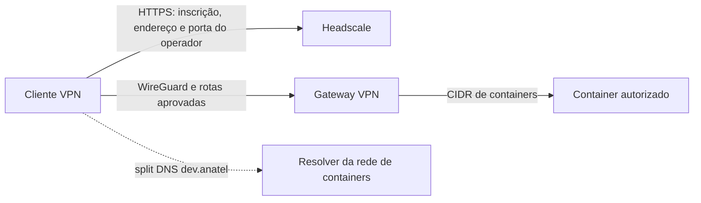

<details id="top">
    <summary>Índice</summary>
    <ol>
        <li><a href="#1-objetivo-e-público">Objetivo e público</a></li>
        <li><a href="#2-visão-geral-e-pré-requisitos">Visão geral e pré-requisitos</a></li>
        <li><a href="#3-escolha-do-cliente">Escolha do cliente</a></li>
        <li><a href="#4-confiar-na-ca">Confiar na CA</a></li>
        <li><a href="#5-linux">Linux</a></li>
        <li><a href="#6-windows-11">Windows 11</a></li>
        <li><a href="#7-macos">macOS</a></li>
        <li><a href="#8-verificar-a-conexão">Verificar a conexão</a></li>
        <li><a href="#9-acessar-containers">Acessar containers</a></li>
        <li><a href="#10-solucionar-problemas">Solucionar problemas</a></li>
        <li><a href="#11-desconectar-e-remover">Desconectar e remover</a></li>
        <li><a href="#12-fontes-oficiais">Fontes oficiais</a></li>
    </ol>
</details>

# Cliente VPN do Gateway e acesso aos containers

## 1. Objetivo e público

Procedimento para desenvolvedores e operadores conectarem clientes Linux, Windows 11 e macOS ao Headscale auto-hospedado no Gateway. A VPN oferece
acesso dividido (split tunnel) ao CIDR dos containers e DNS dividido para nomes autorizados em `dev.anatel`; não encaminha a rota default nem transforma o Gateway em exit node.

O alvo é rootless; a variante rootful continua implementada e mantida como alternativa na [receita rootful](gateway-headscale-podman-rootfull.md).

<div>
  <a href="#top" title="De volta ao topo da página">
    <picture>
      <source media="(prefers-color-scheme: dark)" srcset="../images/up-arrow_white.svg">
      
    </picture>
  </a>
  <br><br>
</div>

## 2. Visão geral e pré-requisitos

Deve-se ter acesso ao endpoint do Headscale em TCP 443. Depois da inscrição, o cliente usa a VPN para chegar ao Gateway e às rotas de containers aprovadas.

O split DNS de `dev.anatel` é para a rede autorizada e não deve ser publicado na Internet.

Headplane é acessível somente pela VPN por operadores autorizados, via HTTPS e com autenticação
própria. Desenvolvedores sem autorização de operador não devem acessá-lo.

Use `--login-server=https://<HEADSCALE_FQDN>` nos clientes. HTTPS usa TCP 443 diretamente no host; não encaminhe a conexão para uma porta não padrão.



Antes de começar, peça ao administrador os dados abaixo. A chave de inscrição deve ser individual,
de uso único, de curta validade e entregue fora do Git e do histórico do shell. A chave privada
do dispositivo é gerada localmente pelo Tailscale e não deve ser compartilhada.

Administradores: consulte a [receita de administração do Gateway VPN](gateway-vpn-admin.md) para
cadastrar usuários Headscale e emitir chaves de inscrição.

| Marcador | O que fornecer ou substituir | Exemplo ilustrativo |
| --- | --- | --- |
| `<HEADSCALE_FQDN>` | Nome público ou privado (ou IP) do Headscale por meio do qual o cliente pode acessar o serviço HTTPS na porta TCP 443. | `headscale.dev.anatel` |
| `<AUTH_KEY_FILE>` | Caminho local, fora do repositório, para o arquivo de chave de inscrição entregue pelo administrador. | `/home/ana/.config/tailscale/auth-key` |
| `<CA_FILE>` | Caminho do certificado público da CA privada, somente se o endpoint usar essa CA. | `/home/ana/Downloads/gateway-ca.crt` |
| `<APP_ALIAS>` | Nome DNS autorizado para o serviço/container. | `backend.project-a.dev.anatel` |
| `<GATEWAY_ALIAS>` | Nome DNS autorizado para o Gateway. | `dev-gateway.dev.anatel` |
| `<CONTAINER_CIDR>` | Rede rootless de containers anunciada pelo Gateway e aceita pelo cliente. | `10.90.0.0/24` |
| `<IP_DO_CONTAINER>` | Endereço do container/serviço autorizado, informado pelo operador. | `10.90.0.11` — webapp |
| `<VPN_PREFIX>` | Prefixo de endereços atribuídos aos clientes VPN. | `100.96.0.0/24` |
| `<SERVICE_PORT>` | Porta do serviço liberada pelo operador. | `5432` para PostgreSQL |
| `<OPERADOR_LOCAL>` | Conta local autorizada a operar `tailscaled` sem `sudo`, se necessário. | `ana` |

Proteja `<AUTH_KEY_FILE>` contra leitura por outros usuários e apague-o depois da inscrição.
Confirme aliases permitidos, portas e procedimento de aprovação. O alvo usa `10.90.0.0/24` para
containers e `100.96.0.0/24` para clientes VPN. Se houver sobreposição com LAN, VPN corporativa
ou outra rede Tailscale, pare e peça um plano de endereçamento.

<div>
  <a href="#top" title="De volta ao topo da página">
    <picture>
      <source media="(prefers-color-scheme: dark)" srcset="../images/up-arrow_white.svg">
      
    </picture>
  </a>
  <br><br>
</div>

## 3. Escolha do cliente

| Sistema | Cliente CLI | Opção GUI | Compatibilidade a confirmar |
| --- | --- | --- | --- |
| Linux | Tailscale CLI oficial; instale pelo repositório da distribuição indicado pelo Tailscale. | `tailscale systray` oficial; confirme os requisitos da distribuição. Trayscale e KTailctl são de terceiros. | A versão mínima depende da distribuição e do pacote; consulte os requisitos atuais. |
| Windows 11 | Tailscale CLI oficial no PowerShell. | Aplicativo Tailscale oficial; a documentação Headscale usa CLI para definir o servidor customizado. | O instalador atual declara Windows 10 ou posterior. Windows 11 está incluído. |
| macOS | Tailscale CLI oficial, se instalado com o aplicativo; use o caminho documentado para a variante instalada. | Headscale descreve GUI para servidor customizado; confirme o suporte na variante instalada. | Confirme a compatibilidade com a documentação da versão atual do cliente. |

Para Linux, prefira a instalação pelo repositório oficial. Consulte requisitos e instruções do
systray na [documentação oficial](https://tailscale.com/kb/1597/linux-systray), incluindo a versão
mínima, D-Bus e `StatusNotifierItem` exigidos pela distribuição. Trayscale e KTailctl são projetos
não oficiais. Confirme a origem dos pacotes na seção [Fontes oficiais](#12-fontes-oficiais).

No Windows, instale o cliente oficial, inclusive pelo MSI quando a equipe distribuir pacotes
gerenciados. Use o aplicativo gráfico para estado e operações diárias, mas defina o servidor
Headscale pela CLI conforme a documentação Headscale. No macOS, prefira a variante standalone;
não instale as variantes standalone e App Store simultaneamente.

<div>
  <a href="#top" title="De volta ao topo da página">
    <picture>
      <source media="(prefers-color-scheme: dark)" srcset="../images/up-arrow_white.svg">
      
    </picture>
  </a>
  <br><br>
</div>

## 4. Confiar na CA

Execute esta seção somente quando o operador confirmar que o certificado HTTPS do Headscale
usa uma CA privada. Obtenha o certificado público da CA por canal confiável. Compare a impressão
digital SHA-256 do certificado com o valor SHA-256 entregue pelo operador por canal separado.
**Pare** se os valores diferirem. Não instale uma CA de laboratório como CA de produção. Siga
somente as instruções oficiais da distribuição e do sistema operacional. Os comandos desta seção
não foram verificados como escritos nesta receita.

### Debian

Calcule e compare a impressão digital antes da instalação. Continue somente se os valores
coincidirem. Instale o certificado no diretório de CAs locais e atualize o repositório:

```bash
openssl x509 -noout -fingerprint -sha256 -in "<CA_FILE>"
```

```bash
sudo install -m 0644 "<CA_FILE>" /usr/local/share/ca-certificates/gateway-vpn.crt
sudo update-ca-certificates
```

### RHEL

Calcule e compare a impressão digital antes da instalação. Continue somente se os valores
coincidirem. Instale o certificado no diretório de âncoras do sistema e atualize a confiança:

```bash
openssl x509 -noout -fingerprint -sha256 -in "<CA_FILE>"
```

```bash
sudo install -m 0644 "<CA_FILE>" /etc/pki/ca-trust/source/anchors/gateway-vpn.crt
sudo update-ca-trust extract
```

Para Ubuntu ou Fedora, a equivalência desses comandos não foi verificada. Siga a documentação
oficial da distribuição; não presuma que os comandos Debian ou RHEL se aplicam.

### Windows 11

**Não verificado nesta receita.**

Em PowerShell 7, calcule a impressão digital SHA-256 do certificado e compare com o valor SHA-256
recebido do operador por canal separado. O método usa .NET Core; não compare o hash SHA-256 do
arquivo com a impressão digital do certificado. Se a impressão digital diferir, pare.

```powershell
$c=[System.Security.Cryptography.X509Certificates.X509Certificate2]::new("<CA_FILE>"); $c.GetCertHashString("SHA256")
```

`Import-Certificate` aceita arquivos `.cer` em DER ou Base64. Importe a CA para as raízes
confiáveis do computador local:

```powershell
Import-Certificate -FilePath "<CA_FILE>" -CertStoreLocation Cert:\LocalMachine\Root
```

Se a importação acima falhar, use esta alternativa em PowerShell elevado:

```powershell
certutil -addstore -f Root "<CA_FILE>"
```

### macOS

**Não verificado nesta receita.**

Antes de instalar, calcule a impressão digital SHA-256 e compare com o valor entregue pelo operador
por canal separado. Pare se diferir. Confirme a sintaxe atual do comando `security` na documentação
Apple antes de instalar a CA raiz no chaveiro de sistema.

```bash
openssl x509 -noout -fingerprint -sha256 -in "<CA_FILE>"
```

```bash
sudo security add-trusted-cert -d -r trustRoot -k /Library/Keychains/System.keychain "<CA_FILE>"
```

<div>
  <a href="#top" title="De volta ao topo da página">
    <picture>
      <source media="(prefers-color-scheme: dark)" srcset="../images/up-arrow_white.svg">
      
    </picture>
  </a>
  <br><br>
</div>

## 5. Linux

Use um terminal Bash. Instale o pacote pelo [procedimento oficial para sua distribuição](https://tailscale.com/kb/1031/install-linux), que configura o repositório Tailscale. Inicie o serviço `tailscaled` conforme a distribuição e confirme que o comando `tailscale` está disponível.

**Não verificado como escrito nesta receita.**
Confira a sintaxe e as opções suportadas na documentação da versão instalada. Com o arquivo de
chave local entregue pelo operador, este exemplo inscreve o dispositivo e aceita rota e DNS. O
prefixo `file:` faz o CLI ler a chave do arquivo, sem colocá-la no histórico do shell.

```bash
sudo tailscale up --login-server=https://<HEADSCALE_FQDN> \
  --auth-key=file:<AUTH_KEY_FILE> --accept-routes=true --accept-dns=true
```

Para permitir que um usuário opere `tailscaled` sem `sudo`, inclua `--operator=<OPERADOR_LOCAL>` na
chamada inicial `sudo tailscale up`, conforme a documentação Tailscale. Não use `--exit-node` nem
anuncie uma rota default.

Em desktops, a documentação oficial descreve `tailscale systray`; consulte os requisitos atuais
na [documentação do systray Linux](https://tailscale.com/kb/1597/linux-systray). A versão mínima
v1.88 e o uso com Headscale não foram verificados. Trayscale e KTailctl são GUIs Linux de terceiros. Inscreva primeiro pela CLI; não foi verificado se essas GUIs configuram Headscale.

<div>
  <a href="#top" title="De volta ao topo da página">
    <picture>
      <source media="(prefers-color-scheme: dark)" srcset="../images/up-arrow_white.svg">
      
    </picture>
  </a>
  <br><br>
</div>

## 6. Windows 11

**Não verificado nesta receita.**
Instale o cliente Tailscale oficial pelo [instalador Windows](https://tailscale.com/kb/1022/install-windows) ou pelo [MSI oficial](https://tailscale.com/docs/install/windows/msi). Use PowerShell elevado (Administrador) para `tailscale up`. O aplicativo gráfico oficial fornece o estado e os controles diários. Confirme na documentação da versão instalada o suporte ao servidor Headscale customizado.

Para definir o servidor Headscale, siga o fluxo CLI documentado pelo Headscale. Com chave
entregue em arquivo, use o caminho local sem copiar o segredo para a linha de comando:

```powershell
tailscale up --login-server=https://<HEADSCALE_FQDN> `
  --auth-key="file:<AUTH_KEY_FILE>" --accept-routes=true --accept-dns=true
```

Confira a rota default:

```powershell
Get-NetRoute -DestinationPrefix 0.0.0.0/0
```

**Resultado esperado:** a rota default continua usando o gateway local, não a Tailscale.

<div>
  <a href="#top" title="De volta ao topo da página">
    <picture>
      <source media="(prefers-color-scheme: dark)" srcset="../images/up-arrow_white.svg">
      
    </picture>
  </a>
  <br><br>
</div>

## 7. macOS

**Não verificado nesta receita.**
Prefira a variante standalone do aplicativo Tailscale. Confirme na documentação da variante
instalada o suporte ao servidor customizado, às rotas e ao DNS. Não mantenha as variantes App Store
e standalone no mesmo computador.

Para configurar o servidor customizado pela GUI conforme o fluxo documentado pelo Headscale,
mantenha `⌥` (Option) pressionada e clique no ícone Tailscale da barra de menus. Passe sobre
**Debug** e escolha **Custom Login Server** > **Add Account...**. Informe
`https://<HEADSCALE_FQDN>`. Não conclua inscrição pelo navegador nem aprove solicitação de
inscrição sem a chave individual, de uso único e validade curta fornecida pelo operador. Se a GUI
não tiver campo para informar essa chave, pare e use o CLI abaixo com `--auth-key=file:`. Use a GUI
para status e uso diário somente conforme o fluxo documentado para a variante instalada.

Para inscrição pelo caminho contratual, use o CLI com a chave entregue em arquivo para conectar
ao servidor customizado. O prefixo `file:` faz o CLI ler a chave sem incluí-la no histórico do shell:

```bash
tailscale up --login-server=https://<HEADSCALE_FQDN> \
  --auth-key=file:<AUTH_KEY_FILE> --accept-routes=true --accept-dns=true
```

O caminho do CLI standalone não foi confirmado para a variante instalada. Use o caminho
documentado pelo fornecedor; não presuma que
`/Applications/Tailscale.app/Contents/MacOS/Tailscale` existe. Confirme a instalação e as
permissões com o operador.

O comando de rota default não foi verificado nesta receita. Resultado esperado: a rota continua
usando o gateway local, não a Tailscale.

```bash
netstat -rn -f inet | grep default
```

<div>
  <a href="#top" title="De volta ao topo da página">
    <picture>
      <source media="(prefers-color-scheme: dark)" srcset="../images/up-arrow_white.svg">
      
    </picture>
  </a>
  <br><br>
</div>

## 8. Verificar a conexão

Use aliases autorizados e compare DNS, endereço e porta com os dados do operador. Os comandos
abaixo são exemplos de verificação. Não use teste ICMP como única prova, pois containers podem
bloquear ping. Os exemplos usam placeholders e não foram verificados como escritos nesta receita.

```bash
tailscale status
getent hosts <GATEWAY_ALIAS>
getent hosts <APP_ALIAS>
```

Resultado esperado: `tailscale status` mostra o cliente conectado; os aliases resolvem para os
endereços aprovados pelo operador.

Em Linux com `systemd-resolved`, consulte o nome e a rota. Estes comandos não foram verificados
nesta receita:

```bash
resolvectl query <APP_ALIAS>
ip route get <IP_DO_CONTAINER>
```

Resultado esperado: `resolvectl` retorna o endereço aprovado e a rota para o container usa a
interface VPN.

No Windows, verifique estado, resolução, porta autorizada e rota default. Estes comandos não foram
verificados nesta receita:

```powershell
tailscale status
Resolve-DnsName <APP_ALIAS>
Test-NetConnection <APP_ALIAS> -Port <SERVICE_PORT>
Get-NetRoute -DestinationPrefix 0.0.0.0/0
```

Resultado esperado: o alias resolve para o endereço aprovado; a rota default permanece no gateway
local. A conexão TCP deve ter sucesso somente quando o operador autorizar a porta e o serviço
estiver acessível.

No macOS, verifique estado, resolução, porta autorizada e rota default. Estes comandos não foram
verificados nesta receita:

```bash
tailscale status
dscacheutil -q host -a name <APP_ALIAS>
nc -vz <APP_ALIAS> <SERVICE_PORT>
netstat -rn -f inet | grep default
```

Resultado esperado: o alias resolve para o endereço aprovado; a rota default permanece no gateway
local. A conexão TCP deve ter sucesso somente quando o operador autorizar a porta e o serviço
estiver acessível.

Confira também as rotas do Linux. Estes comandos não foram verificados nesta receita. A rota de
`<CONTAINER_CIDR>` deve usar a interface VPN; a rota default local não deve passar pela Tailscale.

```bash
ip -4 route show <CONTAINER_CIDR>
ip -4 route show default
```

Headplane é acessível somente pela VPN por operadores autorizados, via HTTPS e com autenticação
própria. Não é um serviço de desenvolvedor.

<div>
  <a href="#top" title="De volta ao topo da página">
    <picture>
      <source media="(prefers-color-scheme: dark)" srcset="../images/up-arrow_white.svg">
      
    </picture>
  </a>
  <br><br>
</div>

## 9. Acessar containers

A VPN fornece conectividade de rede, mas não autenticação dos serviços. O acesso SSH aos containers,
inclusive por VS Code, está **a implementar** e fora do escopo atual. A referência de chaves
permanece [Chaves SSH de acesso ao Gateway e aos containers](ssh-key.md).

O emulador de identidade está **a implementar** e fora do escopo atual. Use o proxy de aplicação
autorizado para acesso HTTP de desenvolvimento.

### HTTP de desenvolvimento

Use o proxy de aplicação autorizado para acessar a SPA e a rota de saúde. Não use o emulador de
identidade, que permanece fora do escopo.

### PostgreSQL

Esta receita não inclui credenciais PostgreSQL. Peça ao operador as instruções de conexão e
autorização; conectividade TCP não substitui autenticação no banco.
<div>
  <a href="#top" title="De volta ao topo da página">
    <picture>
      <source media="(prefers-color-scheme: dark)" srcset="../images/up-arrow_white.svg">
      
    </picture>
  </a>
  <br><br>
</div>

## 10. Solucionar problemas

| Sintoma | Causa provável | Ação |
| --- | --- | --- |
| Erro TLS ao contatar Headscale | CA privada ausente, nome incorreto ou certificado expirado. | Confirme `<HEADSCALE_FQDN>`, validade e impressão digital SHA-256 com o operador; instale somente a CA pública aprovada. Não desative a validação TLS. |
| Nó inscrito, mas serviço inacessível | Rota não aprovada, rota não aceita ou porta não liberada. | Confirme aprovação da rota, aceite de rotas no cliente e acesso ao `<SERVICE_PORT>` com o operador. O comportamento de rotas pode variar por sistema; confirme a configuração aplicada no cliente. |
| Alias `dev.anatel` não resolve | DNS não aceito, alias ausente, resolução local em cache ou VPN sem configuração split DNS. | Confirme `--accept-dns=true`, alias e política DNS distribuída; repita a consulta do sistema operacional. |
| DNS usa endereço diferente do esperado | Cache local ou domínio conflitante com outra VPN. | Compare com o endereço fornecido pelo operador, limpe o cache pelo método do SO e teste sem alterar DNS corporativo. |
| VPN corporativa/Tailscale conflitante | CIDR, domínio DNS ou rota sobrepostos. | Compare as rotas da LAN/VPN corporativa com `<CONTAINER_CIDR>` e `<VPN_PREFIX>`; envie conflitos ao operador e peça plano de endereçamento. Não altere a rota default nem desconecte a VPN corporativa sem autorização. |
| Login informa chave inválida, expirada ou usada | Chave de inscrição de uso único foi consumida ou expirou. | Peça ao operador nova chave individual. Não envie a chave antiga em chamados ou logs. |
| `tailscale status` não mostra conexão | Serviço parado, login pendente ou endpoint configurado indisponível. | Confirme serviço, relógio do sistema e resolução/acesso ao endpoint definido pelo operador antes da VPN; solicite aprovação ao operador. |

Em Linux com `systemd-resolved`, `resolvectl query <APP_ALIAS>` mostra o resultado consultado.
Se o domínio também existir numa VPN corporativa, a seleção do resolver pode depender da
configuração local; não altere a política corporativa sem autorização.

<div>
  <a href="#top" title="De volta ao topo da página">
    <picture>
      <source media="(prefers-color-scheme: dark)" srcset="../images/up-arrow_white.svg">
      
    </picture>
  </a>
  <br><br>
</div>

## 11. Desconectar e remover

`tailscale down` desconecta temporariamente o cliente e mantém a inscrição local para reconexão.
`tailscale logout` encerra a inscrição local; peça ao operador para revogar/remover o dispositivo
no Headscale quando o acesso não for mais necessário. Desconectar não substitui revogação.

```bash
tailscale down
```

Para sair da inscrição local:

```bash
tailscale logout
```

Remova o pacote Tailscale pelo gerenciador de pacotes Linux, desinstale o aplicativo em
**Configurações > Aplicativos** no Windows, ou remova a variante instalada no macOS seguindo as
instruções do fornecedor. Apague o arquivo local da chave de inscrição após uso. Se instalou
uma CA privada somente para este serviço, remova apenas essa âncora pelo gerenciador do sistema
e atualize o repositório de confiança; confirme a impressão digital antes de removê-la.

<div>
  <a href="#top" title="De volta ao topo da página">
    <picture>
      <source media="(prefers-color-scheme: dark)" srcset="../images/up-arrow_white.svg">
      
    </picture>
  </a>
  <br><br>
</div>

## 12. Fontes oficiais

Consulte a documentação oficial correspondente à versão instalada. Para clientes Linux, use a
tabela geral de clientes e a documentação Linux do Tailscale. Projetos GUI Linux são de terceiros
e estão identificados como tal.

### Headscale

- [Clientes suportados](https://headscale.net/stable/about/clients/)
- [Conectar Windows](https://headscale.net/stable/usage/connect/windows/)
- [Conectar Apple/macOS](https://headscale.net/stable/usage/connect/apple/)

### Tailscale

- [Instalar em Linux](https://tailscale.com/kb/1031/install-linux)
- [Instalar em Windows](https://tailscale.com/kb/1022/install-windows)
- [Instalar o MSI no Windows](https://tailscale.com/docs/install/windows/msi)
- [Instalar em macOS](https://tailscale.com/kb/1016/install-mac)
- [Variantes macOS](https://tailscale.com/kb/1065/macos-variants)
- [CLI e flags `tailscale up`](https://tailscale.com/docs/reference/tailscale-cli/up)
- [CLI: conectar, desconectar e sair](https://tailscale.com/kb/1080/cli)
- [Chaves de autenticação](https://tailscale.com/docs/features/access-control/auth-keys)
- [Rotas de sub-rede](https://tailscale.com/kb/1019/subnets)
- [Políticas MDM para Windows](https://tailscale.com/kb/1318/windows-mdm)
- [Systray Linux](https://tailscale.com/kb/1597/linux-systray)

### Certificados e SSH

- [Debian: `update-ca-certificates`](https://manpages.debian.org/stable/ca-certificates/update-ca-certificates.8.en.html)
- [Red Hat: certificados compartilhados do sistema](https://docs.redhat.com/en/documentation/red_hat_enterprise_linux/9/html/securing_networks/using-shared-system-certificates_securing-networks)
- [PowerShell: `Import-Certificate`](https://learn.microsoft.com/en-us/powershell/module/pki/import-certificate?view=windowsserver2025-ps)
- [Apple: adicionar certificados ao Keychain](https://support.apple.com/guide/keychain-access/add-certificates-to-a-keychain-kyca2794/mac)
- [OpenSSH Client no Windows](https://learn.microsoft.com/en-us/windows-server/administration/openssh/openssh_install_firstuse)
- [VS Code Remote - SSH](https://code.visualstudio.com/docs/remote/ssh)

### Projetos GUI Linux de terceiros

- [Trayscale — GUI não oficial para Tailscale](https://github.com/DeedleFake/trayscale)
- [KTailctl — GUI Linux não oficial para Tailscale](https://github.com/f-koehler/KTailctl)

<div>
  <a href="#top" title="De volta ao topo da página">
    <picture>
      <source media="(prefers-color-scheme: dark)" srcset="../images/up-arrow_white.svg">
      
    </picture>
  </a>
  <br><br>
</div>