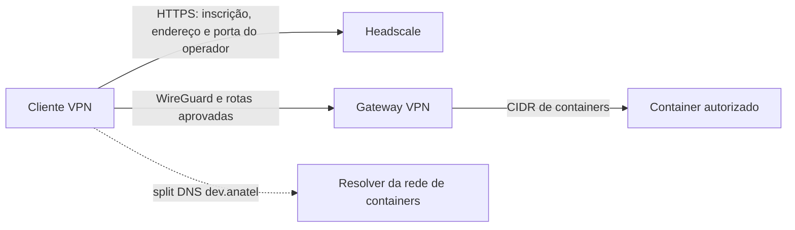

<details id="top">
    <summary>Índice</summary>
    <ol>
        <li><a href="#1-objetivo-e-público">Objetivo e público</a></li>
        <li><a href="#2-visão-geral-e-pré-requisitos">Visão geral e pré-requisitos</a></li>
        <li><a href="#3-escolha-do-cliente">Escolha do cliente</a></li>
        <li><a href="#4-confiar-na-ca">Confiar na CA</a></li>
        <li><a href="#5-linux">Linux</a></li>
        <li><a href="#6-windows-11">Windows 11</a></li>
        <li><a href="#7-macos">macOS</a></li>
        <li><a href="#8-verificar-a-conexão">Verificar a conexão</a></li>
        <li><a href="#9-acessar-containers">Acessar containers</a></li>
        <li><a href="#10-solucionar-problemas">Solucionar problemas</a></li>
        <li><a href="#11-desconectar-e-remover">Desconectar e remover</a></li>
        <li><a href="#12-fontes-oficiais">Fontes oficiais</a></li>
    </ol>
</details>

# Cliente VPN do Gateway e acesso aos containers

## 1. Objetivo e público

Procedimento para desenvolvedores e operadores conectarem clientes Linux, Windows 11 e macOS
ao Headscale auto-hospedado no Gateway. A VPN oferece acesso dividido (split tunnel) ao CIDR
dos containers e DNS dividido para nomes autorizados em `dev.anatel`; não encaminha a rota
default nem transforma o Gateway em exit node.

> **Status do cliente (2026-10-29):** resultados do teste de laboratório Debian 13 (registro de
> sessão, fora do repositório), com Tailscale 1.104.4, no experimento rootless da
> [receita Headscale](gateway-headscale-podman-rootless.md). Não infira argumentos que o registro
> não informa:
>
> | Comando ou teste | Plataforma | Estado |
> | --- | --- | --- |
> | `tailscale status` e estado pós-boot do Headscale | Debian 13 / Tailscale 1.104.4 | Testado; IDs 1 (`gateway-router`, `100.96.0.1`) e 2 (`containerhost`, `100.96.0.2`) mantiveram-se online. |
> | DNS dividido por `10.90.0.1:53` | Debian 13 / Tailscale 1.104.4 | Testado por UDP e TCP; Gateway resolveu para `10.90.0.2` e app para `10.90.0.3`. `getent` via split DNS também resolveu ambos; argumentos exatos não registrados. |
> | HTTPS em TCP 8443 pela LAN | Debian 13 / Tailscale 1.104.4 | Testado; respondeu HTTP 200. TLS validou; o arquivo CA estava presente em `/usr/local/share/ca-certificates/gwvpn-lab.crt`, mas o mecanismo de confiança (`update-ca-certificates` ou `--cacert`) não foi registrado. Isso não comprova a execução da §4. Certificado `CN=headscale.dev.anatel`, emissor `CN=GWVPN Lab CA 2026`. |
> | Acesso à aplicação por IP e alias | Debian 13 / Tailscale 1.104.4 | Testado; aplicação acessada por IP e alias. A aplicação recebeu `100.96.0.2` como IP de origem VPN preservado, conforme §5.5 do contrato. |
> | Teste de conexão ao servidor em TCP 443 e 9090 | Debian 13 / Tailscale 1.104.4, LAN | Sem conexão (`http_code=000`); o servidor não tinha listener nessas portas no momento do teste. A inscrição usou `:8443` pela LAN; 443 público via perímetro não foi testado. |
> | Rota default do cliente | Debian 13 / Tailscale 1.104.4 | Testado; permaneceu `192.168.7.1`. |
>
> A inscrição usou uma chave de uso único e `https://headscale.dev.anatel:8443` pela LAN; o comando
> CLI exato não consta no registro. **Não** usou nem validou Headscale público em TCP 443. Os
> comandos e fluxos que não constam na tabela são **não verificados**, inclusive a forma escrita
> `tailscale up --auth-key=file:`, `--operator`, `resolvectl query`, `ip route get`, GUIs, Windows e
> macOS. Os comandos da §4 também não foram executados como escritos.
>
> O experimento é temporário e experimental; não altera o contrato rootful de
> [ARCHITECTURE.md](../contracts/ARCHITECTURE.md).

<div>
  <a href="#top" title="De volta ao topo da página">
    <picture>
      <source media="(prefers-color-scheme: dark)" srcset="../images/up-arrow_white.svg">
      
    </picture>
  </a>
  <br><br>
</div>

## 2. Visão geral e pré-requisitos

No ambiente de produção, o endpoint HTTPS do Headscale precisa ser alcançável antes da inscrição.
No teste rootless, a inscrição e a verificação usaram o endpoint LAN
`https://headscale.dev.anatel:8443`; TCP 443 público não foi testado. Depois da inscrição,
o cliente usa WireGuard para chegar ao Gateway e às rotas de containers aprovadas. O split DNS
resolve somente nomes de desenvolvimento. No teste rootless, o cliente consultou
`10.90.0.1:53` por UDP e TCP, e os nomes do Gateway e da app resolveram para `10.90.0.2` e
`10.90.0.3`; não publique esse DNS na Internet.

Headplane é acessível somente pela VPN por operadores autorizados, via HTTPS e com autenticação
própria. Desenvolvedores sem autorização de operador não devem acessá-lo.

Se o operador fornecer porta não padrão para endpoint de teste/LAN, use
`--login-server=https://<HEADSCALE_FQDN>:8443` (exemplo somente para teste). Em produção, use
HTTPS na porta 443, encaminhada pelo perímetro.



Antes de começar, peça ao operador os dados abaixo. A chave de inscrição deve ser individual,
de uso único, de curta validade e entregue fora do Git e do histórico do shell. A chave privada
do dispositivo é gerada localmente pelo Tailscale e não deve ser compartilhada.

| Marcador | O que fornecer ou substituir | Exemplo ilustrativo |
| --- | --- | --- |
| `<HEADSCALE_FQDN>` | Nome público do Headscale; HTTPS TCP 443 deve funcionar antes da VPN. | `headscale.exemplo.net` |
| `<AUTH_KEY_FILE>` | Caminho local, fora do repositório, para o arquivo de chave de inscrição entregue pelo operador. | `/home/ana/.config/tailscale/auth-key` |
| `<CA_FILE>` | Caminho do certificado público da CA privada, somente se o endpoint usar essa CA. | `/home/ana/Downloads/gateway-ca.crt` |
| `<APP_ALIAS>` | Nome DNS autorizado para o serviço/container. | `backend.project-a.dev.anatel` |
| `<GATEWAY_ALIAS>` | Nome DNS autorizado para o Gateway. | `dev-gateway.dev.anatel` |
| `<EMULATOR_ALIAS>` | Alias ou endereço do emulador de identidade de desenvolvimento na rede Podman, dentro de `<CONTAINER_CIDR>`. Confirme com o operador. | Fornecido pelo operador; sem valor padrão. |
| `<CONTAINER_CIDR>` | Rede de containers anunciada pelo Gateway e aceita pelo cliente. | `10.90.0.0/24` — bridge rootless de teste, não padrão de produção |
| `<IP_DO_CONTAINER>` | Endereço do container/serviço autorizado, informado pelo operador. | `10.90.0.3` — endereço de teste, não padrão de produção |
| `<VPN_PREFIX>` | Prefixo de endereços atribuídos aos clientes VPN. | `100.96.0.0/24` — valor de teste, não padrão de produção |
| `<SERVICE_PORT>` | Porta do serviço liberada pelo operador. | `5432` para PostgreSQL |
| `<OPERADOR_LOCAL>` | Conta local autorizada a operar `tailscaled` sem `sudo`, se necessário. | `ana` |
| `<CONTA_SSH>` | Conta SSH já autorizada no container. | `appuser` |
| `<SSH_PORT>` | Porta SSH do serviço/container. | `22` |

Proteja `<AUTH_KEY_FILE>` contra leitura por outros usuários e apague-o depois da inscrição.
Confirme com o operador o CIDR efetivo, aliases permitidos, portas e procedimento de aprovação.
Não presuma que os exemplos correspondem à rede ativa. Se houver sobreposição com LAN, VPN
corporativa ou outra rede Tailscale, pare e peça um plano de endereçamento.

<div>
  <a href="#top" title="De volta ao topo da página">
    <picture>
      <source media="(prefers-color-scheme: dark)" srcset="../images/up-arrow_white.svg">
      
    </picture>
  </a>
  <br><br>
</div>

## 3. Escolha do cliente

| Sistema | Cliente CLI mínimo | Opção GUI | Versão mínima verificada na documentação |
| --- | --- | --- | --- |
| Linux | Tailscale CLI oficial; instale pelo repositório da distribuição indicado pelo Tailscale. | `tailscale systray` oficial; mínimo v1.88 não verificado. Trayscale e KTailctl são de terceiros. | A documentação consultada não declara um mínimo único; depende da distribuição e do pacote. |
| Windows 11 | Tailscale CLI oficial no PowerShell. | Aplicativo Tailscale oficial; a documentação Headscale usa CLI para definir o servidor customizado. | O instalador atual declara Windows 10 ou posterior. Windows 11 está incluído. |
| macOS | Tailscale CLI oficial, se instalado com o aplicativo; caminho do CLI standalone não verificado. | Headscale descreve GUI para servidor customizado; suporte nas variantes App Store e standalone não verificado. | Compatibilidade depende da versão atual do cliente; não verificada nesta receita. |

Para Linux, prefira a instalação pelo repositório oficial. Consulte requisitos e instruções do
systray na [documentação oficial](https://tailscale.com/kb/1597/linux-systray); o mínimo v1.88,
D-Bus e `StatusNotifierItem` não foram verificados nesta receita. Trayscale e KTailctl são projetos
não oficiais. Confirme a origem dos pacotes na seção [Fontes oficiais](#12-fontes-oficiais).

No Windows, instale o cliente oficial, inclusive pelo MSI quando a equipe distribuir pacotes
gerenciados. Use o aplicativo gráfico para estado e operações diárias, mas defina o servidor
Headscale pela CLI conforme a documentação Headscale. No macOS, prefira a variante standalone;
não instale as variantes standalone e App Store simultaneamente.

<div>
  <a href="#top" title="De volta ao topo da página">
    <picture>
      <source media="(prefers-color-scheme: dark)" srcset="../images/up-arrow_white.svg">
      
    </picture>
  </a>
  <br><br>
</div>

## 4. Confiar na CA

Execute esta seção somente quando o operador confirmar que o certificado HTTPS do Headscale
usa uma CA privada. Obtenha o certificado público da CA por canal confiável. Compare a impressão
digital SHA-256 do certificado com o valor SHA-256 entregue pelo operador por canal separado.
**Pare** se os valores diferirem. Não instale a CA de laboratório usada nos testes como CA de
produção. No cliente Debian 13, o arquivo público `/usr/local/share/ca-certificates/gwvpn-lab.crt`
estava presente e TLS validou. O registro não informa se a confiança veio de
`update-ca-certificates`, `--cacert` ou outro mecanismo; isso não comprova a execução dos
procedimentos desta seção. Trate todos os comandos da seção como não verificados.

### Debian

Calcule e compare a impressão digital antes da instalação. Continue somente se os valores
coincidirem. Instale o certificado no diretório de CAs locais e atualize o repositório:

```bash
openssl x509 -noout -fingerprint -sha256 -in "<CA_FILE>"
```

```bash
sudo install -m 0644 "<CA_FILE>" /usr/local/share/ca-certificates/gateway-vpn.crt
sudo update-ca-certificates
```

### RHEL

Calcule e compare a impressão digital antes da instalação. Continue somente se os valores
coincidirem. Instale o certificado no diretório de âncoras do sistema e atualize a confiança:

```bash
openssl x509 -noout -fingerprint -sha256 -in "<CA_FILE>"
```

```bash
sudo install -m 0644 "<CA_FILE>" /etc/pki/ca-trust/source/anchors/gateway-vpn.crt
sudo update-ca-trust extract
```

Ubuntu e Fedora provavelmente usam procedimentos semelhantes aos de Debian e RHEL,
respectivamente; essa equivalência não foi verificada.

### Windows 11

**Não verificado.** Em PowerShell 7, calcule a impressão digital SHA-256 do certificado e compare
com o valor SHA-256 recebido do operador por canal separado. O método usa .NET Core; não compare
o hash SHA-256 do arquivo com a impressão digital do certificado. Se a impressão digital diferir,
pare.

```powershell
$c=[System.Security.Cryptography.X509Certificates.X509Certificate2]::new("<CA_FILE>"); $c.GetCertHashString("SHA256")
```

`Import-Certificate` aceita arquivos `.cer` em DER ou Base64. Importe a CA para as raízes
confiáveis do computador local:

```powershell
Import-Certificate -FilePath "<CA_FILE>" -CertStoreLocation Cert:\LocalMachine\Root
```

Se a importação acima falhar, use esta alternativa em PowerShell elevado:

```powershell
certutil -addstore -f Root "<CA_FILE>"
```

### macOS

**Não verificado.** Antes de instalar, calcule a impressão digital SHA-256 e compare com o valor
entregue pelo operador por canal separado. Pare se diferir. No Terminal, instale a CA raiz no
chaveiro de sistema; a sintaxe não foi testada neste projeto.

```bash
openssl x509 -noout -fingerprint -sha256 -in "<CA_FILE>"
```

```bash
sudo security add-trusted-cert -d -r trustRoot -k /Library/Keychains/System.keychain "<CA_FILE>"
```

<div>
  <a href="#top" title="De volta ao topo da página">
    <picture>
      <source media="(prefers-color-scheme: dark)" srcset="../images/up-arrow_white.svg">
      
    </picture>
  </a>
  <br><br>
</div>

## 5. Linux

Use um terminal Bash. Instale o pacote pelo [procedimento oficial para sua distribuição](https://tailscale.com/kb/1031/install-linux), que configura o repositório Tailscale. Inicie o serviço `tailscaled` conforme a distribuição e confirme que o comando `tailscale` está disponível.

**Não verificado como escrito.** A inscrição no laboratório usou chave de uso único, mas o
registro não contém a forma exata do comando. Com o arquivo de chave local entregue pelo operador,
este exemplo inscreve o dispositivo e aceita rota e DNS. O prefixo `file:` faz o CLI ler a chave
do arquivo, sem colocá-la no histórico do shell.

```bash
sudo tailscale up --login-server=https://<HEADSCALE_FQDN> \
  --auth-key=file:<AUTH_KEY_FILE> --accept-routes=true --accept-dns=true
```

Para permitir que um usuário opere `tailscaled` sem `sudo`, inclua `--operator=<OPERADOR_LOCAL>` na
chamada inicial `sudo tailscale up`, conforme a documentação Tailscale. Não use `--exit-node` nem
anuncie uma rota default.

Em desktops, a documentação oficial descreve `tailscale systray`; consulte os requisitos atuais
na [documentação do systray Linux](https://tailscale.com/kb/1597/linux-systray). A versão mínima
v1.88 e o uso com Headscale não foram verificados. Trayscale e KTailctl são GUIs Linux de terceiros. Inscreva primeiro pela CLI; não foi verificado se essas GUIs configuram Headscale.

<div>
  <a href="#top" title="De volta ao topo da página">
    <picture>
      <source media="(prefers-color-scheme: dark)" srcset="../images/up-arrow_white.svg">
      
    </picture>
  </a>
  <br><br>
</div>

## 6. Windows 11

**Não verificado.** Instale o cliente Tailscale oficial pelo [instalador Windows](https://tailscale.com/kb/1022/install-windows) ou pelo [MSI oficial](https://tailscale.com/docs/install/windows/msi). Use PowerShell elevado (Administrador) para `tailscale up`. O aplicativo gráfico oficial fornece o estado e os controles diários.

Para definir o servidor Headscale, siga o fluxo CLI documentado pelo Headscale. Com chave
entregue em arquivo, use o caminho local sem copiar o segredo para a linha de comando:

```powershell
tailscale up --login-server=https://<HEADSCALE_FQDN> `
  --auth-key="file:<AUTH_KEY_FILE>" --accept-routes=true --accept-dns=true
```

O aceite de rotas e DNS por padrão no Windows não foi verificado. Confira a rota default com o
comando abaixo; não deve aparecer rota default via Tailscale. Esse comando também não foi verificado.

```powershell
Get-NetRoute -DestinationPrefix 0.0.0.0/0
```

<div>
  <a href="#top" title="De volta ao topo da página">
    <picture>
      <source media="(prefers-color-scheme: dark)" srcset="../images/up-arrow_white.svg">
      
    </picture>
  </a>
  <br><br>
</div>

## 7. macOS

**Não verificado.** Prefira a variante standalone do aplicativo Tailscale. A documentação do
Headscale descreve a configuração de servidor customizado no macOS, mas não informa se o fluxo
funciona nas variantes App Store e standalone; o suporte de ambas não foi verificado. Não mantenha
as duas variantes no mesmo computador. O aceite de rotas e DNS por padrão também não foi verificado.

Para configurar o servidor customizado pela GUI conforme o fluxo documentado pelo Headscale,
mantenha `⌥` (Option) pressionada e clique no ícone Tailscale da barra de menus. Passe sobre
**Debug** e escolha **Custom Login Server** > **Add Account...**. Informe
`https://<HEADSCALE_FQDN>`. Não conclua inscrição pelo navegador nem aprove solicitação de
inscrição sem a chave individual, de uso único e validade curta fornecida pelo operador. Se a GUI
não tiver campo para informar essa chave, pare e use o CLI abaixo com `--auth-key=file:`. Mantenha
a GUI para status e uso diário. O passo a passo foi consultado, mas não testado neste projeto.

Para inscrição pelo caminho contratual, use o CLI com a chave entregue em arquivo para conectar
ao servidor customizado. O prefixo `file:` faz o CLI ler a chave sem incluí-la no histórico do shell:

```bash
tailscale up --login-server=https://<HEADSCALE_FQDN> \
  --auth-key=file:<AUTH_KEY_FILE> --accept-routes=true --accept-dns=true
```

O caminho `/Applications/Tailscale.app/Contents/MacOS/Tailscale` para o CLI standalone não foi
confirmado nas páginas oficiais consultadas; seu uso não foi verificado. Confirme a instalação e
as permissões com o operador. O modo GUI e CLI no macOS não foi testado neste projeto.

Confira a rota default; não deve aparecer rota default via Tailscale. O comando não foi verificado.

```bash
netstat -rn -f inet | grep default
```

<div>
  <a href="#top" title="De volta ao topo da página">
    <picture>
      <source media="(prefers-color-scheme: dark)" srcset="../images/up-arrow_white.svg">
      
    </picture>
  </a>
  <br><br>
</div>

## 8. Verificar a conexão

O registro do laboratório confirma que `tailscale status` mostrou os dois nós online e que `getent`
via split DNS resolveu o Gateway (`10.90.0.2`) e a app (`10.90.0.3`). Também confirma consulta a
`10.90.0.1:53` por UDP e TCP e que a rota default permaneceu `192.168.7.1`. O registro não informa
os argumentos usados com `getent`; o exemplo abaixo é uma forma de repetir a verificação, não um
comando testado. Use aliases autorizados e compare DNS, endereço e porta com os dados do operador.
Não use teste ICMP como única prova, pois containers podem bloquear ping.

```bash
tailscale status
getent hosts <GATEWAY_ALIAS>
getent hosts <APP_ALIAS>
```

Exemplos não verificados de consulta e rota no Linux:

```bash
resolvectl query <APP_ALIAS>
ip route get <IP_DO_CONTAINER>
```

`getent ahostsv4` também não foi verificado.

Os comandos Windows e macOS não foram verificados:

```powershell
tailscale status
Resolve-DnsName <APP_ALIAS>
Test-NetConnection <APP_ALIAS> -Port <SERVICE_PORT>
Get-NetRoute -DestinationPrefix 0.0.0.0/0
```

```bash
tailscale status
dscacheutil -q host -a name <APP_ALIAS>
nc -vz <APP_ALIAS> <SERVICE_PORT>
netstat -rn -f inet | grep default
```

Confira também as rotas do Linux. Estes comandos não foram verificados. A rota de `<CONTAINER_CIDR>`
deve usar a interface VPN; a rota default local não deve passar pela Tailscale.

```bash
ip -4 route show <CONTAINER_CIDR>
ip -4 route show default
```

Headplane é acessível somente pela VPN por operadores autorizados, via HTTPS e com autenticação
própria. Não é um serviço de desenvolvedor.

<div>
  <a href="#top" title="De volta ao topo da página">
    <picture>
      <source media="(prefers-color-scheme: dark)" srcset="../images/up-arrow_white.svg">
      
    </picture>
  </a>
  <br><br>
</div>

## 9. Acessar containers

A VPN fornece rede, não autenticação da aplicação. Para SSH, use a conta, porta e chave
autorizadas do destino. O procedimento para gerar e instalar a chave está em
[Chaves SSH de acesso ao Gateway e aos containers](ssh-key.md).

```bash
ssh -p <SSH_PORT> <CONTA_SSH>@<APP_ALIAS>
```

No VS Code, instale a extensão Remote - SSH e conecte ao hostname DNS do container. O Gateway
não é um bastion SSH: a conexão segue diretamente pela VPN ao serviço publicado pelo container.
Consulte a [documentação VS Code Remote - SSH](https://code.visualstudio.com/docs/remote/ssh).

Para HTTP de desenvolvimento pela VPN, use o emulador de identidade na rede Podman, em TCP `80`,
sem porta vinculada no host: `http://<EMULATOR_ALIAS>:80/app/` para a SPA e
`http://<EMULATOR_ALIAS>:80/app/api/` para a API. O alias deve resolver para um endereço dentro de
`<CONTAINER_CIDR>`. O emulador injeta headers de identidade sintéticos `X-User-*`; não autentica
usuários e não substitui autenticação de produção. Estas URLs não foram testadas em laboratório.
O NGINX compartilhado publicado no host em TCP `8080` é o alvo do perímetro de produção, não o
caminho VPN de desenvolvimento. `webApp:8000` é interno e não deve ser acessado pelo cliente.
Para PostgreSQL, configure `psql`, pgAdmin ou DBeaver com
`<APP_ALIAS>:<SERVICE_PORT>` e as credenciais próprias do banco. Confirme com o operador qual
serviço e porta estão autorizados.

<div>
  <a href="#top" title="De volta ao topo da página">
    <picture>
      <source media="(prefers-color-scheme: dark)" srcset="../images/up-arrow_white.svg">
      
    </picture>
  </a>
  <br><br>
</div>

## 10. Solucionar problemas

| Sintoma | Causa provável | Ação |
| --- | --- | --- |
| Erro TLS ao contatar Headscale | CA privada ausente, nome incorreto ou certificado expirado. | Confirme `<HEADSCALE_FQDN>`, validade e impressão digital SHA-256 com o operador; instale somente a CA pública aprovada. Não desative a validação TLS. |
| Nó inscrito, mas serviço inacessível | Rota não aprovada, rota não aceita ou porta não liberada. | Confirme aprovação da rota, aceite de rotas no cliente e acesso ao `<SERVICE_PORT>` com o operador. O comportamento padrão de rotas por sistema não foi verificado neste teste. |
| Alias `dev.anatel` não resolve | DNS não aceito, alias ausente, resolução local em cache ou VPN sem configuração split DNS. | Confirme `--accept-dns=true`, alias e política DNS distribuída; repita a consulta do sistema operacional. |
| DNS usa endereço diferente do esperado | Cache local ou domínio conflitante com outra VPN. | Compare com o endereço fornecido pelo operador, limpe o cache pelo método do SO e teste sem alterar DNS corporativo. |
| VPN corporativa/Tailscale conflitante | CIDR, domínio DNS ou rota sobrepostos. | Compare as rotas da LAN/VPN corporativa com `<CONTAINER_CIDR>` e `<VPN_PREFIX>`; envie conflitos ao operador e peça plano de endereçamento. Não altere a rota default nem desconecte a VPN corporativa sem autorização. |
| Login informa chave inválida, expirada ou usada | Chave de inscrição de uso único foi consumida ou expirou. | Peça ao operador nova chave individual. Não envie a chave antiga em chamados ou logs. |
| `tailscale status` não mostra conexão | Serviço parado, login pendente ou endpoint configurado indisponível. | Confirme serviço, relógio do sistema e resolução/acesso ao endpoint definido pelo operador antes da VPN; solicite aprovação ao operador. |

Em Linux com `systemd-resolved`, `resolvectl query <APP_ALIAS>` mostra o resultado consultado.
Se o domínio também existir numa VPN corporativa, a seleção do resolver pode depender da
configuração local; não altere a política corporativa sem autorização.

<div>
  <a href="#top" title="De volta ao topo da página">
    <picture>
      <source media="(prefers-color-scheme: dark)" srcset="../images/up-arrow_white.svg">
      
    </picture>
  </a>
  <br><br>
</div>

## 11. Desconectar e remover

`tailscale down` desconecta temporariamente o cliente e mantém a inscrição local para reconexão.
`tailscale logout` encerra a inscrição local; peça ao operador para revogar/remover o dispositivo
no Headscale quando o acesso não for mais necessário. Desconectar não substitui revogação.

```bash
tailscale down
```

Para sair da inscrição local:

```bash
tailscale logout
```

Remova o pacote Tailscale pelo gerenciador de pacotes Linux, desinstale o aplicativo em
**Configurações > Aplicativos** no Windows, ou remova a variante instalada no macOS seguindo as
instruções do fornecedor. Apague o arquivo local da chave de inscrição após uso. Se instalou
uma CA privada somente para este serviço, remova apenas essa âncora pelo gerenciador do sistema
e atualize o repositório de confiança; confirme a impressão digital antes de removê-la.

<div>
  <a href="#top" title="De volta ao topo da página">
    <picture>
      <source media="(prefers-color-scheme: dark)" srcset="../images/up-arrow_white.svg">
      
    </picture>
  </a>
  <br><br>
</div>

## 12. Fontes oficiais

URLs verificadas com `curl` (HTTP 200) em 2026-10-29; conteúdo pode mudar — confira a versão atual.
A documentação de cliente Linux do Headscale não foi encontrada no caminho testado; use a tabela
geral de clientes e a documentação Linux do Tailscale. Projetos GUI Linux são de terceiros e estão
identificados como tal.

### Headscale

- [Clientes suportados](https://headscale.net/stable/about/clients/)
- [Conectar Windows](https://headscale.net/stable/usage/connect/windows/)
- [Conectar Apple/macOS](https://headscale.net/stable/usage/connect/apple/)

### Tailscale

- [Instalar em Linux](https://tailscale.com/kb/1031/install-linux)
- [Instalar em Windows](https://tailscale.com/kb/1022/install-windows)
- [Instalar o MSI no Windows](https://tailscale.com/docs/install/windows/msi)
- [Instalar em macOS](https://tailscale.com/kb/1016/install-mac)
- [Variantes macOS](https://tailscale.com/kb/1065/macos-variants)
- [CLI e flags `tailscale up`](https://tailscale.com/docs/reference/tailscale-cli/up)
- [CLI: conectar, desconectar e sair](https://tailscale.com/kb/1080/cli)
- [Chaves de autenticação](https://tailscale.com/docs/features/access-control/auth-keys)
- [Rotas de sub-rede](https://tailscale.com/kb/1019/subnets)
- [Políticas MDM para Windows](https://tailscale.com/kb/1318/windows-mdm)
- [Systray Linux](https://tailscale.com/kb/1597/linux-systray)

### Certificados e SSH

- [Debian: `update-ca-certificates`](https://manpages.debian.org/stable/ca-certificates/update-ca-certificates.8.en.html)
- [Red Hat: certificados compartilhados do sistema](https://docs.redhat.com/en/documentation/red_hat_enterprise_linux/9/html/securing_networks/using-shared-system-certificates_securing-networks)
- [PowerShell: `Import-Certificate`](https://learn.microsoft.com/en-us/powershell/module/pki/import-certificate?view=windowsserver2025-ps)
- [Apple: adicionar certificados ao Keychain](https://support.apple.com/guide/keychain-access/add-certificates-to-a-keychain-kyca2794/mac)
- [OpenSSH Client no Windows](https://learn.microsoft.com/en-us/windows-server/administration/openssh/openssh_install_firstuse)
- [VS Code Remote - SSH](https://code.visualstudio.com/docs/remote/ssh)

### Projetos GUI Linux de terceiros

- [Trayscale — GUI não oficial para Tailscale](https://github.com/DeedleFake/trayscale)
- [KTailctl — GUI Linux não oficial para Tailscale](https://github.com/f-koehler/KTailctl)

<div>
  <a href="#top" title="De volta ao topo da página">
    <picture>
      <source media="(prefers-color-scheme: dark)" srcset="../images/up-arrow_white.svg">
      
    </picture>
  </a>
  <br><br>
</div>
