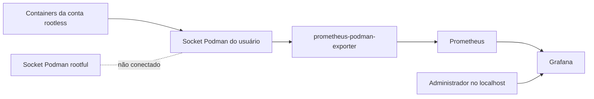

<details id="top">
    <summary>Índice</summary>
    <ol>
        <li><a href="#visão-geral">Visão geral</a></li>
        <li><a href="#ambiente-e-versões">Ambiente e versões</a></li>
        <li><a href="#pré-requisitos-e-variáveis">Pré-requisitos e variáveis</a></li>
        <li><a href="#passo-1-confirmar-a-conta-rootless">Passo 1: Confirmar a conta rootless</a></li>
        <li><a href="#passo-2-habilitar-a-api-do-usuário">Passo 2: Habilitar a API do usuário</a></li>
        <li><a href="#passo-3-criar-a-rede-e-o-segredo">Passo 3: Criar a rede e o segredo</a></li>
        <li><a href="#passo-4-instalar-as-configurações">Passo 4: Instalar as configurações</a></li>
        <li><a href="#passo-5-iniciar-a-pilha-de-monitoramento">Passo 5: Iniciar a pilha de monitoramento</a></li>
        <li><a href="#passo-6-importar-o-dashboard">Passo 6: Importar o dashboard</a></li>
        <li><a href="#verificação-final">Verificação final</a></li>
        <li><a href="#operação-e-referência-rápida">Operação e referência rápida</a></li>
        <li><a href="#solução-de-problemas">Solução de problemas</a></li>
        <li><a href="#reversão-e-desinstalação">Reversão e desinstalação</a></li>
        <li><a href="#referências">Referências</a></li>
    </ol>
</details>

# Instalação do Prometheus e Grafana para containers Podman rootless

## Visão geral

Esta receita orienta administradores Linux a monitorar somente os containers e redes pertencentes
à conta Podman rootless dedicada `podman_user`. O procedimento instala
`prometheus-podman-exporter`, Prometheus e Grafana como unidades Quadlet do usuário.

O exporter recebe somente o socket em `$XDG_RUNTIME_DIR/podman/podman.sock`. O socket rootful
`/run/podman/podman.sock` não é montado nem consultado. Portanto, containers rootful não entram
nas métricas, targets ou dashboards.

| Item | Descrição |
| --- | --- |
| Público | Administradores do host e da conta `podman_user` |
| Tempo estimado | 30 minutos |
| Escopo | Containers e redes do usuário; CPU, memória, estado, I/O, pacotes e bytes de rede |
| Fora do escopo | Containers rootful, métricas de host, publicação na Internet e TLS do Grafana |
| Status | Fontes oficiais verificadas em 2026-11-24; execução integral não realizada neste host |



### Fontes e adaptações

O procedimento adapta o artigo
[How to Monitor Root and User-Level Podman Containers with Grafana](https://dev.to/project42/how-to-monitor-root-and-user-level-podman-containers-with-grafana-1d0).
As unidades rootful foram removidas. O `Network=host` foi substituído por uma rede Podman
dedicada. Imagens receberam versões fixas. Prometheus e Grafana escutam somente no loopback.

O dashboard recomendado é o ID `21559`, indicado no artigo e confirmado na API pública do
Grafana. Os IDs `17639` e `17138` são alternativas comunitárias com requisitos de coletores
descritos em [Passo 6: Importar o dashboard](#passo-6-importar-o-dashboard).

### Decisões de segurança e riscos aceitos

| Decisão | Risco | Justificativa | Mitigação |
| --- | --- | --- | --- |
| Montar o socket Podman no exporter | O Podman API permite execução arbitrária como o usuário rootless | O exporter precisa consultar containers e redes | Socket somente do usuário; porta 9882 não publicada; imagem fixada; rede dedicada |
| Manter métricas sem autenticação | Qualquer processo com acesso à rede interna pode ler métricas | Prometheus e o exporter usam HTTP padrão | Rede privada `monitoring-rootless`; sem publicação do exporter |
| Publicar Prometheus em `127.0.0.1:9090` | Usuários locais podem ler métricas | Facilita diagnóstico local | Não vincular a `0.0.0.0`; usar proxy autenticado se houver acesso remoto |
| Publicar Grafana em `127.0.0.1:3000` | O serviço não aceita conexões LAN diretamente | Preserva a pilha local por padrão | Publicar por NGINX ou VPN com TLS, autenticação e firewall, quando necessário |
| Armazenar a senha do Grafana em Podman secret | Quem controla a conta rootless pode recuperar ou substituir o segredo | A senha não aparece em unidades ou histórico Git | Modo de acesso da conta restrito e senha também guardada no cofre administrativo |

> **Não verificado:** os comandos desta receita foram conferidos em documentação oficial,
> mas não foram executados contra uma VM RHEL 9.8 dedicada nesta alteração. Verifique os
> resultados indicados antes de colocar o serviço em produção.

<div>
  <a href="#top" title="De volta ao topo da página">
    <picture>
      <source media="(prefers-color-scheme: dark)" srcset="../images/up-arrow_white.svg">
      
    </picture>
  </a>
  <br><br>
</div>

## Ambiente e versões

| Componente | Versão | Estado da verificação |
| --- | --- | --- |
| RHEL | 9.8 | Plataforma-alvo já adotada pela [receita rootless do Gateway](gateway-headscale-podman-rootless.md); não revalidada nesta alteração |
| Podman | 5.8.x | Compatível com `prometheus-podman-exporter` 1.11 ou superior e anterior ao exportador 2.0 |
| `prometheus-podman-exporter` | 1.21.2 | Release compatível com Podman 5; tag consultada em 2026-11-24 |
| Prometheus | 3.16.0 | Último release consultado em 2026-11-24 |
| Grafana | 13.3.1 | Último release consultado em 2026-11-24; dashboard 21559 exige Grafana 11.1 ou superior |
| Dashboard | 21559, revisão 1 | Publicado em 2024-07-21; JSON e revisão consultados em 2026-11-24 |

O exporter 2.0.0 suporta Podman 6 e não deve substituir a versão 1.21.2 neste ambiente Podman
5. As alternativas podem ser testadas somente depois de revisar a matriz de compatibilidade.

<div>
  <a href="#top" title="De volta ao topo da página">
    <picture>
      <source media="(prefers-color-scheme: dark)" srcset="../images/up-arrow_white.svg">
      
    </picture>
  </a>
  <br><br>
</div>

## Pré-requisitos e variáveis

- A conta rootless já deve existir, possuir `subuid`/`subgid` válidos e ter o Podman funcionando.
- Prepare linger e a conta conforme a
  [receita rootless do Gateway](gateway-headscale-podman-rootless.md).
- O checkout deve estar acessível pela conta rootless. O exemplo usa
  `/home/podman_user/webAppBoilerPlate`.
- Os programas `podman`, `systemctl`, `curl`, `sha256sum` e `install` devem estar disponíveis.
- Nenhuma alteração rootful é necessária. Não execute `sudo systemctl` para as unidades desta
  receita.

| Porta | Protocolo | Direção | Finalidade |
| --- | --- | --- | --- |
| 3000 | TCP | Loopback de entrada | Interface Grafana |
| 9090 | TCP | Loopback de entrada | Interface e API do Prometheus |
| 9882 | TCP | Rede interna dos containers | Endpoint do exporter; não publicado no host |

Defina as variáveis uma vez na sessão de root. Repita o bloco se abrir outro shell:

```bash
MONITORING_USER=podman_user
MONITORING_HOME="$(getent passwd "${MONITORING_USER}" | cut -d: -f6)"
```

Na sessão da conta rootless, use estas variáveis:

```bash
REPOSITORY_DIR="${HOME}/webAppBoilerPlate"
MONITORING_CONFIG_DIR="${HOME}/.config/monitoring"
QUADLET_USER_DIR="${HOME}/.config/containers/systemd"
```

| Variável | Descrição | Exemplo | Usada em |
| --- | --- | --- | --- |
| `MONITORING_USER` | Conta que possui os containers monitorados | `podman_user` | Passo 1 |
| `MONITORING_HOME` | Home obtida de `/etc/passwd` | `/home/podman_user` | Passo 1 |
| `REPOSITORY_DIR` | Checkout acessível pela conta rootless | `/home/podman_user/webAppBoilerPlate` | Passos 4 e 5 |
| `MONITORING_CONFIG_DIR` | Configurações locais da pilha | `/home/podman_user/.config/monitoring` | Passo 4 |
| `QUADLET_USER_DIR` | Diretório Quadlet do usuário | `/home/podman_user/.config/containers/systemd` | Passo 4 |

<div>
  <a href="#top" title="De volta ao topo da página">
    <picture>
      <source media="(prefers-color-scheme: dark)" srcset="../images/up-arrow_white.svg">
      
    </picture>
  </a>
  <br><br>
</div>

## Passo 1: Confirmar a conta rootless

**Objetivo:** Confirmar que a conta-alvo existe e não executa a pilha como root.

**Contexto:** Execute como `root` no host.

```bash
id "${MONITORING_USER}"
getent passwd "${MONITORING_USER}"
```

**Resultado esperado:**

```text
uid=1001(podman_user) gid=1001(podman_user) groups=1001(podman_user)
podman_user:x:1001:1001::/home/podman_user:/bin/bash
```

> Exemplo ilustrativo. Os números de UID e GID podem ser diferentes.

**Verificação:**

```bash
test "${MONITORING_USER}" != root && test -n "${MONITORING_HOME}"
```

O comando retorna código `0`, sem saída. Depois, abra uma sessão com o user manager correto:

```bash
machinectl shell "${MONITORING_USER}@"
```

Se `machinectl` não estiver instalado, use um login SSH com a conta. Evite `sudo -u` ou `su` sem
`XDG_RUNTIME_DIR` e user bus válidos.

<div>
  <a href="#top" title="De volta ao topo da página">
    <picture>
      <source media="(prefers-color-scheme: dark)" srcset="../images/up-arrow_white.svg">
      
    </picture>
  </a>
  <br><br>
</div>

## Passo 2: Habilitar a API do usuário

**Objetivo:** Disponibilizar somente o socket Podman da conta rootless.

**Contexto:** Execute como `podman_user`, no home, com `XDG_RUNTIME_DIR` e o user bus disponíveis.

Ao entrar nesta sessão, defina novamente as variáveis da conta rootless:

```bash
REPOSITORY_DIR="${HOME}/webAppBoilerPlate"
MONITORING_CONFIG_DIR="${HOME}/.config/monitoring"
QUADLET_USER_DIR="${HOME}/.config/containers/systemd"
```

Confirme o user bus e ative o socket da conta:

```bash
test -S "${XDG_RUNTIME_DIR}/bus"
systemctl --user enable --now podman.socket
```

**Resultado esperado:** `systemctl` não imprime erro. Se o socket já estiver habilitado, ele permanece
ativo.

**Verificação:**

```bash
test -S "${XDG_RUNTIME_DIR}/podman/podman.sock"
podman info --format '{{.Host.Security.Rootless}}'
```

O primeiro comando retorna `0`. O segundo imprime `true`.

> **Atenção:** o socket da Podman API concede controle completo sobre os containers do usuário.
> Não o exponha por TCP sem autenticação mútua TLS.

<div>
  <a href="#top" title="De volta ao topo da página">
    <picture>
      <source media="(prefers-color-scheme: dark)" srcset="../images/up-arrow_white.svg">
      
    </picture>
  </a>
  <br><br>
</div>

## Passo 3: Criar a rede e o segredo

**Objetivo:** Criar uma rede de métricas exclusiva e guardar a senha inicial do Grafana sem gravá-la
em arquivo versionado.

**Contexto:** Execute como `podman_user`.

Crie a rede se ela ainda não existir:

```bash
podman network exists monitoring-rootless || podman network create monitoring-rootless
```

Verifique se já existe um segredo chamado `monitoring-grafana-admin-password`:

```bash
podman secret exists monitoring-grafana-admin-password && printf 'presente\n' || printf 'ausente\n'
```

Se a saída for `ausente`, leia uma senha sem eco, crie o segredo e limpe a variável:

```bash
read -rsp 'Senha inicial do Grafana: ' GRAFANA_ADMIN_PASSWORD; printf '\n'
printf '%s' "${GRAFANA_ADMIN_PASSWORD}" | podman secret create monitoring-grafana-admin-password -
unset GRAFANA_ADMIN_PASSWORD
```

Guarde a senha no cofre administrativo. Não cole a senha diretamente na unidade Quadlet.

**Resultado esperado:** a criação do segredo imprime seu ID.

**Verificação:**

```bash
podman network inspect monitoring-rootless --format '{{.Name}} {{.DNSEnabled}}'
podman secret inspect monitoring-grafana-admin-password --format '{{.Spec.Name}}'
```

A primeira linha deve conter `monitoring-rootless true`. A segunda deve imprimir
`monitoring-grafana-admin-password`.

<div>
  <a href="#top" title="De volta ao topo da página">
    <picture>
      <source media="(prefers-color-scheme: dark)" srcset="../images/up-arrow_white.svg">
      
    </picture>
  </a>
  <br><br>
</div>

## Passo 4: Instalar as configurações

**Objetivo:** Instalar os arquivos de Prometheus, provisionamento Grafana e unidades Quadlet do
usuário.

**Contexto:** Execute como `podman_user`, na raiz do checkout.

Os modelos versionados são
[prometheus.yml](../../deploy/monitoring/rootless/prometheus/prometheus.yml),
[datasource do Grafana](../../deploy/monitoring/rootless/grafana/provisioning/datasources/prometheus.yml)
e as três unidades em [quadlet](../../deploy/monitoring/rootless/quadlet/).

Instale as configurações e as unidades:

```bash
install -D -m 0644 "${REPOSITORY_DIR}/deploy/monitoring/rootless/prometheus/prometheus.yml" "${MONITORING_CONFIG_DIR}/prometheus/prometheus.yml"
install -D -m 0644 "${REPOSITORY_DIR}/deploy/monitoring/rootless/grafana/provisioning/datasources/prometheus.yml" "${MONITORING_CONFIG_DIR}/grafana/provisioning/datasources/prometheus.yml"
install -d -m 0700 "${QUADLET_USER_DIR}"
install -m 0644 "${REPOSITORY_DIR}/deploy/monitoring/rootless/quadlet/podman-exporter.container" "${REPOSITORY_DIR}/deploy/monitoring/rootless/quadlet/prometheus.container" "${REPOSITORY_DIR}/deploy/monitoring/rootless/quadlet/grafana.container" "${QUADLET_USER_DIR}/"
```

As diretivas não padrão têm estes objetivos:

| Arquivo | Diretiva ou valor | Finalidade |
| --- | --- | --- |
| `podman-exporter.container` | `Volume=%t/podman/podman.sock:...` | Expande o runtime dir do usuário e nunca usa `/run/podman/podman.sock` como origem |
| `podman-exporter.container` | `UserNS=keep-id:uid=65534` | Executa o exporter com identidade equivalente à conta rootless, como prevê a documentação upstream |
| `podman-exporter.container` | `--collector.network` | Coleta inventário das redes rootless |
| `podman-exporter.container` | `--collector.container-stats-timeout=5s` | Evita timeout de estatísticas em hosts lentos |
| `prometheus.container` | `PublishPort=127.0.0.1:9090:9090` | Mantém a interface fora da LAN |
| `grafana.container` | `PublishPort=127.0.0.1:3000:3000` | Mantém o Grafana fora da LAN |
| `grafana.container` | `Secret=...type=env...` | Entrega a senha por Podman secret |
| `*.container` | `Network=monitoring-rootless` | Usa DNS interno entre os três serviços |

**Resultado esperado:** os quatro comandos terminam com código `0`, sem saída.

**Verificação:**

```bash
sha256sum "${REPOSITORY_DIR}/deploy/monitoring/rootless/prometheus/prometheus.yml" "${MONITORING_CONFIG_DIR}/prometheus/prometheus.yml" "${REPOSITORY_DIR}/deploy/monitoring/rootless/grafana/provisioning/datasources/prometheus.yml" "${MONITORING_CONFIG_DIR}/grafana/provisioning/datasources/prometheus.yml" "${REPOSITORY_DIR}/deploy/monitoring/rootless/quadlet/podman-exporter.container" "${QUADLET_USER_DIR}/podman-exporter.container" "${REPOSITORY_DIR}/deploy/monitoring/rootless/quadlet/prometheus.container" "${QUADLET_USER_DIR}/prometheus.container" "${REPOSITORY_DIR}/deploy/monitoring/rootless/quadlet/grafana.container" "${QUADLET_USER_DIR}/grafana.container"
```

O comando retorna código `0`. Cada par de arquivos, origem e destino, deve exibir o mesmo hash.

<div>
  <a href="#top" title="De volta ao topo da página">
    <picture>
      <source media="(prefers-color-scheme: dark)" srcset="../images/up-arrow_white.svg">
      
    </picture>
  </a>
  <br><br>
</div>

## Passo 5: Iniciar a pilha de monitoramento

**Objetivo:** Gerar as unidades, baixar as imagens fixadas e iniciar os serviços na ordem correta.

**Contexto:** Execute como `podman_user`.

Recarregue as unidades e inicie a pilha:

```bash
systemctl --user daemon-reload
systemctl --user enable --now podman-exporter.service prometheus.service grafana.service
```

**Resultado esperado:** o segundo comando não imprime erro. O primeiro download pode levar alguns
minutos.

**Verificação:**

```bash
systemctl --user is-active podman-exporter.service prometheus.service grafana.service
podman ps --format '{{.Names}} {{.Status}}'
```

`systemctl` imprime `active` três vezes. A lista do Podman inclui `podman-exporter`, `prometheus`
e `grafana`.

Confirme também a origem do mount do socket:

```bash
podman inspect podman-exporter --format '{{range .Mounts}}{{println .Source "->" .Destination}}{{end}}'
```

A origem deve começar com `/run/user/<UID>/podman/podman.sock`. O destino pode ser
`/run/podman/podman.sock`. Não prossiga se a origem for `/run/podman/podman.sock`.

<div>
  <a href="#top" title="De volta ao topo da página">
    <picture>
      <source media="(prefers-color-scheme: dark)" srcset="../images/up-arrow_white.svg">
      
    </picture>
  </a>
  <br><br>
</div>

## Passo 6: Importar o dashboard

**Objetivo:** Visualizar métricas dos containers e redes rootless no Grafana.

**Contexto:** Acesse o navegador somente no host local ou por um túnel SSH seguro. O usuário é
`admin`; use a senha criada no [Passo 3](#passo-3-criar-a-rede-e-o-segredo).

Abra `http://127.0.0.1:3000`. Em seguida:

1. Selecione **Dashboards** e **New > Import**.
2. Informe o ID `21559`.
3. Selecione o datasource `Prometheus`.
4. Importe e salve o dashboard.

O dashboard `21559` contém estado, CPU, memória, blocos, PIDs e tráfego de entrada e saída por
container. Suas consultas usam as métricas `podman_container_net_input_total` e
`podman_container_net_output_total`.

Para visualizar também o inventário de redes do usuário, crie um painel **Table** e use:

```promql
podman_network_info
```

Configure o formato de consulta como `Table` e a consulta como instantânea. O collector exibe os
labels `name`, `driver`, `interface` e `id`. Essa lista contém somente redes do socket rootless.

Alternativas comunitárias encontradas:

| Dashboard | Uso | Limite |
| --- | --- | --- |
| [21559](https://grafana.com/grafana/dashboards/21559) | Containers, CPU, memória e tráfego de rede | Recomendado; testes visuais nesta versão do Grafana não foram executados |
| [17639](https://grafana.com/grafana/dashboards/17639) | Containers e imagens | Exige `--collector.image`; originalmente publicado para Grafana 9.3.1 |
| [17138](https://grafana.com/grafana/dashboards/17138) | Pods, containers e rede | Exige `--collector.pod`; original e mais antigo |

**Resultado esperado:** o dashboard mostra os containers da conta `podman_user`. O painel de rede
mostra `monitoring-rootless` e outras redes existentes na mesma conta.

**Verificação:**

No Grafana, abra **Explore**, selecione `Prometheus` e execute:

```promql
count(podman_container_info)
```

O resultado deve corresponder ao número de containers visíveis por `podman ps --all` na conta.

<div>
  <a href="#top" title="De volta ao topo da página">
    <picture>
      <source media="(prefers-color-scheme: dark)" srcset="../images/up-arrow_white.svg">
      
    </picture>
  </a>
  <br><br>
</div>

## Verificação final

**Serviços**

```bash
systemctl --user is-active podman-exporter.service prometheus.service grafana.service
curl --fail --silent --show-error http://127.0.0.1:9090/-/healthy
curl --fail --silent --show-error --output /dev/null http://127.0.0.1:3000/api/health
```

Critério: as unidades retornam `active`; Prometheus responde `Prometheus Server is Healthy.`;
Grafana responde HTTP 200.

**Target rootless**

```bash
curl --get --fail --silent --show-error --data-urlencode 'query=up{job="podman-rootless"}' http://127.0.0.1:9090/api/v1/query
```

Critério: a resposta contém `"status":"success"` e valor `"1"`.

**Containers e redes**

```bash
curl --get --fail --silent --show-error --data-urlencode 'query=podman_container_info' http://127.0.0.1:9090/api/v1/query
curl --get --fail --silent --show-error --data-urlencode 'query=podman_network_info' http://127.0.0.1:9090/api/v1/query
```

Critério: a primeira resposta lista os containers da conta `podman_user`; a segunda lista suas
redes. Compare os nomes com:

```bash
podman ps --all --format '{{.Names}}'
podman network ls --format '{{.Name}}'
```

**Exclusão rootful**

Como administrador, liste os containers rootful:

```bash
sudo podman ps --all --format '{{.Names}}'
```

Se existirem nomes, pesquise cada nome na resposta de `podman_container_info`. Nenhum pode
aparecer. A prova estrutural é o mount:

```bash
podman inspect podman-exporter --format '{{range .Mounts}}{{println .Source}}{{end}}'
```

O único socket deve apontar para `/run/user/<UID>/podman/podman.sock`. A origem
`/run/podman/podman.sock` caracteriza erro rootful.

<div>
  <a href="#top" title="De volta ao topo da página">
    <picture>
      <source media="(prefers-color-scheme: dark)" srcset="../images/up-arrow_white.svg">
      
    </picture>
  </a>
  <br><br>
</div>

## Operação e referência rápida

Execute como `podman_user`.

| Ação | Comando |
| --- | --- |
| Ver estado | `systemctl --user status podman-exporter.service prometheus.service grafana.service` |
| Ler logs | `journalctl --user -u podman-exporter.service -u prometheus.service -u grafana.service -f` |
| Reiniciar tudo | `systemctl --user restart podman-exporter.service prometheus.service grafana.service` |
| Parar Grafana | `systemctl --user stop grafana.service` |
| Verificar targets | `curl -fsS http://127.0.0.1:9090/api/v1/targets` |
| Ver containers | `podman ps --filter name=podman-exporter --filter name=prometheus --filter name=grafana` |
| Ver volumes | `podman volume ls --filter name=monitoring-` |
| Ver imagens | `podman images --format '{{.Repository}}:{{.Tag}}'` |

Não remova os volumes em uma reinicialização comum. Eles contêm a base Prometheus e o banco,
usuários, datasource e dashboards do Grafana.

<div>
  <a href="#top" title="De volta ao topo da página">
    <picture>
      <source media="(prefers-color-scheme: dark)" srcset="../images/up-arrow_white.svg">
      
    </picture>
  </a>
  <br><br>
</div>

## Solução de problemas

| Sintoma ou mensagem | Causa provável | Correção |
| --- | --- | --- |
| `Permission denied` no exporter ao abrir o socket | User namespace, label SELinux ou unidade está incorreta | Repita o [Passo 4](#passo-4-instalar-as-configurações); confirme `UserNS=keep-id:uid=65534` e `SecurityLabelType=container_runtime_t`; em seguida, leia o journal |
| Target `podman-rootless` está `down` | Nome DNS não resolve ou exporter não está ativo | Confirme `podman network inspect monitoring-rootless`; reinicie `podman-exporter.service` antes de `prometheus.service` |
| `connection refused` em 9090 ou 3000 | Serviço parado ou bind não foi criado | Execute `systemctl --user status`; confirme `127.0.0.1` em `PublishPort` |
| Grafana exige nova senha inicial | O segredo foi trocado depois da primeira inicialização | O segredo só define a senha na primeira criação do banco; redefina a senha pelas ferramentas do Grafana |
| Dashboard não mostra containers | Datasource errado ou scrape vazio | Confirme que o datasource aponta para `http://prometheus:9090`; execute `up{job="podman-rootless"}` |
| Dashboard não mostra redes | Collector de rede desativado ou painel ausente | Confirme `--collector.network`; crie a tabela de `podman_network_info` do [Passo 6](#passo-6-importar-o-dashboard) |
| Aparece container rootful | A unidade montou socket rootful | Pare a pilha imediatamente; reinstale a unidade do repositório e confirme a origem `/run/user/<UID>/...` |
| `monitoring-rootless` não resolve nomes | Rede foi criada com DNS desabilitado | Remova a rede depois de parar os containers e recrie-a com `podman network create monitoring-rootless` |
| `Timeout` ao coletar estatísticas | Container ou store rootless responde lentamente | Aumente `--collector.container-stats-timeout` e reinicie somente o exporter |

<div>
  <a href="#top" title="De volta ao topo da página">
    <picture>
      <source media="(prefers-color-scheme: dark)" srcset="../images/up-arrow_white.svg">
      
    </picture>
  </a>
  <br><br>
</div>

## Reversão e desinstalação

> **Atenção:** parar e remover unidades preserva os volumes. Remover os volumes elimina métricas,
> usuários, datasource e dashboards do Grafana. Exporte o que for necessário antes da etapa
> marcada como irreversível.

Execute como `podman_user`. Pare e desabilite os serviços:

```bash
systemctl --user disable --now grafana.service prometheus.service podman-exporter.service
systemctl --user daemon-reload
```

Remova somente os arquivos desta receita:

```bash
rm -- "${QUADLET_USER_DIR}/grafana.container" "${QUADLET_USER_DIR}/prometheus.container" "${QUADLET_USER_DIR}/podman-exporter.container"
systemctl --user daemon-reload
```

Remova rede e segredo:

```bash
podman network rm monitoring-rootless
podman secret rm monitoring-grafana-admin-password
```

O bloco anterior preserva os dados em
`monitoring-prometheus-data` e `monitoring-grafana-data`.

> **Irreversível:** o comando seguinte apaga os dados persistentes da pilha:

```bash
podman volume rm monitoring-prometheus-data monitoring-grafana-data
```

Por fim, remova as configurações instaladas somente se não houver alterações locais a preservar:

```bash
rm -- "${MONITORING_CONFIG_DIR}/prometheus/prometheus.yml" "${MONITORING_CONFIG_DIR}/grafana/provisioning/datasources/prometheus.yml"
```

Esses passos não removem containers de aplicação, o socket `podman.socket`, o linger nem as redes da
aplicação.

<div>
  <a href="#top" title="De volta ao topo da página">
    <picture>
      <source media="(prefers-color-scheme: dark)" srcset="../images/up-arrow_white.svg">
      
    </picture>
  </a>
  <br><br>
</div>

## Referências

| Referência | Uso | Versão ou consulta |
| --- | --- | --- |
| [Artigo Project-42](https://dev.to/project42/how-to-monitor-root-and-user-level-podman-containers-with-grafana-1d0) | Inspiração, fluxo inicial e dashboard 21559 | Consultado em 2026-11-24 |
| [Podman `system service`](https://docs.podman.io/en/latest/markdown/podman-system-service.1.html) | Socket rootless, `%t`, linger e modelo de segurança do API | Consultado em 2026-11-24 |
| [Podman `.container` Quadlet](https://docs.podman.io/en/latest/markdown/podman-container.unit.5.html) | Chaves de container, secret, volume, network e publicação | Consultado em 2026-11-24 |
| [Guia do `prometheus-podman-exporter`](https://github.com/containers/prometheus-podman-exporter/blob/main/install.md) | Execução containerizada rootless | Consultado em 2026-11-24 |
| [README do `prometheus-podman-exporter`](https://github.com/containers/prometheus-podman-exporter) | Compatibilidade, flags, coletores e nomes de métricas | 1.21.2, consultado em 2026-11-24 |
| [Releases do Prometheus](https://github.com/prometheus/prometheus/releases/tag/v3.16.0) | Versão da imagem Prometheus | 3.16.0, publicado em 2026-11-05 |
| [Releases do Grafana](https://github.com/grafana/grafana/releases/tag/v13.3.1) | Versão da imagem Grafana | 13.3.1, publicado em 2026-11-10 |
| [Segurança do Prometheus](https://prometheus.io/docs/operating/security/) | Limites de autenticação e exposição | Consultado em 2026-11-24 |
| [Provisionamento do Grafana](https://grafana.com/docs/grafana/latest/administration/provisioning/) | Datasource provisionado por arquivo | Consultado em 2026-11-24 |
| [Dashboard 21559](https://grafana.com/grafana/dashboards/21559) | Dashboard recomendado | Revisão 1 |
| [Dashboard 17639](https://grafana.com/grafana/dashboards/17639) | Alternativa com imagens | Revisão 1 |
| [Dashboard 17138](https://grafana.com/grafana/dashboards/17138) | Alternativa orientada a pods | Revisão 2 |
| [Receita rootless do Gateway](gateway-headscale-podman-rootless.md) | Preparação da conta rootless e do host | Referência interna |

<div>
  <a href="#top" title="De volta ao topo da página">
    <picture>
      <source media="(prefers-color-scheme: dark)" srcset="../images/up-arrow_white.svg">
      
    </picture>
  </a>
  <br><br>
</div>
